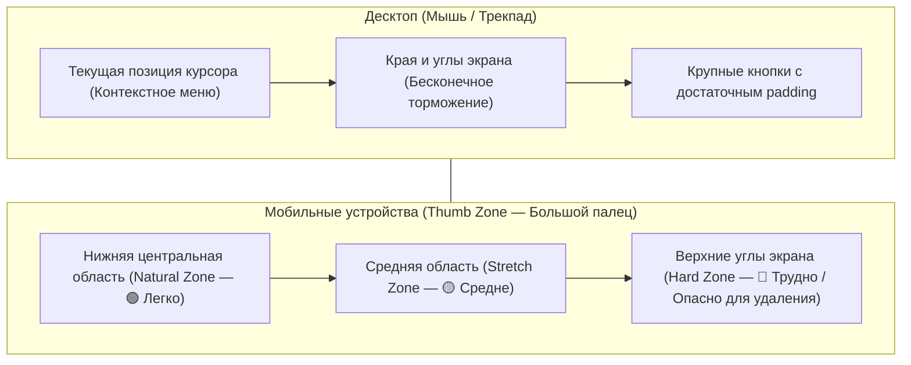

# Фундаментальные законы UX, Intrinsic Web Design и этика интерфейсных анимаций (2025–2026)

> [!IMPORTANT]
> **Резюме для архитекторов и дизайнеров:** В 2025–2026 годах проектирование интерфейсов окончательно сместилось от фиксированных брейкпоинтов («под десктоп / планшет / мобильный») к **Intrinsic Web Design** (контекстной самоадаптации компонентов через `@container` и математику `clamp()`). Прямое влияние UX-метрик на поведенческие факторы ранжирования (Core Web Vitals INP $\le 200\text{ мс}$, отсутствие pogo-sticking) и требования доступности (WCAG 2.2) превратили когнитивную эргономику в строгую инженерную дисциплину.

---

## Оглавление

1. [Фундаментальные законы психофизиологии и когнитивистики в UX](#1-фундаментальные-законы-психофизиологии-и-когнитивистики-в-ux)
   - [Сводная матрица законов UX и их инженерных имплементаций](#сводная-матрица-законов-ux-и-их-инженерных-имплементаций)
   - [Математическая и архитектурная декомпозиция](#математическая-и-архитектурная-декомпозиция)
2. [Intrinsic Web Design: контейнеры, флюидная сетка и типографика](#2-intrinsic-web-design-контейнеры-флюидная-сетка-и-типографика)
   - [Container Queries (`@container`) вместо глобальных `@media`](#container-queries-container-вместо-глобальных-media)
   - [Флюидная типографика `clamp()` и защита браузерного зума (WCAG 1.4.4)](#флюидная-типографика-clamp-и-защита-браузерного-зума-wcag-144)
   - [Оптимальная длина строки (`65ch`) и ритм чтения](#оптимальная-длина-строки-65ch-и-ритм-чтения)
3. [Нативный View Transitions API и этика анимаций](#3-нативный-view-transitions-api-и-этика-анимаций)
   - [Архитектура View Transitions API (SPA и MPA)](#архитектура-view-transitions-api-spa-и-mpa)
   - [Вестибулярная безопасность и `prefers-reduced-motion: reduce`](#вестибулярная-безопасность-и-prefers-reduced-motion-reduce)
4. [Чек-лист технического UX/UI-аудита](#4-чек-лист-технического-uxui-аудита)
5. [Источники и стандарты](#5-источники-и-стандарты)

---

## 1. Фундаментальные законы психофизиологии и когнитивистики в UX

Человеческое восприятие и моторика биологически ограничены. Игнорирование этих ограничений ведет к когнитивной перегрузке (Cognitive Overload), параличу выбора и росту показателя отказов.

### Сводная матрица законов UX и их инженерных имплементаций

| Закон / Принцип | Формулировка и математическая суть | Инженерный стандарт (2025–2026) | Типичный антипаттерн |
| :--- | :--- | :--- | :--- |
| **Закон Хика (Hick's Law)** | Время принятия решения растет логарифмически с увеличением числа и сложности альтернатив: $RT = a + b \log_2(n + 1)$. | Не более **5–7 категорий** верхнего уровня; Progressive Disclosure (поэтапное раскрытие фильтров); выделение 1 приоритетного тарифа в таблице цен. | Мега-меню на 50+ равнозначных ссылок без группировки; 15 видимых фильтров на первом экране мобильного каталога. |
| **Закон Фиттса (Fitts's Law)** | Время перемещения указателя к цели зависит от расстояния до нее ($D$) и размера цели ($W$): $MT = a + b \log_2\left(\frac{2D}{W}\right)$. | Минимум **24×24 CSS px** по WCAG 2.2 (2.5.8 AA), рекомендуемый стандарт для тач-экранов — **44×44 px / 48×48 dp**; вынос главных CTA в «Thumb Zone» (нижняя треть экрана на смартфонах). | Мелкие иконки закрытия модалок (12×12 px) в верхнем углу мобильного экрана; кликабельный текст без `padding`. |
| **Закон Якоба (Jakob's Law)** | Пользователи проводят большую часть времени на *других* сайтах и ожидают от вашего интерфейса привычных паттернов работы. | Логотип слева вверху, корзина справа вверху, поиск по центру шапки, стандартные иконки гамбургера/лупы, привычная механика чекаута. | Скрытие навигации за нестандартными символами; инверсия скролла (scroll-jacking); кастомный курсор с задержкой. |
| **Закон Миллера (Miller's Law)** | Объем рабочей (кратковременной) памяти человека удерживает в среднем **$7 \pm 2$ элемента** (в современных исследованиях активного внимания — **4–5 чанков**). | **Chunking (чанкинг):** автоформатирование карт (`0000 0000 0000 0000`) и телефонов (`+7 (999) 000-00-00`); группировка полей форм в смысловые блоки по 3–4 поля. | Сплошное поле ввода 16 цифр номера карты без пробелов; стены текста без подзаголовков и буллитов. |
| **Порог Доэрти (Doherty Threshold)** | Продуктивность взаимодействия резко возрастает, когда компьютер и пользователь обмениваются откликами быстрее **400 мс** (в идеале — быстрее **100 мс** для визуального отклика). | Core Web Vitals **INP $\le 200\text{ мс}$**; мгновенные оптимистичные UI-обновления (Optimistic UI); Skeleton Screens вместо блокирующих спиннеров при загрузке свыше 300 мс. | «Замирание» кнопки после клика без индикации загрузки (приводит к Rage Clicks и дублированию транзакций). |

---

### Математическая и архитектурная декомпозиция

#### 1. Закон Хика и архитектура прогрессивного раскрытия (Progressive Disclosure)
Когда пользователю предлагается $n$ равновесных вариантов, его мозг тратит ресурсы не на выбор лучшего, а на отсечение лишних. 
- **Решение в E-commerce и SaaS:** разделение первичных и вторичных действий. На первом шаге показываются только 3–4 ключевых параметра, а расширенные настройки прячутся под нативный элемент `<details>` или кнопку «Все фильтры».

#### 2. Закон Фиттса и эргономика интерактивных зон
На десктопе самые быстрые зоны достижения по закону Фиттса — это текущая позиция курсора и края/углы экрана (так называемые «бесконечно широкие цели», где курсор останавливается границей монитора). На мобильных устройствах физика меняется: углы экрана (особенно верхний левый для правшей) являются самыми труднодоступными.



> [!TIP]
> **Практическое правило закона Фиттса:** Деструктивные действия («Удалить аккаунт», «Очистить корзину») должны находиться на безопасном расстоянии от частых позитивных действий («Сохранить», «Оформить заказ») и иметь меньший визуальный вес, чтобы исключить случайное нажатие.

#### 3. Порог Доэрти и шкала восприятия задержек (по Якобу Нильсену)
- **0 – 100 мс:** Воспринимается как мгновенная физическая реакция (нажатие кнопки, переключение таба, hover-эффект).
- **100 – 300 мс:** Заметная глазу, но комфортная задержка. Граница метрики **INP (Interaction to Next Paint) = 200 мс** лежит ровно внутри этого диапазона.
- **300 – 400 мс (Порог Доэрти):** Предел удержания непрерывного потока внимания («состояния потока»).
- **400 – 1000 мс:** Пользователь осознает, что система «задумалась». Требуется отображение **Skeleton UI** (скелетной разметки).
- **> 1000 мс (1 сек):** Теряется фокус диалога. Обязателен индикатор прогресса.
- **> 10 000 мс (10 сек):** Предел удержания внимания задачи. Обязателен процентный прогресс-бар с объяснением этапа («Генерируем PDF-отчет, шаг 2 из 3...») и возможностью фонового выполнения.

---

## 2. Intrinsic Web Design: контейнеры, флюидная сетка и типографика

Термин **Intrinsic Web Design** (внутренний / самодостаточный веб-дизайн), сформулированный Джен Симмонс (Jen Simmons), описывает переход от жестких адаптивных макетов к гибким алгоритмическим системам верстки. Компонент сам знает, сколько места ему доступно, и адаптирует свою раскладку независимо от размера окна браузера.

### Container Queries (`@container`) вместо глобальных `@media`

В классическом Responsive Web Design (RWD) медиавыражение `@media (min-width: 768px)` опирается на ширину **всего вьюпорта**. Если поместить карточку товара в узкий сайдбар на широком мониторе (1920px), `@media` посчитает, что места много, и отрисует горизонтальную десктопную карточку, которая сломает верстку сайдбара.

**Container Queries (`@container`)** решают эту проблему: карточка опрашивает ширину своего непосредственного родительского контейнера (с использованием единиц `cqi` — 1% от inline-размера контейнера).

```css
/* 1. Объявляем родительскую обертку контекстом контейнера */
.product-slot,
.sidebar-widget,
.catalog-grid-item {
  container-type: inline-size;
  container-name: card-wrapper;
}

/* 2. Базовое состояние карточки (узкий контейнер < 380px: вертикальный стек) */
.product-card {
  display: grid;
  grid-template-columns: 1fr;
  gap: 1rem;
  padding: clamp(1rem, 3cqi, 1.5rem);
  border-radius: 12px;
  background: var(--surface-card, #ffffff);
}

/* 3. Перестроение в горизонтальную карточку, когда САМ КОНТЕЙНЕР шире 380px */
@container card-wrapper (min-width: 380px) {
  .product-card {
    grid-template-columns: 140px 1fr;
    align-items: center;
  }
}

/* 4. Расширенный вид для широких секций (например, Hero-карточка > 640px) */
@container card-wrapper (min-width: 640px) {
  .product-card {
    grid-template-columns: 240px 1fr auto;
    gap: 2rem;
  }
}
```

---

### Флюидная типографика `clamp()` и защита браузерного зума (WCAG 1.4.4)

Функция `clamp(MIN, VAL, MAX)` позволяет плавно масштабировать шрифты и отступы без каскада медиавыражений.

> [!CAUTION]
> **Критическая ошибка доступности:** Использование чистого `vw` или `cqi` в центральном аргументе `clamp()` (например, `font-size: clamp(1rem, 2.5vw, 2rem)`) **полностью ломает браузерный зум (Ctrl / Cmd + «+»)**! Поскольку `vw` зависит только от ширины окна, при увеличении масштаба страницы до 200% текст перестает увеличиваться, что является прямым нарушением **WCAG 2.2 критерий 1.4.4 (Resize Text — Level AA)**.

#### Правильная формула доступного `clamp()`
Предпочтительное значение (`VAL`) **обязано** быть суммой относительной единицы шрифта (`rem`) и единицы вьюпорта/контейнера (`vw` или `cqi`):

$$\text{font-size} = \text{clamp}\left(\text{MIN}_{\text{rem}},\ \alpha \cdot \text{rem} + \beta \cdot \text{vw},\ \text{MAX}_{\text{rem}}\right)$$

```css
:root {
  /* ❌ ОШИБКА (Не проходит аудит WCAG 1.4.4): зум не меняет 3vw */
  /* --heading-broken: clamp(1.5rem, 3vw, 3rem); */

  /* ✅ ПРАВИЛЬНО: комбинация rem + vw/cqi гарантирует работу браузерного зума до 200%+ */
  --font-size-body: clamp(1rem, 0.92rem + 0.35vw, 1.1875rem);      /* 16px -> 19px */
  --font-size-h3:   clamp(1.25rem, 1.05rem + 0.9vw, 1.75rem);      /* 20px -> 28px */
  --font-size-h2:   clamp(1.5rem, 1.15rem + 1.6vw, 2.5rem);        /* 24px -> 40px */
  --font-size-h1:   clamp(2rem, 1.35rem + 2.8vw, 3.75rem);         /* 32px -> 60px */

  /* Флюидные вертикальные отступы секций */
  --space-section:  clamp(3rem, 2rem + 4.5vw, 6.5rem);
}

body {
  font-size: var(--font-size-body);
  line-height: 1.6;
}

h1, h2, h3 {
  /* Уменьшаем интерлиньяж для крупных заголовков и балансируем переносы строк */
  line-height: 1.15;
  text-wrap: balance;
}

p {
  /* Предотвращает висячие одиночные слова («сироты») в конце абзацев */
  text-wrap: pretty;
}
```

---

### Оптимальная длина строки (`65ch`) и ритм чтения

Исследования типографики (Роберт Брингхерст, Baymard Institute, NN/g) доказывают, что физиологический комфорт движения глаз по строке (саккады и возвратный сдвиг к началу следующей строки) достигается при длине строки **от 50 до 75 символов** (включая пробелы), где эталонным оптимумом является **`65ch`** (`1ch` равен ширине глифа `0` текущего шрифта).

| Длина строки | Психофизиологический эффект | Рекомендация |
| :--- | :--- | :--- |
| **< 40 символов (`< 40ch`)** | Слишком частый перенос взгляда; разрыв смысловых фраз; усталость от «прыжков» по строкам. | Допустимо только для узких карточек, подписей к фото (captions) и колонок таблиц. |
| **50 – 75 символов (`60ch – 70ch`)** | **Золотой стандарт (`max-width: 65ch`).** Взгляд легко удерживает начало следующей строки периферическим зрением. | Обязательно для всех текстовых блоков, статей, документации и описаний товаров. |
| **> 80 символов (`> 80ch`)** | При возврате взгляда к левому краю глаз теряет нужную строку (эффект удвоения или пропуска строки). Чтение замедляется на 15–25%. | Запрещено для основного текста. На широких экранах контейнер статьи обязан иметь `max-width: 65ch`. |

```css
/* Идеальный контейнер для текстового контента (Long-read / Документация) */
.prose-article {
  width: 100%;
  max-width: 65ch;
  margin-inline: auto;
  font-size: var(--font-size-body);
  line-height: 1.65;
}
```

---

## 3. Нативный View Transitions API и этика анимаций

Анимация в интерфейсе выполняет две функции: **объясняет пространственную связь** между состояниями (Spatial Orientation) и **маскирует задержку рендеринга**. Однако до недавнего времени плавные переходы между состояниями DOM требовали тяжелых JS-библиотек (Framer Motion, GSAP FLIP), раздувающих бандл и ухудшающих TBT / INP.

### Архитектура View Transitions API (SPA и MPA)

Нативный **View Transitions API** позволяет браузеру автоматически сделать «снимок» (raster snapshot) старого состояния, обновить DOM и плавно морфировать элементы в новое состояние в отдельном псевдо-дереве `::view-transition` на GPU, не блокируя главный поток.

#### 1. Кросс-документные переходы для многостраничных сайтов (MPA — только CSS)
Для обычных сайтов при переходе по ссылкам внутри одного домена (Same-Origin) достаточно одного CSS-правила:

```css
/* Включает плавный нативный переход между страницами сайта без единой строчки JS */
@view-transition {
  navigation: auto;
}

/* Связываем миниатюру товара в каталоге с главным фото в карточке товара */
.catalog-item__thumb {
  view-transition-name: active-product-image;
}

.product-page__hero-img {
  view-transition-name: active-product-image;
}
```

#### 2. Программный переход внутри страницы (SPA / Фильтрация / Смена темы)
С использованием прогрессивного улучшения и проверки поддержки API:

```javascript
function updateDOMWithTransition(updateCallback) {
  // 1. Проверяем поддержку API И отсутствие запрета на анимации у пользователя
  const prefersReducedMotion = window.matchMedia('(prefers-reduced-motion: reduce)').matches;

  if (!document.startViewTransition || prefersReducedMotion) {
    updateCallback();
    return;
  }

  // 2. Запускаем аппаратный View Transition
  document.startViewTransition(() => {
    updateCallback();
  });
}
```

---

### Вестибулярная безопасность и `prefers-reduced-motion: reduce`

Около **35% людей старше 40 лет** (по данным исследований вестибулярных расстройств) и миллионы пользователей с мигренями, СДВГ или эпилепсией испытывают физическое головокружение, тошноту (Cyber-sickness) и дезориентацию от параллакс-эффектов, масштабирования (`scale`), быстрого скролл-джекинга и летающих элементов.

> [!WARNING]
> **Важное различие в дизайне:** `prefers-reduced-motion: reduce` означает **«сократить движение»**, а не «убрать любые переходы в ноль». Полное отключение смены прозрачности (`opacity`) или цвета может лишить пользователя визуальной обратной связи. Необходимо отключать **пространственные перемещения (`translate`, `scale`, `rotate`, `scroll-behavior: smooth`)**, заменяя их мягким `cross-fade` (растворением через `opacity`).

```css
/* Базовые плавные переходы для пользователей без вестибулярных ограничений */
@media (prefers-reduced-motion: no-preference) {
  html {
    scroll-behavior: smooth;
  }

  .modal-dialog {
    transition: opacity 220ms cubic-bezier(0.22, 1, 0.36, 1),
                transform 220ms cubic-bezier(0.22, 1, 0.36, 1);
  }
}

/* Защитный режим для пользователей с включенной системной настройкой Reduced Motion (WCAG 2.3.3) */
@media (prefers-reduced-motion: reduce) {
  html {
    scroll-behavior: auto;
  }

  *,
  *::before,
  *::after {
    /* Сокращаем длительность всех keyframe-анимаций до минимума и убираем зацикливание */
    animation-duration: 0.01ms !important;
    animation-iteration-count: 1 !important;
    scroll-behavior: auto !important;
  }

  /* Для View Transitions оставляем только короткий cross-fade без перемещения в пространстве */
  ::view-transition-group(*),
  ::view-transition-old(*),
  ::view-transition-new(*) {
    animation-duration: 120ms !important;
    animation-name: -ua-view-transition-fade-in !important;
  }
}
```

---

## 4. Чек-лист технического UX/UI-аудита

- [ ] **Закон Хика:** В главном меню не более 5–7 пунктов верхнего уровня; сложные фильтры и второстепенные опции скрыты через Progressive Disclosure.
- [ ] **Закон Фиттса и размеры целей:** Все интерактивные элементы (кнопки, иконки, чекбоксы, ссылки в футере) имеют область клика минимум `24×24 CSS px` (WCAG 2.2 AA), а основные мобильные элементы — `44×44 px` или `48×48 px`.
- [ ] **Закон Миллера:** Номера карт, телефонов, ИНН и кодов подтверждения автоматически разбиваются на группы (чанки) при вводе; длинные формы разделены на смысловые шаги или группы (`<fieldset>`).
- [ ] **Порог Доэрти и INP:** Любое нажатие дает визуальный отклик быстрее `100 мс`; метрика Core Web Vitals **INP $\le 200\text{ мс}$**; при загрузке данных дольше `300 мс` отображается Skeleton UI без сдвига макета (`CLS = 0`).
- [ ] **Intrinsic Web Design:** Карточки, виджеты и переиспользуемые блоки сверстаны на `@container` (`container-type: inline-size`), а не привязаны жестко к ширине экрана `@media`.
- [ ] **Безопасный `clamp()`:** Все формулы флюидной типографики содержат сумму `rem + vw/cqi` (например, `clamp(1rem, 0.9rem + 0.4vw, 1.25rem)`). При масштабировании страницы в браузере на **200%** весь текст пропорционально увеличивается.
- [ ] **Типографическая гигиена:** Длина строки основного текста ограничена `max-width: 65ch` (50–75 символов); для заголовков применен `text-wrap: balance`, для абзацев — `text-wrap: pretty`.
- [ ] **Этика анимаций:** Реализована поддержка `@media (prefers-reduced-motion: reduce)`, отключающая параллакс, автоплей-карусели, трансформации перемещения и плавный скролл.

---

## 5. Источники и стандарты

1. **Laws of UX (Jon Yablonski)** — [lawsofux.com](https://lawsofux.com/) — Справочник психофизиологических законов проектирования интерфейсов (Hick's, Fitts's, Jakob's, Miller's, Doherty Threshold).
2. **Nielsen Norman Group (NN/g)** — *Response Times: The 3 Important Limits (Jakob Nielsen)* — [nngroup.com/articles/response-times-3-important-limits/](https://www.nngroup.com/articles/response-times-3-important-limits/)
3. **W3C CSS Containment Module Level 3** — *Container Queries (`@container`)* — [w3.org/TR/css-contain-3/](https://www.w3.org/TR/css-contain-3/)
4. **Smashing Magazine (Adrian Bece)** — *Modern Fluid Typography Using CSS Clamp (with WCAG 1.4.4 Zoom Compliance)* — [smashingmagazine.com/2022/01/modern-fluid-typography-css-clamp/](https://www.smashingmagazine.com/2022/01/modern-fluid-typography-css-clamp/)
5. **W3C CSS View Transitions Module Level 1 & 2** — [w3.org/TR/css-view-transitions-1/](https://www.w3.org/TR/css-view-transitions-1/)
6. **Baymard Institute** — *Readability: The Optimal Line Length (50–75 characters)* — [baymard.com/blog/line-length-readability](https://baymard.com/blog/line-length-readability)
