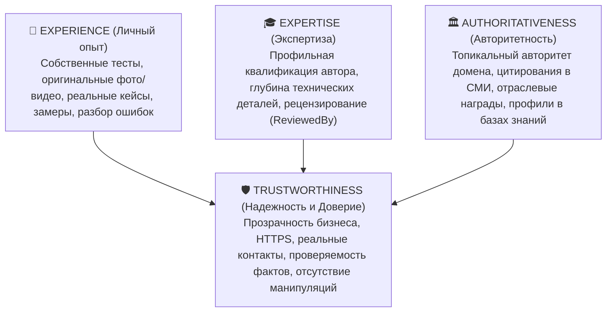
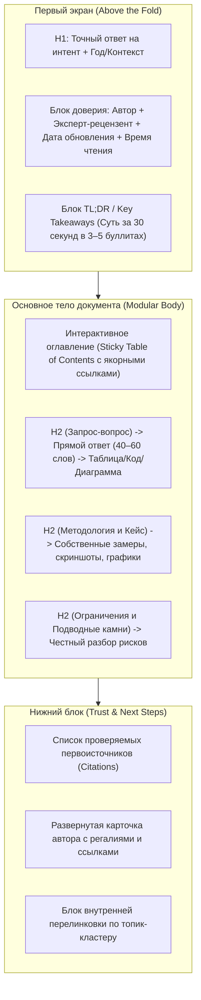
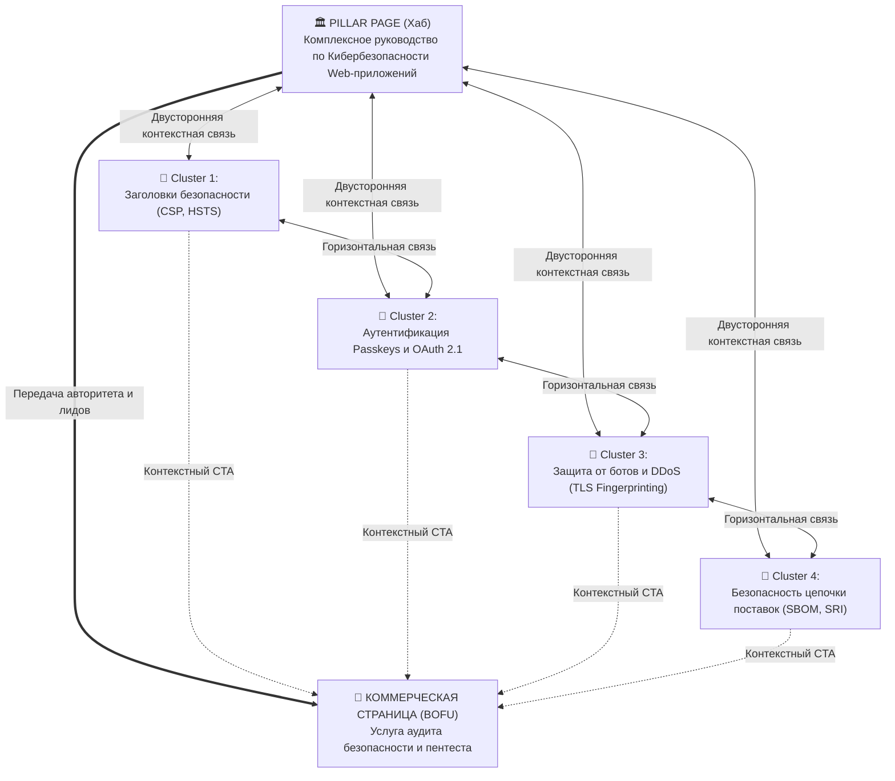

# Контент-стратегия, E-E-A-T и Топик-кластеры в эпоху ИИ (2025–2026)

> [!IMPORTANT]
> **Главный сдвиг 2025–2026:** Массовая генерация текста с помощью LLM обесценила «рерайт топ-10 выдачи». Алгоритмы Google (Helpful Content System, интегрированная в ядро ранжирования в 2024–2025 гг.) и RAG-фильтры генеративных систем пессимизируют вторичный, компилятивный контент. Побеждают страницы с доказуемым **реальным опытом (First-hand Experience)**, высоким **информационным приростом (Information Gain)** и безупречной семантической кластеризацией.

---

## 1. Фреймворк E-E-A-T в условиях избытка ИИ-контента

Согласно актуальному руководству для асессоров Google ([Search Quality Rater Guidelines — E-E-A-T](https://services.google.com/fh/files/misc/hsw-sqrg.pdf)), качество контента оценивается через четыре компонента: **Experience (Опыт), Expertise (Экспертиза), Authoritativeness (Авторитетность)** и **Trustworthiness (Надежность/Доверие)**, где **Trust (Доверие)** является фундаментом пирамиды.

### 1.1. Как доказывать каждый элемент E-E-A-T на практике (Инженерный подход)

| Компонент E-E-A-T | Что НЕ работает в 2025–2026 гг. (ИИ-штампы) | Что требуют поисковые системы и пользователи (Доказательства) |
| :--- | :--- | :--- |
| **Experience (Опыт)** | Общие фразы «Мы протестировали 10 сервисов и выбрали лучшие» со стоковыми картинками или скриншотами главных страниц. | 1. **Собственные артефакты:** скриншоты личных кабинетов, логи терминала, фотографии продукта в руках (с уникальными EXIF/метаданными и деталями). 2. **Количественные метрики:** «При нагрузке 5 000 RPS задержка выросла с 12 мс до 84 мс». 3. **Описание граничных случаев (Edge Cases):** честный разбор недостатков и сценариев, где продукт *не подходит*. |
| **Expertise (Экспертиза)** | Анонимный автор «Admin» или вымышленный персонаж со сгенерированным в Midjourney аватаром. | 1. **Верифицируемый профиль автора:** выделенная страница `/authors/name/` с дипломами, сертификатами, списком публикаций. 2. **Внешний цифровой след (`sameAs`):** ссылки на реальный LinkedIn, GitHub, Google Scholar, Habr. 3. **Двойной контроль (Fact-Checking):** для YMYL-тематик (медицина, финансы, право, безопасность) — плашка «Проверено экспертом / медицинским редактором» (свойство `reviewedBy` в Schema.org). |
| **Authoritativeness (Авторитетность)** | Попытка ранжироваться по всем темам подряд (от рецептов до криптотрейдинга) на одном домене. | 1. **Topical Authority (Тематический авторитет):** полное, исчерпывающее покрытие узкой предметной области через кластеры. 2. **Внешние упоминания:** цитирование ваших исследований в отраслевых отчетах, медиа и профильных сообществах. |
| **Trustworthiness (Надежность)** | Скрытые условия возврата, фейковые таймеры обратного отсчета, отсутствие юридического лица в футере. | 1. **Прозрачная редакционная политика:** страницы «О компании», «Методология тестирования», «Редакционные стандарты». 2. **Ссылки на первоисточники:** прямые ссылки на RFC, W3C, рецензируемые исследования (PubMed, arXiv) и официальную документацию. |

---

## 2. Концепция Information Gain (Информационный прирост)

В патенте Google [Contextual estimation of link information gain (US11354342B2)](https://patents.google.com/patent/US11354342B2/en) описан механизм оценки **Information Gain Score** — метрики того, сколько *новой, уникальной информации* несет ваш документ по сравнению с теми страницами, которые пользователь (или поисковый индекс) уже просмотрел по данному запросу.

> [!CAUTION]
> **Ловушка «Контента по ТЗ копирайтеру из ТОП-10»:** Классический подход SEO-агентств 2015–2022 годов — спарсить заголовки `H2–H3` и облако слов (TF-IDF / LSI) первых 10 сайтов выдачи и написать «усредненный текст» — в 2025–2026 годах гарантирует **нулевой Information Gain**. Поисковику и LLM незачем индексировать и цитировать 11-ю копию одних и тех же тезисов.

### 4 способа обеспечить высокий Information Gain на каждой странице:
1. **Первичные данные (First-Party Data & Original Research):** Публикуйте собственные опросы клиентов, обезличенную агрегированную статистику вашей платформы, результаты собственных бенчмарков.
2. **Уникальные фреймворки, калькуляторы и таблицы принятия решений:** Вместо сплошного текста создавайте сравнительные матрицы с нетривиальными параметрами, интерактивные калькуляторы ROI/TCO, схемы архитектуры в Mermaid.
3. **Контр-консенсусная экспертная позиция (Contrarian Insights):** Развенчивайте популярные мифы из ТОП-10 с опорой на свежие спецификации или замеры (например: *«Почему правило "не более 3 вложенных div" устарело, а реальная проблема — гидратация JS»*).
4. **Актуализация под реалии текущего года:** Четкое разделение устаревших практик и стандартов 2025–2026 годов (даты обновления, версии библиотек, изменения законодательства).

---

## 3. Анатомия идеальной посадочной/экспертной страницы (BLUF & Modular Design)

Современный пользователь сканирует страницу по F- или Pinball-паттерну (данные [Nielsen Norman Group](https://www.nngroup.com/articles/pinball-pattern-search-behavior/)), а ИИ-краулеры разбивают HTML-документ на семантические чанки (Chunks) для векторного поиска (RAG). Поэтому структура страницы должна строиться по военному принципу **BLUF (Bottom Line Up Front — суть в самом начале)**.

### 3.1. Обязательные структурные блоки страницы:
1. **Блок атрибуции под `H1`:** Имя автора (ссылка на профиль), имя технического/медицинского рецензента, дата последней фактической проверки.
2. **Блок `TL;DR` (Краткая выжимка):** Размещается сразу после первого абзаца в теге `<aside>` или выделенном контейнере. Содержит главные выводы и цифры статьи. Удерживает нетерпеливых читателей и идеально парсится генеративными алгоритмами.
3. **Навигационное оглавление (Table of Contents — ToC):** Списки с якорными ссылками (`<a href="#section-id">`). Позволяют поисковым системам формировать быстрые ссылки (Jump Links) прямо в сниппете выдачи и повышают глубину скролла.
4. **Правило «Заголовок-вопрос $\rightarrow$ Мгновенный ответ»:** После каждого `H2`/`H3` первый абзац должен давать прямой, емкий ответ без вводных конструкций («В современном мире...», «Давайте разберемся...»). Детализация, примеры и таблицы идут со второго абзаца.

---

## 4. Архитектура семантических топик-кластеров (Pillar & Cluster / Hub & Spoke)

Поисковые системы ранжируют не отдельные страницы в вакууме, а **семантические кластеры**, оценивая полноту раскрытия темы на всем сайте (Topical Authority).

### 4.1. Роли страниц в модели Hub & Spoke

| Тип страницы | Назначение и охват интента | Объем и глубина |
| :--- | :--- | :--- |
| **Pillar Page (Хабовая / Столповая страница)** | Охватывает широкий высокочастотный интент (например, *«Корпоративная кибербезопасность: архитектура и стандарты»*). Дает структурный обзор всей темы и выступает навигационным центром. | 2 500 – 4 500 слов, высокая плотность оглавления, ссылки на все дочерние Cluster Pages. |
| **Cluster Pages (Кластерные страницы / Spokes)** | Глубоко и исчерпывающе отвечают на узкие средне- и низкочастотные подтемы (например, *«Настройка mTLS в Kubernetes»*, *«Сравнение WAF Cloudflare и AWS Shield»*, *«Чек-лист соответствия OWASP ASVS 5.0»*). | 1 200 – 2 500 слов, максимальная конкретика, код, таблицы, инструкции. |

### 4.2. Инженерные правила внутренней перелинковки (Internal Linking)
1. **Запрет на безанкорные ссылки:** Никогда не используйте анкоры «читайте здесь», «подробнее», «в этой статье». Анкор ссылки (`anchor text`) — важнейший сигнал релевантности для поисковиков. Используйте описательные семантические анкоры: *«см. руководство по [настройке строгой политики Content-Security-Policy (CSP)](/security/csp-guide/)»*.
2. **Замкнутый контур кластера:**
   * **Pillar $\rightarrow$ Clusters:** Хабовая страница ссылается на каждую кластерную статью из релевантных секций.
   * **Clusters $\rightarrow$ Pillar:** Каждая кластерная статья в первых двух экранах содержит ссылку обратно на Pillar Page, подтверждая иерархию.
   * **Cluster $\leftrightarrow$ Cluster:** Соседние статьи внутри одного кластера перелинкованы между собой по смыслу.
   * **Clusters $\rightarrow$ Money Pages:** Информационные статьи передают вес и сконвертированный трафик на коммерческие страницы продуктов/услуг.
3. **Ликвидация страниц-сирот (Orphan Pages):** На сайте не должно быть ни одной индексируемой страницы, на которую ведет менее 2–3 входящих внутренних ссылок.
4. **Контроль каннибализации интента:** Одному поисковому интенту должна соответствовать ровно **одна** страница. Если две статьи конкурируют по одним и тем же запросам в Google Search Console, объедините их в один мощный материал с `301` редиректом со слабой страницы на сильную.

---

## 5. Чек-лист проверки контента и E-E-A-T перед публикацией

- [ ] **Атрибуция и E-E-A-T:** Указан реальный автор с ссылкой на личную страницу и профили в соцсетях (`Person` в Schema.org); для сложных тем указан рецензент (`reviewedBy`).
- [ ] **First-hand Experience:** В материал добавлены минимум 2–3 уникальных артефакта личного опыта (авторские замеры, оригинальные диаграммы, реальные скриншоты интерфейса/кода, разбор кейса).
- [ ] **Information Gain:** Статья содержит уникальные данные, сравнительную таблицу или методологию, которых нет у сайтов из текущего ТОП-10 выдачи.
- [ ] **Структура BLUF:** На первом экране присутствует блок `TL;DR` (ключевые выводы) и кликабельное оглавление (Table of Contents).
- [ ] **Доказательная база:** Все статистические утверждения и стандарты подкреплены прямыми ссылками на авторитетные первоисточники (исследования, документацию, спецификации).
- [ ] **Интеграция в кластер:** Статья содержит минимум 1 ссылку на родительскую Pillar Page, 2–3 ссылки на соседние статьи кластера с информативными анкорами, а на старых страницах кластера проставлены обратные ссылки на новую статью.
