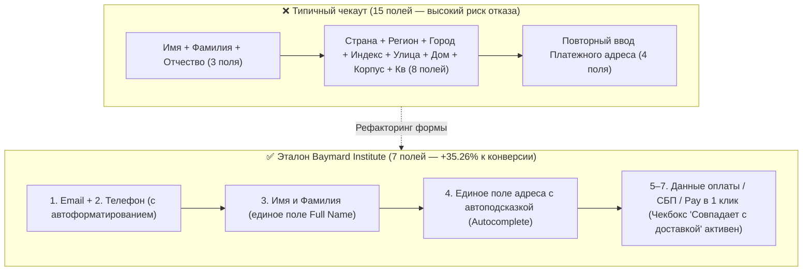

# Оптимизация конверсии (CRO), высококонверсионные формы и архитектура доверия (NN/g & Baymard Institute)

> [!IMPORTANT]
> **Экономика трения в интерфейсе:** По данным масштабного мета-анализа **Baymard Institute** (основанного на 150 000+ часов юзабилити-тестирования), средний мировой показатель брошенных корзин составляет **70.22%**. При этом интернет-магазины и SaaS-платформы могут повысить конверсию чекаута в среднем на **+35.26%** исключительно за счет устранения UX-барьеров в формах и архитектуре оформления заказа — без увеличения рекламного бюджета и без изменения цен.

---

## Оглавление

1. [Паттерны визуального сканирования страницы (Исследования Eye-Tracking NN/g)](#1-паттерны-визуального-сканирования-страницы-исследования-eye-tracking-nng)
   - [Сравнительная матрица паттернов чтения (F-Pattern, Layer-Cake, Spotted, Z-Pattern)](#сравнительная-матрица-паттернов-чтения-f-pattern-layer-cake-spotted-z-pattern)
   - [Как перевести пользователя из токсичного F-Pattern в конверсионный Layer-Cake](#как-перевести-пользователя-из-токсичного-f-pattern-в-конверсионный-layer-cake)
2. [Анатомия брошенных корзин и проектирование чекаута (Baymard Institute)](#2-анатомия-брошенных-корзин-и-проектирование-чекаута-baymard-institute)
   - [Топ причин отказа от покупки на этапе чекаута](#топ-причин-отказа-от-покупки-на-этапе-чекаута)
   - [Математика идеального чекаута: 7–8 полей вместо 15](#математика-идеального-чекаута-78-полей-вместо-15)
   - [Одноколоночная верстка, валидация `onBlur` и мобильные клавиатуры `inputmode`](#одноколоночная-верстка-валидация-onblur-и-мобильные-клавиатуры-inputmode)
3. [Архитектура доверия (Trust Architecture) и психология Social Proof](#3-архитектура-доверия-trust-architecture-и-психология-social-proof)
   - [Прозрачность ценообразования (Total Cost Transparency)](#прозрачность-ценообразования-total-cost-transparency)
   - [Парадокс идеального рейтинга: почему 4.2–4.7 продает лучше, чем 5.0](#парадокс-идеального-рейтинга-почему-4247-продает-лучше-чем-50)
   - [Микрокопирайтинг снижения тревожности (Click Triggers) у CTA](#микрокопирайтинг-снижения-тревожности-click-triggers-у-cta)
4. [Отказ от токсичных Dark Patterns и регуляторные запреты (EU DSA Art. 25, FTC)](#4-отказ-от-токсичных-dark-patterns-и-регуляторные-запреты-eu-dsa-art-25-ftc)
5. [Чек-лист CRO-аудита форм и воронки продаж](#5-чек-лист-cro-аудита-форм-и-воронки-продаж)
6. [Источники и исследования](#6-источники-и-исследования)

---

## 1. Паттерны визуального сканирования страницы (Исследования Eye-Tracking NN/g)

Пользователи в интернете **не читают страницы слово за словом — они их сканируют** (выхватывают информационные якоря для минимизации когнитивных затрат). Лаборатория айтрекинга **Nielsen Norman Group (NN/g)** выделила четыре базовых паттерна движения глаз.

### Сравнительная матрица паттернов чтения (F-Pattern, Layer-Cake, Spotted, Z-Pattern)

| Паттерн сканирования | Траектория взгляда | Когда возникает | Влияние на конверсию и восприятие |
| :--- | :--- | :--- | :--- |
| **F-Pattern (F-паттерн)** | Две горизонтальные полосы сверху, затем быстрое скольжение вниз по левому краю страницы. | На страницах со сплошным неформатированным текстом («стена текста») без подзаголовков и буллитов. | 🔴 **Негативное для бизнеса.** Пользователь пропускает до 70% контента справа и внизу. Признак плохого форматирования текста. |
| **Layer-Cake Pattern («Слоеный пирог»)** | Горизонтальная фиксация на контрастных подзаголовках (`H2`–`H3`) и чтение только того абзаца, чей заголовок зацепил взгляд. | При четкой визуальной иерархии, информативных подзаголовках, списках и таблицах. | 🟢 **Максимально позитивное.** Самый эффективный паттерн для лонгридов, B2B-лендингов, карточек товаров и документации. |
| **Spotted Pattern (Точечный паттерн)** | Взгляд прыгает по визуально выделенным «островкам»: цифрам, полужирным словам (`<strong>`), ценам, кнопкам, иконкам. | При поиске конкретного факта (цены, срока доставки, характеристики, промокода). | 🟢 **Высокое.** Позволяет за 2–3 секунды подтвердить релевантность страницы поисковому интенту. |
| **Z-Pattern / Zig-Zag** | Слева направо по шапке $\rightarrow$ по диагонали через центр $\rightarrow$ слева направо по нижней зоне к кнопке CTA. | На лаконичных первого экрана (Hero-секциях) и промо-лендингах с малым количеством текста. | 🟡 **Уместно только для Hero-экранов** и простых посадочных страниц с одним целевым действием. |

### Как перевести пользователя из токсичного F-Pattern в конверсионный Layer-Cake

> [!TIP]
> **Главный вывод NN/g:** F-паттерн — это защитная реакция мозга на скучную, неструктурированную верстку. Чтобы сломать F-паттерн и включить **Layer-Cake + Spotted Pattern**, необходимо:
> 1. Разбивать текст информативными подзаголовками каждые **150–250 слов** (подзаголовок должен нести суть: вместо *«О нашей доставке»* пишите *«Бесплатная доставка за 2 часа по Москве»*).
> 2. Выносить перечисления в маркированные списки (`<ul>`/`<ol>`), выделяя первые 2–3 слова каждого пункта полужирным шрифтом.
> 3. Заменять текстовые описания характеристик сравнительными таблицами и карточками с цифрами.

---

## 2. Анатомия брошенных корзин и проектирование чекаута (Baymard Institute)

Согласно данным **Baymard Institute**, 7 из 10 пользователей покидают корзину (**70.22%**). Если отсечь сегмент пользователей, которые «просто смотрели» (*just browsing*), остаются чистые UX-причины отказов, которые полностью контролируются архитектурой сайта.

### Топ причин отказа от покупки на этапе чекаута

| Ранг | Причина отказа пользователя (по данным Baymard Institute) | Доля отказов | Архитектурное решение (CRO-стандарт) |
| :---: | :--- | :---: | :--- |
| **1** | **Слишком высокие или внезапные доплаты** (доставка, налоги, сервисные сборы всплыли на последнем шаге) | **48%** | Калькулятор доставки или точная стоимость прямо в корзине / карточке товара до перехода в чекаут; шкала «До бесплатной доставки осталось X ₽». |
| **2** | **Принудительная регистрация аккаунта** («Зарегистрируйтесь, чтобы оформить заказ») | **26%** | **Обязательный Guest Checkout** («Оформить как гость» — самая заметная кнопка). Предложение создать аккаунт в 1 клик *после* оплаты на странице Thank You. |
| **3** | **Недоверие сайту при вводе данных банковской карты** | **25%** | Нативные экспресс-методы (Apple Pay, Google Pay, СБП, Pay-сервисы), визуальная изоляция блока оплаты, микрокопирайтинг о шифровании и возврате. |
| **4** | **Слишком медленная или непредсказуемая доставка** | **23%** | Указание точной даты доставки (*«Доставим в четверг, 22 октября»*) вместо абстрактного *«3–5 рабочих дней»*. |
| **5** | **Слишком длинный и сложный процесс чекаута** | **22%** | Сокращение числа видимых полей до **7–8 инпутов** (12–14 элементов формы). |
| **6** | **Невозможность увидеть/рассчитать итоговую сумму заказа заранее** | **16%** | Динамическое обновление итоговой суммы (`Total`) в липком блоке сводки заказа. |

---

### Математика идеального чекаута: 7–8 полей вместо 15

Исследования Baymard показывают, что **сокращение количества конверсионного трения зависит не от количества шагов (1 шаг против 3 шагов), а от количества видимых полей ввода**.
- Средний неоптимизированный чекаут содержит **14–15 полей ввода** (около 23.48 элементов формы).
- **Эталонный чекаут Baymard** содержит всего **7–8 видимых полей ввода** (12–14 элементов формы в целом), что снижает когнитивную нагрузку вдвое и дает до **+35.26% прироста конверсии**.

#### Как сократить чекаут с 15 до 7 полей без потери данных:
1. **Одно поле `Имя и фамилия` (Full Name)** вместо трех отдельных полей (`Фамилия`, `Имя`, `Отчество`).
2. **Скрытие поля «Квартира / Офис / Подъезд» или «Адресная строка 2»** под ссылку *«+ Добавить квартиру, офис или комментарий курьеру»* или объединение адреса через автокомплит (DaData / Google Places API).
3. **Автоопределение города и региона по IP / индексу** с возможностью смены в 1 клик.
4. **Чекбокс «Платежный адрес совпадает с адресом доставки»**, включенный по умолчанию (`checked`), что скрывает сразу 5–6 дублирующих полей (одновременно выполняя требование **WCAG 2.2 критерий 3.3.7 Redundant Entry**).



---

### Одноколоночная верстка, валидация `onBlur` и мобильные клавиатуры `inputmode`

#### 1. Запрет многоколоночных форм
Многоколоночные формы (когда `Имя` слева, а `Телефон` справа) заставляют взгляд двигаться по Z-образной траектории, из-за чего пользователи пропускают правые поля или не понимают порядок нажатия `Tab`.
- **Правило:** Все поля формы располагаются строго в **одну вертикальную колонку**. Единственное допустимое исключение — `Срок действия карты (ММ/ГГ)` и `CVC/CVV`, которые люди привыкли видеть рядом на физическом пластике.

#### 2. Валидация `onBlur` (после потери фокуса), а не `onChange` (при каждом нажатии клавиши)
Когда пользователь только начал вводить email и набрал первую букву `a`, а поле уже загорелось красным с криком *«Некорректный email!»* — это **преждевременная агрессивная валидация**. Она вызывает раздражение и замедляет ввод.
- **Стандарт:** Ошибка проверяется и показывается по событию **`blur`** (когда пользователь закончил ввод в поле и перешел к следующему). Как только пользователь вернулся в поле с ошибкой и исправил ее — красная рамка должна исчезать мгновенно по событию `input` (Reward Early, Punish Late).

#### 3. Эталонная HTML-разметка конверсионной формы (Мобильные клавиатуры и автозаполнение)

Использование правильных атрибутов `type`, `inputmode` и `autocomplete` автоматически открывает на смартфоне нужную раскладку клавиатуры (крупные цифры для телефона и кода из СМС, символ `@` для почты) и позволяет заполнить форму в 1 касание.

```html
<form class="checkout-form" novalidate>
  <!-- 1. Поле Имени и Фамилии (единое) -->
  <div class="field-wrapper">
    <label for="full-name" class="field-label">Имя и фамилия</label>
    <input
      id="full-name"
      name="name"
      type="text"
      autocomplete="name"
      autocapitalize="words"
      required
      aria-describedby="name-hint"
    />
    <span id="name-hint" class="field-hint">Понадобится для получения заказа в пункте выдачи</span>
  </div>

  <!-- 2. Поле Телефона (вызывает цифровую клавиатуру телефона) -->
  <div class="field-wrapper">
    <label for="phone" class="field-label">Мобильный телефон</label>
    <input
      id="phone"
      name="phone"
      type="tel"
      inputmode="tel"
      autocomplete="tel"
      placeholder="+7 (___) ___-__-__"
      required
      aria-describedby="phone-hint"
    />
    <span id="phone-hint" class="field-hint">Пришлем только SMS с кодом получения (без спама)</span>
  </div>

  <!-- 3. Поле Одноразового кода из SMS (автоподстановка из сообщения на iOS/Android) -->
  <div class="field-wrapper">
    <label for="otp-code" class="field-label">Код из SMS</label>
    <input
      id="otp-code"
      name="otp"
      type="text"
      inputmode="numeric"
      autocomplete="one-time-code"
      pattern="[0-9]{4,6}"
      maxlength="6"
    />
  </div>

  <!-- 4. Промокод, скрытый за нативным <details> (чтобы не провоцировать уход в Google за купонами!) -->
  <details class="promo-disclosure">
    <summary>У меня есть промокод или подарочный сертификат</summary>
    <div class="promo-box">
      <label for="promo-input" class="visually-hidden">Введите промокод</label>
      <input id="promo-input" type="text" name="promo" placeholder="Промокод" />
      <button type="button" class="btn-secondary">Применить</button>
    </div>
  </details>

  <!-- 5. Главная кнопка с микрокопирайтингом снижения риска -->
  <div class="cta-container">
    <button type="submit" class="btn-submit">
      Оплатить заказ — 4 990 ₽
    </button>
    <p class="click-trigger-microcopy">
      🔒 Безопасная оплата через СБП или картой. Бесплатный возврат в течение 30 дней.
    </p>
  </div>
</form>
```

> [!WARNING]
> **Ловушка открытого поля «Промокод»:** Никогда не оставляйте пустое заметное поле «Введите промокод» развернутым в корзине. Увидев пустую рамку, до **15–20% покупателей** испытывают синдром упущенной выгоды (FOMO), открывают новую вкладку, уходят гуглить *«промокод [название магазина]»*, попадают на купонные сайты с нерабочими кодами и **не возвращаются в корзину**. Всегда сворачивайте промокод под аккуратную ссылку `<details><summary>У меня есть промокод</summary></details>`.

---

## 3. Архитектура доверия (Trust Architecture) и психология Social Proof

Доверие в цифровом интерфейсе складывается из трех уровней: **визуальный профессионализм (50 мс)**, **прозрачность условий** и **верифицируемое социальное доказательство (Social Proof)**.

### Прозрачность ценообразования (Total Cost Transparency)
- В B2C E-commerce: показывайте стоимость и дату доставки **в карточке товара** и в мини-корзине, а не на 3-м шаге оформления.
- В B2B и SaaS: страницы с открытыми тарифными сетками конвертируют в целевой лид значительно лучше, чем глухая заглушка *«Цена по запросу»*. Если точный расчет невозможен без брифа, указывайте **вилку цен («От 150 000 ₽ — типовой проект»)** или интерактивный калькулятор оценки.

### Парадокс идеального рейтинга: почему 4.2–4.7 продает лучше, чем 5.0

Исследования Spiegel Research Center (Northwestern University) и Baymard Institute по поведению покупателей выявили нелинейную зависимость конверсии от среднего рейтинга отзывов:

| Средний рейтинг товара / услуги | Восприятие пользователем | Эффект на конверсию |
| :---: | :--- | :--- |
| **< 3.5 ★** | Низкое качество товара или сервиса. | Резкое падение конверсии. |
| **4.2 – 4.7 ★** | **Оптимум достоверности («Честный рейтинг»).** Наличие нескольких конструктивных отзывов на 3–4 звезды убеждает покупателя, что отзывы настоящие и не проходят цензуру. | **Пик вероятности покупки (максимальная конверсия).** |
| **5.0 ★ (при > 20 отзывах)** | Вызывает подозрение в накрутке («Слишком хорошо, чтобы быть правдой» / Fake Reviews). | Конверсия **ниже**, чем у рейтинга **4.4–4.6 ★**. |

**Обязательные элементы блока отзывов (2025–2026):**
1. Плашка **«Реальный покупатель / Заказ подтвержден»** (Verified Purchase).
2. Гистограмма распределения оценок (5★, 4★, 3★, 2★, 1★) с возможностью **фильтрации по негативным отзывам** (пользователи намеренно читают отзывы с 2–3 звездами, чтобы узнать худший сценарий использования товара).
3. Пользовательские фото/видео в реальном интерьере (UGC) и ответы официального представителя бренда на критику.

### Микрокопирайтинг снижения тревожности (Click Triggers) у CTA
Рядом с главной конверсионной кнопкой взгляд пользователя испытывает максимальное сопротивление («А вдруг спишут деньги сразу?», «А смогу ли я отменить?»). Размещение короткого текста-триггера (`Click Trigger`) непосредственно под кнопкой снимает возражение в момент клика:
- В SaaS под кнопкой *«Попробовать 14 дней бесплатно»*: **«Привязка карты не требуется • Отмена в 1 клик в любой момент»**.
- В E-commerce под кнопкой *«Оформить заказ»*: **«Оплата при получении после примерки • Гарантия возврата 30 дней»**.

---

## 4. Отказ от токсичных Dark Patterns и регуляторные запреты (EU DSA Art. 25, FTC)

**Dark Patterns (Темные паттерны / Deceptive Design)** — это манипулятивные приемы интерфейса, заставляющие пользователя совершить действие против его воли или осознанного намерения. В 2025–2026 годах темные паттерны не только разрушают LTV и вызывают чарджбэки (принудительные возвраты средств через банк), но и **прямо запрещены законом**:
- **Евросоюз — Digital Services Act (DSA, Статья 25) и Digital Fairness Act:** прямой запрет на интерфейсные манипуляции, неравнозначные кнопки в баннерах согласия (когда «Принять все» яркая, а «Отклонить» спрятана в 3 клика) и ложные таймеры.
- **США — FTC Click-to-Cancel Rule (Правило Федеральной торговой комиссии):** процедура отмены подписки обязана быть **не сложнее, чем процедура подписки**. Если подписаться можно онлайн в 2 клика, запрещено требовать звонка в колл-центр или общения с ботом для отмены.

| Темный паттерн (Dark Pattern) | Описание токсичной механики | Юридический и поведенческий риск | Этичная альтернатива (White Hat CRO) |
| :--- | :--- | :--- | :--- |
| **Confirmshaming (Шейминг при отказе)** | Кнопка закрытия попапа с уничижительным текстом: *«Нет, спасибо, я хочу продолжать переплачивать»*. | Отторжение к бренду, рост показателя отказов, снижение доверия к экспертизе. | Нейтральный уважительный текст: *«Нет, спасибо»* или *«Закрыть окно»*. |
| **Sneak into Basket (Тайное добавление в корзину)** | Предварительно проставленные галочки (`checked`) на платной страховке, доп. гарантии или чаевых. | Нарушение Директивы ЕС о правах потребителей (CRD) и ЗоЗПП РФ; массовые возвраты и негативные отзывы. | Явный осознанный выбор пользователя (**Opt-in**, чекбокс по умолчанию снят) с прозрачным объяснением ценности страховки. |
| **Roach Motel / Hard-to-Cancel («Ловушка для тараканов»)** | Подписка в 1 клик, но для отписки нужно пройти 7 экранов опросов или позвонить по телефону в рабочие часы. | Крупные штрафы по **FTC Click-to-Cancel** и EU DSA; принудительная блокировка карты клиентом через банк (Chargeback — штраф для мерчанта). | Заметная кнопка *«Отменить подписку»* в личном кабинете + предложение поставить подписку на паузу на 1–3 месяца. |
| **Fake Urgency / Scarcity (Фальшивые таймеры и счетчики)** | Таймер *«Скидка сгорит через 09:59»*, который сбрасывается при обновлении страницы (`F5`), или ложное *«Сейчас этот товар смотрят 48 человек»*. | Штрафы антимонопольных и потребительских регуляторов; мгновенная потеря доверия технически грамотной аудитории. | Честная индикация реального складского остатка (*«Осталось 3 шт. на складе в Москве»*) и реальные даты окончания акции. |

---

## 5. Чек-лист CRO-аудита форм и воронки продаж

- [ ] **Паттерн сканирования:** Текстовые страницы отформатированы под **Layer-Cake** и **Spotted Pattern** (информативные подзаголовки `H2/H3`, маркированные списки с полужирными акцентами, таблицы и карточки вместо сплошных абзацев).
- [ ] **Гостевой чекаут (Guest Checkout):** Покупка доступна без обязательной регистрации и придумывания пароля; создание аккаунта предлагается опционально после оплаты.
- [ ] **Минимум полей (7–8 инпутов):** ФИО объединено в одно поле; адрес снабжен автоподсказками; платежный адрес по умолчанию совпадает с адресом доставки.
- [ ] **Одноколоночная форма:** Все поля ввода выстроены строго в одну колонку сверху вниз; подписи `<label>` расположены **над** полем ввода (не внутри `placeholder`, который исчезает при вводе!).
- [ ] **Мобильная эргономика ввода:** Прописаны корректные атрибуты `type`, `inputmode` (`tel`, `numeric`, `email`) и `autocomplete` (`name`, `tel`, `street-address`, `cc-number`, `one-time-code`).
- [ ] **Дружелюбная валидация:** Проверка полей срабатывает по событию `onBlur` (после завершения ввода), а не при наборе первого символа; текст ошибки конкретно объясняет, как ее исправить.
- [ ] **Скрытый промокод:** Поле ввода купона свернуто под `<details><summary>У меня есть промокод</summary></details>`, чтобы не уводить трафик в поисковики.
- [ ] **Прозрачность цены и Social Proof:** Доставка и сборы видны до чекаута; отзывы содержат фильтр по оценкам и плашку реального заказа; рядом с главным CTA размещен `Click Trigger` (условия возврата / отмены).
- [ ] **Отсутствие Dark Patterns:** Нет предустановленных платных галочек (Opt-in только вручную), нет фейковых таймеров, отмена подписки доступна онлайн в 1–2 клика.

---

## 6. Источники и исследования

1. **Baymard Institute** — *49 Cart Abandonment Rate Statistics (70.22% Average) & Checkout Usability Research (+35.26% Conversion Potential)* — [baymard.com/lists/cart-abandonment-rate](https://baymard.com/lists/cart-abandonment-rate)
2. **Baymard Institute** — *Checkout Flow Average Form Fields: 12–14 Form Elements (7–8 Fields) Benchmark* — [baymard.com/blog/checkout-flow-average-form-fields](https://baymard.com/blog/checkout-flow-average-form-fields)
3. **Nielsen Norman Group (NN/g)** — *Text Scanning Patterns: Eyetracking Evidence (F-Pattern, Layer-Cake, Spotted)* — [nngroup.com/articles/text-scanning-patterns-eyetracking/](https://www.nngroup.com/articles/text-scanning-patterns-eyetracking/)
4. **Nielsen Norman Group (NN/g)** — *Web Form Design: Filling in the Blanks & Inline Validation* — [nngroup.com/articles/web-form-design/](https://www.nngroup.com/articles/web-form-design/)
5. **Spiegel Research Center (Northwestern University)** — *How Online Reviews Influence Sales (Why 4.2–4.7 Stars Outperform 5.0)* — [spiegel.medill.northwestern.edu/how-online-reviews-influence-sales/](https://spiegel.medill.northwestern.edu/how-online-reviews-influence-sales/)
6. **European Union Digital Services Act (DSA)** — *Article 25: Online Interface Design and Prohibition of Dark Patterns* — [eur-lex.europa.eu/eli/reg/2022/2065/oj](https://eur-lex.europa.eu/eli/reg/2022/2065/oj)
7. **U.S. Federal Trade Commission (FTC)** — *Click-to-Cancel Rule (Negative Option Rule Modernization)* — [ftc.gov](https://www.ftc.gov/)
