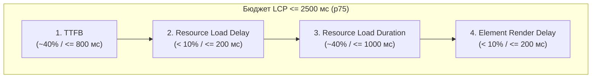
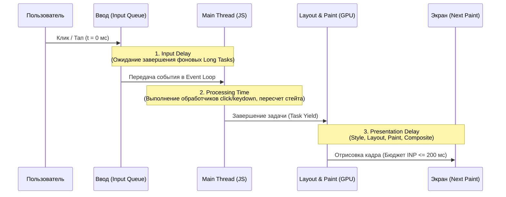

# Core Web Vitals и Клиентская Производительность (Стандарты 2025–2026)

> [!IMPORTANT]
> **Актуальный статус метрик (2025–2026):** С марта 2024 года метрика **FID (First Input Delay)** официально выведена из эксплуатации и заменена на **INP (Interaction to Next Paint)** в качестве ключевой метрики отзывчивости Core Web Vitals. Все пороговые значения рассчитываются по **75-му перцентилю (p75)** полевых данных Chrome User Experience Report (CrUX) с сегментацией по мобильным и десктопным устройствам.

---

## Содержание

1. [Эталонные метрики Core Web Vitals и Web Vitals](#1-эталонные-метрики-core-web-vitals-и-web-vitals)
2. [Декомпозиция и оптимизация LCP (Largest Contentful Paint)](#2-декомпозиция-и-оптимизация-lcp-largest-contentful-paint)
3. [Speculation Rules API: Мгновенная навигация](#3-speculation-rules-api-мгновенная-навигация)
4. [Оптимизация INP (Interaction to Next Paint) и разгрузка Main Thread](#4-оптимизация-inp-interaction-to-next-paint-и-разгрузка-main-thread)
5. [Предотвращение CLS (Cumulative Layout Shift) и Zero-CLS типографика](#5-предотвращение-cls-cumulative-layout-shift-и-zero-cls-типографика)
6. [Жизненный цикл страницы и Back/Forward Cache (bfcache)](#6-жизненный-цикл-страницы-и-backforward-cache-bfcache)
7. [Чек-лист технического аудита производительности](#7-чек-лист-технического-аудита-производительности)

---

## 1. Эталонные метрики Core Web Vitals и Web Vitals

Поисковые системы и аналитические платформы оценивают страницу как прошедшую аудит («Good»), только если **все три основные метрики (LCP, INP, CLS)** находятся в зеленой зоне на 75-м перцентиле реальных пользователей (RUM / CrUX).

| Метрика | Статус в CWV | Что измеряет | Good (Зеленая зона) | Needs Improvement | Poor (Красная зона) |
| :--- | :--- | :--- | :--- | :--- | :--- |
| **LCP** *(Largest Contentful Paint)* | **Core** | Скорость отрисовки самого крупного видимого элемента во вьюпорте | **$\le 2.5\text{ с}$** | $2.5\text{ с} - 4.0\text{ с}$ | $> 4.0\text{ с}$ |
| **INP** *(Interaction to Next Paint)* | **Core** *(заменил FID)* | Задержка отклика интерфейса на взаимодействия (клики, тапы, клавиши) за всю сессию | **$\le 200\text{ мс}$** | $200\text{ мс} - 500\text{ мс}$ | $> 500\text{ мс}$ |
| **CLS** *(Cumulative Layout Shift)* | **Core** | Визуальная стабильность верстки (суммарный вес неожиданных сдвигов макета) | **$\le 0.1$** | $0.1 - 0.25$ | $> 0.25$ |
| **TTFB** *(Time to First Byte)* | Диагностическая | Время от старта навигации до получения первого байта ответа от сервера | **$\le 800\text{ мс}$** | $800\text{ мс} - 1800\text{ мс}$ | $> 1800\text{ мс}$ |
| **FCP** *(First Contentful Paint)* | Диагностическая | Время до первой отрисовки любого текста, изображения или `<svg>` | **$\le 1.8\text{ с}$** | $1.8\text{ с} - 3.0\text{ с}$ | $> 3.0\text{ с}$ |

---

## 2. Декомпозиция и оптимизация LCP (Largest Contentful Paint)

По стандартам Google Web Vitals (`web.dev`), общее время LCP ($\le 2500\text{ мс}$) должно быть строго разделено на 4 непересекающиеся фазы. Превышение бюджета любой из фаз разрушает итоговый показатель.



### Бюджет фаз LCP и причины деградации

| Фаза LCP | Целевая доля | Целевое время | Главные причины просадки | Инженерное решение |
| :--- | :--- | :--- | :--- | :--- |
| **1. Time to First Byte (TTFB)** | ~40% | $\le 800\text{ мс}$ | Медленный БД-запрос, отсутствие CDN, цепочки редиректов, холодный старт Serverless | Edge-кэширование (`stale-while-revalidate`), HTTP/3, 103 Early Hints, SSR Streaming |
| **2. Resource Load Delay** | < 10% | $\le 200\text{ мс}$ | Браузер поздно узнает о LCP-картинке (она в CSS `background-image` или рендерится через JS) | Размещение `` в исходном HTML, `<link rel="preload">`, атрибут `fetchpriority="high"` |
| **3. Resource Load Duration** | ~40% | $\le 1000\text{ мс}$ | Тяжелый вес файла, отсутствие адаптивных `srcset`, конкуренция за полосу пропускания | Сжатие в **AVIF / WebP**, корректный `sizes`, CDN с авто-ресайзом, HTTP/3 приоритизация |
| **4. Element Render Delay** | < 10% | $\le 200\text{ мс}$ | Ресурс скачан, но заблокирован синхронным `<script>`, тяжелым CSS или гидратацией SPA | Асинхронная загрузка скриптов (`defer`), инлайн Critical CSS, устранение A/B-тест анти-фликера |

### Управление приоритетами загрузки (Priority Hints) и Preload

> [!WARNING]
> **Критический анти-паттерн:** Никогда не устанавливайте `loading="lazy"` на главное изображение первого экрана (Hero / LCP). Это откладывает загрузку до расчета геометрии макета и гарантированно увеличивает *Resource Load Delay* на 300–800 мс.

```html
<head>
  <!-- 1. Раннее установление соединения с медиа-CDN -->
  <link rel="preconnect" href="https://cdn.example.com" crossorigin />

  <!-- 2. Предзагрузка LCP-изображения (если оно вызывается из CSS или динамического компонента) -->
  <link
    rel="preload"
    as="image"
    href="https://cdn.example.com/hero-800.avif"
    imagesrcset="
      https://cdn.example.com/hero-400.avif 400w,
      https://cdn.example.com/hero-800.avif 800w,
      https://cdn.example.com/hero-1200.avif 1200w,
      https://cdn.example.com/hero-1600.avif 1600w
    "
    imagesizes="(max-width: 768px) 100vw, 50vw"
    fetchpriority="high"
  />
</head>
<body>
  <!-- 3. Эталонная разметка LCP-изображения на первом экране -->
  <picture>
    <!-- AVIF: экономия ~50% к JPEG и ~20-30% к WebP -->
    <source
      type="image/avif"
      srcset="
        https://cdn.example.com/hero-400.avif 400w,
        https://cdn.example.com/hero-800.avif 800w,
        https://cdn.example.com/hero-1200.avif 1200w,
        https://cdn.example.com/hero-1600.avif 1600w
      "
      sizes="(max-width: 768px) 100vw, 50vw"
    />
    <!-- WebP: фоллбэк -->
    <source
      type="image/webp"
      srcset="
        https://cdn.example.com/hero-400.webp 400w,
        https://cdn.example.com/hero-800.webp 800w,
        https://cdn.example.com/hero-1200.webp 1200w,
        https://cdn.example.com/hero-1600.webp 1600w
      "
      sizes="(max-width: 768px) 100vw, 50vw"
    />
    <!-- Базовый : fetchpriority="high", decoding="async", явно заданные width/height, БЕЗ loading="lazy" -->
    
  </picture>

  <!-- Изображения ниже сгиба экрана (Below the fold): понижаем приоритет и включаем ленивую загрузку -->
  
</body>
```

---

## 3. Speculation Rules API: Мгновенная навигация

**Speculation Rules API** (стандарт W3C WICG) полностью заменяет устаревший и некорректно работавший `<link rel="prerender">`. Он позволяет декларативно управлять **предзагрузкой HTML (`prefetch`)** и **полным фоновым рендерингом (`prerender`)** следующих страниц в скрытой вкладке браузера, сводя **TTFB и LCP к $0\text{ мс}$** при переходе.

### Уровни агрессивности (`eagerness`)

| Уровень `eagerness` | Триггер срабатывания | Рекомендуемый сценарий применения |
| :--- | :--- | :--- |
| **`immediate`** | Сразу после парсинга скрипта правил | Топ-1–2 страницы с вероятностью перехода $> 80\%$ (например, следующий шаг воронки или пагинации) |
| **`eager`** | При малейшем признаке намерения (приближение курсора) | Ключевые разделы навигационного меню или карточки бестселлеров |
| **`moderate`** | При удержании курсора (`hover`) $\ge 200\text{ мс}$ или фокусе | **Оптимальный баланс по умолчанию** для каталогов, статей и внутренних ссылок |
| **`conservative`** | Только в момент нажатия кнопки мыши или касания (`pointerdown` / `mousedown`) | Экономия трафика на тяжелых страницах; выигрыш $100 - 300\text{ мс}$ до отпускания кнопки (`click`) |

### Эталонная конфигурация Speculation Rules API

```html
<script type="speculationrules">
{
  "prefetch": [
    {
      "source": "document",
      "where": {
        "and": [
          { "href_matches": "/*" },
          { "not": { "href_matches": ["/logout", "/cart/*", "/checkout/*", "/api/*", "/admin/*"] } },
          { "not": { "selector_matches": "[rel~=nofollow], .no-prefetch, [download]" } }
        ]
      },
      "eagerness": "moderate"
    }
  ],
  "prerender": [
    {
      "source": "document",
      "where": {
        "and": [
          { "selector_matches": "a.prerender-target, .product-card__link" },
          { "not": { "href_matches": ["/cart/*", "/checkout/*"] } }
        ]
      },
      "eagerness": "moderate"
    },
    {
      "source": "list",
      "urls": ["/catalog/top-seller", "/pricing"],
      "eagerness": "eager"
    }
  ]
}
</script>
```

> [!TIP]
> **Защита аналитики и состояния при `prerender`:** Чтобы просмотры страниц и тяжелые сторонние пиксели не срабатывали до того, как пользователь реально перешел на предрендеренную страницу, проверяйте свойство `document.prerendering` и подписывайтесь на событие `prerenderingchange`:
> ```javascript
> function initAnalytics() {
>   // Отправка хита аналитики
> }
> if (document.prerendering) {
>   document.addEventListener('prerenderingchange', initAnalytics, { once: true });
> } else {
>   initAnalytics();
> }
> ```

---

## 4. Оптимизация INP (Interaction to Next Paint) и разгрузка Main Thread

**INP** измеряет время от аппаратного события ввода пользователя (клик мыши, касание тачскрина, нажатие клавиши) до момента, когда браузер отрисует следующий кадр (Next Paint) с визуальной обратной связью. Считается наихудшая задержка (или 98-й перцентиль взаимодействий для страниц с $> 50$ интеракциями).



### Кооперативная многозадачность с `scheduler.yield()`

Любая задача в главном потоке длительностью **$> 50\text{ мс}$** считается **Long Task** (длинной задачей) и блокирует обработку пользовательского ввода. Использование современного API `scheduler.yield()` позволяет приостановить выполнение цикла или цепочки функций, уступить главный поток браузеру для отрисовки кадра и обработки ввода, а затем продолжить работу с приоритетом продолжения (в отличие от `setTimeout(fn, 0)`, который ставит задачу в самый конец очереди макрозадач).

```javascript
/**
 * Полифилл-обертка для уступки главного потока (Main Thread Yielding)
 */
async function yieldToMain() {
  if ('scheduler' in globalThis && 'yield' in scheduler) {
    return scheduler.yield();
  }
  return new Promise((resolve) => setTimeout(resolve, 0));
}

/**
 * Обработка клика с мгновенным UI-откликом и разбивкой тяжелой логики
 */
async function handleFilterChange(event, items) {
  // 1. Сразу обновляем визуальное состояние (например, спиннер или активный таб)
  event.currentTarget.classList.add('is-loading');

  // 2. Уступаем поток! Браузер немедленно отрисует кадр с классом 'is-loading' (INP < 30 мс)
  await yieldToMain();

  // 3. Выполняем ресурсоемкую фильтрацию пачками с контролем дедлайна (каждые 30 мс)
  const results = [];
  let lastYieldTime = performance.now();

  for (const item of items) {
    if (complexFilterCheck(item)) {
      results.push(item);
    }

    // Если мы занимаем поток дольше 30 мс — уступаем его браузеру
    if (performance.now() - lastYieldTime > 30) {
      await yieldToMain();
      lastYieldTime = performance.now();
    }
  }

  renderFilteredDOM(results);
  event.currentTarget.classList.remove('is-loading');
}
```

### Изоляция сторонних скриптов в Web Workers (Partytown)

Сторонние скрипты (Google Tag Manager, Яндекс.Метрика, чаты поддержки, пиксели ретаргетинга) — главная причина провала INP на мобильных устройствах. Архитектура **Partytown** переносит их исполнение из Main Thread в фоновый **Web Worker**, проксируя обращения к `window`/`document` через синхронные `Atomics` или Service Worker.

```html
<head>
  <!-- Конфигурация Partytown: проксирование вызовов dataLayer в Web Worker -->
  <script>
    window.partytown = {
      lib: '/~partytown/',
      forward: ['dataLayer.push', 'ym']
    };
  </script>
  <script src="/~partytown/partytown.js" async></script>

  <!-- Сторонний скрипт с типом text/partytown НЕ выполняется в Main Thread -->
  <script type="text/partytown" src="https://www.googletagmanager.com/gtag/js?id=G-XXXXXXXXXX"></script>
  <script type="text/partytown">
    window.dataLayer = window.dataLayer || [];
    function gtag(){dataLayer.push(arguments);}
    gtag('js', new Date());
    gtag('config', 'G-XXXXXXXXXX');
  </script>
</head>
```

### Оптимизация Presentation Delay через `content-visibility: auto`

Если DOM-дерево превышает 1500 узлов, фаза **Presentation Delay** (пересчет стилей и Layout) начинает занимать десятки миллисекунд при каждом клике. CSS-свойство `content-visibility: auto` приказывает браузеру полностью пропускать расчёт стилей, макета и отрисовки для секций за пределами экрана.

```css
/* Применяется к тяжелым секциям ниже первого экрана (отзывы, футер, длинные списки) */
.below-fold-section {
  content-visibility: auto;
  /* Резервируем ориентировочный размер (ширина auto, высота 800px), чтобы скроллбар не прыгал */
  contain-intrinsic-size: auto 800px;
}
```

---

## 5. Предотвращение CLS (Cumulative Layout Shift) и Zero-CLS типографика

Формула расчета сдвига макета:
$$\text{Layout Shift Score} = \text{Impact Fraction} \times \text{Distance Fraction}$$
Оценка рассчитывается по сессионным окнам (Session Windows) длительностью до $5\text{ с}$ с максимальным разрывом в $1\text{ с}$ между отдельными сдвигами.

### 1. Zero-CLS для кастомных веб-шрифтов (`size-adjust` и метрики глифов)

При использовании `font-display: swap` подмена системного шрифта (`Arial` / `Roboto`) на загруженный `WOFF2` вызывает перестроение текстовых блоков и скачок CLS. Для достижения **Zero-CLS** необходимо откалибровать метрики системного fallback-шрифта под кастомный с помощью дескрипторов CSS Fonts Module Level 4:

```css
/* 1. Подключаем основной WOFF2 шрифт */
@font-face {
  font-family: 'Inter Custom';
  src: url('/fonts/inter-v18-latin_cyrillic-regular.woff2') format('woff2');
  font-weight: 400;
  font-style: normal;
  font-display: swap;
}

/* 2. Создаем откалиброванный системный фоллбэк с идентичными габаритами коробки глифов */
@font-face {
  font-family: 'Inter Fallback';
  src: local('Arial'), local('Helvetica Neue'), local('Roboto');
  size-adjust: 107.40%;
  ascent-override: 90.20%;
  descent-override: 22.48%;
  line-gap-override: 0.00%;
}

body {
  font-family: 'Inter Custom', 'Inter Fallback', sans-serif;
}
```

### 2. Жесткое резервирование геометрии для динамического контента и медиа

```css
/* Адаптивные видео, карты и iframe */
.video-embed-container {
  width: 100%;
  aspect-ratio: 16 / 9;
  background-color: #111827;
}

/* Резервирование слота под рекламный баннер или динамический виджет (по максимальной высоте) */
.ad-slot-leaderboard {
  min-height: 250px;
  width: 100%;
  display: flex;
  align-items: center;
  justify-content: center;
  contain: layout;
}

/* Анимации ТОЛЬКО через композитные свойства (GPU), никогда через top/left/width/height/margin */
.drawer-panel {
  transform: translate3d(-100%, 0, 0);
  transition: transform 220ms cubic-bezier(0.22, 1, 0.36, 1);
  will-change: transform;
}
.drawer-panel.is-open {
  transform: translate3d(0, 0, 0);
}
```

---

## 6. Жизненный цикл страницы и Back/Forward Cache (bfcache)

**Back/Forward Cache (`bfcache`)** сохраняет полный снимок страницы в оперативной памяти браузера (включая кучу JS и состояние DOM) при уходе пользователя. Возврат по кнопкам «Назад» / «Вперед» восстанавливает страницу за **$0\text{ мс}$**, что радикально улучшает полевые показатели LCP, INP и CLS в CrUX.

### Главные стоп-факторы, блокирующие `bfcache`, и их устранение

| Запрещенный паттерн (Убивает `bfcache`) | Современная замена (Совместима с `bfcache`) |
| :--- | :--- |
| Обработчики `window.addEventListener('unload', ...)` и `beforeunload` | События `pagehide` и `visibilitychange` + отправка данных через `navigator.sendBeacon()` |
| HTTP-заголовок `Cache-Control: no-store` на HTML-документе | Для публичных страниц: `Cache-Control: public, max-age=0, must-revalidate`. Для приватных: `Cache-Control: private, no-cache` |
| Незакрытые соединения `IndexedDB` или активные `WebLocks` | Закрывать транзакции при срабатывании события `pagehide` |

```javascript
// 1. Восстановление актуального состояния (например, корзины) при возврате из bfcache
window.addEventListener('pageshow', (event) => {
  if (event.persisted) {
    // Страница была мгновенно восстановлена из bfcache!
    syncCartBadgeState();
  }
});

// 2. Надежная отправка аналитики при закрытии вкладки без блокировки bfcache
document.addEventListener('visibilitychange', () => {
  if (document.visibilityState === 'hidden') {
    const payload = JSON.stringify({ event: 'session_pause', ts: Date.now() });
    navigator.sendBeacon('/api/telemetry', payload);
  }
});
```

---

## 7. Чек-лист технического аудита производительности

- [ ] **TTFB $\le 800\text{ мс}$:** HTML отдается через CDN/Edge или с поддержкой HTTP/3 (`Alt-Svc: h3=":443"`), отсутствуют цепочки редиректов перед рендерингом.
- [ ] **LCP $\le 2.5\text{ с}$:** Главный LCP-элемент присутствует в исходном SSR/SSG HTML-ответе, имеет атрибут `fetchpriority="high"`, **не имеет** `loading="lazy"`, сжат в формат **AVIF/WebP**.
- [ ] **Speculation Rules API:** Настроен `<script type="speculationrules">` с режимом `moderate` для внутренних ссылок и исключением URL с сайд-эффектами (`/logout`, `/cart`).
- [ ] **INP $\le 200\text{ мс}$:** В Performance-профайлере отсутствуют Long Tasks ($> 50\text{ мс}$) при кликах; тяжелые циклы разбиты через `scheduler.yield()`, а сторонние аналитические скрипты изолированы в Web Worker (Partytown) или отложены.
- [ ] **CLS $\le 0.1$:** У всех ``, `<video>` и `<iframe>` явно указаны `width`/`height` или `aspect-ratio`; веб-шрифты подключены в `WOFF2` с откалиброванным fallback (`size-adjust`, `ascent-override`).
- [ ] **bfcache:** В Chrome DevTools (*Application → Back/forward cache*) проверка проходит со статусом *Successfully served from back/forward cache* (отсутствуют слушатели `unload` и заголовок `Cache-Control: no-store` на публичных документах).

---

## Ссылки на официальные спецификации и стандарты

1. **Google Web Vitals (LCP, INP, CLS Thresholds & CrUX Methodology):** `https://web.dev/articles/vitals`
2. **Optimize Interaction to Next Paint (INP) & `scheduler.yield()`:** `https://web.dev/articles/optimize-inp`
3. **W3C WICG Speculation Rules API Specification:** `https://wicg.github.io/nav-speculation/speculation-rules.html`
4. **MDN Web Docs — HTML `fetchpriority` Attribute (Priority Hints):** `https://developer.mozilla.org/en-US/docs/Web/API/HTMLImageElement/fetchPriority`
5. **W3C CSS Fonts Module Level 4 (`size-adjust`, `ascent-override`):** `https://www.w3.org/TR/css-fonts-4/#font-metrics-override-desc`
6. **W3C CSS Containment Module Level 2 (`content-visibility`):** `https://www.w3.org/TR/css-contain-2/#content-visibility`
