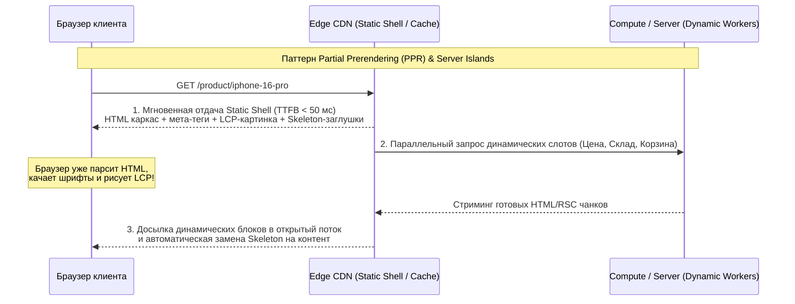
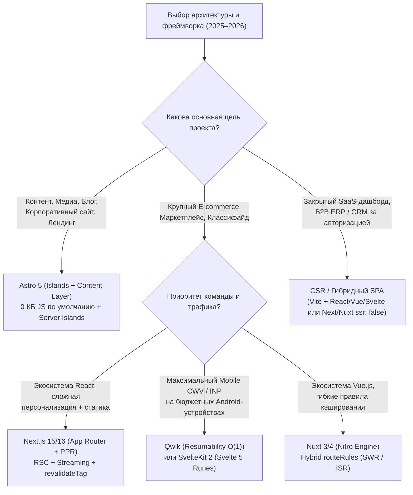

# Архитектуры Рендеринга и Сравнительный Анализ Фреймворков (2025–2026)

> [!IMPORTANT]
> **Ключевой вектор развития веб-архитектуры (2025–2026):** Индустрия окончательно отказалась от монолитного клиентского рендеринга (CSR SPA) для публичных страниц и от блокирующего полностраничного гидрирования (Full-Page Hydration). Стандартом де-факто стали **гибридная потоковая отдача (SSR Streaming)**, **Partial Prerendering (PPR)**, **островная архитектура (Islands / Server Islands)** и **Zero-JS по умолчанию** с выполнением логики на границе сети (**Edge Rendering**).

---

## Содержание

1. [Эволюция паттернов рендеринга (2025–2026)](#1-эволюция-паттернов-рендеринга-20252026)
2. [Визуализация современных конвейеров рендеринга](#2-визуализация-современных-конвейеров-рендеринга)
3. [Сравнительная матрица архитектур рендеринга](#3-сравнительная-матрица-архитектур-рендеринга)
4. [Глубокий технический аудит фреймворков (2025–2026)](#4-глубокий-технический-аудит-фреймворков-20252026)
5. [Примеры эталонных конфигураций и кода](#5-примеры-эталонных-конфигураций-и-кода)
6. [Алгоритм выбора технологического стека под тип проекта](#6-алгоритм-выбора-технологического-стека-под-тип-проекта)
7. [Чек-лист архитектурного аудита рендеринга](#7-чек-лист-архитектурного-аудита-рендеринга)

---

## 1. Эволюция паттернов рендеринга (2025–2026)

### 1.1. SSR Streaming (Потоковый серверный рендеринг)
В классическом SSR сервер ждет завершения самого медленного запроса к БД, прежде чем отправить первый байт (`TTFB`). **SSR Streaming** (поверх HTTP/2 и HTTP/3 потоков) немедленно отправляет браузеру `<head>` и статический каркас страницы (`TTFB < 100 мс`), что позволяет браузеру сразу начать загрузку CSS и LCP-изображения. Медленные блоки оборачиваются в `<Suspense>` и досылаются в тот же открытый HTTP-поток по мере готовности, встраиваясь в DOM без блокировки интерфейса.

### 1.2. ISR (Incremental Static Regeneration) и On-Demand Revalidation
Позволяет сочетать скорость статики (SSG) с актуальностью данных для каталогов из сотен тысяч страниц. В 2025–2026 годах стандартом является **инвалидация по тегам (`revalidateTag`)** через вебхуки из Headless CMS или ERP: при изменении цены товара сбрасывается кэш только конкретных затронутых маршрутов и компонентов.

### 1.3. Partial Prerendering (PPR — Частичный пререндеринг)
Архитектурный паттерн (внедрен в **Next.js 15/16**), устраняющий дилемму «статический или динамический маршрут». Во время сборки (или первого запроса) генерируется **статическая HTML-оболочка (Static Shell)**, которая кэшируется на Edge CDN. Динамические персонализированные блоки (корзина, блок «Для вас», актуальный остаток на складе) размечаются границами `<Suspense>`. При запросе пользователя Edge-узел **за миллисекунды** отдает статическую оболочку и параллельно в том же HTTP-ответе стримит динамические фрагменты.

### 1.4. Islands Architecture и Server Islands (Островная архитектура)
Паттерн, популяризированный **Astro**: вся страница рендерится в чистый HTML и CSS (**$0\text{ КБ}$ клиентского JS по умолчанию**). Интерактивные компоненты (карусель, калькулятор, кнопка покупки) изолируются в независимые «острова», которые гидрируются асинхронно (при простое потока `client:idle` или при появлении во вьюпорте `client:visible`).
В **Astro 5** добавлены **Server Islands (`server:defer`)** — серверный аналог PPR, позволяющий кэшировать основную страницу на CDN, а персонализированные серверные острова подгружать асинхронно.

### 1.5. Resumability (Возобновляемость в Qwik)
В отличие от гидратации (Hydration), где браузер вынужден заново скачать и выполнить весь JS-код компонентов, чтобы восстановить обработчики событий и дерево состояния ($O(N)$ от сложности страницы), **Resumability** сериализует состояние приложения, реактивный граф и привязки слушателей прямо в HTML-атрибуты на сервере. На клиенте загружается крошечный загрузчик (~1 КБ), а код конкретного обработчика скачивается только в момент реального клика (**сложность инициализации $O(1)$**).

### 1.6. Edge Rendering
Выполнение серверного рендеринга, роутинга, A/B-тестирования и проверки авторизации на распределенных узлах CDN (Cloudflare Workers, Vercel Edge, Deno Deploy) в непосредственной географической близости от пользователя ($10 - 40\text{ мс}$ сетевой задержки). Использует легковесные среды выполнения на базе **V8 Isolates** вместо тяжелых контейнеров, обеспечивая нулевой холодный старт ($< 5\text{ мс}$).

---

## 2. Визуализация современных конвейеров рендеринга



---

## 3. Сравнительная матрица архитектур рендеринга

| Архитектура | TTFB | LCP | INP (Нагрузка на CPU клиента) | Актуальность данных | Индексация (SEO & AI-боты) | Идеальная область применения |
| :--- | :--- | :--- | :--- | :--- | :--- | :--- |
| **CSR (SPA)** | Быстрый (пустой HTML) | ❌ Плохой ($> 3.5\text{ с}$) | ❌ Плохой (тяжелый бандл) | В реальном времени | ⚠️ Зависит от JS-рендера бота | Закрытые B2B-кабинеты, SaaS-дашборды за логином |
| **SSG (Статика)** | ✅ Идеальный ($< 50\text{ мс}$) | ✅ Идеальный | ✅ Зависит от фреймворка | Обновление при пересборке | ✅ Эталонная | Документация, лендинги, небольшие корпоративные сайты |
| **ISR (Инкрементальная статика)** | ✅ Идеальный ($< 60\text{ мс}$) | ✅ Идеальный | ✅ Высокий | По таймеру или вебхуку (`revalidateTag`) | ✅ Эталонная | Крупные каталоги E-commerce, порталы недвижимости, СМИ |
| **SSR Streaming** | ✅ Быстрый ($100-250\text{ мс}$) | ✅ Высокий | ⚠️ Зависит от объема гидратации | В реальном времени на каждый запрос | ✅ Эталонная | Динамические маркетплейсы, поиск с фильтрами, фиды |
| **PPR / Server Islands** | ✅ Идеальный ($< 50\text{ мс}$) | ✅ Идеальный | ✅ Высокий (только острова) | Статика мгновенно + динамика в реальном времени | ✅ Эталонная | Высоконагруженный E-commerce с персонализацией |
| **Islands (Astro)** | ✅ Идеальный ($< 50\text{ мс}$) | ✅ Идеальный | ✅ Эталонный ($0\text{ КБ}$ JS базово) | Статика или SSR/Server Islands | ✅ Эталонная | Контентные проекты, медиа, блоги, витрины, маркетинг |
| **Resumability (Qwik)** | ✅ Быстрый ($100-200\text{ мс}$) | ✅ Идеальный | ✅ Эталонный ($O(1)$ без гидратации) | В реальном времени | ✅ Эталонная | Сложные интерактивные витрины на бюджетных смартфонах |

---

## 4. Глубокий технический аудит фреймворков (2025–2026)

| Характеристика | Next.js 15 / 16 (App Router) | Astro 5 | Nuxt 3 / 4 (Nitro Engine) | SvelteKit 2 + Svelte 5 | Qwik + Qwik City |
| :--- | :--- | :--- | :--- | :--- | :--- |
| **Базовая парадигма** | React Server Components (RSC) + PPR | Islands Architecture + Server Islands | Универсальный Vue SSR + Hybrid Route Rules | Компилятор реактивности (**Runes**) без Virtual DOM | **Resumability** ($O(1)$ загрузка без гидратации) |
| **Базовый JS-бандл (Hello World)** | ~85–95 КБ (gzip) | **0 КБ** (если нет клиентских островов) | ~55–65 КБ (gzip) | **~15–22 КБ** (gzip) | **~1–2 КБ** (загрузчик Qwikloader) |
| **Механизм гидратации** | Селективная гидратация только `'use client'` компонентов | Частичная по директивам (`client:load`, `client:visible`, `client:idle`) | Полностраничная или ленивая гидратация компонентов (`LazyHydration`) | Очень быстрая за счет отсутствия VDOM и тонких сигналов Svelte 5 | **Отсутствует** (сериализация слушателей и состояния в HTML) |
| **Кэширование по умолчанию** | В Next.js 15+ `fetch` и Route Handlers **не кэшируются по умолчанию** (`uncached` by default), явная директива `'use cache'` | Статика по умолчанию (`output: 'static'`), опциональный SSR и `server:defer` | Гибкая настройка на уровне URL-масок через `routeRules` в `nuxt.config.ts` | Явное управление через HTTP-заголовки и `prerender = true` | SSR по умолчанию с тонким контролем кэша на уровне маршрута |
| **Потенциал INP (Mobile p75)** | Средний / Высокий (требует дисциплины с `'use client'`) | **Максимальный** | Высокий | **Максимальный** | **Максимальный** |

---

## 5. Примеры эталонных конфигураций и кода

### 5.1. Next.js 15/16: Partial Prerendering (PPR) и декларативное кэширование (`use cache`)

В Next.js 15/16 запросы `fetch` больше не кэшируются неявно. Для включения PPR и гибридного кэширования используется комбинация статического каркаса и `<Suspense>`:

```tsx
// app/products/[slug]/page.tsx
import { Suspense } from 'react';
import { unstable_cacheTag as cacheTag } from 'next/cache';
import { DynamicPriceAndCart, CartSkeleton } from '@/components/product-cart';

// Включение экспериментального / стабильного PPR для маршрута
export const experimental_ppr = true;

// Серверная функция с явным кэшированием и привязкой тега инвалидации
async function getProductStaticDetails(slug: string) {
  'use cache';
  cacheTag(`product-details-${slug}`);
  const res = await fetch(`https://api.example.com/v1/products/${slug}`);
  return res.json();
}

export default async function ProductPage({ params }: { params: Promise<{ slug: string }> }) {
  const { slug } = await params;
  // 1. Этот блок попадает в Static Shell на этапе билда и отдается с CDN мгновенно
  const product = await getProductStaticDetails(slug);

  return (
    <main className="product-layout">
      <h1>{product.title}</h1>
      
      <p>{product.description}</p>

      {/* 2. Динамический слот: при запросе мгновенно отдается CartSkeleton, 
          а реальная цена и остатки досылаются потоком (Streaming) */}
      <Suspense fallback={<CartSkeleton />}>
        <DynamicPriceAndCart productId={product.id} />
      </Suspense>
    </main>
  );
}
```

### 5.2. Astro 5: Сочетание Client Islands и Server Islands (`server:defer`)

В Astro 5 статическая страница кэшируется на CDN, интерактивная галерея гидрируется только когда пользователь доскроллит до нее, а персональная скидка рендерится на сервере асинхронно:

```astro
---
// src/pages/catalog/[id].astro
import Layout from '../../layouts/Layout.astro';
import ProductGallery from '../../components/ProductGallery.tsx';
import PersonalizedOffer from '../../components/PersonalizedOffer.astro';

const { id } = Astro.params;
const product = await fetch(`https://api.example.com/products/${id}`).then((r) => r.json());
---

<Layout title={product.name}>
  <!-- Чистый HTML без единого байта JS -->
  <article class="product-card">
    <h1>{product.name}</h1>

    <!-- Клиентский остров (React): гидрируется только при простое браузера -->
    <ProductGallery images={product.images} client:idle />

    <!-- Серверный остров (Astro 5): страница кэшируется на CDN, 
         а этот блок подгружается с сервера с учетом cookies пользователя -->
    <PersonalizedOffer productId={id} server:defer>
      <div slot="fallback" class="offer-skeleton">Расчет персональной скидки...</div>
    </PersonalizedOffer>
  </article>
</Layout>
```

### 5.3. Nuxt 3 / 4 (Nitro Engine): Гибридная маршрутизация через `routeRules`

Движок **Nitro** в Nuxt позволяет комбинировать SSG, ISR, SWR и CSR в одном конфигурационном файле без изменения кода компонентов:

```typescript
// nuxt.config.ts
export default defineNuxtConfig({
  routeRules: {
    // 1. Главная и маркетинговые страницы: пререндер в чистую статику при билде
    '/': { prerender: true },
    '/about': { prerender: true },

    // 2. Каталог товаров: ISR / SWR — кэш на 1 час, фоновое обновление
    '/catalog/**': { swr: 3600 },

    // 3. Статьи блога: ISR на CDN
    '/blog/**': { isr: 86400 },

    // 4. Личный кабинет и админка: отключаем SSR, рендерим как CSR SPA
    '/account/**': { ssr: false },

    // 5. Заголовки безопасности и CORS для API
    '/api/v1/**': { cors: true, headers: { 'Cache-Control': 'max-age=60, s-maxage=300' } }
  }
});
```

### 5.4. Svelte 5 + SvelteKit 2: Тонкая реактивность на рунах (`$state`, `$derived`)

В Svelte 5 компилятор использует сигналы (Runes), что полностью избавляет от накладных расходов Virtual DOM и минимизирует время обработки событий (`Processing Time` в метрике INP):

```svelte
<script lang="ts">
  // Svelte 5 Runes: точечное обновление DOM без перерисовки дерева компонентов
  let quantity = $state(1);
  let unitPrice = $state(4900);
  let total = $derived(quantity * unitPrice);

  function increment() {
    quantity += 1;
  }
</script>

<div class="checkout-widget">
  <button onclick={increment} type="button">
    Добавить ({quantity} шт.)
  </button>
  <output>Итого: {total} ₽</output>
</div>
```

---

## 6. Алгоритм выбора технологического стека под тип проекта



---

## 7. Чек-лист архитектурного аудита рендеринга

- [ ] **Отсутствие CSR на индексируемых страницах:** Все целевые страницы выдают полный HTML-контент, заголовки `<h1>`–`<h3>`, микроразметку JSON-LD и канонические ссылки в первичном ответе сервера без необходимости выполнения JS.
- [ ] **Контроль границы `'use client'` (для React/Next.js):** Директива `'use client'` вынесена на самый нижний листовой уровень дерева компонентов (кнопки, инпуты, слайдеры), а не размещена на уровне `page.tsx` или корневого `layout.tsx`.
- [ ] **Отсутствие сериализационного раздувания (RSC Payload / Hydration Bloat):** В `window.__NEXT_DATA__`, `__NUXT__` или RSC-потоке передаются только те поля DTO, которые реально отображаются в шаблоне, а не сырые ответы БД из 50+ полей.
- [ ] **Неблокирующий TTFB:** Медленные некритичные запросы (рекомендации, отзывы, блок «С этим покупают») обернуты в `<Suspense>` (SSR Streaming) или вынесены в `server:defer` (Server Islands).
- [ ] **Кэширование на уровне Edge / ISR:** Для карточек товаров и статей настроена стратегия `stale-while-revalidate` и точечный сброс кэша по вебхуку (`revalidateTag`), чтобы боты и пользователи получали ответ из кэша за $< 60\text{ мс}$.

---

## Ссылки на официальные спецификации и документацию

1. **Next.js 15/16 Documentation — Partial Prerendering (PPR) & Caching (`use cache`):** `https://nextjs.org/docs/app/building-your-application/rendering/partial-prerendering`
2. **Astro 5 Documentation — Islands Architecture & Server Islands (`server:defer`):** `https://docs.astro.build/en/concepts/islands/`
3. **Qwik Documentation — Resumability vs. Hydration:** `https://qwik.dev/docs/concepts/resumable/`
4. **Svelte 5 Documentation — Runes Reactivity System:** `https://svelte.dev/docs/svelte/what-are-runes`
5. **Nuxt Nitro Engine — Hybrid Rendering & Route Rules:** `https://nuxt.com/docs/guide/concepts/rendering#hybrid-rendering`
