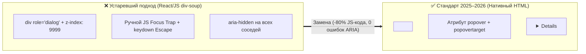

# Полное руководство по веб-доступности: стандарт W3C WCAG 2.2, EAA 2025, семантический HTML и контрастность APCA

> [!IMPORTANT]
> **Ключевой сдвиг 2025–2026 годов:** С **28 июня 2025 года** вступил в полную юридическую силу **European Accessibility Act (EAA — Директива ЕС 2019/882)**. Теперь соблюдение стандарта **WCAG 2.1 / 2.2 Level AA** (через гармонизированный стандарт EN 301 549) является обязательным законом для всех коммерческих цифровых продуктов (e-commerce, банкинг, SaaS, билетные сервисы, медиа), работающих с резидентами ЕС, под угрозой крупных оборотных штрафов и блокировки продаж. Параллельно в США в 2024–2026 гг. Министерство юстиции (DOJ) закрепило обязательность WCAG 2.1/2.2 Level AA в рамках ADA Title II и Title III.

---

## Оглавление

1. [Юридический комплаенс и бизнес-риски (EAA 2025, ADA, EN 301 549)](#1-юридический-комплаенс-и-бизнес-риски-eaa-2025-ada-en-301-549)
2. [Реальная статистика ошибок: отчет WebAIM Million (2025–2026)](#2-реальная-статистика-ошибок-отчет-webaim-million-20252026)
   - [Топ-6 критических ошибок интернета](#топ-6-критических-ошибок-интернета)
   - [Парадокс ARIA: почему избыточный ARIA ломает доступность](#парадокс-aria-почему-избыточный-aria-ломает-доступность)
3. [Детальный разбор изменений в стандарте W3C WCAG 2.2](#3-детальный-разбор-изменений-в-стандарте-w3c-wcag-22)
   - [Удаление устаревшего критерия 4.1.1 Parsing](#удаление-устаревшего-критерия-411-parsing)
   - [Новые критерии уровней A, AA и AAA: сводная таблица](#новые-критерии-уровней-a-aa-и-aaa-сводная-таблица)
   - [Практическая реализация новых критериев WCAG 2.2 в HTML и CSS](#практическая-реализация-новых-критериев-wcag-22-в-html-и-css)
4. [Нативный семантический HTML вместо «костылей» ARIA](#4-нативный-семантический-html-вместо-костылей-aria)
   - [Модальные окна: `<dialog>` + `inert`](#модальные-окна-dialog--inert)
   - [Поповеры и тултипы: нативный атрибут `popover`](#поповеры-и-тултипы-нативный-атрибут-popover)
   - [Аккордеоны: `<details>` и эксклюзивные группы `name`](#аккордеоны-details-и-эксклюзивные-группы-name)
5. [Математика цветового контраста: WCAG 2.x (4.5:1) против алгоритма APCA ($L_c$)](#5-математика-цветового-контраста-wcag-2x-451-против-алгоритма-apca-l_c)
6. [Чек-лист аудита доступности (WCAG 2.2 Level AA)](#6-чек-лист-аудита-доступности-wcag-22-level-aa)
7. [Источники и стандарты](#7-источники-и-стандарты)

---

## 1. Юридический комплаенс и бизнес-риски (EAA 2025, ADA, EN 301 549)

Веб-доступность (a11y) перестала быть добровольной КСО-инициативой. Кроме того, дерево доступности (**Accessibility Tree / AOM**), которое браузер строит для скринридеров (NVDA, JAWS, VoiceOver), напрямую используется **ИИ-агентами и поисковыми краулерами** для семантического понимания интерфейса.

| Юрисдикция / Закон | Статус в 2025–2026 гг. | Технический эталон | Кого касается |
| :--- | :--- | :--- | :--- |
| **Евросоюз: EAA (Directive 2019/882)** | Вступил в силу **28 июня 2025 г.** | **EN 301 549** (базируется на **WCAG 2.1 / 2.2 Level AA**) | Любой бизнес (включая компании вне ЕС), продающий товары/услуги потребителям в странах ЕС (E-commerce, FinTech, SaaS, транспорт, книги). |
| **США: ADA Title II & III** | Обязателен (правило DOJ от апреля 2024 с дедлайнами 2026 г.) | **WCAG 2.1 / 2.2 Level AA** | Государственные, муниципальные сервисы и любой частный бизнес («places of public accommodation»), доступный гражданам США. |
| **Великобритания: Equality Act 2010 / PSBAR** | С октября 2024 г. мониторинг переведен на **WCAG 2.2 AA** | **WCAG 2.2 Level AA** | Государственный сектор и коммерческие сервисы Великобритании. |
| **РФ: ГОСТ Р 52872-2019** | Действует (обязателен для госсектора, банков и социально значимых ресурсов) | Гармонизирован с **WCAG 2.1 AA** | Госсайты, банки (требования ЦБ РФ по доступности финансовых услуг), крупные экосистемы. |

---

## 2. Реальная статистика ошибок: отчет WebAIM Million (2025–2026)

Ежегодное исследование **WebAIM Million** анализирует домашние страницы 1 000 000 самых посещаемых сайтов мира с помощью движка WAVE. Данные за 2025–2026 годы показывают тревожную картину: усложнение фронтенд-фреймворков и бесконтрольная генерация UI-кода приводят к сохранению высокого процента базовых ошибок.

- **Доля сайтов с обнаруженными ошибками WCAG:** **94.8%** (отчет 2025 г.) $\rightarrow$ **95.9%** (отчет 2026 г.).
- **Среднее количество ошибок на одну страницу:** **51.0** (2025 г.) $\rightarrow$ **56.1 ошибки** (2026 г.).
- **Средняя сложность DOM домашней страницы:** выросла с **1 257** до **1 437 элементов** (+22.5% за период), что напрямую коррелирует с ростом ошибок.

### Топ-6 критических ошибок интернета

Более **96% всех автоматически обнаруживаемых ошибок** в мире приходятся всего на 6 базовых проблем верстки:

| Ранг | Категория ошибки (WCAG Failure) | Доля сайтов (2025) | Доля сайтов (2026) | Нарушаемый критерий WCAG |
| :---: | :--- | :---: | :---: | :--- |
| **1** | **Низкий контраст текста (Low contrast text)** | **79.1%** | **83.9%** | 1.4.3 Contrast (Minimum) — Level AA |
| **2** | **Отсутствие `alt`-текста у изображений** | **55.5%** | **53.1%** | 1.1.1 Non-text Content — Level A |
| **3** | **Поля форм без связанных `<label>`** | **48.2%** | **51.0%** | 1.3.1 Info and Relationships / 3.3.2 Labels |
| **4** | **Пустые ссылки (без текста или `aria-label`)** | **45.4%** | **46.3%** | 2.4.4 Link Purpose (In Context) — Level A |
| **5** | **Пустые кнопки (иконки без доступного имени)** | **29.5%** | **30.6%** | 4.1.2 Name, Role, Value — Level A |
| **6** | **Отсутствие атрибута языка `<html lang="...">`** | **15.8%** | **13.5%** | 3.1.1 Language of Page — Level A |

---

### Парадокс ARIA: почему избыточный ARIA ломает доступность

Первый закон использования ARIA от W3C гласит: **«Если вы можете использовать нативный HTML-элемент или атрибут с нужной семантикой и поведением — используйте его вместо добавления ролей и состояний ARIA»** (*No ARIA is better than Bad ARIA*).

> [!WARNING]
> **Факт из WebAIM Million:** На страницах, где активно используются атрибуты ARIA, фиксируется **на 41% – 68% больше ошибок доступности**, чем на страницах без ARIA. Разработчики добавляют `role="button"` или `aria-expanded` на `<div>`, но забывают реализовать навигацию с клавиатуры (`tabindex="0"`, обработку клавиш `Enter` и `Space`, синхронизацию состояний). В результате скринридер объявляет пользователю интерактивный элемент, с которым физически невозможно взаимодействовать.

---

## 3. Детальный разбор изменений в стандарте W3C WCAG 2.2

Стандарт **WCAG 2.2** (официальная рекомендация W3C) полностью обратно совместим с WCAG 2.1, но вносит одно структурное удаление и **9 новых критериев успеха** (из которых 6 относятся к обязательным уровням **A и AA**).

### Удаление устаревшего критерия 4.1.1 Parsing

Критерий **4.1.1 Parsing (Level A)** официально **удален и признан устаревшим (Obsolete and Removed)** в WCAG 2.2.
- **Причина:** В начале 2000-х годов скринридеры самостоятельно парсили сырой HTML-код и ломались от незакрытых тегов или дублирующихся `id`. Сегодня спецификация **HTML5 Living Standard** жестко стандартизировала алгоритмы обработки ошибок парсинга непосредственно внутри браузерного движка (Blink, WebKit, Gecko), а скринридеры читают уже выстроенное браузером дерево доступности. Любые реальные проблемы от дублирования `id` (например, сломанная связь `<label for="id">`) уже покрываются критериями **1.3.1 (Info and Relationships)** и **4.1.2 (Name, Role, Value)**.

---

### Новые критерии уровней A, AA и AAA: сводная таблица

| Код критерия | Название критерия | Уровень | Кому критично | Суть требования |
| :--- | :--- | :---: | :--- | :--- |
| **2.4.11** | **Focus Not Obscured (Minimum)** | **AA** | Клавиатурная навигация, моторные нарушения | Элемент, получивший фокус клавиатуры (`:focus-visible`), **не должен быть полностью перекрыт** авторским контентом (липкими шапками `position: sticky/fixed`, футерами, баннерами cookie). |
| **2.4.12** | Focus Not Obscured (Enhanced) | AAA | Клавиатурная навигация | Фокусируемый элемент не должен перекрываться липкими панелями **ни на один пиксель**. |
| **2.4.13** | **Focus Appearance** | **AAA** *(Best Practice)* | Слабовидящие, моторные нарушения | Рамка фокуса должна иметь толщину минимум **2 CSS px** по периметру и контраст минимум **3:1** между состояниями «в фокусе» и «без фокуса». |
| **2.5.7** | **Dragging Movements** | **AA** | Тремор рук, пользователи трекболов, айтрекеров и голосового ввода | Любое действие, требующее перетаскивания (drag-and-drop списков, ползунки цен, перемещение по карте), **обязано иметь альтернативу одиночным кликом/тапом** (кнопки «Вверх/Вниз», поле ввода числа). |
| **2.5.8** | **Target Size (Minimum)** | **AA** | Моторные нарушения, пользователи смартфонов на ходу | Размер интерактивной мишени должен быть не менее **24×24 CSS px** (или иметь вокруг себя пустое пространство, чтобы круг диаметром 24px с центром в мишени не пересекал другие мишени). |
| **3.2.6** | **Consistent Help** | **A** | Когнитивные расстройства, тревожность | Если на сайте есть механизмы помощи (телефон, email, чат поддержки, ссылка на FAQ), они должны находиться **в одном и том же относительном месте** в DOM на всех страницах. |
| **3.3.7** | **Redundant Entry** | **A** | Когнитивная усталость, нарушения памяти и моторики | Информация, уже введенная пользователем в рамках текущей сессии/процесса, **не должна запрашиваться повторно** (обязательно автозаполнение или чекбокс «Адрес доставки совпадает с платежным»). |
| **3.3.8** | **Accessible Authentication (Minimum)** | **AA** | Дислексия, расстройства памяти, деменция | Запрещено требовать прохождения **когнитивного теста** при входе (запоминание пароля по памяти, решение пазлов/ребусов). Обязательно разрешить вставку пароля (`paste`), работу менеджеров паролей (`autocomplete="current-password"`) или вход по Passkeys / WebAuthn / Magic Link. |
| **3.3.9** | Accessible Authentication (Enhanced) | AAA | Когнитивные нарушения | Запрещены даже CAPTCHA с распознаванием объектов на картинках («Выберите все светофоры»). |

---

### Практическая реализация новых критериев WCAG 2.2 в HTML и CSS

#### 1. Решение для 2.4.11 Focus Not Obscured и 2.4.13 Focus Appearance
Частая проблема современных лендингов и интернет-магазинов: при нажатии `Tab` страница прокручивается к кнопке или ссылке, но она оказывается спрятанной прямо под фиксированной верхней шапкой (`header { position: sticky; height: 80px; }`).

```css
:root {
  --sticky-header-height: 5rem; /* 80px */
  --sticky-bottom-bar: 4rem;    /* 64px на мобильных */
}

/* 1. Защита от перекрытия липкими шапками и подвалами (WCAG 2.4.11 AA) */
html {
  scroll-padding-top: calc(var(--sticky-header-height) + 1.5rem);
  scroll-padding-bottom: calc(var(--sticky-bottom-bar) + 1.5rem);
}

/* 2. Идеальный двухцветный индикатор фокуса, видимый на ЛЮБОМ фоне (WCAG 2.4.13) */
:focus-visible {
  outline: 3px solid #005fcc;
  outline-offset: 2px;
  /* Внутренняя белая тень гарантирует контраст > 3:1 даже на темно-синем фоне */
  box-shadow: 0 0 0 2px #ffffff;
  border-radius: 4px;
}
```

#### 2. Решение для 2.5.7 Dragging Movements (Ползунок фильтра цены)
Если у вас есть двойной ползунок выбора диапазона цены (Range Slider), вы **обязаны** рядом с ним вывести два обычных числовых поля `<input type="number">` («От» и «До»), синхронизированных с ползунком, чтобы пользователь без функции перетаскивания мог просто кликнуть и ввести сумму.

#### 3. Решение для 3.3.8 Accessible Authentication (Доступный вход без блокировки менеджеров паролей)
Никогда не блокируйте событие `onpaste` на полях пароля и одноразовых кодов (OTP).

```html
<!-- ✅ ПРАВИЛЬНО: Доступная форма входа по стандарту WCAG 2.2 (3.3.8 AA) -->
<form action="/auth/login" method="POST">
  <div class="form-group">
    <label for="user-email">Электронная почта</label>
    <input
      id="user-email"
      name="email"
      type="email"
      autocomplete="username"
      inputmode="email"
      required
    />
  </div>

  <div class="form-group">
    <label for="user-password">Пароль</label>
    <!-- Разрешена вставка из буфера, автозаполнение менеджером паролей и Passkeys (webauthn) -->
    <input
      id="user-password"
      name="password"
      type="password"
      autocomplete="current-password webauthn"
      required
    />
  </div>

  <button type="submit" class="btn-primary">Войти в аккаунт</button>
</form>
```

---

## 4. Нативный семантический HTML вместо «костылей» ARIA

В 2025–2026 годах все современные браузеры (Baseline Widely Available) поддерживают нативные интерактивные компоненты, которые берут на себя управление фокусом (`Focus Trap`), выход по клавише `Escape`, вывод в `Top Layer` (поверх любых `z-index`) и озвучивание для скринридеров.



### Модальные окна: `<dialog>` + `inert`

При вызове метода `.showModal()` браузер автоматически:
1. Помещает окно в специальный верхний слой браузера (`#top-layer`), перекрывая любые элементы без войн с `z-index`.
2. Делает весь остальной документ инертным (`inert`) — фокус клавиатуры и скринридер не могут случайно уйти на фоновую страницу.
3. Закрывает окно по нажатию `Escape` и возвращает фокус ровно на ту кнопку, которая его открыла!

```html
<button type="button" onclick="document.getElementById('CallbackModal').showModal()">
  Заказать звонок
</button>

<dialog id="CallbackModal" aria-labelledby="modal-title">
  <h2 id="modal-title">Обратный звонок</h2>
  <p>Оставьте номер, и мы перезвоним за 2 минуты.</p>
  
  <!-- method="dialog" автоматически закрывает модалку при отправке без JS -->
  <form method="dialog">
    <label for="phone-input">Ваш телефон</label>
    <input id="phone-input" type="tel" autocomplete="tel" required />
    
    <div class="dialog-actions">
      <button type="submit" value="confirm">Отправить</button>
      <button type="button" onclick="this.closest('dialog').close()">Отмена</button>
    </div>
  </form>
</dialog>
```

### Поповеры и тултипы: нативный атрибут `popover`

Для выпадающих меню, уведомлений, фильтров и тултипов, которые не должны намертво блокировать страницу (в отличие от модального `<dialog>`), используется нативный **Popover API** вообще без JavaScript:

```html
<!-- Кнопка автоматически связывается с поповером и получает правильную ARIA-семантику -->
<button type="button" popovertarget="cart-preview-popover">
  Корзина (3)
</button>

<!-- Поповер рендерится в Top Layer, закрывается по клику вне области (light dismiss) и по Esc -->
<div id="cart-preview-popover" popover="auto" class="cart-popover">
  <h3>Ваши товары</h3>
  <ul>
    <li>Смартфон X — 1 шт.</li>
  </ul>
  <a href="/checkout" class="btn-checkout">Перейти к оформлению</a>
</div>
```

### Аккордеоны: `<details>` и эксклюзивные группы `name`

Добавление одинакового атрибута `name` нескольким элементам `<details>` превращает их в **эксклюзивный аккордеон** (при открытии одного пункта предыдущий автоматически закрывается — аналогично радиокнопкам) без единой строчки JS:

```html
<section aria-label="Частые вопросы">
  <details name="shipping-faq" open>
    <summary>Сколько стоит экспресс-доставка?</summary>
    <p>При заказе от 3 000 ₽ экспресс-доставка бесплатна. Для остальных заказов — 290 ₽.</p>
  </details>

  <details name="shipping-faq">
    <summary>Как оформить возврат товара?</summary>
    <p>Возврат оформляется в личном кабинете в течение 30 дней без заполнения бумажных заявлений.</p>
  </details>
</section>
```

---

## 5. Математика цветового контраста: WCAG 2.x (4.5:1) против алгоритма APCA ($L_c$)

В текущем юридическом стандарте **WCAG 2.1 / 2.2** контрастность рассчитывается через отношение относительной яркости (Relative Luminance) двух цветов по формуле:

$$CR = \frac{L_1 + 0.05}{L_2 + 0.05}$$

### Нормативы WCAG 2.2 (юридически обязательные)
- **Обычный текст (< 18pt / 24px или < 14pt / 18.66px bold):** минимум **4.5 : 1** (Level AA), **7 : 1** (Level AAA).
- **Крупный текст ($\ge$ 24px или $\ge$ 18.66px bold):** минимум **3.0 : 1** (Level AA), **4.5 : 1** (Level AAA).
- **Нетекстовые элементы UI (рамки инпутов, иконки, графики — критерий 1.4.11):** минимум **3.0 : 1** относительно соседнего фона.

### Почему WCAG 2.x ошибается на темных темах и как работает APCA ($L_c$)
Математика WCAG 2.x не учитывает:
1. **Полярность (Dark Mode vs Light Mode):** Человеческий глаз адаптируется к свечению фона. Белый текст на средне-оранжевом или синем кнопке отлично читается глазом, но часто проваливает тест 4.5:1 в WCAG 2.x. Напротив, в темной теме (Dark Mode) формула WCAG 2.x иногда разрешает комбинации темно-серого текста на черном фоне, которые в реальности нечитаемы.
2. **Пространственную частоту шрифта (Spatial Frequency):** Тонкий шрифт (`font-weight: 300`) размером `16px` требует гораздо более высокого контраста, чем жирный (`font-weight: 700`) того же размера.

Именно поэтому для грядущего стандарта WCAG 3.0 и современного проектирования дизайн-систем разработан перцептивный алгоритм **APCA (Accessible Perceptual Contrast Algorithm)**, измеряющий контраст в единицах **$L_c$ (Lightness Contrast от 0 до $\pm 108$)**.

| Назначение текста | Требование WCAG 2.2 (Обязательный комплаенс) | Рекомендация APCA ($L_c$ — Перцептивный стандарт) | Примечание по шрифту |
| :--- | :---: | :---: | :--- |
| **Основной текст статьи (Body Copy)** | $\ge 4.5 : 1$ | **$L_c \ge 75$** (идеал $L_c \ge 90$) | `16px–18px`, `font-weight: 400` |
| **Вторичный контент, карточки, меню** | $\ge 4.5 : 1$ | **$L_c \ge 60$** | Минимум `16px` при `weight 400` или `14px` при `weight 600` |
| **Крупные заголовки (Headings > 24px bold)** | $\ge 3.0 : 1$ | **$L_c \ge 45$** | Крупные глифы с высокой площадью штриха |
| **Нетекстовые UI-контролы, плейсхолдеры (если не несут важной инфо), иконки** | $\ge 3.0 : 1$ | **$L_c \ge 30$** | Для важных подписей инпутов используйте $L_c \ge 60$ |

> [!TIP]
> **Стратегия двух ключей в 2026 году:** Для прохождения юридических проверок (EAA / ADA) и автоматических сканеров (Lighthouse, Axe, WAVE) ваши цвета обязаны проходить порог **4.5:1 / 3:1 по WCAG 2.2**. При этом для проектирования **Dark Mode** и подбора толщины шрифтов проверяйте палитру по **APCA ($L_c \ge 60..75$)**, избегая чисто белого текста (`#FFFFFF`) на чисто черном фоне (`#000000`), который вызывает эффект галяции (размытия букв) у людей с астигматизмом. Используйте `#F1F5F9` на `#0F172A`.

---

## 6. Чек-лист аудита доступности (WCAG 2.2 Level AA)

- [ ] **Контрастность:** Весь обычный текст имеет контраст $\ge 4.5:1$ ($L_c \ge 60..75$), крупный текст и рамки полей ввода — $\ge 3.0:1$.
- [ ] **Клавиатурная навигация и фокус (2.4.7, 2.4.11, 2.4.13):** Весь функционал сайта доступен по клавишам `Tab`, `Shift+Tab`, `Enter`, `Space`, `Escape` и стрелкам. Индикатор `:focus-visible` имеет толщину $\ge 2\text{px}$ и не перекрывается липкими шапками (`scroll-padding-top`).
- [ ] **Размер целей (2.5.8):** Ни один интерактивный элемент не имеет области клика меньше `24×24 CSS px`.
- [ ] **Альтернатива перетаскиванию (2.5.7):** Все слайдеры диапазонов, канбан-доски и карты имеют кнопки или поля ввода для работы одиночным кликом.
- [ ] **Доступная аутентификация (3.3.8):** Вход в аккаунт не блокирует `paste`, поддерживает менеджеры паролей (`autocomplete="current-password"`) или Passkeys / Magic Links.
- [ ] **Отсутствие повторного ввода (3.3.7):** На многошаговых формах данные переносятся автоматически между шагами.
- [ ] **Единообразие помощи (3.2.6):** Контакты и виджет поддержки находятся на одном и том же месте в структуре всех страниц.
- [ ] **Семантика форм и иконок:** У каждого `<input>` есть явно связанный `<label for="...">`; у всех кнопок-иконок (лупа, корзина, крестик) задан понятный `aria-label` или скрытый текст `.visually-hidden`.
- [ ] **Нативные компоненты:** Модальные окна реализованы через `<dialog>`, выпадающие списки/поповеры — через `popover`, аккордеоны — через `<details>`.

---

## 7. Источники и стандарты

1. **W3C Recommendation** — *Web Content Accessibility Guidelines (WCAG) 2.2* — [w3.org/TR/WCAG22/](https://www.w3.org/TR/WCAG22/)
2. **W3C WAI** — *What's New in WCAG 2.2 (Official Guide)* — [w3.org/WAI/standards-guidelines/wcag/new-in-22/](https://www.w3.org/WAI/standards-guidelines/wcag/new-in-22/)
3. **WebAIM** — *The WebAIM Million (2025 & 2026 Annual Accessibility Reports on the Top 1,000,000 Home Pages)* — [webaim.org/projects/million/](https://webaim.org/projects/million/)
4. **European Union Law** — *Directive (EU) 2019/882 (European Accessibility Act — EAA)* — [eur-lex.europa.eu/eli/dir/2019/882/oj](https://eur-lex.europa.eu/eli/dir/2019/882/oj)
5. **W3C ARIA Authoring Practices Guide (APG)** — *First Rule of ARIA Use* — [w3.org/WAI/ARIA/apg/](https://www.w3.org/WAI/ARIA/apg/)
6. **APCA (Accessible Perceptual Contrast Algorithm)** — *Myndex Research / W3C Silver Task Force* — [git.apcacontrast.com](https://git.apcacontrast.com/)
