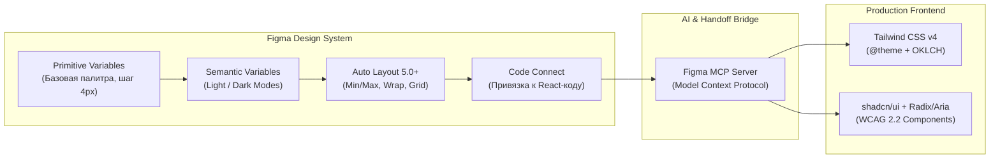

# 01. Инструменты проектирования, дизайна и фронтенд-разработки (2025–2026)

> [!IMPORTANT]
> **Ключевой сдвиг индустрии 2025–2026:**
> Граница между дизайн-макетом в Figma и продакшен-кодом стерлась. Использование **Figma Variables + MCP Server**, переход на **Tailwind CSS v4 (CSS-first + OKLCH)**, владение исходным кодом компонентов через **shadcn/ui** и бесплатный коммерческий доступ ко всем плагинам **GSAP** позволяют собирать интерфейсы уровня Awwwards в 3–4 раза быстрее, чем на стеках 2022–2023 годов, со строгим соблюдением стандарта доступности **WCAG 2.2 AA**.

---

## Оглавление

1. [Проектирование и дизайн в Figma (2025–2026)](#1-проектирование-и-дизайн-в-figma-20252026)
   - [1.1. Figma Variables и архитектура дизайн-токенов](#11-figma-variables-и-архитектура-дизайн-токенов)
   - [1.2. Auto Layout 5.0+ и прямое соответствие CSS Flexbox / Grid](#12-auto-layout-50-и-прямое-соответствие-css-flexbox--grid)
   - [1.3. Dev Mode, Code Connect и интеграция с Figma MCP Server](#13-dev-mode-code-connect-и-интеграция-с-figma-mcp-server)
2. [Стилизация и UI-архитектура](#2-стилизация-и-ui-архитектура)
   - [2.1. Tailwind CSS v4: движок Oxide, директива `@theme` и палитра OKLCH](#21-tailwind-css-v4-движок-oxide-директива-theme-и-палитра-oklch)
   - [2.2. Экосистема shadcn/ui: архитектура владения кодом (React 19 + Tailwind v4)](#22-экосистема-shadcnui-архитектура-владения-кодом-react-19--tailwind-v4)
   - [2.3. Headless-примитивы и доступность: Radix UI vs React Aria (WCAG 2.2)](#23-headless-примитивы-и-доступность-radix-ui-vs-react-aria-wcag-22)
3. [Анимации, микровзаимодействия и скроллтеллинг](#3-анимации-микровзаимодействия-и-скроллтеллинг)
   - [3.1. Motion (`motion/react`): декларативные UI-анимации и Layout Transitions](#31-motion-motionreact-декларативные-ui-анимации-и-layout-transitions)
   - [3.2. GSAP (GreenSock): скроллтеллинг, SplitText и Flip (100% Free в 2025–2026)](#32-gsap-greensock-скроллтеллинг-splittext-и-flip-100-free-в-20252026)
   - [3.3. Матрица выбора: CSS vs Motion vs GSAP и аппаратное ускорение](#33-матрица-выбора-css-vs-motion-vs-gsap-и-аппаратное-ускорение)
4. [Чек-лист готовности дизайн-системы и фронтенд-стека](#4-чек-лист-готовности-дизайн-системы-и-фронтенд-стека)

---

## 1. Проектирование и дизайн в Figma (2025–2026)

В 2025–2026 годах Figma перестала быть просто векторным редактором «картинок». Современный макет проектируется как визуальное представление DOM-дерева и CSS-переменных.



### 1.1. Figma Variables и архитектура дизайн-токенов

Использование старых *Figma Styles* для одиночных цветов и отступов ушло в прошлое для базовых параметров. Стандарт проектирования — **двухуровневая система переменных (Figma Variables)**, которая напрямую транслируется в CSS Custom Properties (`--*`).

| Уровень токенов | Назначение в Figma | Примеры именования в Figma | Трансляция в CSS / Tailwind v4 |
| :--- | :--- | :--- | :--- |
| **1. Primitives (Примитивы)** | Сырые значения палитры и размерной сетки (без привязки к контексту). Не используются напрямую в макетах! | `blue/500`, `zinc/900`, `space/4` (`16px`), `radius/md` (`8px`) | `--color-blue-500: oklch(0.62 0.21 259);` |
| **2. Semantics (Семантика)** | Контекстные роли элементов с поддержкой **Modes** (`Light` / `Dark`, `Desktop` / `Mobile`). Ссылаются на примитивы. | `bg/surface`, `bg/elevated`, `text/primary`, `text/muted`, `border/subtle`, `accent/primary` | `--color-bg-surface: var(--color-zinc-50);` (меняется в `.dark`) |

> [!TIP]
> **Практическое правило по цветам (OKLCH vs HEX):**
> Внутри Figma переменные могут храниться в HEX/RGB, но при экспорте токенов в CSS для Tailwind v4 используйте цветовое пространство **OKLCH**. В отличие от RGB/HSL, пространство OKLCH перцептивно равномерно (perceptually uniform): изменение оттенка (`Hue`) при сохранении яркости (`Lightness`) и насыщенности (`Chroma`) гарантирует одинаковый визуальный контраст для глаза человека и предсказуемое соблюдение норм контрастности WCAG.

### 1.2. Auto Layout 5.0+ и прямое соответствие CSS Flexbox / Grid

Макет, собранный на абсолютном позиционировании (перетаскиванием слоев вручную без Auto Layout), считается техническим браком. Каждый фрейм должен использовать возможности **Auto Layout 5.0+**:

* **Flex-направление и перенос (`Wrap`):** Горизонтальные, вертикальные стеки и многострочный перенос карточек (`flex-wrap: wrap`).
* **Ограничители размеров (`Min/Max Width & Height`):** Позволяют задать карточке `Fill container` с ограничением `min-width: 280px` и `max-width: 420px`, полностью повторяя поведение адаптивной CSS-сетки без создания десятков дублирующихся экранов.
* **Абсолютное позиционирование внутри Auto Layout (`Ignore Auto Layout`):** Используется строго для бейджей, кнопок закрытия модалок и декоративных фоновых свечений (`position: absolute` относительно родителя с `position: relative`).

### 1.3. Dev Mode, Code Connect и интеграция с Figma MCP Server

Два главных инструмента синхронизации дизайна и разработки в 2025–2026 гг.:

1. **Figma Code Connect:** Позволяет связать компонент в библиотеке Figma с реальным React-компонентом из вашего репозитория (`src/components/ui/button.tsx`). Когда разработчик открывает **Dev Mode**, вместо бесполезного автогенерируемого CSS он видит точный JSX-сниппет вашей дизайн-системы:
   ```tsx
   <Button variant="default" size="lg" icon={<ArrowRight />}>
     Начать бесплатно
   </Button>
   ```
2. **Figma MCP Server (Model Context Protocol):** Стандартизированный мост между Figma и AI-редакторами кода (Cursor, Windsurf, Claude Code, VS Code). Подключив официальный или локальный MCP-сервер Figma, разработчик передает ссылку на фрейм в чат IDE, и AI-агент считывает **не просто скриншот**, а точное дерево узлов, имена семантических переменных, параметры Auto Layout и привязки Code Connect, генерируя чистый код на Tailwind v4 и `shadcn/ui`.

---

## 2. Стилизация и UI-архитектура

### 2.1. Tailwind CSS v4: движок Oxide, директива `@theme` и палитра OKLCH

Выход **Tailwind CSS v4** стал самым масштабным обновлением фреймворка с момента его создания.

#### Главные архитектурные изменения Tailwind CSS v4:
* **Движок Oxide (Rust + Lightning CSS):** Полная сборка стилей ускорилась до **3.5–5 раз**, а инкрементальная пересборка при сохранении файла (HMR) занимает микросекунды (до **100x быстрее** при отсутствии новых классов). Встроенный парсер на базе *Lightning CSS* нативно обрабатывает каскадные слои (`@layer`), вложенность (CSS Nesting) и вендорные префиксы без сторонних плагинов `postcss-import` или `autoprefixer`.
* **Отказ от `tailwind.config.js` (CSS-First Configuration):** Больше не нужно поддерживать отдельный JavaScript-конфиг. Вся настройка темы, шрифтов, брейкпоинтов и кастомных токенов выполняется напрямую в главном CSS-файле с помощью директивы `@theme`.
* **Нативные `@container` запросы (Container Queries):** Поддержка `@container`, `@sm:`, `@md:`, `@max-md:` встроена в ядро без плагина `@tailwindcss/container-queries`. Компоненты теперь адаптируются к ширине своего родительского блока, а не только к ширине окна браузера (`viewport`).
* **Все токены — это нативные CSS-переменные:** Любой токен из `@theme` автоматически становится доступным в `:root` как CSS-переменная (например, `var(--color-brand-500)`), что идеально подходит для передачи цветов в Canvas/WebGL или библиотеки анимаций (Motion / GSAP).

#### Эталонный пример интеграции токенов Figma в Tailwind CSS v4 (`app/globals.css`)

```css
/* Подключение Tailwind CSS v4 одной строкой */
@import "tailwindcss";

/* Вариант переключения темной темы через класс .dark */
@custom-variant dark (&:where(.dark, .dark *));

/* 1. Семантические переменные из Figma Variables (Light / Dark Modes) */
:root {
  --bg-surface: oklch(0.99 0.002 247.8);
  --bg-elevated: oklch(0.96 0.005 247.8);
  --text-primary: oklch(0.18 0.02 255.0);
  --text-muted: oklch(0.48 0.02 255.0);
  --border-subtle: oklch(0.90 0.01 255.0);
  --brand-primary: oklch(0.58 0.22 262.0);
  --brand-primary-fg: oklch(0.99 0.002 247.8);
  --radius-card: 0.75rem;
}

.dark {
  --bg-surface: oklch(0.14 0.015 255.0);
  --bg-elevated: oklch(0.19 0.02 255.0);
  --text-primary: oklch(0.96 0.005 247.8);
  --text-muted: oklch(0.68 0.015 255.0);
  --border-subtle: oklch(0.26 0.02 255.0);
  --brand-primary: oklch(0.67 0.20 262.0);
  --brand-primary-fg: oklch(0.14 0.015 255.0);
}

/* 2. Регистрация токенов в ядре Tailwind v4 через @theme inline */
@theme inline {
  /* Шрифты (подключенные локально через next/font или @font-face) */
  --font-sans: var(--font-inter), ui-sans-serif, system-ui, sans-serif;
  --font-mono: var(--font-jetbrains-mono), ui-monospace, monospace;

  /* Цветовые утилиты: bg-surface, text-primary, border-subtle, bg-brand */
  --color-surface: var(--bg-surface);
  --color-elevated: var(--bg-elevated);
  --color-primary: var(--text-primary);
  --color-muted: var(--text-muted);
  --color-subtle: var(--border-subtle);
  --color-brand: var(--brand-primary);
  --color-brand-foreground: var(--brand-primary-fg);

  /* Радиусы и кастомные кривые анимаций */
  --radius-xl: var(--radius-card);
  --ease-out-expo: cubic-bezier(0.16, 1, 0.3, 1);
}
```

### 2.2. Экосистема shadcn/ui: архитектура владения кодом (React 19 + Tailwind v4)

В 2025–2026 годах классические монолитные UI-библиотеки, устанавливаемые в `node_modules` как черный ящик (Material UI, Ant Design, Bootstrap), уступили место подходу **Code Ownership (владение кодом)**, стандартом которого стал **shadcn/ui**.

#### Почему `shadcn/ui` стал стандартом де-факто:
1. **Нулевой Vendor Lock-in:** Команда `npx shadcn@latest add dialog` не тянет закрытый пакет со своими стилями, а копирует чистый исходный код компонента прямо в вашу папку `src/components/ui/dialog.tsx`. Вы можете изменить любую строчку разметки, анимации или логики за 10 секунд.
2. **Полная совместимость с React 19 и Tailwind v4:** Актуальные шаблоны `shadcn/ui` избавлены от устаревших оберток `React.forwardRef` (так как в React 19 `ref` передается как обычный проп), используют атрибут `data-slot` для точечной стилизации и цветовую схему `oklch()`.
3. **Идеальная совместимость с AI-генерацией (v0, Cursor, Claude):** Все современные LLM обучены на архитектуре `shadcn/ui + Tailwind`. Это означает, что AI генерирует новые экраны вашего продукта сразу на ваших компонентах без галлюцинаций и конфликтов CSS.

### 2.3. Headless-примитивы и доступность: Radix UI vs React Aria (WCAG 2.2)

Красиво сверстать выпадающий список, модальное окно или датапикер недостаточно — они должны быть полностью доступными (Accessible) с клавиатуры и для скринридеров. Создавать с нуля управление фокусом (`Focus Trap`), `aria-expanded`, `aria-activedescendant` и закрытие по `Escape` — верный путь к багам. Для этого используются **Headless UI-примитивы** (поведение и доступность без стилей).

#### Сравнение главных Headless-решений 2025–2026 гг.

| Критерий | **Radix UI Primitives** | **React Aria (Adobe)** |
| :--- | :--- | :--- |
| **Роль на рынке** | Базовый фундамент для `shadcn/ui`, самый популярный выбор в экосистеме Next.js / React. | Эталон корпоративной доступности и сложных контролов от команды Adobe. |
| **Архитектурный подход** | Составные компоненты (`<Dialog.Root>`, `<Dialog.Trigger>`, `<Dialog.Content>`) с поддержкой пропа `asChild`. | Модульные хуки (`useButton`, `useDatePicker`) + готовые `react-aria-components` с data-атрибутами состояний. |
| **Сложные компоненты** | Отлично закрывает 90% задач (Dialog, Popover, Select, Tabs, Dropdown, Tooltip, Accordion). | Незаменим для сложных виджетов: **DateRangePicker с календарями и таймзонами, ComboBox, Table/Grid с drag-and-drop, Tree**. |
| **Мобильный и тач-опыт** | Хороший, но иногда требует доработки для специфичных мобильных жестов. | Лучший в классе: встроенная нормализация событий нажатия (`onPress`) между мышью, тачскрином и клавиатурой. |

> [!WARNING]
> **Обязательные требования стандарта доступности WCAG 2.2 (уровень AA):**
> При верстке компонентов поверх Radix UI или React Aria вы обязаны соблюсти новые критерии **WCAG 2.2**:
> 1. **2.5.8 Target Size (Minimum):** Размер области клика любого интерактивного элемента (кнопки, иконки, чекбокса) должен быть не менее **24×24 CSS-пикселей** (а для мобильных интерфейсов рекомендуется **44×44 px**).
> 2. **2.4.11 Focus Not Obscured (Minimum):** Элемент, получивший фокус при навигации клавишей `Tab`, не должен полностью перекрываться липкими шапками (`sticky header`), плавающими виджетами чата или cookie-баннерами. Используйте `scroll-padding-top` на `html`.
> 3. **3.3.8 Accessible Authentication:** Запрещено блокировать вставку пароля (`Ctrl+V` / `Cmd+V`) в полях входа и заставлять пользователя проходить когнитивные головоломки без альтернативы (используйте Passkeys, менеджеры паролей и невидимую капчу).

---

## 3. Анимации, микровзаимодействия и скроллтеллинг

В 2025–2026 годах анимационный стек фронтенда четко разделился на три специализированных уровня: нативный CSS/Web API, декларативный **Motion** и таймлайновый **GSAP**.

### 3.1. Motion (`motion/react`): декларативные UI-анимации и Layout Transitions

Библиотека, ранее известная как *Framer Motion*, провела ребрендинг и теперь развивается как независимый проект **Motion** (импорт из пакета `motion/react`).

* **Где незаменим:** Внутри компонентного дерева React, где элементы постоянно монтируются, размонтируются и меняют размеры в зависимости от стейта.
* **Ключевые фичи:**
  * `<AnimatePresence>` — плавная анимация исчезновения компонента перед его удалением из DOM (модалки, тосты, табы).
  * `layout` и `layoutId` — автоматическая FLIP-анимация изменения геометрии и перетекания активного индикатора (например, плашка активного таба или раскрытие карточки в полный экран) всего одним пропом.
  * Аппаратное ускорение через **Mini-версию (`useAnimate`)** на базе нативного Web Animations API (WAAPI) с весом бандла менее **2.5–4 КБ**.

#### Пример доступного компонента с Tailwind v4 и `motion/react` (с учетом `prefers-reduced-motion`)

```tsx
"use client";

import { useState } from "react";
import { motion, useReducedMotion } from "motion/react";

const TABS = [
  { id: "overview", label: "Обзор платформы" },
  { id: "analytics", label: "Аналитика в реальном времени" },
  { id: "security", label: "Безопасность и 152-ФЗ" },
];

export function AccessibleAnimatedTabs() {
  const [activeTab, setActiveTab] = useState(TABS[0].id);
  // Учет системной настройки пользователя «Уменьшение движения» (WCAG 2.2)
  const shouldReduceMotion = useReducedMotion();

  return (
    <div className="@container w-full max-w-2xl rounded-xl border border-subtle bg-elevated p-2">
      <div
        role="tablist"
        aria-label="Разделы возможностей продукта"
        className="flex flex-col gap-1 @md:flex-row"
      >
        {TABS.map((tab) => {
          const isActive = activeTab === tab.id;
          return (
            <button
              key={tab.id}
              role="tab"
              aria-selected={isActive}
              onClick={() => setActiveTab(tab.id)}
              className="relative min-h-[44px] flex-1 rounded-lg px-4 py-2.5 text-sm font-medium text-primary transition-colors focus-visible:outline-2 focus-visible:outline-offset-2 focus-visible:outline-brand"
            >
              {isActive && (
                <motion.span
                  layoutId="active-tab-pill"
                  transition={
                    shouldReduceMotion
                      ? { duration: 0 }
                      : { type: "spring", stiffness: 420, damping: 32 }
                  }
                  className="absolute inset-0 rounded-lg bg-brand shadow-sm"
                />
              )}
              <span
                className={`relative z-10 ${
                  isActive ? "text-brand-foreground" : "text-muted hover:text-primary"
                }`}
              >
                {tab.label}
              </span>
            </button>
          );
        })}
      </div>
    </div>
  );
}
```

### 3.2. GSAP (GreenSock): скроллтеллинг, SplitText и Flip (100% Free в 2025–2026)

> [!NOTE]
> **Историческое событие в веб-разработке:**
> После приобретения компании GreenSock платформой **Webflow**, библиотека **GSAP и все бывшие платные премиум-плагины Club GSAP (`SplitText`, `Flip`, `MorphSVG`, `DrawSVG`, `ScrollSmoother`, `ScrambleText`) стали на 100% бесплатными**, включая коммерческое использование в клиентских проектах и SaaS.

* **Где незаменим GSAP:** Сложная хореография (таймлайны из 10+ последовательных шагов), анимация SVG-путей, 3D-сцен (Three.js), посимвольная/построчная типографика (`SplitText` с поддержкой ARIA) и скроллтеллинг (`ScrollTrigger` с фиксацией экрана `pin: true` и привязкой прогресса к скроллу `scrub: true`).
* **Правильная интеграция с React:** В проектах на React / Next.js всегда используйте официальный хук **`@gsap/react` (`useGSAP`)** вместо `useEffect`. Он автоматически очищает все созданные твины и `ScrollTrigger`-инстансы при размонтировании компонента, предотвращая утечки памяти и поломку верстки при клиентской навигации.

### 3.3. Матрица выбора: CSS vs Motion vs GSAP и аппаратное ускорение

| Задача | Рекомендуемый инструмент | Почему именно он |
| :--- | :--- | :--- |
| Ховеры, фокусы, простые переходы состояний, переходы между страницами | **Нативный CSS + View Transitions API** (`transition`, `@keyframes`, `scroll-driven animations`) | **0 КБ JavaScript.** Выполняется напрямую в компоновщике браузера, не нагружает Main Thread и гарантирует идеальный показатель **INP (< 200 мс)**. |
| Модальные окна, аккордеоны, тосты, перетекающие табы, жесты перетаскивания (Drag) в React | **Motion (`motion/react`)** | Глубокая связь со стейтом и жизненным циклом React (`AnimatePresence`, `layoutId`). Декларативный синтаксис. |
| Промо-лендинги уровня Awwwards, сложный скроллтеллинг с пиннингом секций, анимация текста и WebGL | **GSAP + `@gsap/react`** (`ScrollTrigger`, `SplitText`, `Flip`) | Непревзойденный контроль над таймлайнами, точная синхронизация со скроллом и 100% бесплатный доступ ко всем плагинам. |

> [!CAUTION]
> **Золотое правило производительности анимаций (60–120 FPS и защита CLS/INP):**
> Никогда не анимируйте CSS-свойства, вызывающие перерасчет геометрии макета (**Layout / Reflow**): `width`, `height`, `top`, `left`, `margin`, `padding`. Их анимация приводит к просадкам кадров на мобильных устройствах и штрафам по метрике **CLS (Cumulative Layout Shift)** в Core Web Vitals.
> Анимируйте **только свойства, обрабатываемые на GPU на этапе Composite**:
> * `transform` (`translate3d`, `scale`, `rotate`)
> * `opacity`
> * `filter` / `clip-path` (в разумных пределах)
> Если нужно анимировать изменение размеров контейнера — используйте технику **FLIP** (`layout` в Motion или плагин `Flip` в GSAP), которая пересчитывает изменение геометрии через быстрый `transform: scale()`.

---

## 4. Чек-лист готовности дизайн-системы и фронтенд-стека

Используйте этот чек-лист перед передачей проекта из дизайна в верстку и перед выкладкой UI в продакшен:

- [ ] **Figma Variables:** Все цвета, отступы и радиусы вынесены в двухуровневую систему переменных (*Primitives* $\rightarrow$ *Semantics*) с настроенными режимами `Light` и `Dark`.
- [ ] **Auto Layout 100%:** В макете нет ни одного фрейма на «ручном» абсолютном позиционировании (кроме осознанно закрепленных бейджей/оверлеев); настроены `Min/Max Width` и `Wrap`.
- [ ] **Tailwind CSS v4 (`@theme`):** Удален устаревший `tailwind.config.js`; все дизайн-токены объявлены в главном CSS-файле через `@theme` с использованием палитры `oklch()`.
- [ ] **Локализация шрифтов:** Шрифты подключены в формате `.woff2` локально (или через `next/font/local`) со свойством `font-display: swap` — нет прямых запросов к `fonts.googleapis.com` в браузере клиента.
- [ ] **Владение кодом UI (`shadcn/ui`):** Базовые компоненты лежат в репозитории проекта (`components/ui/*`), совместимы с React 19 и используют примитивы **Radix UI** или **React Aria**.
- [ ] **Доступность (WCAG 2.2 AA):**
  - [ ] Контрастность обычного текста $\ge 4.5:1$, крупного текста и UI-элементов $\ge 3:1$.
  - [ ] Минимальная кликабельная область кнопок и интерактивных иконок $\ge 24\times24\text{ px}$ (рекомендуется $44\times44\text{ px}$ на тач-экранах).
  - [ ] Весь интерфейс проходится клавишей `Tab`, фокус имеет четкую обводку (`:focus-visible`) и не перекрывается липкими панелями.
- [ ] **Безопасные анимации:** Вся анимация построена на `transform` и `opacity`, в GSAP используется хук `useGSAP()` для очистки памяти, а для пользователей с вестибулярными нарушениями поддерживается `@media (prefers-reduced-motion: reduce)`.
