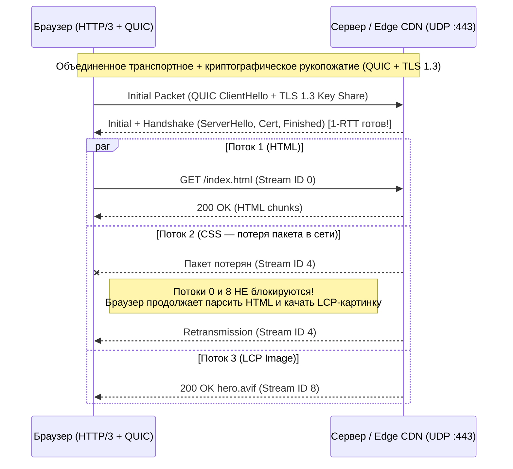

# Сетевая Безопасность, Криптография и Защитные HTTP-Заголовки (2025–2026)

> [!IMPORTANT]
> **Стандарты транспортного уровня 2025–2026:** Использование TLS 1.0/1.1 запрещено (RFC 8996), а TLS 1.2 переведен в разряд legacy-совместимости. Эталонным стандартом является **TLS 1.3 (RFC 8446)** с обязательным **Forward Secrecy (PFS)**, поддержкой гибридной постквантовой криптографии (**X25519MLKEM768**) и протоколом **HTTP/3 (RFC 9114)** поверх транспортного уровня **QUIC (UDP)**.

---

## Содержание

1. [Транспортная безопасность: TLS 1.3 и Постквантовая криптография (PQC)](#1-транспортная-безопасность-tls-13-и-постквантовая-криптография-pqc)
2. [Протокол HTTP/3 и QUIC: Архитектура и устранение HoL Blocking](#2-протокол-http3-и-quic-архитектура-и-устранение-hol-blocking)
3. [HSTS (HTTP Strict Transport Security) и HSTS Preload](#3-hsts-http-strict-transport-security-и-hsts-preload)
4. [Strict Content Security Policy (CSP Level 3) и Trusted Types](#4-strict-content-security-policy-csp-level-3-и-trusted-types)
5. [Межсайтовая изоляция (COOP, COEP, CORP) и Permissions-Policy](#5-межсайтовая-изоляция-coop-coep-corp-и-permissions-policy)
6. [Эталонная конфигурация веб-сервера (Nginx / Edge Proxy)](#6-эталонная-конфигурация-веб-сервера-nginx--edge-proxy)
7. [Чек-лист аудита сетевой и браузерной безопасности](#7-чек-лист-аудита-сетевой-и-браузерной-безопасности)

---

## 1. Транспортная безопасность: TLS 1.3 и Постквантовая криптография (PQC)

### Преимущества TLS 1.3 (RFC 8446) над TLS 1.2
1. **Сокращение рукопожатия до 1-RTT:** Установление защищенного канала занимает всего один сетевой оборот вместо двух в TLS 1.2, что экономит $50 - 150\text{ мс}$ на этапе подключения и напрямую ускоряет **TTFB и LCP**.
2. **Безусловная прямая секретность (Perfect Forward Secrecy — PFS):** Из спецификации полностью удалены статические алгоритмы обмена ключами RSA и небезопасные примитивы (RC4, 3DES, SHA-1, CBC-режимы). Все сессии используют эфемерный обмен Диффи-Хеллмана (ECDHE), поэтому компрометация приватного ключа сервера в будущем не позволит расшифровать ранее перехваченный трафик.
3. **Защита от атак «Harvest Now, Decrypt Later» (Постквантовая криптография 2025–2026):** Современные браузеры (Chrome, Edge, Firefox) и CDN/веб-серверы (Cloudflare, Nginx с OpenSSL 3.2+ / BoringSSL) используют гибридный обмен ключами **X25519MLKEM768** (сочетание классической эллиптической кривой X25519 и стандартизированного NIST FIPS 203 постквантового алгоритма ML-KEM / Kyber).

> [!CAUTION]
> **Опасность 0-RTT (Early Data) в TLS 1.3:** Режим `0-RTT` позволяет клиенту отправить первый HTTP-запрос вместе с первым пакетом рукопожатия при повторном визите. Однако 0-RTT уязвим к **Replay Attack** (атаке повторного воспроизведения). Включайте `0-RTT` **только для идемпотентных `GET`-запросов** статики и никогда не принимайте `POST`/`PUT`/`DELETE` без проверки заголовка `Early-Data: 1` (при сомнениях сервер обязан вернуть статус `425 Too Early` согласно RFC 8470).

---

## 2. Протокол HTTP/3 и QUIC: Архитектура и устранение HoL Blocking

В протоколе **HTTP/2** несколько потоков мультиплексируются внутри одного TCP-соединения. Поскольку TCP гарантирует строгую последовательность байтов, потеря **всего одного TCP-пакета** на уровне сети останавливает обработку всех параллельных потоков (CSS, JS, картинок) до повторной пересылки потерянного пакета. Это явление называется **TCP Head-of-Line (HoL) Blocking**.

**HTTP/3 (RFC 9114)** работает поверх протокола **QUIC (RFC 9000)** на базе **UDP**:



### Ключевые архитектурные выигрыши HTTP/3 + QUIC

| Параметр | HTTP/2 (TCP + TLS 1.3) | HTTP/3 (QUIC поверх UDP) | Выигрыш для пользователя и CWV |
| :--- | :--- | :--- | :--- |
| **Рукопожатие (New Connection)** | 2 RTT (1 RTT TCP + 1 RTT TLS 1.3) | **1 RTT** (транспорт и TLS объединены) | Снижение TTFB на $30 - 100\text{ мс}$ (особенно в мобильных сетях) |
| **Head-of-Line (HoL) Blocking** | ❌ Блокирует все потоки при потере 1 TCP-пакета | ✅ **Устранен:** потоки изолированы на уровне QUIC | При потере $2\%$ пакетов (3G/4G/Wi-Fi) LCP ускоряется на $20 - 40\%$ |
| **Смена сети (Connection Migration)** | ❌ Обрыв TCP при переходе с Wi-Fi на LTE (смена IP) | ✅ **Бесшовная миграция** по `Connection ID` | Загрузка страницы и видеопоток не прерываются при выходе из дома |
| **Сжатие заголовков** | HPACK (зависит от порядка доставки) | **QPACK (RFC 9204)** (асинхронное) | Исключена блокировка декодирования заголовков |

---

## 3. HSTS (HTTP Strict Transport Security) и HSTS Preload

Механизм **HSTS (RFC 6797)** запрещает браузеру обращаться к домену по незашифрованному протоколу `http://`, защищая от атак **SSL Stripping** (перехвата первого редиректа `http:// -> https://` в публичной Wi-Fi сети) и одновременно **устраняя задержку на 301-редирект**.

Для включения домена в зашитый во все браузеры список **HSTS Preload List (`hstspreload.org`)** заголовок обязан соответствовать трем строгим критериям:
1. `max-age` не менее `31536000` секунд (1 год), рекомендуется `63072000` (2 года).
2. Наличие директивы `includeSubDomains`.
3. Наличие директивы `preload`.

```http
Strict-Transport-Security: max-age=63072000; includeSubDomains; preload
```

---

## 4. Strict Content Security Policy (CSP Level 3) и Trusted Types

> [!WARNING]
> **Почему классический Allowlist CSP больше не работает:** Политики вида `script-src 'self' https://www.googletagmanager.com https://cdn.jsdelivr.net 'unsafe-inline'` бесполезны против современных XSS-атак. Наличие `'unsafe-inline'` позволяет выполнить любой внедренный тег `<script>`, а публичные CDN и JSONP-эндпоинты в белом списке позволяют атакующему обойти защиту через **CSP Bypass Gadgets**.

### Архитектура Strict CSP с криптографическим `nonce` и `'strict-dynamic'`

В стандарте **CSP Level 3** применяется подход **Strict CSP**:
1. На каждый HTTP-запрос сервер генерирует криптографически стойкий одноразовый токен (`nonce` минимум 128 бит в кодировке Base64) и подставляет его в заголовок `Content-Security-Policy` и в атрибут `nonce="..."` всех легитимных тегов `<script>` на странице.
2. Директива **`'strict-dynamic'`** автоматически делегирует доверие тем скриптам, которые создаются программно через `document.createElement('script')` уже доверенным скриптом (например, загрузчиком бандлов Webpack/Vite или Google Tag Manager), и при этом заставляет современные браузеры игнорировать устаревшие директивы `'unsafe-inline'` и списки хостов.
3. Директива **`require-trusted-types-for 'script'`** блокирует передачу сырых строк в опасные DOM XSS-приемники (`element.innerHTML`, `document.write`, `eval`), требуя предварительной санитизации через API **Trusted Types**.

### Генерация `nonce` на уровне Middleware (пример для Node.js / Next.js)

```typescript
// middleware.ts
import { NextResponse, type NextRequest } from 'next/server';

export function middleware(request: NextRequest) {
  // 1. Генерируем криптографически стойкий одноразовый nonce на каждый запрос
  const nonce = Buffer.from(crypto.randomUUID()).toString('base64');

  // 2. Формируем политику Strict CSP Level 3 + Trusted Types
  const cspHeader = `
    default-src 'self';
    script-src 'nonce-${nonce}' 'strict-dynamic' https: 'unsafe-inline';
    style-src 'self' 'unsafe-inline';
    img-src 'self' blob: data: https://cdn.example.com;
    font-src 'self';
    connect-src 'self' https://api.example.com;
    object-src 'none';
    base-uri 'self';
    form-action 'self';
    frame-ancestors 'none';
    upgrade-insecure-requests;
    require-trusted-types-for 'script';
  `
    .replace(/\s{2,}/g, ' ')
    .trim();

  const requestHeaders = new Headers(request.headers);
  requestHeaders.set('x-nonce', nonce);
  requestHeaders.set('Content-Security-Policy', cspHeader);

  const response = NextResponse.next({
    request: { headers: requestHeaders }
  });
  response.headers.set('Content-Security-Policy', cspHeader);

  return response;
}
```

> [!NOTE]
> Обратите внимание на присутствие `https: 'unsafe-inline'` рядом с `'nonce-...' 'strict-dynamic'`: в соответствии со спецификацией W3C CSP Level 3 любой современный браузер, поддерживающий `'strict-dynamic'`, **автоматически игнорирует** `'unsafe-inline'` и `https:`, обеспечивая максимальную защиту, а старые клиенты получают обратную совместимость.

---

## 5. Межсайтовая изоляция (COOP, COEP, CORP) и Permissions-Policy

Для защиты от атак по сторонним каналам памяти (**Spectre**, межпроцессные утечки через `window.opener`) и контроля доступа к аппаратным API браузера используется пакет заголовков изоляции:

| Заголовок | Рекомендуемое значение | Защитная функция |
| :--- | :--- | :--- |
| **`Cross-Origin-Opener-Policy` (COOP)** | `same-origin` или `same-origin-allow-popups` | Изолирует контекст просмотра (`Browsing Context Group`): внешние вкладки теряют доступ к объекту `window.opener` |
| **`Cross-Origin-Resource-Policy` (CORP)** | `same-site` (для статики) / `same-origin` (для приватных API) | Запрещает чужим сайтам встраивать ваши изображения, скрипты и ответы API через ``/`<script>`, защищая от XS-Leaks |
| **`Cross-Origin-Embedder-Policy` (COEP)** | `require-corp` или `credentialless` | В паре с `COOP: same-origin` включает режим `crossOriginIsolated` (необходим для `SharedArrayBuffer` и высокоточных таймеров) |
| **`X-Content-Type-Options`** | `nosniff` | Запрещает браузеру угадывать MIME-тип (MIME Sniffing), предотвращая исполнение загруженного пользователем файла как JS/HTML |
| **`Referrer-Policy`** | `strict-origin-when-cross-origin` | Передает полный URL внутри сайта, но только домен (`origin`) при переходе на внешний HTTPS-ресурс (защита токенов в URL) |
| **`Permissions-Policy`** | `camera=(), microphone=(), geolocation=(), payment=(), usb=()` | Явно отключает доступ к чувствительным аппаратным API браузера как для самой страницы, так и для всех встроенных `<iframe>` |

---

## 6. Эталонная конфигурация веб-сервера (Nginx / Edge Proxy)

Ниже представлена производственная конфигурация **Nginx (v1.25.x / 1.27.x+ с OpenSSL 3.2+)** с включенным **HTTP/3 (QUIC)**, **TLS 1.3**, гибридным постквантовым обменом ключами и полным набором заголовков безопасности:

```nginx
server {
    # 1. Слушаем TCP для HTTP/2 и UDP для HTTP/3 (QUIC)
    listen 443 ssl;
    listen [::]:443 ssl;
    listen 443 quic reuseport;
    listen [::]:443 quic reuseport;

    http2 on;
    http3 on;
    quic_retry on;      # Защита от UDP-спуфинга и усиления трафика (QUIC Address Validation)
    quic_gso on;        # Generic Segmentation Offload для ускорения отправки UDP-пакетов

    server_name example.com;

    # 2. Криптография TLS 1.3 + Гибридный постквантовый обмен ключами (PQC)
    ssl_protocols TLSv1.3;
    ssl_ecdh_curve X25519MLKEM768:X25519:secp384r1;
    ssl_prefer_server_ciphers off;
    ssl_session_tickets off;

    # OCSP Stapling для мгновенной проверки статуса сертификата без запроса клиента к CA
    ssl_stapling on;
    ssl_stapling_verify on;
    resolver 1.1.1.1 8.8.8.8 valid=300s;

    # 3. Уведомление браузера о поддержке HTTP/3 на порту 443 (кэш на 24 часа)
    add_header Alt-Svc 'h3=":443"; ma=86400' always;

    # 4. Эталонные заголовки безопасности (Security Headers)
    add_header Strict-Transport-Security "max-age=63072000; includeSubDomains; preload" always;
    add_header X-Content-Type-Options "nosniff" always;
    add_header Referrer-Policy "strict-origin-when-cross-origin" always;
    add_header Cross-Origin-Opener-Policy "same-origin-allow-popups" always;
    add_header Cross-Origin-Resource-Policy "same-site" always;
    add_header Permissions-Policy "accelerometer=(), camera=(), geolocation=(), gyroscope=(), magnetometer=(), microphone=(), payment=(), usb=(), browsing-topics=()" always;
    add_header X-Frame-Options "DENY" always;
}
```

---

## 7. Чек-лист аудита сетевой и браузерной безопасности

- [ ] **TLS 1.3 и PQC:** Сервер поддерживает TLS 1.3 (1-RTT), устаревшие протоколы TLS 1.0/1.1 полностью отключены, настроена группа кривых `X25519MLKEM768:X25519`.
- [ ] **HTTP/3 (QUIC):** Открыт порт `UDP 443`, сервер отдает заголовок `Alt-Svc: h3=":443"; ma=86400`, проверка на `http3check.net` подтверждает работу QUIC.
- [ ] **HSTS Preload:** На всех ответах HTTPS присутствует заголовок `Strict-Transport-Security: max-age=63072000; includeSubDomains; preload`, редирект осуществляется строго по цепочке `http://example.com -> https://example.com`.
- [ ] **Strict CSP Level 3:** Политика `Content-Security-Policy` использует одноразовый криптографический `nonce` и директиву `'strict-dynamic'` без глобального разрешения `'unsafe-eval'`; указано `frame-ancestors 'none'` (или `'self'`) и `object-src 'none'`.
- [ ] **Изоляция и аппаратные лимиты:** Присутствуют заголовки `X-Content-Type-Options: nosniff`, `Referrer-Policy: strict-origin-when-cross-origin`, `Cross-Origin-Opener-Policy` и `Permissions-Policy`.

---

## Ссылки на официальные спецификации и стандарты IETF / W3C

1. **IETF RFC 8446 — The Transport Layer Security (TLS) Protocol Version 1.3:** `https://datatracker.ietf.org/doc/html/rfc8446`
2. **IETF RFC 9114 — HTTP/3 Specification:** `https://datatracker.ietf.org/doc/html/rfc9114`
3. **IETF RFC 9000 — QUIC: A UDP-Based Multiplexed and Secure Transport:** `https://datatracker.ietf.org/doc/html/rfc9000`
4. **W3C Content Security Policy Level 3 (Strict CSP & `'strict-dynamic'`):** `https://www.w3.org/TR/CSP3/`
5. **W3C Trusted Types Specification (DOM XSS Prevention):** `https://w3c.github.io/trusted-types/dist/spec/`
6. **OWASP HTTP Headers Cheat Sheet:** `https://cheatsheetseries.owasp.org/cheatsheets/HTTP_Headers_Cheat_Sheet.html`
