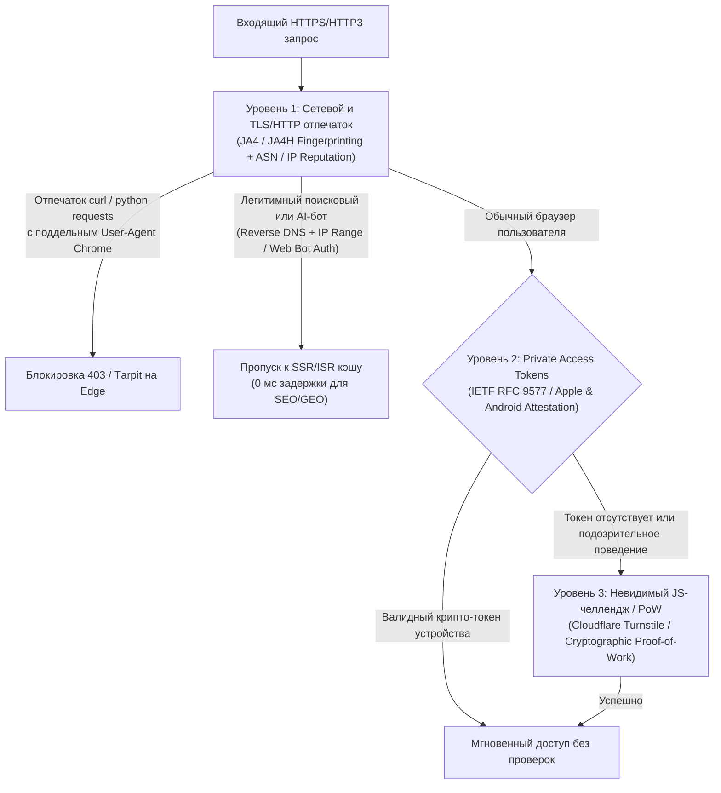

# Прикладная Безопасность (OWASP Top 10), Passkeys (WebAuthn) и Защита от Ботов (2025–2026)

> [!IMPORTANT]
> **Парадигма безопасности приложений 2025–2026:** Защита веб-платформ строится на трех столпах:
> 1. **Упреждающий контроль по стандарту OWASP Top 10** (изоляция сессий через префикс `__Host-`, защита цепочки поставок SBOM/SRI и блокировка SSRF на сетевом уровне).
> 2. **Отказ от паролей в пользу криптографических ключей Passkeys** (стандарт W3C WebAuthn Level 3 / FIDO2 с поддержкой автозаполнения **Conditional UI**), полностью неуязвимых к фишингу.
> 3. **Невидимая эшелонированная защита от ботов и DDoS** без визуальных капч (Cloudflare Turnstile, Private Access Tokens **RFC 9577** и криптографическое профилирование клиентов **JA4+**).

---

## Содержание

1. [Практическая защита по стандарту OWASP Top 10](#1-практическая-защита-по-стандарту-owasp-top-10)
2. [Абсолютная защита сессий: Префиксы кук `__Host-` и `__Secure-`](#2-абсолютная-защита-сессий-префиксы-кук-__host--и-__secure-)
3. [Беспарольная аутентификация: Passkeys и WebAuthn Level 3 (FIDO2)](#3-беспарольная-аутентификация-passkeys-и-webauthn-level-3-fido2)
4. [Эшелонированная защита от DDoS и ботов (Anti-Bot 2025–2026)](#4-эшелонированная-защита-от-ddos-и-ботов-anti-bot-20252026)
5. [Чек-лист прикладной безопасности и защиты от автоматизации](#5-чек-лист-прикладной-безопасности-и-защиты-от-автоматизации)

---

## 1. Практическая защита по стандарту OWASP Top 10

В актуальном стандарте **OWASP Top 10** фокус смещен с классических синтаксических инъекций на архитектурные изъяны контроля доступа, компрометацию зависимостей (Supply Chain) и подделку серверных запросов (SSRF).

| Категория OWASP Top 10 | Механика уязвимости на практике | Обязательный инженерный стандарт защиты (2025–2026) |
| :--- | :--- | :--- |
| **A01: Broken Access Control** | **IDOR / BOLA:** Подмена ID объекта в запросе (`/api/orders/1042` $\rightarrow$ `/api/orders/1043`), пропуск проверки прав в Server Actions / API | Принцип **Deny by Default**; замена автоинкрементных ID на **UUIDv7**; проверка владения ресурсом (`WHERE id = $1 AND owner_id = $2`) на уровне БД (или Row-Level Security в PostgreSQL) |
| **A02: Cryptographic Failures** | Хранение слабых хэшей паролей (MD5/SHA-256), утечка секретов в клиентский бандл (`NEXT_PUBLIC_*`) | Хэширование паролей алгоритмом **Argon2id** (минимум $64\text{ МБ}$ памяти, $3$ итерации); шифрование чувствительных полей в БД через **AES-256-GCM** с ротацией ключей в KMS/Vault |
| **A03: Injection (SQLi, XSS, NoSQLi)** | Конкатенация строк в SQL/ORM-запросах, небезопасный рендеринг HTML | Строго параметризованные запросы (Prepared Statements) и типизированные Query Builders; **Strict CSP** + **Trusted Types** на клиенте; валидация входных схем через **Zod / Valibot** |
| **A04: Insecure Design** | Бизнес-логика без лимитов: массовое списание бонусов в состоянии гонки (Race Condition), скрейпинг каталога | Идемпотентные ключи (`Idempotency-Key`) и транзакции с блокировкой `SELECT ... FOR UPDATE` для финансовых операций; жесткие Rate Limits на бизнес-действия |
| **A08: Software and Data Integrity Failures** | Подмена npm-пакета в цепочке поставок (Supply Chain Attack), модификация скрипта на внешнем CDN | Генерация **SBOM (CycloneDX)** в CI/CD; `npm ci --ignore-scripts`; криптографическая подпись коммитов и контейнеров (**Sigstore Cosign**); атрибут **SRI (`integrity="sha384-..."`)** для всех внешних ресурсов |
| **A10: Server-Side Request Forgery (SSRF)** | Сервер скачивает URL, переданный пользователем (превью ссылки, импорт аватарки, вебхук), и атакующий обращается к внутренней сети (`http://169.254.169.254/latest/meta-data/`) | Запрет прямых исходящих соединений из воркера приложения: проксирование через изолированный egress-прокси с блокировкой приватных диапазонов (`10.0.0.0/8`, `127.0.0.0/8`, `169.254.0.0/16`, `fc00::/7`) **после разрешения DNS** (защита от DNS Rebinding) |

### Защита внешних ресурсов через Subresource Integrity (SRI)

Если проект подключает скрипт или таблицу стилей со стороннего CDN, атрибут `integrity` гарантирует, что браузер заблокирует выполнение файла при изменении хотя бы одного байта на стороне CDN:

```html
<script
  src="https://cdn.example.com/analytics-sdk-v4.2.0.min.js"
  integrity="sha384-oqVuAfXRKap7fdgcCY5uykM6+R9GqQ8K/uxy9rx7HNQlGYl1kPzQho1wx4JwY8wC"
  crossorigin="anonymous"
  defer
></script>
```

---

## 2. Абсолютная защита сессий: Префиксы кук `__Host-` и `__Secure-`

Стандарт **RFC 6265bis** вводит криптографически строгие префиксы имен для `Set-Cookie`, которые принудительно проверяются браузером и защищают от атак **Cookie Tossing** (когда скомпрометированный поддомен `promo.example.com` перезаписывает сессионную куку основного домена `example.com`).

* **`__Secure-`**: Браузер примет куку только в том случае, если она установлена по протоколу HTTPS и содержит флаг `Secure`.
* **`__Host-`** *(Максимальный уровень защиты)*: Браузер примет куку **только если одновременно выполнены 4 условия**:
  1. Установлена через защищенное соединение (`HTTPS`).
  2. Присутствует атрибут `Secure`.
  3. **Отсутствует** атрибут `Domain` (кука жестко привязана исключительно к текущему хосту, поддомены не имеют к ней доступа).
  4. Атрибут `Path` строго равен `/`.

### Эталонный заголовок установки сессионной куки

```http
Set-Cookie: __Host-session_id=eyJhbGciOiJFZERTQSI...; Path=/; Secure; HttpOnly; SameSite=Lax; Max-Age=2592000
```

> [!TIP]
> **Почему `SameSite=Lax`, а не `Strict` для основной сессии?** При `SameSite=Strict` пользователь, перешедший на ваш сайт по внешней ссылке из письма, поисковика или мессенджера, на первом переходе окажется разлогиненным, так как браузер не отправит куку. `SameSite=Lax` передает куку при безопасных навигационных переходах верхнего уровня (`GET`), но надежно блокирует ее отправку при межсайтовых `POST`-запросах и встраивании (защита от CSRF). Для критических действий (смена реквизитов, перевод средств) дополнительно используйте токен анти-CSRF или повторную проверку через Passkey.

---

## 3. Беспарольная аутентификация: Passkeys и WebAuthn Level 3 (FIDO2)

**Passkeys** — это синхронизируемые (или аппаратные) резидентные криптографические ключи на базе асимметричной криптографии (**W3C WebAuthn Level 3** + протокол **CTAP2** от альянса **FIDO2**).

### Почему Passkeys технически неуязвимы к фишингу и утечкам БД:
1. **В базе данных сервера нет секрета:** Сервер хранит только публичный ключ (`PublicKey`, алгоритмы `ES256` / `EdDSA`). Утечка таблицы пользователей бесполезна для атакующего.
2. **Аппаратная привязка к домену (`rpId`):** Приватный ключ хранится в защищенном анклаве устройства (Secure Enclave / TPM / Google Password Manager / iCloud Keychain). Браузер на уровне ОС включает точное доменное имя сайта (`origin` и `rpId`) в подписываемый криптографический вызов. На фишинговом домене `examp1e.com` ключ физически не сработает.

```mermaid
sequenceDiagram
    participant User as Пользователь (Биометрия / PIN)
    participant Browser as Браузер (WebAuthn API + Conditional UI)
    participant Enclave as Secure Enclave / TPM (Приватный ключ)
    participant Server as Бэкенд (Relying Party)

    Server->>Browser: 1. Генерация криптографического challenge (32 байта)
    User->>Browser: 2. Фокус в поле ввода <input autocomplete="username webauthn">
    Browser->>User: Отображение Passkey прямо в нативном меню автозаполнения
    User->>Enclave: Подтверждение через FaceID / TouchID / Windows Hello
    Enclave->>Browser: 3. Подпись (challenge + origin + rpIdHash) приватным ключом
    Browser->>Server: 4. Отправка PublicKeyCredential (authenticatorData + signature)
    Server->>Server: 5. Проверка подписи публичным ключом из БД + валидация challenge и rpId
    Server-->>Browser: 6. Выдача сессии (__Host-session_id)
```



### Реализация WebAuthn Conditional UI (Автозаполнение Passkey в поле логина)

**Conditional UI (Conditional Mediation)** позволяет не ломать привычный интерфейс формы входа: браузер сам предлагает выбрать Passkey во всплывающем подсказчике обычного текстового поля логина, как только пользователь кликает в него.

#### 1. HTML-разметка с поддержкой `webauthn` в `autocomplete`

```html
<form id="login-form" action="/api/auth/login" method="POST">
  <label for="username-input">Email или логин</label>
  <input
    id="username-input"
    name="username"
    type="text"
    autocomplete="username webauthn"
    required
  />
  <button type="submit">Продолжить</button>
</form>
```

#### 2. Клиентский скрипт инициализации Conditional UI (WebAuthn Level 3)

```javascript
async function initPasskeyConditionalUI() {
  // 1. Проверяем поддержку WebAuthn и Conditional Mediation в браузере
  if (
    !window.PublicKeyCredential ||
    !PublicKeyCredential.isConditionalMediationAvailable
  ) {
    return;
  }

  const isAvailable = await PublicKeyCredential.isConditionalMediationAvailable();
  if (!isAvailable) return;

  try {
    // 2. Запрашиваем одноразовый криптографический challenge с нашего бэкенда
    const response = await fetch('/api/auth/webauthn/challenge');
    const { challengeBase64Url } = await response.json();

    // Преобразование Base64URL строки в Uint8Array (или через PublicKeyCredential.parseRequestOptionsFromJSON в WebAuthn L3)
    const challengeBuffer = Uint8Array.from(
      atob(challengeBase64Url.replace(/-/g, '+').replace(/_/g, '/')),
      (c) => c.charCodeAt(0)
    );

    // 3. Запускаем фоновое ожидание выбора Passkey в автозаполнении инпута
    const credential = await navigator.credentials.get({
      mediation: 'conditional',
      publicKey: {
        challenge: challengeBuffer,
        rpId: window.location.hostname,
        userVerification: 'preferred',
        timeout: 300000
      }
    });

    if (credential) {
      // 4. Отправляем подписанный ассершен на сервер для верификации
      const verifyRes = await fetch('/api/auth/webauthn/verify', {
        method: 'POST',
        headers: { 'Content-Type': 'application/json' },
        body: JSON.stringify(credential.toJSON ? credential.toJSON() : credential)
      });

      if (verifyRes.ok) {
        window.location.assign('/dashboard');
      }
    }
  } catch (err) {
    // AbortError возникает штатно, если пользователь решил войти обычным способом
    if (err.name !== 'AbortError') {
      console.error('Ошибка WebAuthn Conditional UI:', err);
    }
  }
}

document.addEventListener('DOMContentLoaded', initPasskeyConditionalUI);
```

---

## 4. Эшелонированная защита от DDoS и ботов (Anti-Bot 2025–2026)

> [!WARNING]
> **Отказ от классических визуальных CAPTCHA:** Традиционные капчи с разгадыванием светофоров и велосипедов снижают конверсию форм на $8 - 15\%$, ухудшают метрики **INP / CLS** из-за тяжелых сторонних фреймов и при этом легко решаются современными мультимодальными LLM и клик-фермами дешевле чем за $\$0.50$ за $1000$ решений.

В 2025–2026 годах защита от автоматизированного парсинга, Credential Stuffing и L7 DDoS-атак строится на **невидимой многоуровневой верификации**:



### 4.1. JA3 / JA4+ TLS и HTTP Fingerprinting
Headless-боты и скрипты на Python/Go/Node.js часто подменяют заголовок `User-Agent`, выдавая себя за последний Google Chrome. Однако во время установки соединения (`TLS ClientHello` и `HTTP/2 SETTINGS` / `HTTP/3 QUIC transport parameters`) каждый сетевой стек передает уникальный набор шифров, расширений TLS, кривых и размеров окон.
Семейство алгоритмов **JA4+** (`JA4` для TLS/QUIC, `JA4H` для HTTP-заголовков, `JA4T` для TCP) формирует детерминированный отпечаток клиента на пограничном прокси. Если запрос заявляет `User-Agent: Chrome/134`, но имеет TLS-отпечаток библиотеки `tls-client` или `urllib3`, WAF блокирует его до обращения к серверу приложения.

### 4.2. Private Access Tokens (PAT — IETF RFC 9577 / Privacy Pass)
Стандарт **RFC 9577** позволяет веб-серверу или CDN запросить у операционной системы клиента (iOS, macOS, Android, Chrome) **слепую криптографическую подпись (RSA Blind Signature)** через заголовок `WWW-Authenticate: PrivateToken challenge=...`.
Устройство пользователя подтверждает через аппаратный чип безопасности, что за экраном находится реальный человек на настоящем телефоне или ноутбуке, и возвращает одноразовый токен в заголовке `Authorization: PrivateToken token=...`. При этом сервер не узнает ни Apple ID, ни Google-аккаунт, ни серийный номер устройства (полное соблюдение приватности), а пользователь **вообще не видит никакой капчи**.

### 4.3. Невидимые челленджи (Cloudflare Turnstile) и защита поисковых ботов
Для форм регистрации, входа и оформления заказа вместо визуальной капчи используется **Cloudflare Turnstile** (или собственные легковесные Proof-of-Work воркеры на базе WebCrypto), которые выполняют серию неинтерактивных проверок окружения браузера в фоновом потоке.

> [!IMPORTANT]
> **Критическое правило для SEO и AI-поиска (GEO):** Никогда не закрывайте публичные HTML-страницы интерактивным JS-челленджем (`503 Service Unavailable` / `403 Just a moment...`) для верифицированных краулеров (`Googlebot`, `YandexBot`, `Bingbot`, `OAI-SearchBot`, `ClaudeBot`, `PerplexityBot`). Верификация поисковых и AI-ботов на WAF должна осуществляться строго через **двойную проверку Reverse DNS (FCrDNS)**, официальные JSON-манифесты IP-адресов поисковых систем или криптографические подписи запросов **HTTP Message Signatures (RFC 9421 / Web Bot Auth)**.

---

## 5. Чек-лист прикладной безопасности и защиты от автоматизации

- [ ] **Сессионные куки `__Host-`:** Все куки авторизации и сессии используют префикс `__Host-`, флаги `Secure`, `HttpOnly`, `SameSite=Lax` и `Path=/` (без указания `Domain`).
- [ ] **Защита от IDOR и SSRF:** Первичные ключи в публичных URL используют `UUIDv7`; каждый запрос к БД проверяет принадлежность ресурса текущему `user_id`; исходящие запросы сервера к пользовательским URL фильтруются от локальных IP-диапазонов.
- [ ] **Безопасность цепочки поставок (Supply Chain):** В CI/CD используется `npm ci --ignore-scripts` (или `pnpm install --frozen-lockfile`), генерируется SBOM, а внешние CDN-скрипты снабжены хэшем `integrity="sha384-..."`.
- [ ] **Passkeys (WebAuthn Level 3):** Реализована беспарольная аутентификация с поддержкой **Conditional UI** (`autocomplete="username webauthn"`); для резервных паролей используется хэширование **Argon2id**.
- [ ] **Anti-Bot без вреда для SEO и CWV:** На формах внедрен невидимый челлендж (Turnstile / PAT RFC 9577), включен фильтр несовпадения TLS-отпечатков **JA4**, а легитимные поисковые и AI-краулеры проходят по белому списку FCrDNS / IP-диапазонов без блокировок.

---

## Ссылки на официальные спецификации и стандарты

1. **OWASP Top 10 Standard & Cheat Sheet Series:** `https://owasp.org/www-project-top-ten/`
2. **W3C Web Authentication (WebAuthn) Level 3 Specification:** `https://www.w3.org/TR/webauthn-3/`
3. **IETF RFC 9577 — The Privacy Pass Architecture (Private Access Tokens):** `https://datatracker.ietf.org/doc/html/rfc9577`
4. **IETF RFC 6265bis — Cookie Prefixes (`__Host-` and `__Secure-`):** `https://datatracker.ietf.org/doc/html/draft-ietf-httpbis-rfc6265bis`
5. **W3C Subresource Integrity (SRI) Specification:** `https://www.w3.org/TR/SRI/`
6. **JA4+ Network Fingerprinting Technical Specification (FoxIO):** `https://github.com/FoxIO-LLC/ja4`
