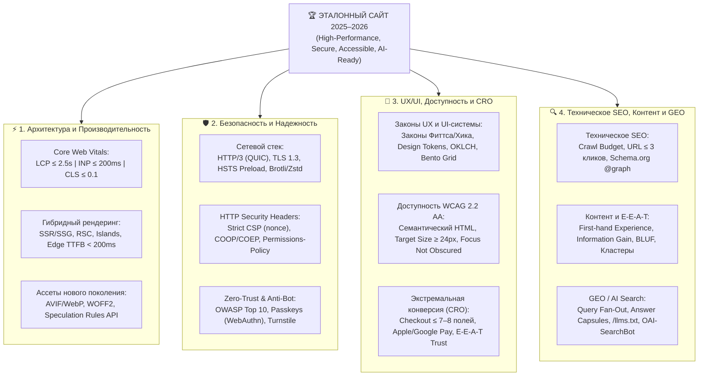

# Создание лучших сайтов: Мировые стандарты 2025–2026

> [!IMPORTANT]
> **Единая инженерно-маркетинговая база знаний (Production Reference Guide 2025–2026).**
> Данное руководство объединяет актуальные спецификации W3C, IETF, OWASP, Google Search Central, законы когнитивной психологии UX/CRO и научные исследования по оптимизации под генеративный ИИ-поиск (GEO). Из документации полностью исключены устаревшие мифы прошлых лет — оставлены только измеримые метрики, проверенные архитектурные паттерны и готовые к внедрению чек-листы.

---

## 1. Executive Summary: Главные технологические и продуктовые сдвиги 2025–2026

В 2025–2026 годах граница между фронтенд-инженерией, информационной безопасностью, UX/UI-дизайном и поисковым маркетингом окончательно стерлась. Сайт больше не может быть «красивым, но медленным» или «оптимизированным под ключи, но бесполезным для человека».

1. **От FID к INP в Core Web Vitals:** Метрика First Input Delay (FID) окончательно ушла в историю. Главным стандартом отзывчивости интерфейса стала **INP (Interaction to Next Paint $\le 200\text{ мс}$)**, оценивающая задержку *всех* взаимодействий пользователя за сессию и наказывающая сайты за раздутые JS-бандлы и блокировку главного потока (Main Thread).
2. **Гибридный рендеринг и Edge-вычисления:** Монолитный Client-Side Rendering (CSR) уступил место **SSR/SSG с потоковой передачей (Streaming SSR)**, **React Server Components (RSC)**, **Островной архитектуре (Islands Architecture — Astro)** и **Resumability (Qwik)**, исполняемым на граничных узлах CDN (Edge Network) в нескольких миллисекундах от пользователя.
3. **Сетевой стек HTTP/3 (QUIC) и тотальная защита по умолчанию:** Стандартом транспорта стали **HTTP/3 + TLS 1.3 (0-RTT)** и сжатие **Brotli / Zstandard**. Безопасность строится вокруг строгой **Content-Security-Policy (CSP Level 3)** с криптографическими `nonce`, отказа от паролей в пользу **Passkeys (WebAuthn / FIDO2)** и невидимой поведенческой защиты от ботов (**Cloudflare Turnstile**) вместо раздражающих капч с картинками.
4. **Инклюзивность как закон (WCAG 2.2 + EAA 2025):** Со вступлением в силу Европейского акта о доступности (**European Accessibility Act — июнь 2025 г.**) соблюдение стандарта **WCAG 2.2 Level AA** (включая размер мишеней клика $\ge 24\times24\text{ CSS px}$, видимый фокус и отказ от когнитивных тестов при входе) стало юридическим требованием и мощным драйвером конверсии.
5. **Сдвиг от классического SEO к GEO (Generative Engine Optimization):** Появление Google AI Overviews (снижающих CTR первой позиции органики на **~58%**) и взрывной рост **ChatGPT Search** и **Perplexity** изменили правила игры. Теперь сайты конкурируют за **цитирование внутри ИИ-ответов**, внедряют связанные графы сущностей Schema.org (`@graph`), верстают контент модульными «капсулами ответов» (Answer Capsules), публикуют манифесты **`/llms.txt`** и тонко разграничивают доступ для обучающих (`GPTBot`) и поисковых (`OAI-SearchBot`, `PerplexityBot`) ИИ-краулеров.

---

## 2. Архитектура эталонного сайта 2025–2026 (Четыре столпа)

---

## 3. Интерактивная карта базы знаний (Навигатор по всем 7 модулям и 20 руководствам)

Вся документация разделена на 7 профильных модулей (20 детальных руководств и справочников):

### ⚡ Модуль 01: Архитектура и Производительность (`01-architecture-and-performance`)
1. **[01. Core Web Vitals и оптимизация скорости загрузки](./01-architecture-and-performance/01-core-web-vitals.md)**
   * Метрики 75-го перцентиля CrUX: **LCP ($\le 2.5\text{ с}$)**, **INP ($\le 200\text{ мс}$)** и **CLS ($\le 0.1$)**.
   * Декомпозиция задержки INP (`Input Delay`, `Processing Time`, `Presentation Delay`) и уступание главного потока через `scheduler.yield()`.
   * Предотвращение сдвигов макета (CLS), `fetchpriority="high"`, оптимизация шрифтов (`WOFF2`, `size-adjust`), изображений (`AVIF`/`WebP`) и мгновенные переходы через **Speculation Rules API**.
2. **[02. Паттерны рендеринга и современные фреймворки](./01-architecture-and-performance/02-rendering-and-frameworks.md)**
   * Сравнительная матрица **CSR, SSR, SSG, ISR, Streaming SSR, Partial Prerendering (PPR), React Server Components (RSC), Islands Architecture и Resumability**.
   * Выбор стека под бизнес-задачу (Next.js 15/16, Nuxt 3/4, Astro 5, SvelteKit 2 + Svelte 5, Qwik).
   * Edge Computing, стратегия кэширования (`stale-while-revalidate`) и борьба с «проклятием гидратации».

### 🛡️ Модуль 02: Безопасность и Сетевая надежность (`02-security-and-reliability`)
3. **[01. Сетевые протоколы и заголовки безопасности (HTTP Headers)](./02-security-and-reliability/01-network-and-headers.md)**
   * Настройка **HTTP/3 (QUIC)**, **TLS 1.3 (0-RTT)**, постквантовой криптографии (`X25519MLKEM768`), **OCSP Stapling**, сжатия **Brotli (`br`)** и **Zstandard (`zstd`)**.
   * Эталонные конфигурации заголовков: **HSTS Preload**, **Strict CSP Level 3 (`nonce` + `strict-dynamic`)**, Trusted Types, `X-Content-Type-Options`, `Referrer-Policy`, `Permissions-Policy` и изоляция `COOP`/`COEP`/`CORP`.
4. **[02. Защита приложений (OWASP), Аутентификация и Антибот](./02-security-and-reliability/02-owasp-auth-and-antibot.md)**
   * Практическая защита по **OWASP Top 10** и **OWASP API Security** (BOLA, SSRF, SQLi, XSS, Supply Chain / SBOM / SRI).
   * Современная аутентификация: внедрение **Passkeys (WebAuthn Level 3 / FIDO2 Conditional UI)**, безопасное хранение сессий (`HttpOnly`, `Secure`, `SameSite`, префикс `__Host-`).
   * Эшелонированная защита от ботов и DDoS: **JA4+ Fingerprinting**, **Cloudflare Turnstile** и **Private Access Tokens (RFC 9577)**.

### 🎨 Модуль 03: UX/UI-дизайн, Доступность и Конверсия (`03-ux-ui-and-accessibility`)
5. **[01. Психология UX и современные UI-системы](./03-ux-ui-and-accessibility/01-ux-laws-and-modern-ui.md)**
   * Когнитивные законы проектирования: **Закон Фиттса, Закон Хика, Закон Якоба, Порог Доэрти ($< 400\text{ мс}$), Закон Миллера**.
   * **Intrinsic Web Design** (`@container` Container Queries), флюидная типографика (`clamp()` с защитой зума 200%), нативный **View Transitions API** и этика анимаций (`prefers-reduced-motion`).
6. **[02. Цифровая доступность: Стандарт WCAG 2.2 и EAA](./03-ux-ui-and-accessibility/02-accessibility-wcag-2.2.md)**
   * Юридические требования **European Accessibility Act (EAA 2025)**, ADA и статистика ошибок **WebAIM Million**.
   * Разбор всех новых критериев **WCAG 2.2** (`Focus Not Obscured`, `Dragging Movements`, `Target Size Minimum 24x24px`, `Accessible Authentication` и др.), нативные `<dialog>` и `popover` вместо ошибок ARIA, контрастность WCAG 2.x и **APCA ($L_c$)**.
7. **[03. Оптимизация конверсии (CRO), Формы и Психология доверия](./03-ux-ui-and-accessibility/03-cro-forms-and-trust.md)**
   * Айтрекинг-паттерны **NN/g** (*Layer-Cake* против *F-Pattern*) и исследования **Baymard Institute** (**+35.26% к конверсии** за счет сокращения чекаута до **7–8 полей** и Guest Checkout).
   * Правила верстки идеальных форм (отказ от `placeholder` вместо `<label>`, `inputmode`, `autocomplete`, валидация `onBlur`), социальные доказательства (рейтинг **4.2–4.7★**) и запрет *Dark Patterns* (EU DSA Art. 25, FTC Click-to-Cancel).

### 🔍 Модуль 04: Техническое SEO, Контент и ИИ-поиск (`04-seo-content-and-geo`)
8. **[01. Техническое SEO: Архитектура, Индексация и Schema.org](./04-seo-content-and-geo/01-technical-seo.md)**
   * Управление краулинговым бюджетом, фасетная навигация, плоская архитектура URL (глубина $\le 3$ кликов), `rel="canonical"` и мультиязычный `hreflang`.
   * Чистые XML Sitemaps с достоверным `<lastmod>`, протокол **IndexNow** и построение связанного графа сущностей **Schema.org (`@graph` + `@id`)** с ревизией депрецированных типов 2025–2026 гг.
9. **[02. Контент-стратегия, E-E-A-T и Семантические кластеры](./04-seo-content-and-geo/02-content-eeat-and-clusters.md)**
   * Инженерный подход к **E-E-A-T** (доказательство реального опыта — First-hand Experience) и патент Google по **Information Gain**.
   * Анатомия экспертной страницы по принципу **BLUF** (`TL;DR`, оглавление ToC, доказательная база) и архитектура топик-кластеров (**Pillar & Cluster / Hub & Spoke**).
10. **[03. Оптимизация под генеративный ИИ-поиск (GEO / AEO)](./04-seo-content-and-geo/03-geo-ai-search-optimization.md)**
    * Аналитика Ahrefs и Semrush по **Google AI Overviews**, **ChatGPT Search** и **Perplexity**; механика веерного ветвления запросов (**Query Fan-Out**).
    * Формула Принстонского исследования GEO (**+30–40% к видимости** за счет статистики, цитат и источников), модульная верстка **Answer Capsules (130–170 слов)**, внешний консенсус бренда, спецификация **`/llms.txt`** и эталонный **`robots.txt`** для ИИ-ботов.

### 📚 Модуль 05: Локальная документация первоисточников и стандартов (`05-sources-and-references`)
11. **[01. Сводный реестр авторитетных источников (Мастер-каталог)](./05-sources-and-references/01-authoritative-sources.md)**
    * Единый каталог всех 45+ официальных спецификаций, RFC, научных статей и исследований по 8 тематическим блокам.
12. **[02. Официальные спецификации W3C, WHATWG, IETF RFC и NIST (Конспект документации)](./05-sources-and-references/02-w3c-whatwg-ietf-specs.md)**
    * Детальный технический разбор стандартов WCAG 2.2, CSP3, Trusted Types, WebAuthn Level 3, CSS Container Queries, Speculation Rules API, TLS 1.3 (RFC 8446), QUIC (RFC 9000), HTTP/3 (RFC 9114), HSTS (RFC 6797), Privacy Pass (RFC 9577) и NIST FIPS 203 (ML-KEM).
13. **[03. Документация Google Search Central, Google web.dev и Schema.org](./05-sources-and-references/03-google-search-and-webdev-docs.md)**
    * Справочник стандартов Google: формулы CrUX p75 (LCP, INP, CLS), правила Google Search Essentials, Googlebot WRS, ревизия Schema.org, руководство асессоров SQRG (E-E-A-T, YMYL, антиспам-политики) и патент US11354342B2 (Information Gain).
14. **[04. Исследования институтов UX/CRO и регуляторные акты (Baymard, NN/g, WebAIM, EU DSA/EAA)](./05-sources-and-references/04-ux-cro-and-accessibility-studies.md)**
    * Документация исследований Baymard Institute (130 000+ часов юзабилити-тестов), айтрекинга и психологии NN/g, отчетов WebAIM Million (2025–2026), Spiegel Research Center и нормативных актов EU EAA, DSA Art. 25 и FTC Click-to-Cancel.
15. **[05. Научные работы и спецификации по ИИ-поиску (Princeton GEO, AIO, llms.txt, AI Bots)](./05-sources-and-references/05-geo-ai-search-papers-and-specs.md)**
    * Полный разбор научной работы Принстонского университета (`arXiv:2311.09735` — таблица всех 9 методов GEO-bench), исследований Ahrefs/Semrush по AI Overviews, спецификации `llmstxt.org` и документации краулеров OpenAI, Anthropic, Perplexity и Google.

### 🏗️ Модуль 06: Платформы, CMS, Конструкторы и AI-генераторы сайтов (`06-platforms-cms-and-builders`)
16. **[01. Визуальные конструкторы и No-Code платформы (Framer, Webflow, Tilda, Wix Studio, Readymag)](./06-platforms-cms-and-builders/01-nocode-and-visual-builders.md)**
    * Сравнение архитектуры рендеринга, тарифов, лимитов CMS, возможностей экспорта кода, показателей Core Web Vitals и специфики работы в РФ/СНГ (152-ФЗ, платежи, CRM) и на глобальном рынке.
17. **[02. Классические CMS, E-commerce движки и Headless CMS](./06-platforms-cms-and-builders/02-cms-and-ecommerce-engines.md)**
    * Современный высокоскоростной стек **WordPress** (Gutenberg FSE + Bricks Builder + Bedrock + Redis); сравнение **Shopify** (Liquid vs Hydrogen), **1С-Битрикс**, **InSales**, **WooCommerce** и **Medusa.js 2.0**; полный разбор **Headless CMS** (**Payload CMS 3.0**, **Strapi 5**, **Sanity**, **Directus**, **Keystatic**, **Decap**, **Ghost**).
18. **[03. ИИ-платформы генерации сайтов (Vibe Coding) и агентные AI-IDE](./06-platforms-cms-and-builders/03-ai-builders-and-vibe-coding.md)**
    * Генераторы интерфейсов и фуллстек-приложений (**v0 by Vercel**, **Bolt.new**, **Lovable.dev**, **Relume AI**), агентные среды разработки (**Cursor**, **Windsurf**, **Google Antigravity**, **Claude Code**), настройка серверов **MCP** и 4-часовой пайплайн сборки сайта.

### 🧰 Модуль 07: Инструменты, Инфраструктура, Сервисы и Пошаговый план запуска (`07-tools-infrastructure-and-roadmap`)
19. **[01. Инструменты проектирования, дизайна и фронтенд-разработки](./07-tools-infrastructure-and-roadmap/01-design-and-frontend-toolkit.md)**
    * **Figma** (Variables, Auto Layout 5.0+, Dev Mode, Code Connect, Figma MCP), **Tailwind CSS v4** (движок Oxide, `@theme`, палитра `oklch()`), **shadcn/ui**, **Radix UI / React Aria** и анимации на **Motion** и **GSAP** (`ScrollTrigger`, `SplitText`).
20. **[02. Домены, DNS, Хостинг, Self-Hosted PaaS, Базы данных, Auth, Почта и Платежи](./07-tools-infrastructure-and-roadmap/02-domains-hosting-baas-and-payments.md)**
    * Регистраторы доменов и DNS (Cloudflare At-Cost, Porkbun, Timeweb/Beget, нюансы ТСПУ/ECH в РФ), облачный Edge-хостинг (**Vercel, Cloudflare Workers, Railway, Fly.io**) против связки **VPS (Hetzner / Timeweb Cloud) + Coolify / Dokploy**, базы данных (**Supabase, Neon, Turso**), **Better Auth vs Clerk**, почта (**Resend + React Email**) и прием платежей (**Stripe, Paddle/Lemon Squeezy vs ЮKassa, Т-Касса, CloudPayments, СБП и кассы 54-ФЗ**).
21. **[03. Тестирование, Аналитика, Мониторинг, Юридический комплаенс (152-ФЗ / GDPR), Бюджеты и Пошаговый план](./07-tools-infrastructure-and-roadmap/03-analytics-qa-legal-and-roadmap.md)**
    * Автотесты (**Vitest, Playwright, Lighthouse CI**), аналитика и мониторинг (**PostHog, Plausible/Umami, Яндекс.Метрика, GA4, GSC, Яндекс.Вебмастер, Sentry, Better Stack**), полный юридический чек-лист по **152-ФЗ РФ** и **GDPR**, 3 готовые сметы бюджетов и **пошаговый план запуска сайта с нуля (Дни 1–18)**.

---

## 4. Сводная таблица целевых метрик эталонного сайта (2025–2026)

Используйте эту таблицу как единый SLA (Service Level Agreement) для команд разработки, DevOps, дизайна и маркетинга:

| Домен качества | Метрика / Параметр | Целевой эталон (Good / Pass) | Критический порог (Poor / Fail) | Инструмент измерения и верификации |
| :--- | :--- | :---: | :---: | :--- |
| **Производительность (CWV)** | **LCP** (Largest Contentful Paint) | **$\le 2.5\text{ с}$** (идеал $< 1.8\text{ с}$) | $> 4.0\text{ с}$ | CrUX (75-й перцентиль), PageSpeed Insights |
| **Отзывчивость (CWV)** | **INP** (Interaction to Next Paint) | **$\le 200\text{ мс}$** (идеал $< 100\text{ мс}$) | $> 500\text{ мс}$ | CrUX, Chrome DevTools Performance |
| **Визуальная стабильность** | **CLS** (Cumulative Layout Shift) | **$\le 0.1$** (идеал $< 0.05$) | $> 0.25$ | CrUX, Web Vitals Extension |
| **Скорость сервера / Edge** | **TTFB** (Time to First Byte) | **$\le 200\text{ мс}$** (допустимо $\le 800\text{ мс}$) | $> 1800\text{ мс}$ | WebPageTest, Cloudflare Analytics |
| **Бюджет JavaScript** | Размер критического JS-бандла (Gzip/Brotli) | **$\le 150–170\text{ КБ}$** | $> 350\text{ КБ}$ | Webpack/Vite Bundle Analyzer, Lighthouse |
| **Сетевая безопасность** | Протокол и шифрование | **HTTP/3 (QUIC) + TLS 1.3** | HTTP/1.1, TLS 1.0/1.1 | SSL Labs (Рейтинг **A+**), HTTP/3 Check |
| **Заголовки безопасности** | HTTP Security Headers (CSP, HSTS, COOP) | **Рейтинг A / A+** | Рейтинг C, D, F | Mozilla Observatory, SecurityHeaders.com |
| **Доступность (Accessibility)** | Стандарт **WCAG 2.2** | **Level AA (100% ключевых путей)** | Наличие блокеров Level A/AA | `@axe-core/playwright`, NVDA / VoiceOver |
| **Эргономика и UI** | Размер интерактивных мишеней клика | **$\ge 44\times44\text{ px}$** (минимум WCAG $24\times24\text{ px}$) | $< 24\times24\text{ px}$ | Chrome DevTools Accessibility Inspector |
| **Конверсия (CRO)** | Число полей в форме чекаута / лид-форме | **7–8 полей** (Checkout) / **3–4 поля** (B2B Lead) | $> 12–15$ полей | Аудит форм по методологии Baymard |
| **Техническое SEO** | Глубина вложенности страниц (Crawl Depth) | **$\le 3\text{ кликов}$** от главной страницы | $> 4\text{ кликов}$ / Страницы-сироты | Screaming Frog SEO Spider, JetOctopus |
| **ИИ-поиск (GEO / AEO)** | Готовность к RAG и ИИ-агентам | **Answer Capsules + `/llms.txt` + `OAI-SearchBot` Allow** | Блокировка поисковых ИИ-ботов в WAF/`robots.txt` | Проверка ответа `curl` с User-Agent ИИ-ботов |

---

## 5. Финальный Мастер-чеклист перед запуском в продакшен (Pre-Launch Master Checklist)

### ⚡ Блок 1: Архитектура, Рендеринг и Скорость
- [ ] Полевые и лабораторные показатели Core Web Vitals находятся в зеленой зоне: **LCP $\le 2.5\text{ с}$**, **INP $\le 200\text{ мс}$**, **CLS $\le 0.1$**.
- [ ] Главный элемент первого экрана (Hero-изображение) присутствует в исходном SSR/SSG HTML, имеет `fetchpriority="high"`, точные `width`/`height` и **не** имеет `loading="lazy"`.
- [ ] Все изображения переведены в **AVIF / WebP** с адаптивным `srcset`; шрифты — в **WOFF2** с `font-display: swap`/`optional` и настроенным `size-adjust`.
- [ ] Сторонние скрипты аналитики и чатов вынесены в Web Workers (Partytown) или загружаются отложенно после гидратации без блокировки главного потока (`Long Tasks < 50 мс`).
- [ ] Настроены **Speculation Rules API** (`prerender`/`prefetch`) для мгновенных переходов по высоковероятным маршрутам каталога и конверсионной воронки.

### 🛡️ Блок 2: Безопасность, Сеть и Защита от ботов
- [ ] На уровне веб-сервера / CDN активированы **HTTP/3 (QUIC)**, **TLS 1.3**, **OCSP Stapling**, сжатие **Brotli (`br`)** / **Zstandard (`zstd`)** и принудительный редирект на HTTPS.
- [ ] Внедрены строгие заголовки безопасности: `Strict-Transport-Security` (HSTS Preload), `Content-Security-Policy` (через `nonce` без `unsafe-inline`), `X-Content-Type-Options: nosniff`, `Referrer-Policy` и `Permissions-Policy`.
- [ ] Все пользовательские и API-эндпоинты защищены от уязвимостей **OWASP Top 10** (параметризованные запросы к БД, защита от BOLA/IDOR, белый список для исходящих запросов против SSRF).
- [ ] Сессионные куки используют флаги `HttpOnly`, `Secure`, `SameSite=Lax`/`Strict` и префикс `__Host-`; поддерживается вход по **Passkeys (WebAuthn)** и **OAuth 2.1 с PKCE**.
- [ ] Вместо графических капч на формах установлен невидимый **Cloudflare Turnstile**, а в WAF настроены Rate Limiting и защита от автоматизированного парсинга.

### 🎨 Блок 3: UX/UI, Доступность (WCAG 2.2) и CRO
- [ ] Вся верстка построена на семантических тегах HTML5 (`<header>`, `<nav>`, `<main>`, `<article>`, `<button>`); интерактивные элементы полностью управляются с клавиатуры (`Tab`, `Enter`, `Escape`) с видимым индикатором `:focus-visible`.
- [ ] Контрастность текста ($\ge 4.5:1$), UI-компонентов ($\ge 3:1$) и размеры зон нажатия ($\ge 24\times24\text{ px}$ по WCAG 2.2 AA, $\ge 44\times44\text{ px}$ на тач-экранах) проходят автотесты `@axe-core/playwright` с 0 ошибок.
- [ ] Анимации работают исключительно на GPU-свойствах (`transform`, `opacity`) и отключаются при системной настройке `@media (prefers-reduced-motion: reduce)`.
- [ ] В формах отсутствуют `placeholder` вместо `<label>`, включены `autocomplete` и мобильные клавиатуры `inputmode`, разрешена вставка паролей из буфера обмена, а валидация срабатывает по `onBlur`.
- [ ] Чекаут не требует принудительной регистрации (доступен **Guest Checkout**), содержит не более **7–8 полей**, объединяет «Имя и Фамилию» в одно поле, раскрывает полную стоимость с доставкой до ввода карты и поддерживает оплату в 1 клик (**Apple Pay / Google Pay / СБП**).

### 🔍 Блок 4: Техническое SEO, Контент (E-E-A-T) и ИИ-поиск (GEO)
- [ ] Все целевые страницы отдают код `200 OK`, доступны не более чем в **3 клика** от главной, имеют самореферентный абсолютный `rel="canonical"` и корректные взаимные теги `hreflang` (при мультиязычности).
- [ ] Сгенерирована чистая карта `sitemap.xml` (без редиректов и `noindex`) с честным тегом `<lastmod>` и авто-уведомлениями по протоколу **IndexNow**.
- [ ] Внедрен связанный граф микроразметки **Schema.org JSON-LD (`@graph` + `@id`)**, связывающий `Organization`, `WebSite`, `WebPage`, `BreadcrumbList`, `Article`/`Product` и `Person` (автора/рецензента).
- [ ] Страницы сверстаны по принципу **BLUF**: на первом экране размещен блок выжимки `TL;DR`, оглавление с якорями (ToC), реальные доказательства опыта (**First-hand Experience**) и ссылки на первоисточники.
- [ ] Каждый смысловой раздел `H2`/`H3` оформлен в виде **Answer Capsule (130–170 слов)** с прямым определением в первом предложении и семантическими таблицами `<table>` для цитирования в **Google AI Overviews, ChatGPT Search и Perplexity**.
- [ ] В корне сайта опубликован навигационный манифест **`/llms.txt`**, а в `robots.txt` и правилах WAF/CDN гарантирован беспрепятственный доступ для поисковых ИИ-ботов (`OAI-SearchBot`, `ChatGPT-User`, `PerplexityBot`, `Claude-SearchBot`, `Googlebot`, `Bingbot`).
