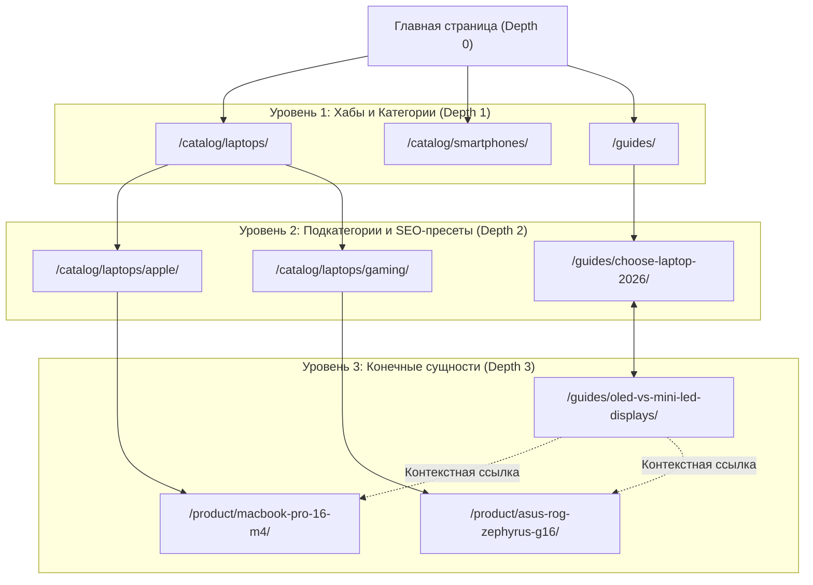
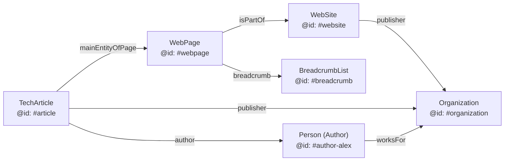

# Техническое SEO (2025–2026): Архитектура, Индексация и Графы Сущностей

> [!IMPORTANT]
> **Главный сдвиг 2025–2026:** Техническое SEO перестало быть набором изолированных «трюков» для роботов. Сегодня это **инженерия доставки данных** для двух классов систем одновременно: классических поисковых индексов (Googlebot, Bingbot, YandexBot) и RAG-пайплайнов генеративных ИИ-движков (SearchGPT/OAI-SearchBot, PerplexityBot, Google Gemini). Ошибки рендеринга, раздутый краулинговый бюджет или отсутствие связанного графа сущностей (`@graph` в Schema.org) делают сайт невидимым для обоих миров.

---

## 1. Управление краулинговым бюджетом (Crawl Budget Management)

Краулинговый бюджет — это количество URL-адресов, которые поисковый бот может и хочет просканировать за единицу времени. По документации [Google Search Central (Crawl Budget Management)](https://developers.google.com/search/docs/crawling-indexing/large-site-managing-crawl-budget), бюджет определяется двумя факторами:
1. **Предел скорости сканирования (Crawl Capacity Limit):** насколько быстро сервер отдает ответ (TTFB < 200 мс) без ошибок `5xx` и `429 Too Many Requests`.
2. **Спрос на сканирование (Crawl Demand):** популярность URL, частота обновления и авторитетность страницы.

### 1.1. Главные пожиратели краулингового бюджета и методы борьбы

| Ловушка краулинга (Crawl Trap) | Причина возникновения | Архитектурное решение (2025–2026) |
| :--- | :--- | :--- |
| **Фасетная навигация (Faceted Navigation)** | Комбинаторный взрыв фильтров (`/shoes?color=red&size=42&sort=price_asc`) генерирует миллионы дублей. | 1. Разрешать индексацию только частотных SEO-срезов (бренд + категория) через ЧПУ (`/shoes/nike/`).<br>2. Закрывать комбинации >2 фильтров, сортировки и диапазоны цен в `robots.txt` или через `noindex, nofollow` + AJAX/Fetch без смены индексируемого `<a href>`. |
| **Бесконечные календари и пагинация** | Динамическая генерация ссылок на будущие/прошлые даты (`?month=2099-12`) или глубокую пагинацию (`?page=9999`). | Ограничение глубины пагинации, вывод ссылок на бесконечно далекие даты через JS без тегов `<a href>`, возврат `404` на пустые страницы пагинации. |
| **Сессионные и трекинговые GET-параметры** | Уникальные `session_id`, `utm_*`, `gclid`, `fbclid`, `ref` в внутренних ссылках. | Строгий `rel="canonical"` на чистый URL; нормализация URL на уровне CDN (Cloudflare URL Normalization); запрет генерации внутренних ссылок с трекингом. |
| **Soft 404 (Мягкие 404)** | Удаленный товар или пустая категория отдает HTTP-код `200 OK` с текстом «Товар не найден». | Строгий возврат HTTP `404 Not Found` или `410 Gone` (для навсегда удаленных разделов). |
| **Цепочки редиректов (Redirect Chains)** | `HTTP -> HTTPS -> www -> non-www -> trailing-slash` (3–5 прыжков). | Схлопывание всех правил в **единый прямой `301 Moved Permanently` / `308 Permanent Redirect`** на уровне Edge/CDN. |

> [!WARNING]
> **Миф о `noindex` и краулинговом бюджете:** Тег `<meta name="robots" content="noindex">` **не экономит** краулинговый бюджет. Чтобы прочитать этот тег, боту нужно сначала скачать HTML-документ. Для блокировки сканирования мусорных параметров используйте `Disallow` в `robots.txt` или не размещайте на них ссылки `<a href>`.

---

## 2. Таксономия, Архитектура URL и Глубина кликов

### 2.1. Правило 3 кликов и плоская архитектура (Flat Architecture)
Любая коммерчески или информационно значимая страница сайта должна находиться на расстоянии **не более 3 кликов (Crawl Depth $\le 3$)** от главной страницы. Чем меньше глубина вложенности, тем выше передаваемый внутренний вес (Internal PageRank) и чаще частота переобхода ботом.



### 2.2. Стандарты проектирования URL (URI Design)
1. **Семантическая читаемость (Human & LLM Readable):** URL должен явно отражать иерархию и топик страницы (`/cloud-security/zero-trust-architecture/`, а не `/p=84920&cat=12`). ИИ-агенты используют токены URL для первичной оценки релевантности до парсинга страницы.
2. **Разделители:** Используйте исключительно дефисы (`-`), а не нижние подчеркивания (`_`). Google рассматривает дефис как разделитель слов, а подчеркивание — как склейку (`zero_trust` = `zerotrust`).
3. **Регистр и слеши:** Строгий нижний регистр (`lowercase`). Выберите единый стандарт закрывающего слеша (со слешем или без) и настройте сквозной `301` редирект во избежание дублей.
4. **Независимость карточек товаров от категорий:** Карточки товаров должны иметь корневой путь `/product/macbook-pro-16-m4/`, а не `/catalog/laptops/apple/macbook-pro-16-m4/`. Это позволяет привязывать один товар к нескольким категориям без генерации дублей URL, а путь навигации отображать через микроразметку `BreadcrumbList`.

---

## 3. Правила каноникализации (`rel="canonical"`)

Атрибут `<link rel="canonical" href="...">` указывает поисковым системам каноническую (основную) версию страницы среди группы полных или частичных дубликатов.

### 3.1. Золотые правила каноникализации
* **Абсолютные URL:** Всегда используйте полный путь с протоколом и доменом (`https://example.com/category/page/`), а не относительный (`/category/page/`).
* **Self-Referencing Canonical:** Каждая уникальная индексируемая страница обязана содержать каноническую ссылку сама на себя. Это защищает страницу от дублирования при появлении внешних ссылок с произвольными GET-метками (`?utm_source=...`).
* **Каноникализация пагинации (Критическая ошибка!):** На страницах пагинации (`/blog?page=2`, `/blog?page=3`) канонический тег должен указывать **сам на себя** (`href="https://example.com/blog?page=2"`), а **НЕ на первую страницу** (`/blog`). Указание первой страницы в качестве канонической для всей пагинации приводит к выпадению из индекса товаров и статей, размещенных глубже первой страницы ([Google Search Central: Pagination Best Practices](https://developers.google.com/search/docs/specialty/ecommerce/pagination-and-incremental-page-loading)).
* **Синхронизация сигналов:** Канонический URL должен отдавать код `200 OK`, быть открытым для индексации (без `noindex`), присутствовать в `sitemap.xml` и использоваться во всех внутренних ссылках.

---

## 4. Мультиязычность и мультирегиональность (`hreflang`)

Для сайтов с несколькими языковыми или региональными версиями атрибут `hreflang` предотвращает конкуренцию собственных страниц в выдаче разных стран и подменяет в SERP правильную валюту/язык.

### 4.1. Строгие требования к `hreflang`
1. **Двунаправленность (Reciprocity / Return Tags):** Если страница `A` (`/en/`) ссылается в `hreflang` на страницу `B` (`/de/`), то страница `B` **обязана** содержать обратный тег `hreflang` на страницу `A`. Без взаимного подтверждения теги игнорируются.
2. **Самореферентность (Self-Referencing):** В блоке `hreflang` всегда должна присутствовать ссылка на текущую языковую версию страницы.
3. **Строгие стандарты кодов:**
   * Язык указывается в формате **ISO 639-1** (например, `en`, `de`, `ru`, `es`).
   * Регион (опционально) — в формате **ISO 3166-1 Alpha 2** (например, `US`, `GB`, `DE`, `KZ`).
   * *Типичная ошибка:* использование `en-UK` вместо правильного `en-GB` (код Великобритании — `GB`, а `UK` зарезервирован, при этом `uk` как язык — украинский).
4. **Обязательный `x-default`:** Указывает резервную страницу (обычно англоязычную или страницу выбора региона) для пользователей, чей язык/регион не совпадает ни с одной из локализаций.

```html
<!-- Эталонная секция <head> для мультиязычной страницы (на примере https://example.com/en-gb/pricing/) -->
<link rel="canonical" href="https://example.com/en-gb/pricing/" />

<link rel="alternate" hreflang="en-us" href="https://example.com/en-us/pricing/" />
<link rel="alternate" hreflang="en-gb" href="https://example.com/en-gb/pricing/" />
<link rel="alternate" hreflang="de-de" href="https://example.com/de-de/preise/" />
<link rel="alternate" hreflang="ru"    href="https://example.com/ru/tarify/" />
<link rel="alternate" hreflang="x-default" href="https://example.com/en-us/pricing/" />
```

---

## 5. Чистые XML Sitemaps и протокол IndexNow

Файл `sitemap.xml` — это манифест канонических URL вашего сайта для поисковых систем.

### 5.1. Правила гигиены XML Sitemap в 2025–2026 гг.
* **Только `200 OK` + Canonical + Indexable:** В карте сайта категорически запрещено размещать редиректы (`301`/`302`), битые ссылки (`404`), неканонические URL или страницы с `noindex`.
* **Честный `<lastmod>`:** Тег `<lastmod>` (в формате ISO 8601 `YYYY-MM-DDThh:mm:ss+TZD`) является главным сигналом для Googlebot и Bingbot о необходимости повторного обхода. **Обновляйте `<lastmod>` только при реальном изменении основного контента или цен.** Если скрипт обновляет дату на всех страницах каждую ночь при деплое, поисковики перестают доверять `<lastmod>` всего домена.
* **Удаление мертвых тегов `<priority>` и `<changefreq>`:** Поисковые системы официально игнорируют оба тега более 7 лет. Удалите их для уменьшения веса XML-файла.
* **Декомпозиция по типам сущностей:** При большом объеме страниц используйте индексный файл `sitemap-index.xml`, разделяя карты по типам (`sitemap-products.xml`, `sitemap-categories.xml`, `sitemap-articles.xml`). Лимит одного файла — до **50 000 URL** или **50 МБ** в несжатом виде.
* **Протокол IndexNow:** Для мгновенного уведомления Bing (на базе которого работают многие RAG-сценарии ИИ-поиска) и Яндекса об изменениях контента интегрируйте webhook-отправку URL по протоколу [IndexNow](https://www.indexnow.org/) сразу после публикации или обновления записи в CMS.

---

## 6. Связанный Граф Сущностей Schema.org (`@graph` и `@id`)

> [!IMPORTANT]
> В 2025–2026 годах микроразметка JSON-LD используется не только для получения визуальных сниппетов (Rich Results) в SERP, но и для **прямой загрузки графа знаний (Knowledge Graph) в LLM и поисковые движки** (Entity SEO). Вместо разрозненных кусков кода на странице необходимо строить единый связанный граф через массив `@graph` и уникальные идентификаторы узлов `@id`.

### 6.1. Ревизия типов Schema.org: Актуальные vs Депрецированные (2025–2026)

В 2023–2025 годах Google Search Central провел масштабную чистку поисковой выдачи от визуального шума. В частности, в **июне 2025 года** Google официально прекратил поддержку целого ряда расширенных сниппетов ([Google Search Central Blog: Simplifying the Search Results Page](https://developers.google.com/search/blog/2025/06/simplifying-search-results)).

| Категория статуса | Типы разметки Schema.org | Статус в Google Search и AI-поиске (2025–2026) |
| :--- | :--- | :--- |
| **Полностью поддерживаемые (Rich Results + Entity Graph)** | `Organization`, `LocalBusiness`, `Person`, `Product` (вкл. `MerchantReturnPolicy`, `OfferShippingDetails`), `Article` (`NewsArticle`, `BlogPosting`, `TechArticle`), `BreadcrumbList`, `VideoObject`, `SoftwareApplication`, `Event`, `JobPosting`, `Recipe`, `DiscussionForumPosting`, `ProfilePage`, `Dataset`, `Book` (Book Actions). | Генерируют расширенные сниппеты в SERP и формируют основной граф сущностей для E-E-A-T и товарного поиска (Google Merchant / Shopping Graph). *Примечание:* `Book Actions` изначально попали в анонс депрекации июня 2025 г., но Google отозвал их удаление и сохранил поддержку. |
| **Строго ограниченные (Restricted Rich Results)** | `FAQPage` | Визуальный сниппет в Google SERP выводится **только для авторитетных государственных и медицинских сайтов**. Однако для коммерческих сайтов разметка `FAQPage` остается полезной для парсинга вопросов/ответов ИИ-ботами (Perplexity, ChatGPT). |
| **Депрецированные в 2023–2024 гг.** | `HowTo`, `QAPage` (частично вытеснен `DiscussionForumPosting`) | Полностью отключены в визуальной выдаче Google (десктоп и мобайл). |
| **Депрецированные в июне 2025 г. (Упразднены в SERP и GSC)** | `ClaimReview`, `CourseInfo`, `EstimatedSalary`, `LearningVideo`, `SpecialAnnouncement`, `VehicleListing` | **Удалены из Google Rich Results, Search Console и BigQuery-экспортов.** Оставление этой разметки на сайте не вызывает санкций, но не дает никаких визуальных преимуществ в Google SERP. |

### 6.2. Архитектура связанного графа (`@graph` + `@id`)

Вместо вставки трех разных тегов `<script type="application/ld+json">` для организации, хлебных крошек и статьи, объединяйте их в единый граф, где сущности ссылаются друг на друга через URI-идентификаторы `@id`:



### 6.3. Эталонный пример полного JSON-LD графа (`@graph`)

Ниже представлен готовый к продакшену шаблон связанного графа JSON-LD, объединяющий `Organization`, `WebSite`, `WebPage`, `BreadcrumbList`, `TechArticle` и экспертного автора `Person` с подтверждением компетенций (`sameAs`, `knowsAbout`, `jobTitle`):

```html
<script type="application/ld+json">
{
  "@context": "https://schema.org",
  "@graph": [
    {
      "@type": "Organization",
      "@id": "https://example.com/#organization",
      "name": "Example Tech Labs",
      "url": "https://example.com/",
      "logo": {
        "@type": "ImageObject",
        "@id": "https://example.com/#logo",
        "url": "https://example.com/assets/logo.png",
        "width": 600,
        "height": 60
      },
      "sameAs": [
        "https://github.com/example-tech-labs",
        "https://www.linkedin.com/company/example-tech-labs",
        "https://www.wikidata.org/wiki/Q12345678"
      ],
      "contactPoint": {
        "@type": "ContactPoint",
        "contactType": "customer support",
        "email": "support@example.com",
        "availableLanguage": ["English", "Russian"]
      }
    },
    {
      "@type": "WebSite",
      "@id": "https://example.com/#website",
      "url": "https://example.com/",
      "name": "Example Tech Labs — Cloud & AI Engineering",
      "publisher": {
        "@id": "https://example.com/#organization"
      },
      "inLanguage": "ru-RU"
    },
    {
      "@type": "WebPage",
      "@id": "https://example.com/guides/zero-trust-architecture/#webpage",
      "url": "https://example.com/guides/zero-trust-architecture/",
      "name": "Архитектура Zero Trust в 2026 году: полное руководство",
      "isPartOf": {
        "@id": "https://example.com/#website"
      },
      "breadcrumb": {
        "@id": "https://example.com/guides/zero-trust-architecture/#breadcrumb"
      },
      "datePublished": "2026-01-15T09:00:00+03:00",
      "dateModified": "2026-03-10T14:30:00+03:00",
      "inLanguage": "ru-RU"
    },
    {
      "@type": "BreadcrumbList",
      "@id": "https://example.com/guides/zero-trust-architecture/#breadcrumb",
      "itemListElement": [
        {
          "@type": "ListItem",
          "position": 1,
          "name": "Главная",
          "item": "https://example.com/"
        },
        {
          "@type": "ListItem",
          "position": 2,
          "name": "Руководства",
          "item": "https://example.com/guides/"
        },
        {
          "@type": "ListItem",
          "position": 3,
          "name": "Архитектура Zero Trust",
          "item": "https://example.com/guides/zero-trust-architecture/"
        }
      ]
    },
    {
      "@type": "Person",
      "@id": "https://example.com/authors/alex-ivanov/#person",
      "name": "Алексей Иванов",
      "url": "https://example.com/authors/alex-ivanov/",
      "jobTitle": "Principal Security Architect (CISSP, CISM)",
      "worksFor": {
        "@id": "https://example.com/#organization"
      },
      "knowsAbout": [
        "Zero Trust Network Access",
        "Mutual TLS (mTLS)",
        "Cloud Security",
        "OWASP Top 10"
      ],
      "sameAs": [
        "https://www.linkedin.com/in/alex-ivanov-sec",
        "https://github.com/alex-ivanov-sec"
      ]
    },
    {
      "@type": "TechArticle",
      "@id": "https://example.com/guides/zero-trust-architecture/#article",
      "mainEntityOfPage": {
        "@id": "https://example.com/guides/zero-trust-architecture/#webpage"
      },
      "headline": "Архитектура Zero Trust в 2026 году: полное руководство по внедрению",
      "description": "Практическое руководство по переходу от периметральной безопасности к Zero Trust: mTLS, BeyondCorp и проверка состояния устройств.",
      "image": "https://example.com/assets/covers/zero-trust-2026.webp",
      "datePublished": "2026-01-15T09:00:00+03:00",
      "dateModified": "2026-03-10T14:30:00+03:00",
      "author": {
        "@id": "https://example.com/authors/alex-ivanov/#person"
      },
      "ReviewedBy": {
        "@type": "Person",
        "name": "Мария Смирнова",
        "jobTitle": "Head of DevSecOps"
      },
      "publisher": {
        "@id": "https://example.com/#organization"
      },
      "about": [
        {
          "@type": "Thing",
          "name": "Zero Trust Architecture",
          "sameAs": "https://www.wikidata.org/wiki/Q65089600"
        }
      ]
    }
  ]
}
</script>
```

> [!TIP]
> **Связка `about` и `mentions` с Wikidata:** Обратите внимание на блок `"about"` с ссылкой на `wikidata.org/wiki/Q65089600`. Явная привязка темы статьи к глобальному идентификатору сущности в Wikidata устраняет лексическую неоднозначность (Disambiguation) для поисковых графов и LLM.

---

## 7. Чек-лист технического SEO-аудита перед релизом

- [ ] **Рендеринг для ботов:** Критический контент (`<h1>`, основной текст, внутренние ссылки `<a href>`, микроразметка JSON-LD и метатеги) присутствует в первичном SSR/SSG HTML-ответе сервера без необходимости выполнения клиентского JavaScript.
- [ ] **Глубина и URL:** Все целевые страницы доступны в $\le 3$ клика от главной; URL в нижнем регистре, через дефис, без цепочек редиректов.
- [ ] **Каноникализация:** На всех страницах (включая пагинацию `?page=N`) прописан самореферентный абсолютный `rel="canonical"`.
- [ ] **Локализация:** Настроены взаимные теги `hreflang` с валидными кодами ISO 639-1 / ISO 3166-1 и тегом `x-default`.
- [ ] **XML Sitemap:** Карта содержит только канонические `200 OK` страницы с достоверным `<lastmod>` и подключена к авто-пингам IndexNow.
- [ ] **Связанный граф Schema.org:** Внедрен единый блок JSON-LD с `@graph` и связями `@id`, исключены устаревшие типы (`ClaimReview`, `CourseInfo`, `HowTo` и др.), валидация в [Schema Markup Validator](https://validator.schema.org/) и [Google Rich Results Test](https://search.google.com/test/rich-results) проходит без ошибок.
