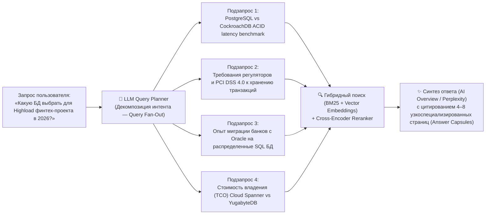

# Оптимизация под генеративный ИИ-поиск (GEO / AEO): Стандарты 2025–2026

> [!IMPORTANT]
> **Главный сдвиг 2025–2026:** Классическая борьба за «10 синих ссылок» сменилась борьбой за **цитирование внутри синтезированного ИИ-ответа** (Share of Model / Citation Visibility). Пользователи делегируют поиск и сравнение продуктов генеративным системам: **Google AI Overviews (AIO) / AI Mode**, **ChatGPT Search**, **Perplexity**, **Claude Search** и **Microsoft Copilot**. Дисциплина оптимизации контента и технической инфраструктуры сайта под RAG-пайплайны (Retrieval-Augmented Generation) получила название **GEO (Generative Engine Optimization)** или **AEO (Answer Engine Optimization)**.

---

## 1. Аналитика рынка ИИ-поиска и механизм Query Fan-Out

### 1.1. Влияние AI Overviews на органический трафик (Данные исследований Ahrefs и Semrush)
Масштабные исследования поисковой выдачи 2025–2026 годов зафиксировали фундаментальную трансформацию поведения пользователей и алгоритмов отбора источников:
* **Падение CTR классического ТОП-1 на ~58%:** По данным [исследования Ahrefs (AI Overviews Reduce Clicks by 58%)](https://ahrefs.com/blog/ai-overviews-reduce-clicks/), появление блока Google AI Overview над результатами поиска снижает средний CTR первой органической позиции на **58%** (рост падения с 34,5% в 2024 году до 58% к началу 2026 года), формируя феномен Zero-Click Searches.
* **Парадокс видимости — только ~38% ссылок в AIO берутся из ТОП-10:** По данным [анализа цитирований Ahrefs](https://ahrefs.com/blog/ai-overviews-citations/), лишь около **38%** URL-адресов, на которые ссылается Google AI Overview, ранжируются в классическом ТОП-10 по исходному запросу пользователя. Остальные **~62%** источников извлекаются с позиций 11–100+ или по смежным подзапросам.
* **Высокая конверсия ИИ-трафика:** Согласно отчетам [Semrush AI Search Study](https://www.semrush.com/blog/ai-search-seo-traffic-study/), несмотря на меньший объем кликов, пользователь, перешедший по ссылке-источнику из ChatGPT Search или Perplexity, конвертируется в **2,5–4,4 раза лучше**, чем посетитель из традиционной органики, так как этап первичного прогрева и сравнения уже выполнен внутри диалога с ИИ.

### 1.2. Почему в ИИ-ответы попадают страницы вне ТОП-10: Механизм Query Fan-Out
Генеративные поисковики (Google Gemini в AIO, ChatGPT Search, Perplexity) не ищут ответ по одному ключевому запросу пользователя. Они используют архитектуру **Query Fan-Out (Веерное ветвление запросов)**:



**Вывод для GEO-стратегии:** Чтобы попасть в синтезированный ответ по высококонкурентному запросу, не обязательно побеждать гигантов по главному ВЧ-ключу. Достаточно дать **самый точный, оцифрованный и структурно чистый ответ** на один из специфических веерных подзапросов (`Sub-queries`), которые генерирует LLM при планировании ответа.

---

## 2. Доказательная оптимизация текста: Принстонское исследование GEO (GEO-bench)

Фундаментальная научная работа исследователей из Принстонского университета, Georgia Tech, Allen Institute for AI и IIT Delhi — [GEO: Generative Engine Optimization (Aggarwal et al., KDD 2024 / arXiv:2311.09735)](https://arxiv.org/abs/2311.09735) — протестировала на бенчмарке из 10 000 запросов (**GEO-bench**) влияние различных модификаций текста на видимость сайта в генеративных ответах (Position-Adjusted Word Count и Subjective Impression).

### 2.1. Рейтинг эффективности методов GEO (по данным Принстонского исследования)

| Метод оптимизации контента | Прирост видимости в ИИ-ответах | Механика работы и примеры применения |
| :--- | :---: | :--- |
| **1. Добавление конкретной статистики (Statistics Addition)** | **+30% ... +40%** | Замена качественных прилагательных («быстрый», «надежный», «большинство») на точные количественные метрики, проценты, даты и объемы выборки. LLM обучены отдавать приоритет фактологической конкретике при сборке ответа. |
| **2. Цитирование авторитетных источников (Cite Sources)** | **+30% ... +37%** | Явное указание источников внутри текста («Согласно отчету Gartner за 2025 год...», «По спецификации W3C WCAG 2.2...») с гиперссылками. Повышает оценку достоверности чанка при реранкинге (Reranking). |
| **3. Прямые цитаты экспертов (Quotation Addition)** | **+28% ... +41%** | Включение верифицируемых цитат профильных специалистов с указанием имени и должности. Добавляет уникальные семантические маркеры и сигнал E-E-A-T. |
| **4. Упрощение и беглость изложения (Fluency & Easy-to-Understand)** | **+15% ... +30%** | Четкая субъектно-предикатная структура предложений (`Сущность -> Действие -> Результат`), отсутствие воды и сложных канцеляризмов. Облегчает векторное кодирование (Embedding) смысла без потерь. |
| **5. Авторитетный тон и техническая терминология (Authoritative & Technical Terms)** | **+10% ... +20%** | Точное использование отраслевых терминов (например, `mTLS`, `INP`, `Brotli`, `Zero-Knowledge Proof`) вместо размытых описаний. |
| **❌ Переспам ключевыми словами (Keyword Stuffing)** | **-8% ... -10% (Пессимизация!)** | Механическое повторение SEO-ключей из классического SEO **снижает** видимость в генеративных системах, так как ухудшает перплексию текста и отсеивается фильтрами качества RAG. |

---

## 3. Модульная верстка контента для RAG: «Капсулы ответов» (Answer Capsules)

Когда поисковый ИИ-бот скачивает вашу страницу, он разбивает ее на фрагменты текста (**Chunks** — обычно по 200–500 токенов) для сохранения в векторном индексе или подачи в контекстное окно LLM. Если ответ на вопрос «размазан» по пяти экранам текста, векторная близость (Cosine Similarity) такого фрагмента к запросу пользователя будет низкой.

### 3.1. Стандарт «Answer Capsule» (Капсула ответа: 130–170 слов)
Проектируйте каждый раздел `H2`/`H3` как **автономную капсулу ответа**, которую ИИ может процитировать целиком без потери контекста:

1. **Заголовок `H2`/`H3` в форме явного вопроса или точной формулировки концепции:**
   * *Плохо:* `Производительность и скорость`
   * *Хорошо:* `Какая задержка (INP) считается эталонной для e-commerce в 2026 году?`
2. **Первое предложение — прямое определение (Is-A / Does-A Statement):** Начинайте абзац с полного подлежащего, не используйте местоимения («Это», «Он», «Данный подход»), так как при чанкинге связь с предыдущим абзацем теряется.
3. **Оптимальный объем капсулы — 40–60 слов для краткого определения или 130–170 слов для развернутого блока** (включая маркированный список из 3–5 пунктов или мини-таблицу).
4. **Структурированные HTML-таблицы (`<table>`, `<thead>`, `<tbody>`, `<th>`):** LLM демонстрируют высочайшую точность извлечения данных из классических семантических таблиц. Никогда не верстайте таблицы через вложенные `<div class="table-row">` и тем более не вставляйте таблицы картинками (`.png`/`.jpg`).

---

## 4. Внешний консенсус бренда (Off-Site Brand Mentions & Co-Occurrence)

Генеративные модели и поисковые системы оценивают авторитетность бренда не только по гиперссылкам (`<a href>`), но и по **бессылочным упоминаниям (Unlinked Brand Mentions)** и **совместной встречаемости (Co-Occurrence)** имени вашего бренда с ключевыми сущностями ниши в обучающей выборке и в живом индексе.

### 4.1. Где ИИ-поисковики ищут подтверждение авторитета (Consensus Signals)
* **UGC-платформы и инженерные сообщества:** **Reddit**, **Hacker News**, **Stack Overflow**, **GitHub Discussions**, **Habr**, профильные Telegram/Discord-архивы. После сделок Google и OpenAI с Reddit обсуждения реальных пользователей имеют колоссальный вес в формировании рекомендаций («Best X tools according to Reddit»).
* **Агрегаторы отзывов и рейтингов (B2B/B2C):** G2, Capterra, Gartner Peer Insights, Trustpilot, Product Hunt, профильные отраслевые рейтинги.
* **Видеохостинги с транскриптами (YouTube):** Google Gemini и AI Overviews активно индексируют тайм-коды и текстовые расшифровки (Subtitles/CC) экспертных видео на YouTube.
* **Энциклопедические и графовые базы:** Wikidata, Wikipedia, Crunchbase.

> [!TIP]
> **Стратегия Entity Co-Occurrence:** Добивайтесь того, чтобы в независимых обзорах, СМИ и сравнениях название вашего продукта регулярно стояло в одном абзаце с лидерами категории и целевыми сценариями использования (например: *«Для защиты API от ботов компании используют Cloudflare Turnstile, DataDome или [Ваш Бренд]»*). Это закрепляет связь сущностей в векторном пространстве модели.

---

## 5. Управление ИИ-краулерами: Разделение Training Bots и Search Bots

> [!CAUTION]
> **Фатальная ошибка администраторов в 2024–2026 гг.:** Желая запретить бесплатное обучение LLM на своем контенте, многие владельцы сайтов бездумно заблокировали все User-Agent, связанные с OpenAI, Anthropic и Perplexity. В результате они **полностью удалили свои сайты из ответов и ссылок ChatGPT Search и Perplexity**, потеряв самый быстрорастущий канал реферального трафика.

Необходимо четко разделять **три класса ИИ-ботов** ([OpenAI Crawlers Documentation](https://platform.openai.com/docs/bots), [Anthropic Crawlers](https://support.anthropic.com/en/articles/8896518-does-anthropic-crawl-data-from-the-web-and-how-can-site-owners-block-the-crawler), [Google Common Crawlers](https://developers.google.com/search/docs/crawling-indexing/overview-google-crawlers)):

| User-Agent бота | Владелец | Класс и назначение бота | Рекомендуемая политика для бизнеса (GEO) |
| :--- | :--- | :--- | :--- |
| **`OAI-SearchBot`** | OpenAI | **Поисковый индекс (Search Index):** индексирует сайты специально для показа кликабельных ссылок и источников в **ChatGPT Search**. *Не используется для обучения базовых моделей.* | ✅ **`Allow: /`** (Обязательно разрешить!) |
| **`ChatGPT-User`** | OpenAI | **Живой агент (User-Triggered Fetch):** обращается к странице в реальном времени по запросу пользователя в ChatGPT. | ✅ **`Allow: /`** (Обязательно разрешить!) |
| **`PerplexityBot`** / **`Perplexity-User`** | Perplexity AI | **Поисковый индекс и живой агент:** формирует ответы с цитатами в поисковике Perplexity. | ✅ **`Allow: /`** (Обязательно разрешить!) |
| **`Claude-SearchBot`** / **`Claude-User`** | Anthropic | **Поисковый бот и живой агент** для веб-поиска внутри Claude. | ✅ **`Allow: /`** (Обязательно разрешить!) |
| **`Googlebot`** / **`Bingbot`** | Google / Microsoft | **Базовые поисковые индексы:** питают как классическую выдачу, так и **Google AI Overviews** и **Microsoft Copilot / ChatGPT Search**. | ✅ **`Allow: /`** (Критически важно!) |
| **`Applebot`** | Apple | Базовый поисковый индекс для Siri и Spotlight. | ✅ **`Allow: /`** |
| **`GPTBot`** | OpenAI | **Краулер обучения (Model Training):** собирает корпус текстов для тренировки будущих поколений базовых моделей GPT. | ⚖️ По решению бизнеса (`Allow` для присутствия бренда в базовых весах модели или `Disallow` для защиты платного/эксклюзивного контента). |
| **`ClaudeBot`** | Anthropic | **Краулер обучения** базовых моделей Claude. | ⚖️ По решению бизнеса. |
| **`Google-Extended`** | Google | **Токен управления обучением:** регулирует использование контента для обучения моделей Gemini и Vertex AI (не влияет на классический поиск Google, но может влиять на генеративные функции вне основного поиска). | ⚖️ По решению бизнеса. |
| **`Applebot-Extended`** | Apple | **Токен управления обучением** Apple Intelligence. | ⚖️ По решению бизнеса. |
| **`CCBot`** / **`Bytespider`** | Common Crawl / ByteDance | Массовый парсинг открытого веба для датасетов обучения. | 🚫 Часто блокируется (`Disallow: /`) из-за агрессивной нагрузки на сервер и отсутствия прямого поискового трафика. |

### 5.1. Эталонный `robots.txt` для максимизации видимости в SEO и ИИ-поиске (2026)

```txt
# ===================================================================
# 1. КЛАССИЧЕСКИЕ ПОИСКОВЫЕ СИСТЕМЫ (Google, Bing, Yandex, Apple)
# ===================================================================
User-agent: Googlebot
User-agent: Bingbot
User-agent: Yandex
User-agent: Applebot
Allow: /
Disallow: /admin/
Disallow: /api/internal/
Disallow: /checkout/
Disallow: /cart/
Disallow: /*?sort=
Disallow: /*?session_id=

# ===================================================================
# 2. ПОИСКОВЫЕ ИИ-БОТЫ И RAG-АГЕНТЫ (Трафик и цитирования в ответах!)
# Разрешаем полный доступ к публичному контенту, статике и документам
# ===================================================================
User-agent: OAI-SearchBot
User-agent: ChatGPT-User
User-agent: PerplexityBot
User-agent: Perplexity-User
User-agent: Claude-SearchBot
User-agent: Claude-User
User-agent: DuckAssistBot
Allow: /
Disallow: /admin/
Disallow: /api/internal/
Disallow: /checkout/
Disallow: /cart/

# ===================================================================
# 3. БОТЫ ОБУЧЕНИЯ БАЗОВЫХ МОДЕЛЕЙ (Training Crawlers)
# Вариант А (для B2B/SaaS/E-commerce): Разрешить, чтобы бренд попал в веса LLM.
# Вариант Б (для платных медиа/издательств): Заменить Allow: / на Disallow: /
# ===================================================================
User-agent: GPTBot
User-agent: ClaudeBot
User-agent: Google-Extended
User-agent: Applebot-Extended
Allow: /
Disallow: /admin/
Disallow: /checkout/

# ===================================================================
# 4. БЛОКИРОВКА АГРЕССИВНЫХ СКРЕЙПЕРОВ БЕЗ РЕФЕРАЛЬНОГО ТРАФИКА
# ===================================================================
User-agent: Bytespider
User-agent: CCBot
User-agent: ImagesiftBot
Disallow: /

# ===================================================================
# КАРТЫ САЙТА И МАНИФЕСТЫ
# ===================================================================
Sitemap: https://example.com/sitemap-index.xml
```

> [!WARNING]
> **Проверка WAF и CDN (Cloudflare / AWS WAF):** Даже если в `robots.txt` прописан `Allow: /` для `OAI-SearchBot` или `PerplexityBot`, ваш файрвол (например, режим «Bot Fight Mode» или «Block AI Scrapers» в Cloudflare) может блокировать их на сетевом уровне по IP/ASN, отдавая `403 Forbidden` или JS-капчу. Обязательно добавьте верифицированных поисковых ИИ-ботов в список исключений (Allowlist / Verified Bots) в панели CDN!

---

## 6. Спецификация `/llms.txt`: Навигационный манифест для ИИ-агентов

Предложенный Джереми Ховардом (Answer.AI) стандарт **[llms.txt](https://llmstxt.org/)** решает фундаментальную проблему: HTML-страницы перегружены навигацией, рекламой, скриптами и CSS-классами, которые сжигают контекстное окно LLM.

Размещение файла `https://example.com/llms.txt` (и опционально полного дампа документации `https://example.com/llms-full.txt` плюс чистых `.md`-версий страниц по адресу `URL.md`) предоставляет ИИ-агентам, IDE-ассистентам (Cursor, Windsurf, Copilot) и RAG-краулерам компактную, очищенную структуру главных знаний вашего сайта в формате Markdown.

### 6.1. Строгая структура файла `/llms.txt` по спецификации
1. **`# Заголовок H1` (Обязательно):** Название проекта, компании или продукта.
2. **`> Цитата-резюме (Blockquote)`:** Краткое (1–3 предложения) описание того, чем занимается компания, для кого предназначен продукт и в чем его ключевая ценность.
3. **Пояснительный параграф (Опционально):** Ключевые факты, метрики, архитектура или правила интерпретации данных.
4. **Разделы `## H2` со списками ссылок:** Списки в формате `- [Название документа](https://example.com/url): Краткое описание содержимого и ценности страницы`.
5. **Раздел `## Optional`:** Второстепенные ссылки, которые агент может пропустить при жестком лимите контекстного окна.

### 6.2. Эталонный шаблон `/llms.txt` для современного B2B/SaaS/E-commerce сайта

```markdown
# Example Cloud Security Platform

> Example Cloud Security — это корпоративная платформа защиты веб-приложений и API (WAAP, Zero Trust Access и Bot Management), обеспечивающая фильтрацию трафика на Edge-узлах с задержкой менее 2 мс и полным соответствием PCI DSS 4.0 и OWASP ASVS 5.0.

Ключевые факты о платформе (актуально на 2026 год):
- Глобальная сеть: 320+ точек присутствия (PoP), пропускная способность более 150 Тбит/с.
- Точность детекции автоматизированных угроз (TLS/HTTP2 Fingerprinting + Behavioral AI): 99.94% при доле ложных срабатываний (False Positives) < 0.01%.
- Способы интеграции: Reverse Proxy (DNS), Kubernetes Ingress Controller, AWS/GCP/Azure Cloud Native коннекторы, SDK для Go, Rust, Node.js и Python.

## Core Documentation & Architecture

- [Архитектура платформы и принципы работы](https://example.com/docs/architecture.md): Подробная схема прохождения трафика, Anycast-маршрутизация, терминация TLS 1.3 и изоляция воркеров.
- [Быстрый старт за 5 минут](https://example.com/docs/quickstart.md): Пошаговая инструкция по подключению домена, выпуску SSL-сертификата и активации базовых правил OWASP Core Rule Set.
- [Справочник REST & GraphQL API](https://example.com/docs/api-reference.md): Спецификация OpenAPI 3.1 для автоматизации правил фаервола, управления ключами и выгрузки логов в SIEM.

## Product Capabilities & Benchmarks

- [Защита от ботов и ИИ-скрейперов (Bot Management)](https://example.com/products/bot-management/): Сравнение с Cloudflare Turnstile и DataDome, работа с JA4/HTTP3 отпечатками и защита форм.
- [Тарифные планы и калькулятор стоимости (Pricing)](https://example.com/pricing/): Актуальная сетка тарифов (Pro, Business, Enterprise), лимиты запросов (RPS) и SLA 99.999%.
- [Бенчмарк производительности 2026](https://example.com/research/waap-latency-benchmark-2026/): Независимое тестирование задержки TTFB при пиковых атаках до 50 млн RPS.

## Security & Compliance

- [Сертификаты и соответствие стандартам (Trust Center)](https://example.com/security/compliance/): Отчеты SOC 2 Type II, ISO/IEC 27001:2022, PCI DSS v4.0 и политика обработки персональных данных (GDPR).

## Optional

- [О компании и команде экспертов](https://example.com/about/): История компании, руководство, научные публикации и открытые вакансии.
- [История изменений (Changelog)](https://example.com/changelog/): Релиз-ноуты новых функций и обновлений сигнатур безопасности.
```

---

## 7. Чек-лист GEO / AEO оптимизации перед запуском

- [ ] **Доступность для поисковых ИИ-ботов:** В `robots.txt` и в настройках WAF/CDN открыт доступ (`200 OK` без JS-капчи) для `OAI-SearchBot`, `ChatGPT-User`, `PerplexityBot`, `Claude-SearchBot`, `Googlebot` и `Bingbot`.
- [ ] **Манифест `/llms.txt`:** В корне домена размещен валидный файл `/llms.txt` с кратким резюме бизнеса и аннотированными ссылками на ключевые разделы.
- [ ] **Формат Answer Capsules:** Ключевые разделы страниц сверстаны по принципу: *Заголовок-вопрос (`H2`/`H3`) $\rightarrow$ Прямое определение в первом предложении $\rightarrow$ Капсула ответа (130–170 слов) + семантическая HTML-таблица `<table>`*.
- [ ] **Принстонская формула GEO (+30–40%):** В каждый экспертный и коммерческий материал внедрены конкретные цифры/метрики, прямые цитаты экспертов и ссылки на проверяемые первоисточники; устранен переспам ключевыми словами.
- [ ] **Покрытие веерных запросов (Query Fan-Out):** Кластеры контента закрывают не только высокочастотные запросы, но и узкие сравнительные, технические и сценарные вопросы («X против Y для задачи Z», «стоимость владения», «ограничения и риски»).
- [ ] **Внешний консенсус (Off-Site Mentions):** Бренд представлен и упоминается в релевантном контексте на площадках, формирующих доверие LLM (профильные ветки Reddit/Habr/GitHub, отзовики G2/Trustpilot, видеообзоры на YouTube с тайм-кодами).
