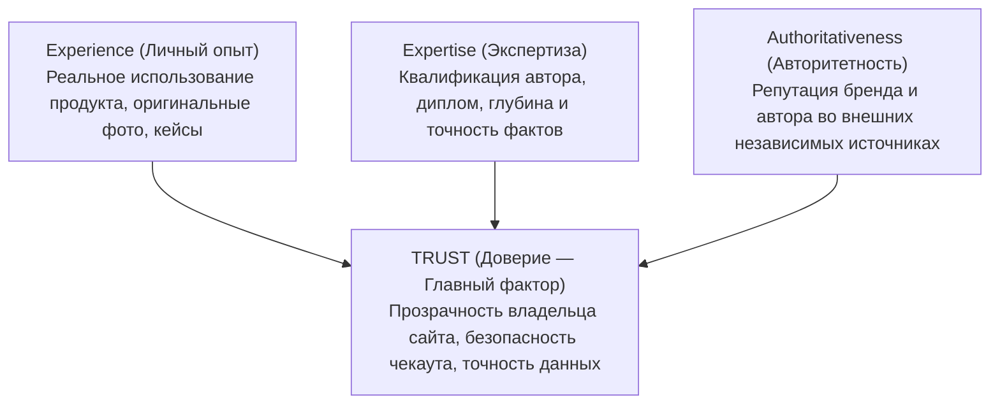

# Документация Google Search Central, Google web.dev и Schema.org (Справочник стандартов Google)

> [!IMPORTANT]
> **Статус документа:** Полный технический конспект официальной документации **Google Search Central**, **Google Chrome User Experience Report (CrUX / web.dev)**, **Search Quality Rater Guidelines (SQRG)**, реестра **Schema.org** и патентной базы Google (редакция 2025–2026 гг.).

---

## Оглавление
1. [Core Web Vitals и метрики производительности (Google web.dev & CrUX)](#1-core-web-vitals-и-метрики-производительности-google-webdev--crux)
2. [Google Search Essentials: Индексация, Краулинг и Рендеринг (WRS)](#2-google-search-essentials-индексация-краулинг-и-рендеринг-wrs)
3. [Структурированные данные Schema.org: Поддерживаемые и депрецированные типы (2025–2026)](#3-структурированные-данные-schemaorg-поддерживаемые-и-депрецированные-типы-20252026)
4. [Руководство асессоров Google (SQRG): E-E-A-T, YMYL и антиспам-политики](#4-руководство-асессоров-google-sqrg-e-e-a-t-ymyl-и-антиспам-политики)
5. [Патент Google US11354342B2: Information Gain Score (Информационный прирост)](#5-патент-google-us11354342b2-information-gain-score-информационный-прирост)

---

## 1. Core Web Vitals и метрики производительности (Google web.dev & CrUX)

* **Официальные источники:**
  * Core Web Vitals & Thresholds: [https://web.dev/articles/vitals](https://web.dev/articles/vitals)
  * Interaction to Next Paint (INP): [https://web.dev/articles/inp](https://web.dev/articles/inp)
  * Largest Contentful Paint (LCP): [https://web.dev/articles/lcp](https://web.dev/articles/lcp)
  * Cumulative Layout Shift (CLS): [https://web.dev/articles/cls](https://web.dev/articles/cls)

### 1.1. Методология оценки в Google Search (CrUX p75)
1. **Полевые данные (Field Data / RUM):** В качестве фактора ранжирования (Page Experience Signal) Google использует **исключительно реальные пользовательские данные** из отчета Chrome User Experience Report (**CrUX**) за скользящее окно в **28 дней**. Лабораторные оценки Lighthouse не участвуют в ранжировании напрямую.
2. **Правило 75-го перцентиля (`p75`):** Чтобы страница или группа страниц получила статус «Good», не менее **75% всех зарегистрированных посещений** должны укладываться в зеленый порог одновременно по всем трем основным метрикам (LCP, INP, CLS).

| Метрика | Полное название и суть измерения | Зеленая зона (Good, p75) | Желтая зона (Needs Improvement) | Красная зона (Poor) | Статус в ранжировании (2025–2026) |
| :--- | :--- | :--- | :--- | :--- | :--- |
| **LCP** | **Largest Contentful Paint** — время отрисовки самого крупного видимого контентного элемента в первом экране (``, `<video>`, текст). | **$\le 2.5\text{ с}$** | $2.5\text{ с} – 4.0\text{ с}$ | $> 4.0\text{ с}$ | **Core Web Vital** (Основной сигнал) |
| **INP** | **Interaction to Next Paint** — задержка отзывчивости интерфейса на действия пользователя (клик, тап, нажатие клавиши) за **всю сессию** на странице. | **$\le 200\text{ мс}$** | $200\text{ мс} – 500\text{ мс}$ | $> 500\text{ мс}$ | **Core Web Vital** (Официально заменил FID 12 марта 2024 г.) |
| **CLS** | **Cumulative Layout Shift** — суммарный коэффициент неожиданных визуальных сдвигов макета (максимальное сессионное окно до 5 с). | **$\le 0.1$** | $0.1 – 0.25$ | $> 0.25$ | **Core Web Vital** (Основной сигнал) |
| **TTFB** | **Time to First Byte** — время от запроса навигации до получения первого байта HTML-ответа (DNS + TLS + Server Processing). | **$\le 800\text{ мс}$** | $800\text{ мс} – 1800\text{ мс}$ | $> 1800\text{ мс}$ | Вспомогательная диагностическая метрика |
| **FID** | *First Input Delay* (только задержка первого ввода без учета времени выполнения обработчиков и отрисовки кадра). | — | — | — | **УДАЛЕНА (Deprecated)** из всех инструментов и алгоритмов |

### 1.2. Анатомия метрики LCP (4 подфазы без перекрытий)
Согласно документации Google (`web.dev/articles/optimize-lcp`), время LCP раскладывается на 4 последовательных этапа:

| Подфаза LCP | Доля от целевого бюджета (2.5 с) | Технические требования документации Google |
| :--- | :--- | :--- |
| **1. Time to First Byte (TTFB)** | ~30–40% ($\le 800\text{ мс}$) | Edge-кэширование HTML на CDN (`s-maxage`, `stale-while-revalidate`), минимизация цепочек редиректов, включение HTTP/3. |
| **2. Resource Load Delay** | **$< 10\%$** (стремится к 0 мс) | Браузер должен обнаружить URL LCP-картинки сразу в исходном HTML. **Запрещена** загрузка LCP-изображения через JS или `background-image` во внешнем CSS без `<link rel="preload" fetchpriority="high">`. |
| **3. Resource Load Duration** | ~30–40% | Использование форматов **AVIF / WebP**, адаптивных размеров `srcset` + `sizes`, атрибут **`fetchpriority="high"`** строго на одном главном изображении (``) и **строгий запрет `loading="lazy"`** на элементах первого экрана. |
| **4. Element Render Delay** | **$< 10\%$** (стремится к 0 мс) | Устранение блокирующих рендеринг скриптов в `<head>` (`defer`/`async`) и отказ от клиентского рендеринга (CSR) первого экрана в пользу SSR/SSG. |

### 1.3. Анатомия метрики INP (3 фазы взаимодействия)
Каждое взаимодействие пользователя (`click`, `keydown`, `pointerdown`) состоит из 3 фаз, сумма которых и составляет задержку INP:

$$\text{INP Latency} = \text{Input Delay} + \text{Processing Duration} + \text{Presentation Delay}$$

1. **Input Delay (Задержка ввода):** Время, в течение которого основной поток браузера (Main Thread) занят фоновыми задачами (**Long Animation Frames — LoAF > 50 мс**, например, парсинг сторонней аналитики или гидратация React), и не может приступить к обработке клика.
2. **Processing Duration (Время выполнения обработчиков):** Время работы колбэков `addEventListener`. Документация Google предписывает уступать главный поток отрисовке через API **`scheduler.yield()`** после обновления визуального состояния кнопки, откладывая отправку аналитики.
3. **Presentation Delay (Задержка отрисовки кадра):** Время пересчета стилей (`Recalculate Style`), геометрии (`Layout`) и композитинга (`Paint`). Снижается уменьшением размера DOM-дерева (**рекомендация Google: `< 1400` узлов**) и использованием CSS-свойства **`content-visibility: auto`** для скрытых экранов.

### 1.4. Формула расчета CLS (Layout Shift Score)
$$\text{Layout Shift Score} = \text{Impact Fraction} \times \text{Distance Fraction}$$
* **Impact Fraction:** Доля экрана (viewport), которую занимали сместившиеся элементы до и после сдвига в сумме.
* **Distance Fraction:** Максимальное расстояние, на которое сместился элемент, деленное на высоту/ширину экрана.
* **Обязательные практики:** Явное указание `width` и `height` (или `aspect-ratio`) у всех ``, `<video>` и `<iframe>`; резервирование контейнеров `min-height` под рекламные баннеры и динамические блоки; использование `font-display: optional` или `swap` с метрически выровненным фоллбэк-шрифтом (`size-adjust`, `ascent-override`).

---

## 2. Google Search Essentials: Индексация, Краулинг и Рендеринг (WRS)

* **Официальные источники:**
  * Google Search Essentials: [https://developers.google.com/search/docs/essentials](https://developers.google.com/search/docs/essentials)
  * Crawl Budget Management: [https://developers.google.com/search/docs/crawling-indexing/large-site-managing-crawl-budget](https://developers.google.com/search/docs/crawling-indexing/large-site-managing-crawl-budget)
  * JavaScript SEO Basics: [https://developers.google.com/search/docs/crawling-indexing/javascript/javascript-seo-basics](https://developers.google.com/search/docs/crawling-indexing/javascript/javascript-seo-basics)

### 2.1. Управление краулинговым бюджетом (Crawl Budget)
Краулинговый бюджет определяется балансом двух показателей в документации Google:
1. **Crawl Capacity Limit (Лимит пропускной способности):** Зависит от скорости ответа сервера (TTFB) и доли ошибок `5xx` / `429`. При ускорении ответа сервера Googlebot автоматически увеличивает количество параллельных соединений.
2. **Crawl Demand (Востребованность сканирования):** Зависит от популярности URL и частоты их обновления.
3. **Защита от пожирателей бюджета (Faceted Navigation):** Фасетные фильтры с миллионами комбинаций параметров (`?color=red&size=xl&sort=price`) должны блокироваться от сканирования или каноникализироваться. При удалении мусорных страниц Google рекомендует возвращать HTTP-код **`410 Gone`** (удаляет из индекса быстрее, чем `404 Not Found`).

### 2.2. Иерархия сигналов каноникализации (Consolidation of Duplicate URLs)
Согласно документации Google (`consolidate-duplicate-urls`), `rel="canonical"` является **сильной подсказкой (strong hint), а не безусловной директивой**. При выборе канонического URL алгоритм оценивает следующие сигналы по убыванию силы:
1. **`301` / `308` Permanent Redirect** (Самый сильный сигнал).
2. **HTML-тег `<link rel="canonical" href="...">` или HTTP-заголовок `Link: <...>; rel="canonical"`** (для PDF).
3. **Внутренняя перелинковка сайта** (если сайт ставит canonical на страницу А, но во всех меню и хлебных крошках ссылается на страницу Б, Googlebot может проигнорировать canonical).
4. **Включение URL в `sitemap.xml`** (в Sitemap должны попадать **только** канонические URL с кодом `200 OK`).
5. **Предпочтение протокола `HTTPS`** над `HTTP` и более чистых («красивых») URL над URL с GET-параметрами.

### 2.3. Правила Sitemaps (`<lastmod>`) и локализации (`hreflang`)
* **Лимиты `sitemap.xml`:** Максимум **50 000 URL** и **50 МБ** (в несжатом виде) на один файл; при превышении используется файл индекса `sitemap_index.xml`.
* **Игнорирование `<priority>` и `<changefreq>`:** Официальная документация Google прямо указывает, что Googlebot **полностью игнорирует** теги `<priority>` и `<changefreq>`.
* **Строгая валидация `<lastmod>`:** Google учитывает `<lastmod>` только в том случае, если дата меняется при **реальном изменении основного контента страницы**. Если скрипт проставляет сегодняшнюю дату всем страницам при генерации карты сайта, Google перестает доверять `<lastmod>` для всего домена.
* **Двунаправленность `hreflang`:** Каждая языковая версия обязана ссылаться сама на себя (self-referential), на все альтернативные языковые версии и на резервную версию `x-default`. Если страница `en` ссылается на `de`, а страница `de` не содержит обратной ссылки на `en`, тег `hreflang` игнорируется.

### 2.4. Web Rendering Service (WRS) и JavaScript SEO
Googlebot обрабатывает страницы в три этапа: **Crawling $\rightarrow$ Rendering (очередь WRS на базе headless-движка Evergreen Chromium) $\rightarrow$ Indexing**.
* **Ссылки:** Googlebot переходит **только** по валидным тегам `<a href="https://...">`. Элементы `` или `<a href="javascript:void(0)">` **не сканируются**.
* **Soft 404 в SPA:** Если клиентский роутер SPA отдает код `200 OK` для несуществующего URL и просто рендерит в JS текст «Страница не найдена», Google расценивает это как ошибку **Soft 404**. Необходимо либо отдавать серверный `404` (SSR), либо динамически инжектировать `<meta name="robots" content="noindex">` на странице ошибки.
* **Lazy Loading контента:** Googlebot **не скроллит** страницу в классическом понимании — WRS просто увеличивает высоту виртуального окна просмотра (viewport) до очень большого значения. Поэтому подгрузка контента по событию `window.onscroll` может не сработать; необходимо использовать стандартный **`IntersectionObserver`** и атрибут `loading="lazy"`.

---

## 3. Структурированные данные Schema.org: Поддерживаемые и депрецированные типы (2025–2026)

* **Официальные источники:**
  * Google Search Gallery (Поддерживаемые Rich Results): [https://developers.google.com/search/docs/appearance/structured-data/search-gallery](https://developers.google.com/search/docs/appearance/structured-data/search-gallery)
  * Официальный формат: **JSON-LD** (рекомендован Google вместо Microdata и RDFa).

### 3.1. Полная ревизия депрецированных и ограниченных типов Schema.org в Google Search

> [!WARNING]
> Начиная с августа 2023 года и вплоть до обновлений 2025–2026 годов, Google провел масштабную зачистку поисковой выдачи от спамных расширенных сниппетов. Внедрение устаревших типов ради визуальных сниппетов больше не дает эффекта в SERP (хотя семантический граф сущностей `@id` по-прежнему полезен для LLM и Knowledge Graph).

| Тип разметки Schema.org | Текущий статус в Google Search (2025–2026) | Официальное решение Google Search Central |
| :--- | :--- | :--- |
| **`HowTo`** | **Полностью удален (Deprecated)** | Визуальные сниппеты пошаговых инструкций полностью отключены на десктопах и мобильных устройствах (сентябрь 2023). |
| **`FAQPage`** | **Жестко ограничен (Restricted)** | Расширенные сниппеты FAQ в выдаче Google показываются **только для авторитетных государственных (`gov`) и медицинских сайтов**. Для коммерческих сайтов и блогов визуальный сниппет отключен (но структура полезна для парсинга AI Overviews). |
| **`SpecialAnnouncement`**, **`CourseInfo`**, **`EstimatedSalary`**, **`LearningVideo`**, **`ClaimReview`**, **`VehicleListing`** | **Удалены из Rich Results (2025)** | В рамках упрощения поисковой выдачи (июнь 2025) Google прекратил поддержку этих специализированных визуальных карточек в SERP. |
| **`SitelinksSearchBox` (`WebSite`)** | **Удален из SERP (Ноябрь 2024)** | Поле поиска по сайту внутри сниппета Google отключено; однако разметка `WebSite` с свойством `name` и `alternateName` остается **обязательной** для отображения названия сайта (Site Name) в выдаче. |

### 3.2. Приоритетные поддерживаемые типы JSON-LD (2025–2026)
1. **`Organization` / `LocalBusiness`:** Обязательно использование глобального идентификатора `@id`, логотипа, контактов, реквизитов и массива **`sameAs`** (ссылки на профили компании в Википедии, Wikidata, соцсетях, реестрах) для формирования карточки в **Google Knowledge Graph**.
2. **`Product` + `ProductGroup` (Вариативные товары) + `MerchantListing`:** Поддержка вариаций товара (`hasVariant`, `variesBy`, `inProductGroupWithID`), условий доставки (`OfferShippingDetails`) и правил возврата (`MerchantReturnPolicy`).
3. **`Article` / `NewsArticle` / `BlogPosting` + `Person` (Автор):** Обязательная связка статьи с сущностью реального автора (`author` $\rightarrow$ `Person` с `jobTitle`, `url`, `sameAs`) для подтверждения **E-E-A-T**.
4. **`ProfilePage` и `DiscussionForumPosting`:** Введены Google специально для платформ пользовательского контента, форумов и карточек экспертов (интеграция с вкладкой Perspectives / Forums).

---

## 4. Руководство асессоров Google (SQRG): E-E-A-T, YMYL и антиспам-политики

* **Официальные источники:**
  * Search Quality Rater Guidelines (PDF): [https://guidelines.raterhub.com/searchqualityevaluatorguidelines.pdf](https://guidelines.raterhub.com/searchqualityevaluatorguidelines.pdf)
  * Spam Policies for Google Web Search: [https://developers.google.com/search/docs/essentials/spam-policies](https://developers.google.com/search/docs/essentials/spam-policies)

### 4.1. Матрица оценки качества E-E-A-T (Раздел 3.4 SQRG)
Асессоры и алгоритмы Helpful Content оценивают страницы по четырем компонентам, где **Trust (Доверие)** является центральным и важнейшим звеном:

* **YMYL (Your Money or Your Life):** Темы, способные повлиять на здоровье, финансовую стабильность, безопасность человека или гражданское общество (медицина, фармацевтика, кредиты, инвестиции, налоги, юриспруденция, интернет-магазины с онлайн-оплатой). Для сайтов YMYL применяются **максимально строгие стандарты проверки E-E-A-T** (обязательное наличие проверяемого автора-специалиста, научного редактора/рецензента `reviewedBy` и ссылок на первичные клинические/законодательные источники).

### 4.2. Три новые антиспам-политики Google (Март 2024 — 2026)
1. **Scaled Content Abuse (Злоупотребление массовой генерацией контента):** Запрещает массовое создание страниц (независимо от того, созданы они ИИ, человеком или комбинацией шаблонов) с главной целью манипуляции поисковой выдачей без привнесения оригинальной ценности для пользователя.
2. **Site Reputation Abuse (Паразитное SEO / Злоупотребление репутацией сайта):** Запрещает размещение на авторитетных доменах (например, крупных СМИ или университетов) стороннего контента (купонов, обзоров казино, займов, БАДов), который не создается редакцией самого сайта и публикуется ради эксплуатации траста хост-домена.
3. **Expired Domain Abuse (Злоупотребление перехваченными доменами):** Запрещает покупку истекших доменов (дропов) с историческим ссылочным профилем (например, бывшего сайта клиники или госоргана) и перепрофилирование их под коммерческие партнерские сетки или малоценный контент.

---

## 5. Патент Google US11354342B2: Information Gain Score (Информационный прирост)

* **Номер патента:** US Patent `US11354342B2` (выдан 7 июня 2022 г., правообладатель: Google LLC).
* **Официальное название:** *Contextual estimation of link information gain*.
* **Авторы изобретения:** Behshad Behzadi,拳 (Google Zürich).
* **Прямая ссылка:** [https://patents.google.com/patent/US11354342B2/en](https://patents.google.com/patent/US11354342B2/en)

### 5.1. Суть алгоритма и смерть «компиляционного SEO-рерайта»
Исторически SEO-специалисты создавали статьи методом «Небоскреба» (брали ТОП-10 конкурентов, выписывали все их заголовки H2–H3 и делали рерайт в одну длинную статью). Патент **Information Gain Score** описывает математический механизм борьбы с клонированным контентом:
1. Когда пользователь изучает тему или когда ИИ-система формирует ответ (AI Overviews), система отслеживает набор фактов и концептов, которые уже были показаны в первых документах ($D_1, D_2$).
2. Для каждого следующего кандидата в выдаче ($D_n$) вычисляется **Information Gain (Информационный прирост)** — сколько **новой, дополнительной, ранее не встречавшейся в других документах релевантной информации** содержит этот документ.
3. Документ, который просто пересказывает консенсус ТОП-10 другими словами, получает низкий Information Gain Score и понижается в выдаче, уступая место документу, содержащему:
   * Уникальные эмпирические данные, замеры или собственные исследования;
   * Оригинальные таблицы сравнения, калькуляторы или схемы;
   * Практические инсайты из личного опыта (`Experience`), отсутствующие в стандартных справочниках.
