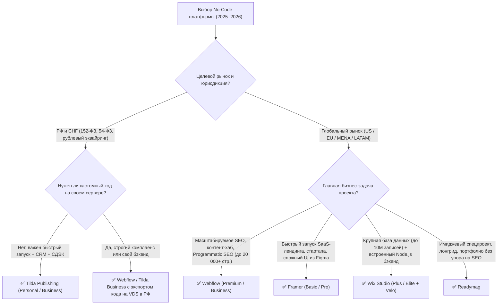

# Визуальные конструкторы и No-Code платформы (2025–2026)

> [!IMPORTANT]
> **Эволюция No-Code (2025–2026):** Визуальные конструкторы окончательно разделились на две архитектурные школы: **React/Canvas-ориентированные системы** (Framer, Readymag), компилирующие макет в JS-приложение (SPA/SSR), и **DOM/CSS-ориентированные платформы** (Webflow, Wix Studio, Tilda), опирающиеся на классическую блочную или сеточную верстку. Выбор платформы напрямую определяет потолок масштабирования по SEO, показатели Core Web Vitals (особенно **INP ≤ 200 мс**) и соответствие локальному законодательству (152-ФЗ в РФ).

---

## Оглавление

1. [Глубокий архитектурный разбор платформ](#1-глубокий-архитектурный-разбор-платформ)
   - [1.1. Framer — React-рендеринг и интерактивный дизайн](#11-framer--react-рендеринг-и-интерактивный-дизайн)
   - [1.2. Webflow — Визуальное программирование DOM, AEO и Programmatic SEO](#12-webflow--визуальное-программирование-dom-aeo-и-programmatic-seo)
   - [1.3. Tilda Publishing — Модульная экосистема для рынка РФ/СНГ](#13-tilda-publishing--модульная-экосистема-для-рынка-рфснг)
   - [1.4. Wix Studio — Агентский комбайн на CSS Grid и Velo](#14-wix-studio--агентский-комбайн-на-css-grid-и-velo)
   - [1.5. Readymag — Журнальная верстка и свободный холст](#15-readymag--журнальная-верстка-и-свободный-холст)
2. [Сводная сравнительная матрица (Тарифы, Лимиты, Архитектура)](#2-сводная-сравнительная-матрица-тарифы-лимиты-архитектура)
3. [Core Web Vitals (LCP, INP, CLS) и техническое SEO/GEO](#3-core-web-vitals-lcp-inp-cls-и-техническое-seogeo)
   - [3.1. Подводные камни производительности и их устранение](#31-подводные-камни-производительности-и-их-устранение)
   - [3.2. Показатели CWV в реальных условиях (CrUX Benchmarks)](#32-показатели-cwv-в-реальных-условиях-crux-benchmarks)
   - [3.3. AEO / GEO-оптимизация (видимость в AI-поиске)](#33-aeo--geo-оптимизация-видимость-в-ai-поиске)
4. [Особенности для рынка РФ/СНГ vs Глобальный рынок](#4-особенности-для-рынка-рфснг-vs-глобальный-рынок)
5. [Дерево принятия решений (Mermaid)](#5-дерево-принятия-решений-mermaid)
6. [Чек-лист технического аудита сайта на конструкторе перед релизом](#6-чек-лист-технического-аудита-сайта-на-конструкторе-перед-релизом)

---

## 1. Глубокий архитектурный разбор платформ

### 1.1. Framer — React-рендеринг и интерактивный дизайн

**Framer** позиционируется как инструмент перехода из Figma сразу в продакшен («Design to Publish»). Под капотом любой проект на Framer — это полноценное **React-приложение**, использующее библиотеку **Motion (ранее Framer Motion)** для анимаций.

* **Архитектура рендеринга:**
  * При публикации Framer генерирует предрендеренный HTML (SSR/SSG) для первичной индексации поисковыми роботами, после чего в браузере происходит **React Hydration** (гидратация DOM-дерева и подключение событий).
  * Навигация между страницами работает в режиме SPA (Single Page Application) без полной перезагрузки документа.
* **Тарифы и лимиты (при годовой оплате, 2026):**
  * **Free ($0/мес):** До 1 000 страниц, 10 коллекций CMS, но только на поддомене `.framer.website` с баннером платформы.
  * **Mini ($5/мес):** До 2 страниц (лендинг + 404), без CMS, 1 ГБ трафика.
  * **Basic ($10–15/мес):** До 30 статических страниц, **1 коллекция CMS** (до **1 000 записей**), 10 ГБ трафика.
  * **Pro ($30/мес):** До 300 статических страниц, **10 коллекций CMS** (до **2 500 записей** в базовом пакете, расширяется аддонами до **40 коллекций и 40 000 записей**), 100 ГБ трафика, защита паролем, стейджинг.
* **Экспорт кода:** **Отсутствует.** Из-за привязки к закрытому серверному рендерингу Framer и внутренней инфраструктуре CMS выгрузить чистый HTML/CSS или готовый Next.js-репозиторий невозможно (доступны только сторонние неофициальные парсеры с потерей логики CMS).

---

### 1.2. Webflow — Визуальное программирование DOM, AEO и Programmatic SEO

**Webflow** — это визуальный интерфейс над нативной спецификацией HTML5 и CSS3 (Flexbox, CSS Grid, CSS Variables). В отличие от Framer, Webflow не тянет за собой тяжелый React-рантайм.

* **Архитектура рендеринга:**
  * Генерирует чистый, семантический статический HTML/CSS и минималистичный JS (только для интеракций).
  * Хостинг работает поверх глобальной сети **AWS CloudFront и Fastly CDN** (начиная с 2024–2025 гг. инфраструктура переведена на Cloudflare/Fastly Edge).
* **Тарифы и лимиты (обновленная сетка 2025–2026):**
  * **Starter ($0):** До 2 страниц, 50 записей CMS, домен `.webflow.io`.
  * **Basic ($14–15/мес):** До 150 статических страниц, **0 коллекций CMS**, 10 ГБ CDN-трафика.
  * **CMS / Premium ($23–29/мес):** До 150 статических страниц, **20–40 коллекций CMS**, от **2 000 до 20 000 записей CMS** (в зависимости от пакета расширения), до 50–100 ГБ трафика.
  * **Business ($39+/мес):** До 300 статических страниц, **40 коллекций CMS**, до **10 000–20 000 записей CMS** (с возможностью докупки), до 2.5 ТБ трафика.
* **Экспорт кода:** **Поддерживается** (при наличии платного тарифа Workspace: Core/Growth). Экспортируется архив с чистым HTML, CSS, JS и медиафайлами. *Ограничение:* коллекции Webflow CMS, формы и поиск при экспорте не выгружаются (требуется привязка к внешнему бэкенду или конвертация через Udesly).
* **Programmatic SEO & Нативные AEO-инструменты:**
  * Идеальная платформа для **Programmatic SEO**: через Webflow REST API (или связку Whalesync + Airtable / Supabase) можно автоматически генерировать десятки тысяч посадочных страниц по шаблонам коллекций.
  * В 2025–2026 гг. в Webflow внедрены нативные **AEO (Answer Engine Optimization)** функции: автоматическая генерация `llms.txt`, управление доступом AI-краулеров (`GPTBot`, `ClaudeBot`, `PerplexityBot`) на уровне панели управления и встроенный генератор JSON-LD схем с динамическими полями из CMS.

---

### 1.3. Tilda Publishing — Модульная экосистема для рынка РФ/СНГ

**Tilda** — доминирующая no-code платформа в рунете, сочетающая библиотеку из 550+ готовых адаптивных блоков и редактор свободного позиционирования **Zero Block**.

* **Архитектура рендеринга:**
  * Статический HTML/CSS со сборкой скриптов (ранее jQuery, с 2023–2025 гг. полный переход базового ядра `tilda-scripts` на нативный **Vanilla JS**).
  * **Zero Block** использует абсолютное позиционирование (`position: absolute`), где координаты элементов (`top`, `left`, `width`) жестко привязаны к сетке брейкпоинтов (1200px, 960px, 640px, 480px, 320px) или пересчитываются скриптом при масштабировании по ширине окна (`window` autoscale).
* **Тарифы и лимиты (2026):**
  * **Free (0 ₽):** 1 сайт, до 50 страниц, 50 МБ на сервере, без своего домена и без вставки HTML-кода (блок T123 недоступен).
  * **Personal (500 ₽/мес при оплате за год или 750 ₽/мес):** 1 сайт, до **500 статических страниц**, **1 ГБ** дискового пространства, полный доступ к Zero Block, коду, Потокам (блог) и Каталогу товаров.
  * **Business (1 000 ₽/мес при оплате за год или 1 250 ₽/мес):** **5 сайтов** (по 500 страниц и 1 ГБ каждый) + **функция экспорта исходного кода**.
* **Лимиты CMS (Каталог и Потоки):**
  * В Каталоге товаров поддерживается до **5 000 товаров** (рекомендуемый лимит без потери скорости фильтрации — до 1 500–2 500 позиций).
  * В «Потоках» (новостные ленты и статьи) можно публиковать до **5 000 записей в одном потоке** (при этом посты потоков не расходуют лимит в 500 обычных страниц сайта).
* **Экспорт кода:** **Поддерживается на тарифе Business.** Архив содержит статические HTML-файлы, CSS, JS и изображения для размещения на своем сервере (Nginx/Apache). При экспорте отключаются встроенные формы Tilda, Личный кабинет и динамический каталог (если не настроен вебхук/API).

---

### 1.4. Wix Studio — Агентский комбайн на CSS Grid и Velo

**Wix Studio** пришел на смену Editor X, предложив профессиональную среду разработки на базе честного **CSS Grid / Flexbox**, пропорционального скейлинга (`vw`/`px`/`clamp`) и встроенной серверной среды **Wix Velo (Node.js)**.

* **Архитектура рендеринга:**
  * Гибридный SSR + клиентский рантайм Wix Thunderbolt. Несмотря на серьезную оптимизацию в 2024–2026 гг., платформа все еще загружает базовый системный бандл скриптов для работы виджетов.
  * Наличие **Wix Velo** позволяет писать полноценный бэкенд-код на JavaScript/TypeScript, создавать серверные хуки, cron-задачи и кастомные коллекции БД.
* **Тарифы и лимиты (при годовой оплате, 2026):**
  * **Basic (~$19/мес):** **1 500 записей CMS**, 10 ГБ хранилища (без приема онлайн-платежей).
  * **Standard (~$27/мес):** **4 000 записей CMS**, 50 ГБ хранилища, базовый e-commerce.
  * **Plus (~$34/мес):** **20 000 записей CMS**, 120 ГБ хранилища.
  * **Elite (~$159/мес):** До **10 000 000 (10 млн) записей CMS**, безлимитное хранилище, выделенная инфраструктура.
* **Экспорт кода:** **Отсутствует** (жесткий Vendor Lock-in).

---

### 1.5. Readymag — Журнальная верстка и свободный холст

**Readymag** — инструмент для создания интерактивных лонгридов, презентаций, портфолио и цифровых спецпроектов с фокусом на типографику и сложную скролл-анимацию.

* **Архитектура рендеринга:**
  * Свободный холст с абсолютным позиционированием и тяжелым JavaScript-движком отрисовки кадров анимации (пошаговая интерполяция свойств при скролле).
  * Семантическая структура DOM сильно упрощена в угоду визуальной точности.
* **Тарифы и лимиты (2026):**
  * **Free ($0):** 1 опубликованный проект до 10 страниц.
  * **Personal / Freelancer / Studio ($15 – $40/мес):** Неограниченное число проектов, кастомные домены, инъекция кода.
  * **Экспорт кода:** Доступен на старших тарифах (**Studio / Scale — от $40–55/мес**) в виде скомпилированного JS/HTML-бандла для хостинга на своем сервере.
* **Применимость для SEO:** Крайне низкая. Readymag не имеет полноценной реляционной CMS для потоковой генерации контента и плохо справляется с классическим поисковым продвижением многостраничников.

---

## 2. Сводная сравнительная матрица (Тарифы, Лимиты, Архитектура)

| Параметр / Платформа | **Framer** | **Webflow** | **Tilda** | **Wix Studio** | **Readymag** |
| :--- | :--- | :--- | :--- | :--- | :--- |
| **Базовая модель верстки** | Canvas / Flexbox + React (Motion) | Честный DOM (Flexbox / CSS Grid) | Блоки + Абсолютная сетка (Zero Block) | Честный CSS Grid / Flexbox (Proportional) | Свободный холст (Absolute Canvas) |
| **Рендеринг под капотом** | SSR + React Hydration (SPA) | Чистый статический HTML5 / CSS3 / JS | Статический HTML + Vanilla JS | SSR + Wix Thunderbolt Runtime | JS-ориентированный Canvas-рендер |
| **Стартовый платный тариф** | $10/мес (Basic) | $14/мес (Basic) / $25/мес (Premium CMS) | 500 ₽/мес (~$5.5) (Personal) | $19/мес (Basic) | $15/мес (Personal) |
| **Лимит статических страниц** | 30 (Basic) / 300 (Pro) | 150 (Basic/CMS) / 300 (Business) | 500 страниц на 1 сайт | 100 статических (+ динамические) | Без жесткого лимита (рекоменд. до 50) |
| **Лимит коллекций CMS** | 1 (Basic) / 10–40 (Pro + Add-ons) | 0 (Basic) / 20–40 (CMS/Premium) | Потоки (до 5000 постов) + Каталог (5000) | Без жесткого лимита коллекций | Нет нативной CMS |
| **Лимит записей CMS (Items)** | 1 000 (Basic) — 40 000 (Pro Max) | 2 000 — 20 000+ (Premium/Business) | До 5 000 товаров / 5 000 постов в потоке | 1 500 (Basic) — **10 000 000** (Elite) | Н/Д |
| **Экспорт исходного кода** | ❌ Нет | ✅ Да (HTML/CSS/JS, кроме CMS) | ✅ Да (на тарифе Business, 1000 ₽/мес) | ❌ Нет | ✅ Да (от тарифа Studio, ~$40/мес) |
| **Потенциал SEO / GEO** | Средне-высокий (отличный для SaaS/стартапов) | **Эталонный** (Programmatic SEO, AEO) | Высокий для РФ (Яндекс + Google) | Средний (тяжелый системный JS) | Низкий (только под трафик/PR) |
| **Соблюдение 152-ФЗ (РФ)** | ❌ Серверы в США/ЕС (AWS) | ❌ Серверы в США/ЕС (AWS/Fastly) | ✅ **Да** (ЦОД в РФ для доменов `.ru`/`.рф`) | ❌ Серверы вне РФ (блокировка оплат) | ❌ Серверы в США/ЕС (AWS) |

---

## 3. Core Web Vitals (LCP, INP, CLS) и техническое SEO/GEO

С марта 2024 года и в стандартах 2025–2026 гг. метрика **INP (Interaction to Next Paint, норма ≤ 200 мс)** окончательно заменила FID. Именно на INP и LCP сильнее всего проявляются архитектурные болезни визуальных конструкторов.

### 3.1. Подводные камни производительности и их устранение

#### ⚠️ Проблема №1: Тяжелые Zero Block в Tilda (LCP и INP)
* **Суть проблемы:** При сборке страницы целиком из 15–20 Zero Block дизайнеры часто:
  1. Дублируют скрытые слои для разных брейкпоинтов (вместо адаптации одного элемента создают отдельный текстовый или графический узел для Desktop и отдельный для Mobile, скрывая старый через `display: none` / `opacity: 0`), что раздувает DOM-дерево свыше **1 500–3 000 узлов**.
  2. Включают пошаговую скролл-анимацию (Step-by-step animation) с привязкой к `scroll` и свойством `filter: blur()`.
  3. Используют `window autoscale` одновременно на десятках блоков, вызывая принудительный пересчет геометрии (**Forced Reflow / Layout Thrashing**) при загрузке и повороте экрана смартфона.
* **Решение:**
  * Использовать единые элементы на всех 5 разрешениях (без клонирования узлов).
  * Заменить тяжелые PNG-фоны в Zero Block на векторные SVG или сжатые WebP (до 150 КБ).
  * Для первого экрана (Hero-секция) отключать `lazy-load` у главного изображения и не вешать сложную скролл-анимацию на элемент LCP.

#### ⚠️ Проблема №2: Бесконечные Loop-анимации и React Hydration во Framer (INP и TBT)
* **Суть проблемы:**
  1. Framer позволяет в два клика добавить **Loop-анимации** (бегущие строки Ticker, вращающиеся 3D-плашки, пульсации) и встроить тяжелые 3D-сцены из **Spline**.
  2. Если анимация изменяет некомпозитные свойства (`width`, `height`, `top`, `left`, `box-shadow`, `backdrop-filter`) вместо GPU-ускоренных (`transform`, `opacity`), основной поток браузера (Main Thread) забивается задачами перерисовки.
  3. Во время **React Hydration** на слабых мобильных процессорах клик по меню («гамбургеру») получает задержку **INP > 350–500 мс**, что выбрасывает страницу из «зеленой зоны» Search Console.
* **Решение:**
  * Ограничивать количество одновременно работающих `Ticker` / `Loop` эффектов во вьюпорте.
  * Для 3D-объектов (Spline / Three.js) ставить превью-постер на мобильных устройствах или загружать сцену по событию `IntersectionObserver` с пониженным DPR.
  * Минимизировать количество вложенных `Smart Components` с десятками вариантов состояний на одной странице.

#### ⚠️ Проблема №3: Раздутие CSS и кастомных скриптов в Webflow (CLS и LCP)
* **Суть проблемы:** Без системы именования классов (например, **Client-First от Finsweet** или **Lumos**) дизайнеры создают уникальные комбо-классы для каждого отступа (`Div Block 42`, `Heading 18 Copy`), раздувая CSS-файл. Кроме того, изображения без явно заданных пропорций (`aspect-ratio` или `width`/`height`) вызывают скачки макета (**CLS > 0.1**).
* **Решение:**
  * Включить в настройках публикации Webflow: **Minify HTML, CSS, JS**, а также **Use Secure Frame Headers**.
  * Всегда указывать фиксированные размеры или CSS `aspect-ratio` для картинок и контейнеров с рекламными/встраиваемыми блоками.
  * Для главного баннера (LCP) в настройках изображения переключить загрузку с `Lazy` на **`Eager`** (это добавляет приоритет загрузки первого экрана).

---

### 3.2. Показатели CWV в реальных условиях (CrUX Benchmarks)

| Метрика / Эталон Google | **Webflow** (Оптимизир.) | **Tilda** (Стандарт + 3–4 Zero) | **Tilda** (100% тяжелые Zero) | **Framer** (Умерен. анимации) | **Wix Studio** |
| :--- | :--- | :--- | :--- | :--- | :--- |
| **LCP** (*норма ≤ 2.5 с*) | **1.4 – 2.1 с** 🟢 | **1.8 – 2.4 с** 🟢 | **3.2 – 4.8 с** 🔴 | **1.6 – 2.3 с** 🟢 | **2.4 – 3.1 с** 🟡 |
| **INP** (*норма ≤ 200 мс*) | **60 – 120 мс** 🟢 | **90 – 160 мс** 🟢 | **240 – 450 мс** 🔴 | **150 – 280 мс** 🟡 | **180 – 260 мс** 🟡 |
| **CLS** (*норма ≤ 0.1*) | **0.01 – 0.04** 🟢 | **0.02 – 0.08** 🟢 | **0.12 – 0.25** 🔴 | **0.00 – 0.03** 🟢 | **0.03 – 0.09** 🟢 |
| **PageSpeed Mobile Score** | **90 – 99** | **82 – 94** | **45 – 68** | **78 – 92** | **65 – 84** |

---

### 3.3. AEO / GEO-оптимизация (видимость в AI-поиске)

Для попадания сайта в ответы **ChatGPT Search, Perplexity, Google AI Overviews и Яндекс Нейро** критически важна чистота HTML-разметки без необходимости выполнять сложный клиентский JS:

1. **Webflow и Tilda** отдают готовый, плоский HTML сразу в первом ответе сервера. Краулеры ИИ (`OAI-SearchBot`, `ClaudeBot`, `PerplexityBot`), которые часто **не выполняют JavaScript**, считывают 100% контента и микроразметки `Schema.org` (JSON-LD).
2. **Framer** также рендерит контент на сервере (SSR), но из-за обилия служебных `data-framer-*` атрибутов и инлайновых стилей соотношение **Text-to-HTML Ratio** ниже. Важно правильно размечать семантические теги (`<main>`, `<article>`, `<section>`, `<nav>`, `<h1>`–`<h3>`) в правой панели Framer (**Accessibility → Tag**).
3. **Readymag** формирует сложную для парсинга структуру из абсолютно позиционированных слоев, где порядок чтения текста в DOM может не совпадать с визуальным порядком на экране — для GEO/AEO это худший сценарий.

---

## 4. Особенности для рынка РФ/СНГ vs Глобальный рынок

> [!WARNING]
> **Юридический и инфраструктурный статус в РФ (2025–2026):** Использование зарубежных облачных платформ (Webflow, Framer, Wix, Readymag) без локализации баз данных несет прямые риски штрафов по **152-ФЗ «О персональных данных»** (первичный сбор ПДн граждан РФ на серверах в США/ЕС запрещен), а также проблемы с блокировкой IP-адресов CDN (Cloudflare / AWS CloudFront) на сетях ТСПУ Роскомнадзора.

### Сравнение инфраструктурной применимости

| Критерий | **Рынок РФ / СНГ (Tilda)** | **Глобальный рынок (Webflow / Framer)** |
| :--- | :--- | :--- |
| **Локализация данных (152-ФЗ)** | При привязке домена `.ru`/`.рф` или выборе региона в настройках сайта данные форм и заказы сохраняются на серверах в РФ (Яндекс.Облако / Selectel). | Данные форм попадают на серверы AWS в США. *Обход для РФ:* полный отказ от нативных форм или экспорт кода из Webflow на российский VDS. |
| **Устойчивость к блокировкам ТСПУ** | Выделенные российские IP-адреса и локальный CDN, 100% доступность у всех провайдеров РФ. | Высокий риск недоступности сайтов на поддоменах и кастомных доменах из-за блокировок подсетей AWS CloudFront и Cloudflare (особенно с ECH). |
| **Платежные шлюзы из коробки** | ЮKassa, Т-Банк (Тинькофф), СберБанк, CloudPayments, Робокасса, Альфа-Банк, Долями, Яндекс Пэй + автоотправка чеков по **54-ФЗ (АТОЛ, МодульКасса)**. | Stripe, PayPal, Apple Pay / Google Pay (через Stripe). Российские карты не принимаются. |
| **Интеграции с CRM и доставкой** | Нативные коннекторы к **amoCRM, Битрикс24**, МойСклад, Unisender, Telegram-ботам; виджеты карт **СДЭК, Boxberry, Почта России, Яндекс Доставка**. | HubSpot, Salesforce, Pipedrive, Mailchimp, Klaviyo, Zapier, Make, Airtable. |
| **Оплата самой платформы** | Оплата российскими картами (Мир) или по счету для юрлиц/ИП с закрывающими документами (ЭДО). | Только зарубежные карты Visa/Mastercard. |

---

## 5. Дерево принятия решений (Mermaid)

---

## 6. Чек-лист технического аудита сайта на конструкторе перед релизом

- [ ] **Семантика заголовков и регионов:** На каждой странице ровно один тег `<h1>`. В конструкторах (Framer / Webflow / Tilda Zero Block) принудительно выставлены теги `<header>`, `<main>`, `<footer>`, `<nav>` (в Tilda Zero Block теги заголовков `H1–H3` заданы в настройках текстового элемента `SEO Tag`).
- [ ] **Аудит DOM и адаптива (Zero Block / Framer):** Удалены дублирующиеся скрытые элементы на мобильных брейкпоинтах. Общее число DOM-узлов страницы не превышает **1 500 элементов**.
- [ ] **Оптимизация LCP:** Главное изображение первого экрана переведено в формат WebP/AVIF, весит менее **150–200 КБ**, имеет атрибут `loading="eager"` (отключен Lazy Load для первого экрана) и не перекрыто длительной входной анимацией (`opacity: 0` на старте).
- [ ] **Контроль INP (≤ 200 мс):** Сторонние скрипты (Яндекс.Метрика, GTM, онлайн-чаты, пиксели ВК) загружаются с отложенной инициализацией (по таймеру 2–3 секунды или после первого взаимодействия пользователя).
- [ ] **Стабильность верстки (CLS ≤ 0.1):** Кастомные веб-шрифты подключены в формате `.woff2` со свойством `font-display: swap`, для всех изображений и iframe заданы явные пропорции.
- [ ] **Индексация и каноникалы:** Закрыты от индексации служебные поддомены конструктора (`*.webflow.io`, `*.tilda.ws`, `*.framer.website`), настроены `canonical` на основной домен с HTTPS, проверен `robots.txt` и автогенерация `sitemap.xml`.
- [ ] **Микроразметка и AEO:** В `<head>` добавлена валидная JSON-LD разметка (`Organization`, `Product`, `FAQPage` или `Article`), проверенная в Schema Markup Validator; открыт доступ для поисковых AI-ботов (`OAI-SearchBot`, `PerplexityBot`).
- [ ] **Комплаенс 152-ФЗ (для РФ):** Под всеми формами сбора данных размещен чекбокс согласия на обработку ПДн со ссылкой на актуальную Политику конфиденциальности, отключена передача данных на зарубежные аналитические серверы (Google Analytics 4 заменен или проксируется при наличии уведомления РКН о трансграничной передаче, шрифты Google Fonts загружены локально).
