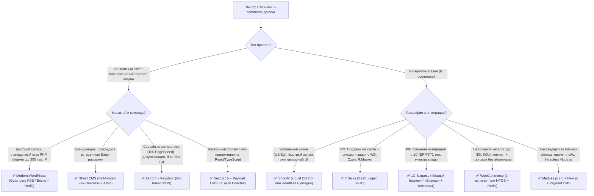

# Классические CMS, E-commerce платформы и Headless CMS (2025–2026)

> [!IMPORTANT]
> **Смена парадигмы в 2025–2026 годах:** Рынок систем управления контентом и электронной коммерции окончательно разделился на три архитектурных направления:
> 1. **Модернизированный монолит** (WordPress на базе Gutenberg FSE / Bricks + Redis, 1С-Битрикс с композитным кешем) — где старые медленные конструкторы уступили место чистой генерации DOM.
> 2. **Омниканальные SaaS-платформы** (Shopify с архитектурой Online Store 2.0 / Hydrogen, InSales с нативным синк-ядром под маркетплейсы).
> 3. **Headless & Composable архитектура** (Payload CMS 3.0 внутри Next.js App Router, Sanity, Directus, Strapi 5, Medusa.js 2.0) — полный отказ от монолита в пользу типизированных API и фронтенда на Next.js / Astro / Nuxt.

---

## Оглавление

1. [Современный стек WordPress (95–100 баллов PageSpeed)](#1-современный-стек-wordpress-95100-баллов-pagespeed)
   - [1.1. Почему классический Elementor и Divi устарели](#11-почему-классический-elementor-и-divi-устарели)
   - [1.2. Эталонная архитектура WordPress 2026](#12-эталонная-архитектура-wordpress-2026)
   - [1.3. Конфигурация серверного кеширования (Nginx FastCGI + Redis)](#13-конфигурация-серверного-кеширования-nginx-fastcgi--redis)
2. [E-commerce движки: от SaaS до Composable Commerce](#2-e-commerce-движки-от-saas-до-composable-commerce)
   - [2.1. Shopify (Классический Liquid vs Headless Hydrogen + Oxygen)](#21-shopify-классический-liquid-vs-headless-hydrogen--oxygen)
   - [2.2. 1С-Битрикс: Управление сайтом (Редакции 2026, CommerceML и Композит)](#22-1с-битрикс-управление-сайтом-редакции-2026-commerceml-и-композит)
   - [2.3. InSales (Омниканальный e-commerce и маркетплейсы РФ)](#23-insales-омниканальный-e-commerce-и-маркетплейсы-рф)
   - [2.4. WooCommerce (HPOS и реальные границы масштабирования)](#24-woocommerce-hpos-и-реальные-границы-масштабирования)
   - [2.5. Medusa.js 2.0 (Open-Source модульный Headless E-commerce)](#25-medusajs-20-open-source-модульный-headless-e-commerce)
   - [2.6. Сравнительная матрица E-commerce платформ](#26-сравнительная-матрица-e-commerce-платформ)
3. [Headless CMS для связки с Next.js, Astro и Nuxt](#3-headless-cms-для-связки-с-nextjs-astro-и-nuxt)
   - [3.1. Payload CMS 3.0 — Next.js-нативный лидер (Local API 0 мс)](#31-payload-cms-30--nextjs-нативный-лидер-local-api-0-мс)
   - [3.2. Strapi 5 — Зрелый Open-Source стандарт](#32-strapi-5--зрелый-open-source-стандарт)
   - [3.3. Sanity — Content Lake, GROQ и коллаборация в реальном времени](#33-sanity--content-lake-groq-и-коллаборация-в-реальном-времени)
   - [3.4. Directus — Database-First платформа поверх чистого SQL](#34-directus--database-first-платформа-поверх-чистого-sql)
   - [3.5. Keystatic & Decap CMS — Git-based управление контентом (MDX)](#35-keystatic--decap-cms--git-based-управление-контентом-mdx)
   - [3.6. Ghost — Издательская платформа, подписки и рассылки](#36-ghost--издательская-платформа-подписки-и-рассылки)
   - [3.7. Сводная матрица Headless CMS](#37-сводная-матрица-headless-cms)
4. [Архитектурные схемы и сценарии выбора под бюджет](#4-архитектурные-схемы-и-сценарии-выбора-под-бюджет)
5. [Чек-лист выбора и внедрения CMS / E-commerce](#5-чек-лист-выбора-и-внедрения-cms--e-commerce)

---

## 1. Современный стек WordPress (95–100 баллов PageSpeed)

### 1.1. Почему классический Elementor и Divi устарели

Долгое время WordPress ассоциировался с медленными сайтами из-за использования тяжелых визуальных конструкторов первого поколения (**Elementor, WPBakery, Divi Classic**) и универсальных тем с сотнями неиспользуемых скриптов:
* **DOM Bloat (Раздутие DOM):** Для вывода одной кнопки внутри колонки старые билдеры генерировали от 6 до 12 вложенных `<div>`-оберток, доводя размер страницы до 3 000–5 000 узлов.
* **Блокирующий CSS/JS:** Подключение десятков разрозненных CSS-файлов виджетов и зависимость от `jQuery` убивали метрику **INP (Interaction to Next Paint)** и **LCP**.

---

### 1.2. Эталонная архитектура WordPress 2026

Современная разработка на WordPress полностью отказывается от тяжелых пейдж-билдеров в пользу чистого кода и профессиональной инженерной инфраструктуры:

| Уровень стека | Устаревший подход (Legacy WP) | Современный стандарт (Modern WP 2025–2026) | Технический выигрыш |
| :--- | :--- | :--- | :--- |
| **Визуальный редактор / Тема** | Elementor + Astra/Avada | **Gutenberg FSE (Full Site Editing)** + кастомные блоки на React/ACF **ИЛИ** **Bricks Builder** (чистый семантический DOM без лишних оберток) | Сокращение объема HTML/CSS в 4–6 раз, выход в 95–100 баллов Lighthouse Mobile без костылей. |
| **Фреймворк разработки** | Хаотичные правки `functions.php` по FTP | **Roots Stack: Bedrock** (Composer, `.env`, структура папок с изоляцией ядра) + **Sage** (Blade-шаблонизатор, Vite, Tailwind CSS) | Полноценный CI/CD через Git, управление плагинами как зависимостями Composer, безопасность. |
| **Кастомные поля и типы данных** | Тяжелые комбайны плагинов | **ACF Pro (Advanced Custom Fields)** с сохранением схем в `acf-json` под Git-контролем | Нулевая нагрузка на БД при чтении конфигурации полей (чтение из локального JSON). |
| **Объектный кеш БД** | Прямые `SELECT` в `wp_postmeta` на каждый хит | **Redis Object Cache** (через расширение `phpredis` на C) | Снижение числа SQL-запросов со 150–300 до 2–5 запросов на динамическую страницу. |
| **Серверный веб-сервер** | Apache + `.htaccess` | **Nginx (FastCGI Cache)** или **OpenLiteSpeed (LSCache)** + PHP 8.3 / 8.4 (OPcache + JIT) | Отдача закешированной HTML-страницы из оперативной памяти за **15–35 мс (TTFB)**. |

---

### 1.3. Конфигурация серверного кеширования (Nginx FastCGI + Redis)

Для достижения **TTFB < 50 мс** в `wp-config.php` (или конфиге Bedrock `config/application.php`) активируется постоянный объектный кеш Redis:

```php
// Конфигурация Redis Object Cache в современном стеке WordPress (Bedrock)
Config::define('WP_REDIS_HOST', env('REDIS_HOST') ?: '127.0.0.1');
Config::define('WP_REDIS_PORT', 6379);
Config::define('WP_REDIS_DATABASE', 0);
Config::define('WP_REDIS_PREFIX', 'wp_prod_');
Config::define('WP_REDIS_MAXTTL', 86400); // 24 часа
Config::define('WP_CACHE', true);
```

---

## 2. E-commerce движки: от SaaS до Composable Commerce

### 2.1. Shopify (Классический Liquid vs Headless Hydrogen + Oxygen)

На глобальном рынке **Shopify** остается безоговорочным лидером за счет лучшей в мире конверсии чекаута (**Shop Pay**). Платформа предлагает два архитектурных пути:

1. **Классический монолит (Online Store 2.0 на шаблонизаторе Liquid):**
   * Рендеринг на серверах Shopify (глобальный Edge CDN на базе Cloudflare).
   * Высочайшая скорость разработки, полная совместимость с тысячами готовых приложений из Shopify App Store.
   * *Минус:* сторонние приложения часто инжектят тяжелые клиентские скрипты в витрину, ухудшая INP, а структура URL жестко фиксирована (`/products/`, `/collections/`, `/pages/`) — изменить вложенность папок для SEO нельзя.
2. **Headless-стек (Hydrogen на базе Remix + хостинг Oxygen):**
   * **Hydrogen** — официальный React-фреймворк от Shopify, построенный поверх **Remix**, использующий **Storefront API (GraphQL)**.
   * **Oxygen** — глобальная бессерверная (Serverless Edge) платформа хостинга для Hydrogen-витрин, включенная в стоимость стандартных тарифов Shopify без доплат за трафик.
   * *Плюс:* абсолютная свобода в структуре URL для SEO, мгновенные переходы между страницами, кастомная логика бандлов и конфигураторов, субсекундный LCP за счет React Server Components и потокового SSR.
   * *Тарифы и комиссии (2026):* **Basic ($29–39/мес)**, **Grow / Shopify ($79–105/мес)**, **Advanced ($299–399/мес)**, **Shopify Plus (от $2 300–2 500/мес)**. При использовании стороннего платежного шлюза (не Shopify Payments) взимается дополнительная комиссия с оборота от **0.6% до 2%**.

---

### 2.2. 1С-Битрикс: Управление сайтом (Редакции 2026, CommerceML и Композит)

В РФ и странах СНГ **1С-Битрикс** удерживает позиции стандарта для среднего и крупного ритейла благодаря глубокой нативной интеграции с учетными системами **«1С:Предприятие» (УТ, ERP, УНФ)**.

* **Главные технические преимущества:**
  * **Протокол обмена CommerceML 2.x / Real-time обмен:** Двусторонняя синхронизация номенклатуры, сложных типов цен (оптовые, региональные, персональные), остатков по десяткам складов и статусов заказов из коробки.
  * **Технология «Композитный сайт» (Автокомпозит):** Уникальный гибридный механизм кеширования, при котором страница разделяется на статическую оболочку (отдается мгновенно из HTML-кеша Nginx/Memcached за **20–40 мс**) и динамические области (корзина, персональные цены), подгружаемые асинхронным фоновым запросом.
  * **SEO-модуль и Умный фильтр:** Автоматическая генерация посадочных страниц под низкочастотные запросы из комбинаций характеристик фильтра (ЧПУ умного фильтра) с индивидуальными метатегами `Title`, `H1` и каноникалами.
* **Актуальные редакции и цены (с 1 января 2026 г. после плановой индексации на ~15%):**
  * **«Старт» — 7 100 ₽** (корпоративные сайты и каталоги без корзины).
  * **«Стандарт» — 20 500 ₽** (контентные проекты, веб-формы, форумы).
  * **«Малый бизнес» — 47 000 ₽** (базовый интернет-магазин: 1 склад, 1 тип цены, интеграция с 1С и кассами по 54-ФЗ).
  * **«Бизнес» — 96 500 ₽** (полнофункциональный e-commerce: многоскладовость, множество типов цен, товарные наборы, накопительные скидки, B2B-кабинеты).
  * **«Энтерпрайз» — от 1 950 000 ₽** (кластеризация БД, шардинг, SLA 24/7).
  * *Продление лицензии:* **25% от актуальной цены редакции в год** (11 750 ₽/год для «Малого бизнеса» и 24 125 ₽/год для «Бизнеса»).

---

### 2.3. InSales (Омниканальный e-commerce и маркетплейсы РФ)

**InSales** (входит в экосистему Сбера) — ведущая российская облачная SaaS-платформа для электронной коммерции, ориентированная на селлеров, совмещающих собственный интернет-магазин с продажами на маркетплейсах.

* **Ключевые возможности:**
  * **Единое окно омниканальности:** Нативная синхронизация карточек товаров, цен, остатков и заказов с **Wildberries, Ozon, Яндекс Маркетом и Мегамаркетом** из одной панели управления.
  * **Готовая инфраструктура под законы РФ:** Серверы в РФ (полное соответствие **152-ФЗ**), встроенная фискализация чеков по **54-ФЗ**, готовые модули СДЭК, Boxberry, Почты России, СберЛогистики и всех российских банковских эквайрингов + СБП.
  * **Кастомизация (Liquid):** Шаблоны витрины написаны на языке **Liquid** (аналогично Shopify), что дает полный доступ к HTML/CSS/JS для SEO-оптимизации и верстки без ограничений блочных конструкторов.
* **Тарифы (2026):** От **~1 400 до 9 000+ ₽/мес** (при годовой оплате) в зависимости от количества товаров, пользователей и подключенных каналов маркетплейсов. **Комиссия с оборота — 0%.**

---

### 2.4. WooCommerce (HPOS и реальные границы масштабирования)

**WooCommerce** — бесплатный Open-Source плагин электронной коммерции для WordPress, на котором работает более 25% небольших магазинов в мире.

* **Прорыв HPOS (High-Performance Order Storage):**
  * Исторически WooCommerce хранил заказы в общей таблице постов `wp_posts` и `wp_postmeta`, из-за чего при 50 000+ заказов база данных деградировала.
  * В современных версиях по умолчанию включен механизм **HPOS**, который выносит заказы в выделенные плоские реляционные таблицы (`wp_wc_orders`, `wp_wc_order_addresses`, `wp_wc_order_operational_data`). Это ускорило оформление заказа (Checkout) до **5 раз**, а поиск по заказам в админке — до **40 раз**.
* **Реальные границы масштабирования:**
  * С включенным HPOS, объектным кешем Redis и поиском на базе **Elasticsearch / Meilisearch** (например, через плагин ElasticPress) WooCommerce стабильно держит каталог до **50 000 – 100 000 SKU**.
  * *Потолок:* При наличии сложной многоскладской логики, пересчета региональных остатков в реальном времени из 1С каждые 5 минут и каталоге свыше 150 000 вариативных товаров архитектура `wp_postmeta` для товаров все еще уступает специализированным схемам БД (1С-Битрикс, Medusa.js, Magento).

---

### 2.5. Medusa.js 2.0 (Open-Source модульный Headless E-commerce)

**Medusa.js 2.0** — главный Open-Source (MIT) конкурент Shopify Plus и тяжеловесного Commercetools в мире **Node.js / TypeScript**.

* **Архитектура Medusa 2.0 (Composable Modules):**
  * Полный редизайн ядра: каждый домен электронной коммерции (`Cart`, `Product`, `Pricing`, `Inventory`, `Order`, `Fulfillment`, `Promotion`, `Customer`) выделен в полностью изолированный **модуль со своей схемой данных**.
  * Встроенный движок **Workflows Engine** с поддержкой распределенных транзакций и отката (Compensation actions) позволяет легко связывать корзину с внешними ERP, CRM, WMS и кастомными платежными шлюзами (включая российские эквайринги).
  * Работает на **PostgreSQL**, предоставляет сверхбыстрый REST API и готовую стартовую витрину на **Next.js 15 App Router**.
  * Идеально сочетается с **Payload CMS 3.0** или **Sanity** для управления богатым редакторским контентом и SEO-лендингами.

---

### 2.6. Сравнительная матрица E-commerce платформ

| Критерий | **Shopify (Liquid / Hydrogen)** | **1С-Битрикс («Малый бизнес» / «Бизнес»)** | **InSales** | **WooCommerce (Modern Stack + HPOS)** | **Medusa.js 2.0** |
| :--- | :--- | :--- | :--- | :--- | :--- |
| **Тип лицензии и модель** | SaaS (проприетарный) | Коробочная CMS (On-Premise, проприетарная) | SaaS (проприетарный, РФ) | Open-Source (GPL, On-Premise) | Open-Source (MIT, Headless Node.js) |
| **Технологический стек** | Ruby/Liquid или React (Remix/Hydrogen) | PHP 8.3+ / MySQL или PostgreSQL | Облако (шаблоны на Liquid) | PHP 8.3+ / MySQL/MariaDB + Redis | TypeScript / Node.js / PostgreSQL |
| **Стоимость лицензии / подписки** | $29 – $2 300+/мес (+ комиссия до 2%) | 47 000 ₽ или 96 500 ₽ разово (+25%/год со 2-го года) | 1 400 – 9 000+ ₽/мес (комиссия 0%) | 0 ₽ (оплата только за VDS и премиум-плагины) | 0 ₽ (MIT) или облако Medusa Cloud |
| **Комфортный объем каталога (SKU)** | До 100 000 – 1 000 000+ | До 500 000 – 2 000 000+ SKU | До 100 000 – 300 000 SKU | До 30 000 – 80 000 SKU (с HPOS + Elastic) | Не ограничен (миллионы SKU в PostgreSQL) |
| **Интеграция с «1С:Предприятие»** | Сложная (через кастомные коннекторы) | **Эталонная нативная** (CommerceML, Real-time) | Готовый модуль синхронизации с 1С и МойСклад | Через плагины обмена (требует тонкой доработки) | Кастомная (через Medusa Workflows и Webhooks) |
| **Синхронизация с WB / Ozon / Я.Маркет** | Нет нативной для РФ | Через модули из Маркетплейса Битрикс | **Встроенная в ядро (лучшая на рынке РФ)** | Через сторонние плагины | Через кастомные модули |
| **Гибкость SEO (URL, фильтры, SSR)** | Средняя (Liquid) / Максимальная (Hydrogen) | Максимальная (ЧПУ умного фильтра из коробки) | Высокая (полный доступ к шаблонам и метатегам) | Высокая (зависит от плагина фильтрации) | Максимальная (полный контроль на Next.js/Nuxt) |

---

## 3. Headless CMS для связки с Next.js, Astro и Nuxt

В архитектуре **Jamstack / Composable Web** система управления контентом отделена от слоя представления (фронтенда) и выступает как типизированное хранилище структурированных данных.

### 3.1. Payload CMS 3.0 — Next.js-нативный лидер (Local API 0 мс)

**Payload CMS 3.0** совершил революцию в мире TypeScript-разработки, став первой полнофункциональной CMS, которая **устанавливается непосредственно внутрь папки `/app` проекта на Next.js (App Router)**.

* **Архитектурный прорыв:**
  * Вам больше не нужно поднимать два отдельных сервера (один для Node.js CMS, другой для фронтенда Next.js). Админка Payload и сам сайт работают в рамках одного процесса и деплоятся одной командой (на любой VDS в Docker или на Vercel).
  * **Local API (0 мс сетевой задержки):** Поскольку серверные компоненты React (RSC) в Next.js выполняются на том же сервере, где работает ядро Payload, получение данных происходит **напрямую через вызов TypeScript-функции в памяти**, минуя сериализацию HTTP/REST/GraphQL:

```typescript
// Чтение данных в React Server Component (Next.js App Router) через Payload 3.0 Local API
import { getPayload } from 'payload'
import configPromise from '@payload-config'

export default async function ProductPage({ params }: { params: { slug: string } }) {
  const payload = await getPayload({ config: configPromise })

  // Прямой типобезопасный запрос к БД без сетевого оверхеда HTTP (0ms latency)
  const { docs } = await payload.find({
    collection: 'products',
    where: { slug: { equals: params.slug } },
    depth: 2,
    limit: 1,
  })

  const product = docs[0]
  return <main><h1>{product.title}</h1></main>
}
```

* **Ключевые особенности:** Code-first конфигурация на TypeScript с автогенерацией типов, лексический текстовый редактор (**Lexical** от Meta), встроенная система версионирования, черновиков, локализации, RBAC-прав доступа и адаптеры под **PostgreSQL (Drizzle ORM)**, **MongoDB** и **SQLite**. Лицензия — **100% открытая MIT**.

---

### 3.2. Strapi 5 — Зрелый Open-Source стандарт

**Strapi 5** — самая популярная в мире самостоятельная Node.js Headless CMS с визуальным конструктором типов данных (**Content-Type Builder**).

* **Что нового в Strapi 5:**
  * Новый **Document Service API** (пришел на смену запутанному Entity Service из v4), упростивший работу с черновиками, публикациями (`Draft & Publish`) и локалями.
  * Нативная история версий контента и улучшенная типизация TypeScript.
  * Работает поверх реляционных СУБД (**PostgreSQL, MySQL, MariaDB, SQLite**).
* **Плюсы и минусы:** Огромная экосистема готовых плагинов (SEO, Redirects, Sitemap) и понятный интерфейс для контент-менеджеров. В отличие от Payload, требует отдельного инстанса Node.js и общения по сети (REST или GraphQL).

---

### 3.3. Sanity — Content Lake, GROQ и коллаборация в реальном времени

**Sanity** разделяет платформу на два слоя: облачную базу документов в реальном времени **Content Lake (SaaS)** и полностью кастомизируемую на React админ-панель **Sanity Studio (Open-Source)**, которую можно встроить прямо в свой Next.js/Astro проект.

* **Ключевые преимущества:**
  * **Real-time Collaboration:** Несколько редакторов могут одновременно править одну статью с мгновенной синхронизацией курсоров (как в Google Docs / Figma).
  * **Язык запросов GROQ и Visual Editing:** Мощнейший декларативный язык фильтрации и проекции JSON-графов на лету, а также технология **Visual Editing (Overlays)** — клик по любому тексту на превью сайта сразу открывает нужное поле в студии.
  * **Portable Text:** Хранение форматированного текста не в виде «сырого» HTML, а в виде строго типизированного JSON-массива блоков, что позволяет рендерить один и тот же контент на сайте, в мобильном приложении (iOS/Android) и в рассылках.
* *Ограничение для РФ:* Поскольку база данных **Content Lake** находится исключительно в облаке Sanity (Google Cloud США/ЕС) и не может быть развернута On-Premise, в ней нельзя хранить персональные данные граждан РФ (152-ФЗ).

---

### 3.4. Directus — Database-First платформа поверх чистого SQL

**Directus** использует принципиально иной подход: он **не навязывает собственную схему таблиц**, а подключается к любой новой или уже существующей SQL-базе данных (**PostgreSQL, MySQL, MS SQL, Oracle, CockroachDB, SQLite**), осуществляя интроспекцию таблиц и внешних ключей в реальном времени.

* **Где незаменим Directus:**
  * Если у вас уже есть действующая база данных (ERP, каталог товаров, аналитика) и нужно за 15 минут получить поверх нее современную админ-панель на Vue.js, ролевую модель доступа, автоматический REST + GraphQL API и визуальный конструктор автоматизаций (**Directus Flows**).
  * В базе данных остаются абсолютно чистые SQL-таблицы без служебного мусора CMS — к ним можно параллельно обращаться из Python-скриптов, BI-систем (DataLens / Superset) или микросервисов на Go.
* *Нюанс лицензии:* Используется лицензия **BSL 1.1** (бесплатно для самохостинга компаниям с общим доходом/финансированием до $5 млн в год; свыше этого порога требуется коммерческая лицензия).

---

### 3.5. Keystatic & Decap CMS — Git-based управление контентом (MDX)

Для документаций, корпоративных блогов и сверхбыстрых контентных сайтов на **Astro** или **Next.js** база данных часто вообще не нужна:

* **Keystatic (от Thinkmill):** Современная Git-based CMS первого класса. В режиме разработки работает прямо с локальными файлами `.mdoc` / `.mdx` / `.json` / `.yaml` на диске, а в продакшене коммитит изменения редакторов напрямую в ветку GitHub-репозитория через красивый визуальный интерфейс. Имеет нативные интеграции с **Astro** и **Next.js** и встроенный типобезопасный Reader API.
* **Decap CMS (бывшая Netlify CMS):** Классическая легковесная SPA-админка, подключаемая одним JS-файлом поверх любого статического генератора (Astro, Hugo, Eleventy).
* **Плюсы Git-based подхода:** Бесплатный хостинг (Cloudflare Pages / Vercel / GitHub Pages), абсолютная неуязвимость к SQL-инъекциям, мгновенный откат любой правки через `git revert`, 100 баллов PageSpeed за счет чистой статики (SSG).

---

### 3.6. Ghost — Издательская платформа, подписки и рассылки

**Ghost (v5 / v6)** — специализированная платформа на Node.js для онлайн-СМИ, корпоративных медиа, независимых авторов и контент-маркетинга.

* **Встроенный стек монетизации и дистрибуции:**
  * Лучший в индустрии минималистичный редактор лонгридов с поддержкой интерактивных карточек (Callouts, Toggle, Audio/Video, Code, Product cards).
  * **Нативный Email-маркетинг (Newsletters):** Публикация статьи на сайте может в один клик отправляться по сегментированной базе подписчиков без сторонних дорогих сервисов (Mailchimp / ConvertKit).
  * **Пейволлы и платные подписки (Memberships):** Встроенная регистрация читателей и закрытие премиум-контента по подписке.
  * **Встроенное техническое SEO:** Автоматическая генерация каноникалов, чистых XML-карт сайта, микроразметки Schema.org (`Article`, `Person`), OpenGraph-карточек и поддержка протокола **ActivityPub (Fediverse)** в свежих релизах.
* Может работать как монолит (на быстрых темах **Handlebars**) или как **Headless CMS** в связке с фронтендом на **Astro / Next.js** через `Ghost Content API`.

---

### 3.7. Сводная матрица Headless CMS

| Платформа | Архитектура и Ядро | База данных / Хранилище | Лицензия | Поддержка On-Premise (152-ФЗ) | Идеальный сценарий применения |
| :--- | :--- | :--- | :--- | :--- | :--- |
| **Payload CMS 3.0** | Code-first (TypeScript), живет внутри **Next.js App Router** | PostgreSQL, MongoDB, SQLite | **MIT** (100% Open Source) | ✅ Да (Docker / любой VDS в РФ) | Сложные корпоративные сайты, порталы и e-commerce на Next.js с Local API (0 мс). |
| **Strapi 5** | Standalone Node.js + визуальный конструктор схем | PostgreSQL, MySQL, MariaDB, SQLite | **MIT** (Community Edition) | ✅ Да (Docker / VDS) | Классический бэкенд для веб- и мобильных приложений, где схему создают через UI. |
| **Sanity** | Cloud Content Lake + React Studio (Code-first) | Проприетарная облачная документоориентированная БД | Studio — MIT / Бэкенд — **SaaS** | ❌ Нет (только облако США/ЕС) | Глобальные проекты с большой редакцией, мультиканальной дистрибуцией и громоздкими связями. |
| **Directus** | Database-First обертка на Node.js / Vue 3 | Любая чистая SQL БД (Postgres, MySQL, MS SQL, Oracle) | **BSL 1.1** (бесплатно до $5M оборота) | ✅ Да (Docker / VDS) | Проекты поверх существующей SQL БД, внутренние админки, PIM-системы, каталоги данных. |
| **Keystatic** | Git-based (TypeScript), встраивается в Astro / Next.js | Файлы `.mdx` / `.mdoc` / `.json` в Git-репозитории | **MIT** (100% Open Source) | ✅ Да (локальные файлы / свой Git) | Документация, блоги и маркетинговые сайты на **Astro** без расходов на СУБД. |
| **Ghost** | Издательский движок на Node.js (Монолит или Headless) | MySQL 8 | **MIT** (100% Open Source) | ✅ Да (Docker / Ubuntu VDS) | Онлайн-медиа, бренд-медиа, блоги с встроенными email-рассылками и платным доступом. |

---

## 4. Архитектурные схемы и сценарии выбора под бюджет



### Сценарии выбора по бюджету и стоимости владения (TCO)

1. **Малый бюджет (MVP, локальный бизнес, нишевый магазин до 5 000 товаров):**
   * *Контент / Услуги:* **Astro + Keystatic** (хостинг $0 на Cloudflare Pages) или **Modern WordPress на Bricks/Gutenberg** (VDS за 600–1 000 ₽/мес).
   * *E-commerce РФ:* **InSales** (от 1 400 ₽/мес без затрат на программистов и серверы) или **WooCommerce + HPOS**.
   * *E-commerce Global:* **Shopify Basic** ($29/мес).
2. **Средний бизнес (Контентные хабы, магазины 10 000 – 100 000 SKU, омниканальность):**
   * *Контент / Корпоративный портал:* **Next.js + Payload CMS 3.0** или **Astro + Directus / Strapi 5**.
   * *E-commerce РФ с 1С:* **1С-Битрикс (редакция «Малый бизнес» за 47 000 ₽ или «Бизнес» за 96 500 ₽)** на выделенном оптимизированном окружении BitrixVM с композитным кешем.
3. **Крупный бизнес и Highload (Custom Composable Commerce, финтех, застройщики, федеральные сети):**
   * *Архитектура:* Полный **Composable / Headless стек**: витрина на **Next.js 15 / Nuxt 3**, коммерческое ядро на **Medusa.js 2.0** (или **Shopify Hydrogen** для глобального рынка, или **1С-Битрикс Энтерпрайз** как бэкенд-шина в РФ), управление контентом через **Payload 3.0 / Sanity / Directus**, поиск через **Meilisearch / Elasticsearch**.

---

## 5. Чек-лист выбора и внедрения CMS / E-commerce

- [ ] **Отказ от тяжелых билдеров в WordPress:** Если выбран WordPress, в техническом задании жестко зафиксирован запрет на Elementor/WPBakery в пользу **Gutenberg FSE (Native Blocks)** или **Bricks Builder**, а также обязательная настройка **Redis Object Cache** и **Nginx FastCGI Cache**.
- [ ] **Активация HPOS в WooCommerce:** В настройках `WooCommerce → Настройки → Дополнительно → Функции` включено высокопроизводительное хранилище заказов (**High-Performance Order Storage**) без режима устаревшего дублирования в `wp_posts`.
- [ ] **Настройка инвалидации кеша в Headless-связках:** При использовании **Payload / Strapi / Directus / Sanity** с фронтендом на **Next.js** вместо полного пересбора сайта (Full Rebuild) настроена точечная инвалидация по тегам (**On-Demand ISR через `revalidateTag()` и вебхуки CMS**), чтобы правки редакторов появлялись на сайте за 1 секунду.
- [ ] **Аудит лимитов и ЧПУ фильтрации в E-commerce:** Проверено, что выбранный движок умеет генерировать индексируемые статические URL для пересечений характеристик фильтра (`Бренд + Категория + Цвет`) с уникальными `H1`/`Title` и автоматически закрывать от индексации (`noindex` или `canonical`) комбинации из 3+ параметров или пустые выборки.
- [ ] **Суверенитет данных (152-ФЗ для РФ):** Для проектов, работающих с гражданами РФ, исключено хранение профилей клиентов и заказов в облачных зарубежных БД (Sanity Content Lake, Shopify, Strapi Cloud) — используется либо локальный инстанс в ЦОД РФ (Selectel, Timeweb Cloud, Yandex Cloud), либо российское облако (InSales).
