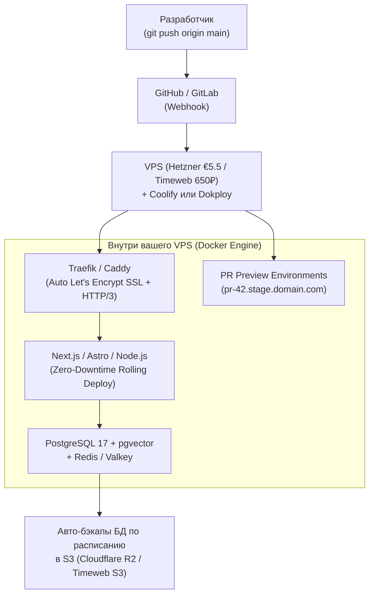
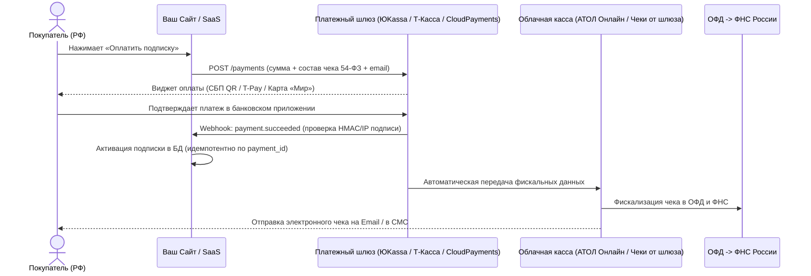

# 02. Домены, DNS, Хостинг, Self-Hosted PaaS, Базы данных, Auth, Почта и Платежи (2025–2026)

> [!IMPORTANT]
> **Ключевой архитектурный тренд 2025–2026:**
> Разработчики и бизнесы массово уходят от непредсказуемых счетов за овердрафт трафика на Serverless-платформах ($20+/мес за кресло + $40–150 за гигабайты) в сторону **Cloudflare Workers (`@opennextjs/cloudflare`)** и связки **VPS (Hetzner / Timeweb Cloud) + Self-Hosted PaaS (Coolify / Dokploy)**. В аутентификации платные MAU-сервисы вытесняются бесплатным TypeScript-фреймворком **Better Auth**, хранящим пользователей прямо в вашей базе данных.

---

## Оглавление

1. [Домены и DNS-провайдеры](#1-домены-и-dns-провайдеры)
   - [1.1. Глобальные регистраторы (.com, .io, .ai, .dev)](#11-глобальные-регистраторы-com-io-ai-dev)
   - [1.2. Регистраторы в РФ (.ru, .рф, .su) и подводные камни продления](#12-регистраторы-в-рф-ru-рф-su-и-подводные-камни-продления)
   - [1.3. DNS и критический нюанс с блокировками TLS ECH в РФ](#13-dns-и-критический-нюанс-с-блокировками-tls-ech-в-рф)
2. [Облачный Edge-хостинг против VPS + Self-Hosted PaaS](#2-облачный-edge-хостинг-против-vps--self-hosted-paas)
   - [2.1. Сравнение Managed Cloud & Edge платформ (Vercel, Cloudflare, Railway, Fly.io)](#21-сравнение-managed-cloud--edge-платформ-vercel-cloudflare-railway-flyio)
   - [2.2. Революция Self-Hosted PaaS: VPS + Coolify / Dokploy («Свой личный Vercel»)](#22-революция-self-hosted-paas-vps--coolify--dokploy-свой-личный-vercel)
3. [Базы данных и Backend-as-a-Service (BaaS)](#3-базы-данных-и-backend-as-a-service-baas)
   - [3.1. Supabase, Neon и Turso: матрица выбора в 2025–2026 гг.](#31-supabase-neon-и-turso-матрица-выбора-в-20252026-гг)
4. [Аутентификация и транзакционная почта](#4-аутентификация-и-транзакционная-почта)
   - [4.1. Аутентификация: Better Auth vs Clerk](#41-аутентификация-better-auth-vs-clerk)
   - [4.2. Транзакционная почта (Resend + React Email, Postmark, РФ SMTP) и DNS-записи](#42-транзакционная-почта-resend--react-email-postmark-рф-smtp-и-dns-записи)
5. [Прием платежей: Глобальный рынок (Stripe vs MoR) и РФ (54-ФЗ и СБП)](#5-прием-платежей-глобальный-рынок-stripe-vs-mor-и-рф-54-фз-и-сбп)
   - [5.1. Глобальные платежи: Stripe против Merchant of Record (Paddle / Lemon Squeezy)](#51-глобальные-платежи-stripe-против-merchant-of-record-paddle--lemon-squeezy)
   - [5.2. Платежные шлюзы в РФ: ЮKassa, Т-Касса, CloudPayments, СБП и 54-ФЗ](#52-платежные-шлюзы-в-рф-юkassa-т-касса-cloudpayments-сбп-и-54-фз)
6. [Чек-лист инфраструктурной безопасности перед запуском](#6-чек-лист-инфраструктурной-безопасности-перед-запуском)

---

## 1. Домены и DNS-провайдеры

Выбор регистратора домена оценивается **не по промо-цене первого года**, а по стоимости продления (Renewal Price), бесплатному скрытию персональных данных (WHOIS Privacy) и отсутствию навязанных услуг.

### 1.1. Глобальные регистраторы (.com, .io, .ai, .dev)

| Регистратор | Цена `.com` (Регистрация / Продление) | WHOIS Privacy | Ключевые преимущества и особенности |
| :--- | :--- | :--- | :--- |
| **Cloudflare Registrar** | **~$10.44 / ~$10.44** (Оптовая цена At-Cost) | Бесплатно навсегда | **Эталон рынка.** 0% наценки поверх реестра ICANN/Verisign. Встроенный DNSSEC в 1 клик. Требует использования NS-серверов Cloudflare. |
| **Porkbun** | ~$11.08 / ~$11.08 | Бесплатно навсегда | Лучший выбор, если нужны внешние NS-серверы или редкие зоны (`.ai`, `.dev`, `.app`). Прозрачные цены без скрытых доплат. |
| **Namecheap** | ~$10–12 / ~$16.98+ | Бесплатно навсегда | Надежный интерфейс, отличная поддержка, но продление дороже, чем у Cloudflare и Porkbun. |
| *GoDaddy (Антирекомендация)* | ~$0.99 (промо) / **$22–25+** | Часто платно | Агрессивный апсейл, дорогое продление, темные паттерны в интерфейсе. Не рекомендуется. |

### 1.2. Регистраторы в РФ (.ru, .рф, .su) и подводные камни продления

На российском рынке классические регистраторы часто заманивают регистрацией за 149–199 ₽, выставляя на второй год счет в **1 200 – 2 500 ₽** за продление.

| Регистратор (РФ) | Регистрация `.ru` | Продление `.ru` (2-й год+) | Оценка и нюансы (2025–2026) |
| :--- | :--- | :--- | :--- |
| **Timeweb Domains** | ~179–199 ₽ | **~390–499 ₽** | **Лучший выбор в РФ.** Прозрачный тариф на продление, удобная панель, бесшовная связка с Timeweb Cloud и верификация через Госуслуги (ЕСИА). |
| **Beget** | ~179 ₽ | **~390–550 ₽** | Честное ценообразование без навязанных «пакетов безопасности», отличный API и DNS-менеджер. |
| **Рег.ру / NIC.ru (Руцентр)** | ~199 ₽ | **990 – 2 490+ ₽** | Крупнейшие игроки с огромным количеством автоматических допродаж в корзине. Продление в 3–5 раз дороже среднерыночного по хостинг-провайдерам. |

> [!WARNING]
> **Обязательная верификация доменов `.ru` / `.рф`:**
> По правилам Координационного центра доменов .RU/.РФ каждый администратор обязан подтвердить паспортные данные (или реквизиты юрлица/ИП). В 2025–2026 годах самый быстрый способ — привязка подтвержденного аккаунта **Госуслуг (ЕСИА)** или **T-ID / Сбер ID** в панели регистратора (занимает 2 минуты). Без верификации делегирование домена приостанавливается (`HOLD`).

### 1.3. DNS и критический нюанс с блокировками TLS ECH в РФ

**Cloudflare DNS** остается самым быстрым в мире Anycast DNS-провайдером (время отклика `10–25 мс`). Однако при работе с аудиторией из России в 2025–2026 годах необходимо учитывать фильтрацию **ТСПУ (Технические средства противодействия угрозам)**:

> [!CAUTION]
> **Проблема недоступности сайтов за Cloudflare в РФ из-за TLS ECH (Encrypted Client Hello):**
> Начиная с конца 2024 и в 2025–2026 годах оборудование ТСПУ российских провайдеров блокирует TLS-рукопожатия, использующие расширение **ECH (Encrypted Client Hello)** на проксируемых IP-адресах Cloudflare (оранжевое облачко).
> **Как решить проблему для пользователей из РФ:**
> 1. **Вариант А (Рекомендуемый для проектов только на РФ по 152-ФЗ):** Использовать Cloudflare **только в режиме DNS Only** (серое облачко) или использовать российский Anycast DNS (Selectel DNS, Timeweb DNS, Yandex Cloud DNS), направляя трафик напрямую на российский IP-адрес вашего сервера с сертификатом Let's Encrypt.
> 2. **Вариант Б (Если нужно проксирование Cloudflare):** Отключить Encrypted Client Hello (ECH) на уровне зоны через Cloudflare API (доступно на платных тарифах или через запрос к API `settings/ech` со значением `"off"`), а также ограничить максимальную версию протокола до TLS 1.2/1.3 без публикации `HTTPS` DNS-записей с параметром `ech=...`.

---

## 2. Облачный Edge-хостинг против VPS + Self-Hosted PaaS

### 2.1. Сравнение Managed Cloud & Edge платформ (Vercel, Cloudflare, Railway, Fly.io)

| Платформа | Базовый тариф | Сильные стороны | Ограничения и скрытые расходы |
| :--- | :--- | :--- | :--- |
| **Vercel** | Hobby ($0, некоммерч.) / **Pro ($20/мес за участника)** | Нативная платформа создателей Next.js. Идеальный DX, мгновенные Preview-деплои на каждый PR, встроенный Image Optimization и Fluid Compute. | Дорого при командной работе ($20 за каждое место) и при резком росте трафика / вызовов Serverless-функций. |
| **Cloudflare Pages & Workers** (`@opennextjs/cloudflare`) | Free ($0) / **Workers Paid ($5/мес)** | **Самый выгодный Edge-хостинг.** Бесплатный безлимитный трафик статики! На тарифе за **$5/мес** включено 10 млн SSR-запросов и 30 млн CPU-миллисекунд. Официальный адаптер `@opennextjs/cloudflare` поддерживает Next.js 15 App Router. | Код выполняется в среде `workerd` (а не полном Node.js), поэтому нативные C++ аддоны Node.js не поддерживаются. |
| **Railway** | Hobby (**$5/мес** базовый кредит) + оплата по факту ресурсов | Лучший облачный PaaS для полноценных контейнеров, фоновых воркеров (BullMQ/Cron), WebSockets, Python/Go-сервисов и Redis + Postgres в одном графе. | Оплата по потреблению RAM/CPU — при утечке памяти счет может вырасти. |
| **Fly.io** | Pay-as-you-go (~$5–15/мес) | Запуск Docker-приложений как легковесных микро-виртуалок **Firecracker** близко к пользователям по всему миру. | Требует навыков работы с `flyctl` и понимания сетевой маршрутизации. |
| **Netlify** | Free / Pro ($19/мес за участника) | Хорош для статических сайтов (Astro, Hugo, Vite SPA), встроенных форм и сплит-тестирования. | Уступает Vercel и Cloudflare Workers по скорости и стоимости SSR для Next.js. |

### 2.2. Революция Self-Hosted PaaS: VPS + Coolify / Dokploy («Свой личный Vercel»)

В 2025–2026 годах главным хитом среди разработчиков и агентств стала установка бесплатной open-source панели управления деплоем (**Coolify** или **Dokploy**) поверх арендованного облачного сервера (VPS/VDS).



#### Почему связка VPS + Coolify / Dokploy выигрывает по экономике в 5–10 раз:
* **Фиксированная цена без сюрпризов:** Аренда мощного VPS на базе **Hetzner Cloud** (4 vCPU, 8 ГБ RAM, 80 ГБ NVMe, 20 ТБ трафика в Германии/Финляндии) стоит **~€5.5–€7/мес**. Для проектов в РФ под **152-ФЗ** аналогичный сервер в **Timeweb Cloud** или **Selectel** (Москва / Санкт-Петербург) обходится в **~600–900 ₽/мес**.
* **Полный функционал Vercel из коробки:**
  * Автоматическая сборка через **Nixpacks** или `Dockerfile` по `git push` из GitHub/GitLab.
  * Автоматический выпуск и продление бесплатных SSL-сертификатов (включая Wildcard) через Traefik / Caddy.
  * Автоматическое поднятие **Preview-окружений** на каждый Pull Request с уникальной ссылкой.
  * Развертывание баз данных (**PostgreSQL, Redis, ClickHouse, MinIO**) в 1 клик с автоматическим шифрованным бэкапом в S3-хранилище каждый час или сутки.
* **Что выбрать — Coolify или Dokploy?**
  * **Dokploy** написан на TypeScript/Node.js, потребляет минимум оперативной памяти (~150–200 МБ), имеет сверхчистый интерфейс в стиле Vercel и нативную поддержку `docker-compose` и мультисерверного Docker Swarm.
  * **Coolify** (v4+) обладает гигантским каталогом готовых шаблонов в 1 клик (Supabase, Plausible, Umami, PocketBase, Ghost, n8n, PostHog).

---

## 3. Базы данных и Backend-as-a-Service (BaaS)

### 3.1. Supabase, Neon и Turso: матрица выбора в 2025–2026 гг.

| Платформа | СУБД под капотом | Киллер-фичи 2025–2026 | Бесплатный тариф / Платный старт | Когда выбирать |
| :--- | :--- | :--- | :--- | :--- |
| **Supabase** | Полноценный **PostgreSQL** (`pgvector`, `pg_cron`) | **Полный BaaS:** БД + Row Level Security (RLS) + S3 Storage + Realtime WebSockets + Edge Functions. **Можно развернуть Self-Hosted на своем VPS в РФ через Coolify/Docker!** | Free (2 проекта, пауза при неактивности) / **Pro ($25/мес)** | Когда нужен быстрый старт полного бэкенда (БД + Хранилище файлов + Realtime) или требуется **Self-Hosted в РФ для 152-ФЗ**. |
| **Neon** | **Serverless PostgreSQL** (разделение Compute и Storage) | **Мгновенное ветвление БД (Database Branching):** на каждый PR в GitHub за 1 секунду создается изолированная копия БД (`copy-on-write`) вместе с Vercel Preview! Авто-масштабирование и Scale-to-Zero. | Free (0.5 ГБ, всегда активный дев) / **Launch ($19/мес)** | Лучший облачный Postgres для стека **Next.js + Drizzle ORM / Prisma** на глобальном рынке. |
| **Turso** | **libSQL** (форк SQLite для Edge) | Репликация на границе сети (Edge) с задержкой чтения `< 5 мс`, архитектура **Database-per-tenant** (отдельная изолированная БД под каждого клиента в B2B SaaS). | Free (5 ГБ, до 100+ БД) / **Scaler ($4.99/мес)** | Мультитенантные SaaS, локально-ориентированные приложения (Local-first) и связка с Cloudflare Workers. |

---

## 4. Аутентификация и транзакционная почта

### 4.1. Аутентификация: Better Auth vs Clerk

Долгое время разработчики разрывались между дорогим облачным сервисом **Clerk** и сложным в настройке `NextAuth.js (Auth.js v5)`. В 2025–2026 годах стандартом открытой TypeScript-разработки стал **Better Auth**.

| Параметр | **Better Auth (`better-auth`)** | **Clerk** |
| :--- | :--- | :--- |
| **Где хранятся данные юзеров** | **В вашей собственной БД** (Postgres / MySQL / SQLite через Drizzle, Prisma или Kysely). Полное соответствие **152-ФЗ РФ** при размещении БД в РФ! | На облачных серверах Clerk в США (требует синхронизации через Webhooks в вашу БД; **не подходит для 152-ФЗ РФ**). |
| **Стоимость** | **$0 навсегда (MIT Open Source).** Никаких лимитов на количество пользователей (MAU). | Бесплатно до 10 000 MAU, далее от **$25/мес + $0.02 за каждого активного юзера** (и $100+/мес за B2B-организации и SAML). |
| **Функционал из коробки** | Email/Password, OAuth (Google, GitHub, Yandex, VK), **Passkeys (WebAuthn)**, **2FA (TOTP)**, Magic Links, **Organizations & Multi-tenancy (роли и команды)**, Rate Limiting. | Готовые красивые UI-компоненты (`<SignIn />`, `<UserButton />`), управление профилем и сессиями за 15 минут. |

#### Пример конфигурации `Better Auth` с поддержкой 2FA, Passkeys и Организаций (`src/lib/auth.ts`)

```typescript
import { betterAuth } from "better-auth";
import { drizzleAdapter } from "better-auth/adapters/drizzle";
import { twoFactor, passkey, organization } from "better-auth/plugins";
import { db } from "@/db"; // Ваш инстанс Drizzle ORM (PostgreSQL)

export const auth = betterAuth({
  database: drizzleAdapter(db, {
    provider: "pg",
  }),
  emailAndPassword: {
    enabled: true,
    autoSignIn: true,
  },
  socialProviders: {
    github: {
      clientId: process.env.GITHUB_CLIENT_ID!,
      clientSecret: process.env.GITHUB_CLIENT_SECRET!,
    },
    google: {
      clientId: process.env.GOOGLE_CLIENT_ID!,
      clientSecret: process.env.GOOGLE_CLIENT_SECRET!,
    },
  },
  plugins: [
    twoFactor({ issuer: "MySaaS" }),
    passkey(),
    organization(), // B2B-команды, инвайты и роли прямо в вашей БД бесплатно
  ],
});
```

### 4.2. Транзакционная почта (Resend + React Email, Postmark, РФ SMTP) и DNS-записи

Никогда не отправляйте системные письма (сброс пароля, коды входа, чеки) с обычного личного ящика Gmail/Yandex — аккаунт будет заблокирован в первый же день.

1. **Глобальный рынок:**
   * **Resend + React Email:** Современный стандарт для разработчиков. Позволяет верстать адаптивные кросс-клиентские письма как обычные React-компоненты на Tailwind (`@react-email/components`) с предпросмотром в браузере. Бесплатно до **3 000 писем/мес** (100 в день), платный тариф — $20/мес за 50 000 писем.
   * **Postmark:** Лидер по скорости доставки транзакционных писем во «Входящие» (раздельные IP-пулы для транзакций и маркетинга, доставка за 1–3 секунды).
2. **Российский рынок (152-ФЗ и высокая доставляемость на `@mail.ru` и `@yandex.ru`):**
   * **UniSender Go / Dashamail Транзакции / Яндекс 360 для бизнеса:** Имеют прогретые российские IP-адреса и не попадают под зарубежные блокировки шлюзов. При этом шаблоны писем так же верстаются на **React Email** (`render(<WelcomeEmail />)` в HTML-строку) и отправляются через `nodemailer` или HTTP API.

> [!IMPORTANT]
> **Обязательная триада DNS-записей для почты (SPF + DKIM + DMARC):**
> С 2024–2026 годов Gmail, Yahoo, Яндекс и Mail.ru жестко отклоняют письма с доменов без настроенной криптографической аутентификации:
> * **SPF (`TXT` на `@`):** Разрешает отправку только серверам вашего провайдера (`v=spf1 include:_spf.resend.com ~all`).
> * **DKIM (`TXT` или `CNAME` на `resend._domainkey`):** Цифровая криптографическая подпись каждого письма.
> * **DMARC (`TXT` на `_dmarc`):** Политика защиты от спуфинга (`v=DMARC1; p=quarantine; rua=mailto:dmarc@yourdomain.com`).
> * **Subdomain Isolation (Изоляция поддомена):** Отправляйте транзакционные письма с поддомена (например, `notify.yourdomain.com`), чтобы репутация рассылок никогда не повредила основной корпоративной почте на `@yourdomain.com`.

---

## 5. Прием платежей: Глобальный рынок (Stripe vs MoR) и РФ (54-ФЗ и СБП)

### 5.1. Глобальные платежи: Stripe против Merchant of Record (Paddle / Lemon Squeezy)

При продаже цифровых продуктов или SaaS-подписок по всему миру главная проблема — не сам эквайринг, а **налоговый комплаенс (Global Tax Compliance)**. При продаже подписки за $20 покупателю из Германии, Великобритании или штата Техас продавец обязан рассчитать, удержать и перечислить местный НДС (EU VAT, UK VAT, US Sales Tax) в налоговую соответствующей страны.

| Критерий | **Прямой процессинг (Stripe)** | **Merchant of Record — MoR (Paddle / Lemon Squeezy / Polar.sh)** |
| :--- | :--- | :--- |
| **Юридическая схема** | Вы продаете напрямую покупателю. Нужна зарегистрированная компания (US LLC / C-Corp, UK Ltd, EU). | **Платформа выступает официальным продавцом (реселлером)** в чеке покупателя, а вам выплачивает роялти/выручку одним переводом раз в месяц. |
| **Уплата мировых налогов (EU VAT, US Sales Tax)** | Вы несете ответственность за регистрацию и подачу налоговых деклараций при превышении порогов (или доплачиваете за Stripe Tax + бухгалтеров). | **100% на стороне Paddle / Lemon Squeezy.** Они сами считают, удерживают и платят НДС в 100+ странах мира. |
| **Комиссия** | **2.9% + $0.30** (+ 0.5% за Stripe Tax + 0.7% за Billing). | **5% + $0.50** (все включено: эквайринг, подписки, антифрод, налоги, возвраты). |
| **Кому подходит** | Крупным компаниям с юристами и высоким оборотом ($50k+/мес), а также маркетплейсам (Stripe Connect). | **Идеально для инди-хакеров, микро-SaaS и небольших команд**, желающих продавать на весь мир с первого дня без налоговой головной боли. |

*(Примечание: В 2024 году компания Stripe приобрела Lemon Squeezy, чтобы развивать собственное направление Merchant of Record наряду с классическим Stripe).*

### 5.2. Платежные шлюзы в РФ: ЮKassa, Т-Касса, CloudPayments, СБП и 54-ФЗ

Для приема платежей от российских пользователей в рублях (картами «Мир», СБП, T-Pay, SberPay, Яндекс Пэй) требуются статус **ИП, ООО или Самозанятого (плательщика НПД)** и соблюдение закона **54-ФЗ «О применении контрольно-кассовой техники»**.



#### Сравнение главных платежных агрегаторов РФ (2025–2026)

| Платежный шлюз | Комиссия по картам РФ | Комиссия по СБП (QR / Кнопка) | Онлайн-касса 54-ФЗ и особенности |
| :--- | :--- | :--- | :--- |
| **ЮKassa (Сбер)** | ~2.8% – 3.5% (зависит от оборота и категории) | **0.4% – 0.7%** (макс. 1 500 ₽ за транзакцию) | Самый популярный шлюз в РФ. Работает с **ИП, ООО и Самозанятыми**. Есть встроенное решение **«Чеки от ЮKassa»** (не нужно арендовать отдельную кассу в АТОЛ!) и поддержка автоплатежей (рекуррентов). |
| **Т-Касса (Т-Банк)** | ~2.5% – 3.2% | **0.4% – 0.7%** | Отличная конверсия благодаря **T-Pay в 1 клик**, встроенным рассрочкам («Долями») и собственному облачному кассовому сервису. |
| **CloudPayments** | ~2.7% – 3.9% | **0.4% – 0.7%** | **Лучший технический виджет для SaaS и рекуррентных подписок**, собственная облачная касса **CloudKassir**, детальная аналитика отказов. Работает только с ИП и ООО. |
| **Robokassa** | от ~2.9% – 3.9% | ~0.7% | Удобна для старта (включая самозанятых и физлиц) за счет встроенного решения «Робочеки» без покупки отдельной ККТ и фискального накопителя. |

> [!TIP]
> **Экономия до 80% на эквайринге через СБП (Систему быстрых платежей):**
> Комиссия за прием платежей по СБП законодательно ограничена ЦБ РФ на уровне **0.4%** (для социально значимых товаров, медицины, образования, ЖКХ) и **0.7%** (для большинства ИТ-услуг и цифровых товаров), в то время как карточный эквайринг забирает **2.8–3.5%**. В 2025–2026 годах СБП поддерживает **сценарий привязки счета (СБПэй / автоплатежи СБП)** — обязательно ставьте кнопку «Оплатить через СБП» на первое место в платежной форме!

---

## 6. Чек-лист инфраструктурной безопасности перед запуском

- [ ] **Домен и DNS:** Включена блокировка переноса домена (`Registrar Lock`), настроен `DNSSEC`, автопродление привязано к рабочей карте/счету с запасом средств.
- [ ] **Доступность в РФ (ТСПУ):** Проверена открываемость сайта с российских мобильных операторов (МТС, МегаФон, Билайн, Т2) и домашнего интернета (Ростелеком); исключена блокировка из-за Cloudflare TLS ECH.
- [ ] **Защита VPS (для Coolify / Dokploy):**
  - [ ] Отключен вход по паролю в SSH (`PasswordAuthentication no`), вход строго по Ed25519 SSH-ключам.
  - [ ] Закрыты все порты в файрволе (`ufw` / Cloud Firewall), кроме `80`, `443` и кастомного/защищенного порта SSH; порт базы данных (`5432`) и Redis (`6379`) **никогда не смотрят во внешний интернет** (доступны только внутри Docker-сети или через SSH-туннель/Tailscale).
- [ ] **Бэкапы БД (Правило 3-2-1):** Настроено автоматическое ежедневное создание зашифрованного дампа PostgreSQL во внешнее объектное хранилище S3 и **проведен хотя бы один тестовый рестор (восстановление)** на чистой базе.
- [ ] **Почтовая репутация:** Проверены записи `SPF`, `DKIM` и `DMARC` через сервис `mail-tester.com` (оценка не ниже `9.5/10`).
- [ ] **Безопасность платежных Webhooks:** Серверный эндпоинт приема вебхуков (`/api/webhooks/payment`) обязательно проверяет криптографическую подпись заголовка (`Stripe-Signature` или список доверенных IP/HMAC ЮKassa/CloudPayments) и обрабатывает повторные запросы **идемпотентно** (по уникальному `payment_id` в транзакции БД).
