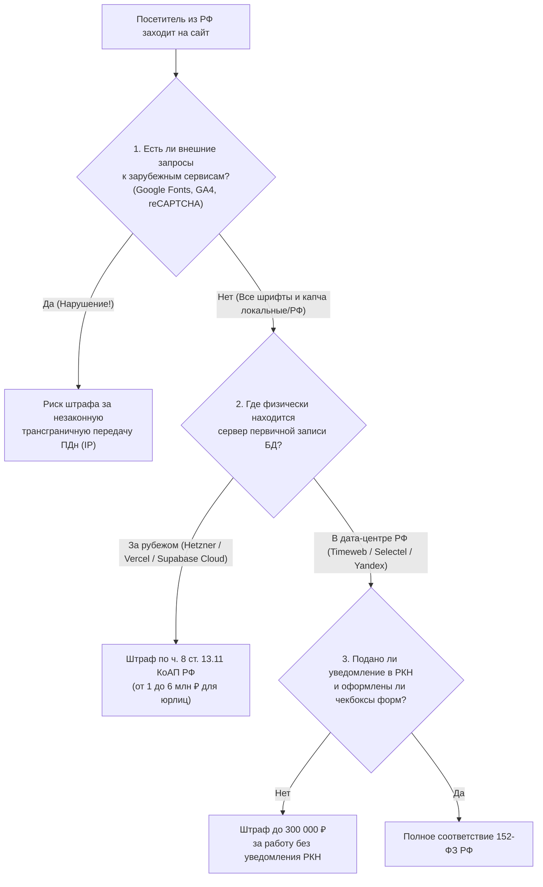
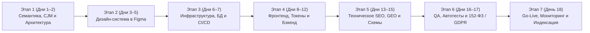

# 03. Тестирование, Аналитика, Мониторинг, Юридический комплаенс (152-ФЗ и GDPR), Бюджеты и Пошаговый план запуска (2025–2026)

> [!IMPORTANT]
> **Главное правило продакшен-запуска 2025–2026:**
> Выкладка сайта без автотестов критического пути (Playwright), мониторинга ошибок (Sentry) и юридического аудита (152-ФЗ в РФ или GDPR в ЕС) — это прямая финансовая угроза бизнесу. В России с 2025 года штрафы за неподачу уведомления в Роскомнадзор достигают **100 000 – 300 000 ₽**, а за нелокализованные базы данных и утечки персональных данных достигают **1–18 млн ₽ и оборотных штрафов**. При этом техническое приведение сайта в полное соответствие закону занимает всего 1–2 дня при правильной архитектуре.

---

## Оглавление

1. [Контроль качества (QA) и автоматизированное тестирование](#1-контроль-качества-qa-и-автоматизированное-тестирование)
   - [1.1. Пирамида тестирования современного фронтенда: Vitest + Playwright + Lighthouse CI](#11-пирамида-тестирования-современного-фронтенда-vitest--playwright--lighthouse-ci)
   - [1.2. Эталонный пайплайн GitHub Actions для защиты `main`-ветки](#12-эталонный-пайплайн-github-actions-для-защиты-main-ветки)
2. [Веб-аналитика, продуктовая аналитика и мониторинг](#2-веб-аналитика-продуктовая-аналитика-и-мониторинг)
   - [2.1. Сравнение систем аналитики: PostHog, Plausible / Umami, Яндекс.Метрика, GA4](#21-сравнение-систем-аналитики-posthog-plausible--umami-яндексметрика-ga4)
   - [2.2. Панели вебмастеров (GSC, Яндекс.Вебмастер) и мгновенная индексация IndexNow](#22-панели-вебмастеров-gsc-яндексвебмастер-и-мгновенная-индексация-indexnow)
   - [2.3. Отслеживание ошибок (Sentry) и мониторинг аптайма (Better Stack)](#23-отслеживание-ошибок-sentry-и-мониторинг-аптайма-better-stack)
3. [Юридический комплаенс сайта (2025–2026)](#3-юридический-комплаенс-сайта-20252026)
   - [3.1. РФ: 152-ФЗ «О персональных данных» и закон о рекламе (ОРД / ЕРИР)](#31-рф-152-фз-о-персональных-данных-и-закон-о-рекламе-орд--ерир)
   - [3.2. Глобальный рынок: GDPR (Евросоюз), CCPA (США) и Google Consent Mode v2](#32-глобальный-рынок-gdpr-евросоюз-ccpa-сша-и-google-consent-mode-v2)
4. [Сводные сметы бюджетов на инфраструктуру (3 реальных сценария)](#4-сводные-сметы-бюджетов-на-инфраструктуру-3-реальных-сценария)
   - [Сценарий 1: Глобальный Indie-стартап / Контентный проект ($1–21/мес)](#сценарий-1-глобальный-indie-стартап--контентный-проект-121мес)
   - [Сценарий 2: Коммерческий проект или E-commerce в РФ по 152-ФЗ (800–1 800 ₽/мес)](#сценарий-2-коммерческий-проект-или-e-commerce-в-рф-по-152-фз-8001-800-рмес)
   - [Сценарий 3: Масштабируемый Global SaaS ($130–240/мес)](#сценарий-3-масштабируемый-global-saas-130240мес)
5. [Пошаговый план создания и запуска сайта (Roadmap: Дни 1–18)](#5-пошаговый-план-создания-и-запуска-сайта-roadmap-дни-118)
6. [Финальный Go-Live чек-лист перед открытием трафика](#6-финальный-go-live-чек-лист-перед-открытием-трафика)

---

## 1. Контроль качества (QA) и автоматизированное тестирование

### 1.1. Пирамида тестирования современного фронтенда: Vitest + Playwright + Lighthouse CI

Устаревшая связка `Jest + Cypress` окончательно уступила место более быстрым и стабильным инструментам:

| Уровень тестирования | Стандарт 2025–2026 | Что именно проверяем |
| :--- | :--- | :--- |
| **1. Статический анализ и типизация** | **TypeScript (`strict: true`) + Biome / ESLint** | Отсутствие ошибок типов, неиспользуемых переменных и нарушений правил React Hooks за 1–2 секунды. |
| **2. Unit & Component тесты** | **Vitest + Testing Library** | Чистые бизнес-функции (расчет скидок, налогов, валидация схем Zod, парсеры) и изолированная логика сложных UI-компонентов. Выполняется в 5–10 раз быстрее Jest благодаря нативному ESM. |
| **3. End-to-End (E2E) тесты** | **Playwright** | **Критические пользовательские пути (Critical User Journeys)** в реальных движках Chromium, WebKit (Safari) и Firefox: Регистрация $\rightarrow$ Вход $\rightarrow$ Оформление заказа / Оплата. При падении теста в CI генерируется **Playwright Trace Viewer** с покадровым видео, DOM-слепками и сетевыми логами. |
| **4. Аудит скорости и SEO** | **Lighthouse CI (`@lhci/cli`) + `@axe-core/playwright`** | Автоматическая блокировка слияния Pull Request, если оценка Performance падает ниже `90`, `LCP > 2.5s`, `CLS > 0.1` или нарушены правила доступности WCAG 2.2 AA. |

### 1.2. Эталонный пайплайн GitHub Actions для защиты `main`-ветки

Создайте файл `.github/workflows/ci-quality.yml`, чтобы ни один баг или просадка SEO/Core Web Vitals не попали в продакшен:

```yaml
name: CI Quality & E2E Gate

on:
  pull_request:
    branches: [main]

jobs:
  verify:
    runs-on: ubuntu-latest
    timeout-minutes: 15
    steps:
      - name: Checkout repository
        uses: actions/checkout@v4

      - name: Setup Node.js 22 LTS & pnpm
        uses: pnpm/action-setup@v4
        with:
          version: 9
      - uses: actions/setup-node@v4
        with:
          node-version: 22
          cache: "pnpm"

      - name: Install dependencies
        run: pnpm install --frozen-lockfile

      - name: Typecheck & Lint
        run: |
          pnpm run typecheck
          pnpm run lint

      - name: Run Unit Tests (Vitest)
        run: pnpm vitest run

      - name: Install Playwright Browsers
        run: pnpm exec playwright install --with-deps chromium

      - name: Build Production App & Run Playwright E2E + Axe A11y
        run: |
          pnpm run build
          pnpm exec playwright test
```

---

## 2. Веб-аналитика, продуктовая аналитика и мониторинг

### 2.1. Сравнение систем аналитики: PostHog, Plausible / Umami, Яндекс.Метрика, GA4

В 2025–2026 годах использование тяжелых трекеров без необходимости снижает скорость загрузки (INP / TBT) и попадает под блокировщики рекламы (`uBlock Origin`, `Brave`) у 30–45% технически подкованной аудитории.

| Система аналитики | Вес скрипта | Главные возможности | Бесплатный лимит / Self-Hosted | Юрисдикция и 152-ФЗ / GDPR |
| :--- | :--- | :--- | :--- | :--- |
| **PostHog** | ~45 КБ (gzip) | **Вся продуктовая аналитика в одном окне:** События, Воронки (Funnels), Когорты (Retention), **Session Replay** (запись экрана), **Feature Flags**, **A/B-тесты**, опросы пользователей. | **1 млн событий/мес** и **5 000 записей сессий/мес бесплатно!** Доступен Self-Hosted. | Облака в ЕС (Франкфурт) и США. Для 152-ФЗ РФ используйте только Self-Hosted на VPS в РФ. |
| **Plausible / Umami** | **< 2 КБ!** | Легковесная веб-аналитика на 1 экране: источники трафика, UTM-метки, география, конверсии по целям. | В облаке платно ($9/мес), но **на 100% бесплатно в Self-Hosted** через Coolify / Dokploy! | **Работают вообще без куки (Cookieless)** и не собирают персональные идентификаторы. Не требуют раздражающего Cookie-баннера по GDPR! |
| **Яндекс.Метрика** | ~65 КБ | Стандарт для Рунета: **Вебвизор 2.0**, карты кликов и скролла, сквозная аналитика и автоцели для Яндекс.Директа. | **100% бесплатно** без лимитов трафика. | Серверы в РФ (соответствует локализации **152-ФЗ**), но требует **Cookie-баннера** и включения **уведомления в РКН**. |
| **Google Analytics 4 (GA4)** | ~90+ КБ | Глубокая интеграция с Google Ads и BigQuery, предиктивные аудитории. | Бесплатно. | **Токсичен для 152-ФЗ в РФ** (трансграничная передача данных в Google LLC в США без спецразрешения). В ЕС требует настройки **Consent Mode v2**. |

> [!CAUTION]
> **Обязательное правило безопасности при использовании Яндекс.Метрики (Вебвизор) и PostHog (Session Replay):**
> По умолчанию запись сессий может зафиксировать ввод ФИО, телефонов, адресов и платежных данных на экране. Чтобы не допустить утечки ПДн в аналитику, всегда добавляйте CSS-класс маскирования на все поля ввода и блоки с личными данными:
> * Для **Яндекс.Метрики (Вебвизор 2.0):** добавьте класс `ym-record-keys` только на публичные поля, либо скройте приватные блоки классом `ym-hide-content` (а поля `input[type="password"]` маскируются по умолчанию, но для телефонов и email обязательно ставьте `class="ym-disable-keys"`).
> * Для **PostHog / Sentry Replay:** включите опцию `maskAllInputs: true` и используйте класс `ph-no-capture` / `data-sentry-mask` на блоках с персональными данными.

### 2.2. Панели вебмастеров (GSC, Яндекс.Вебмастер) и мгновенная индексация IndexNow

Сразу после выкладки сайта на домен необходимо зарегистрировать его в трех панелях поисковых систем:

1. **Google Search Console (GSC):** Верификация через DNS `TXT`-запись (предпочтительно как *Domain Property*, чтобы охватить все поддомены и протоколы `http/https`). Отправка `sitemap.xml`, мониторинг Core Web Vitals (отчет CrUX) и ручная отправка новых важных URL через URL Inspection.
2. **Яндекс.Вебмастер:** Настройка региональности бизнеса, привязка профиля в **Яндекс Бизнесе** (для коммерческих факторов и гео-колдунщиков), загрузка фидов товаров/услуг (YML) и мониторинг обхода страниц.
3. **Протокол мгновенной индексации `IndexNow` (Яндекс + Bing + ChatGPT Search):**
   В отличие от Google, поисковые системы **Яндекс** и **Microsoft Bing** (на базе которого работает веб-поиск **ChatGPT Search** и **Copilot**) поддерживают открытый протокол `IndexNow`. При публикации или обновлении статьи ваша CMS или серверный скрипт отправляет один `POST`-запрос к `https://api.indexnow.org/indexnow` со списком измененных URL, и поисковый робот индексирует страницу **за несколько минут, а не недель**.

### 2.3. Отслеживание ошибок (Sentry) и мониторинг аптайма (Better Stack)

* **Sentry (`@sentry/nextjs` / `@sentry/react`):** Стандарт де-факто для перехвата исключений на клиенте и сервере. Обязательно настройте автоматическую загрузку **Source Maps** при сборке в CI/CD (с последующим удалением `.map` файлов из публичного доступа `deleteSourcemapsAfterUpload: true`), чтобы в панели Sentry вы видели точную строчку исходного TypeScript-кода, где произошла ошибка, но конкуренты не могли прочитать ваш код в браузере. (Бесплатный тариф Developer включает 5 000 ошибок в месяц; также есть легковесный self-hosted аналог **GlitchTip**).
* **Мониторинг доступности (Uptime Monitoring):**
  * **Better Stack (бывший Better Uptime):** Пингует ваш сайт и API-эндпоинт `/api/health` каждые 30–180 секунд с разных континентов, проверяет срок действия SSL-сертификата и при падении мгновенно шлет алерт в **Telegram / Slack / Email**, а также предоставляет красивую публичную страницу статуса (`status.yourdomain.com`). Бесплатно до 10 мониторов.
  * **Uptime Kuma:** Лучшее бесплатное Self-Hosted решение (устанавливается в 1 клик в Coolify/Dokploy) с нативными уведомлениями в Telegram-бота за 2 минуты.

---

## 3. Юридический комплаенс сайта (2025–2026)

### 3.1. РФ: 152-ФЗ «О персональных данных» и закон о рекламе (ОРД / ЕРИР)

В 2025–2026 годах Роскомнадзор проверяет сайты автоматизированными сканерами (парсерами сетевых запросов, DOM-дерева и реестра операторов). Любой сайт, собирающий имя, телефон, email, использующий форму обратной связи или просто подключивший Яндекс.Метрику (cookies и IP-адрес признаются персональными данными), **является Оператором персональных данных**.



#### Полный технический и юридический чек-лист по 152-ФЗ РФ (2025–2026):

1. **Физическая локализация баз данных на территории РФ (ч. 5 ст. 18 152-ФЗ):**
   Первичный сбор, запись, систематизация и хранение персональных данных граждан РФ должны осуществляться в базах данных, физически расположенных в дата-центрах на территории России (Москва, Санкт-Петербург, Новосибирск — например, **Timeweb Cloud, Selectel, Yandex Cloud, VK Cloud, Beget**). Нельзя отправлять формы заявок российских клиентов напрямую в зарубежные облака (Airtable, Notion, зарубежный Supabase Cloud или Firebase).
2. **Подача уведомления в Реестр операторов ПДн Роскомнадзора (ст. 22 152-ФЗ):**
   До начала обработки данных (или немедленно, если сайт уже работает) ИП, ООО или самозанятый обязаны подать электронное уведомление на портале РКН (`pd.rkn.gov.ru`) через подтвержденную учетную запись Госуслуг. Это **бесплатно** и занимает 20–30 минут. Отсутствие компании в реестре при наличии форм на сайте карается штрафом до **300 000 ₽**.
3. **Запрет скрытой трансграничной передачи IP-адресов через внешние скрипты:**
   * **Отказ от внешней подгрузки Google Fonts (`fonts.googleapis.com` / `fonts.gstatic.com`):** Скачайте шрифты `.woff2` в папку проекта (`/public/fonts/`) или используйте `next/font`, который скачивает шрифты на этапе сборки (`build time`) и раздает их с вашего российского сервера.
   * **Отказ от Google Analytics 4 и Google Tag Manager** на сайтах, ориентированных исключительно на РФ (замените на **Яндекс.Метрику** или локальный **Umami / Plausible** на вашем сервере в РФ).
   * **Отказ от Google reCAPTCHA и Cloudflare Turnstile** на российских формах: используйте **Яндекс SmartCaptcha** (серверы в РФ, бесплатный лимит до 10 000–100 000 проверок, полное соответствие 152-ФЗ).
4. **Правильное оформление форм сбора данных и документов в подвале сайта (`Footer`):**
   * В футере каждой страницы должны быть кликабельные ссылки: **«Политика в отношении обработки персональных данных»**, **«Пользовательское соглашение / Публичная оферта»** и **реквизиты оператора** (Наименование ИП/ООО, ИНН, ОГРН/ОГРНИП, контактный email).
   * Под каждой формой ввода (заявка, регистрация, корзина) должен стоять **отдельный чекбокс**: *«Я даю согласие на обработку персональных данных в соответствии с Политикой обработки ПДн»*.
   * **Строгий запрет на предзаполненные галочки!** Чекбокс по умолчанию обязан быть **пустым** (`defaultChecked={false}`), а кнопка отправки блокируется до его осознанной активации пользователем.
   * На согласие на **рекламные и маркетинговые рассылки** (по ст. 18 ФЗ «О рекламе») обязательно должен быть **второй отдельный чекбокс** (нельзя «зашивать» согласие на рекламу внутрь общего согласия на обработку ПДн или оферты — за спам без отдельного согласия с 2024–2025 гг. штрафы для юрлиц составляют **от 300 000 до 1 000 000 ₽**).
5. **Маркировка интернет-рекламы (ст. 18.1 ФЗ «О рекламе» — ОРД и ЕРИР):**
   Любой рекламный баннер стороннего продукта, партнерская ссылка или платная интеграция на вашем сайте обязаны иметь пометку **«Реклама»**, указание рекламодателя (наименование + ИНН/ОГРН) и уникальный токен **`erid: XXXXX`**, полученный через Оператора рекламных данных (Яндекс ОРД, VK ОРД, Ozon ОРД). Собственные товары и услуги компании на своем собственном сайте в стандартном каталоге маркировать токеном `erid` не нужно (кроме выделенных саморекламных сквозных спецбаннеров).

### 3.2. Глобальный рынок: GDPR (Евросоюз), CCPA (США) и Google Consent Mode v2

Если ваш сайт или SaaS работает на аудиторию Европейского союза, Великобритании и США (Калифорния):

1. **Правило равнозначного выбора в Cookie-баннере (GDPR & ePrivacy Directive):**
   * Запрещены темные паттерны (Dark Patterns), когда кнопка «Accept All» — яркая зеленая, а отказ спрятан глубоко в настройках. Кнопки **«Accept All» (Принять все)** и **«Reject All» (Отклонить необязательные)** обязаны находиться на первом уровне баннера и иметь одинаковый визуальный вес.
   * До нажатия «Accept All» ни один маркетинговый или аналитический скрипт, использующий куки (GA4, Meta Pixel, TikTok Pixel), **не имеет права записывать идентификаторы в браузер**.
2. **Обязательный Google Consent Mode v2 (с марта 2024–2026 для ЕЭЗ и UK):**
   Если вы используете Google Analytics 4 или Google Ads для трафика из Европы, вы обязаны передавать 4 сигнала согласия по умолчанию `denied` до взаимодействия с баннером:
   * `ad_storage: 'denied'`
   * `analytics_storage: 'denied'`
   * `ad_user_data: 'denied'` (новое в v2)
   * `ad_personalization: 'denied'` (новое в v2)
3. **Право на забвение (Right to Erasure — Art. 17 GDPR) и экспорт данных:**
   В личном кабинете вашего SaaS должна быть кнопка **«Delete Account» (Удалить аккаунт)**, которая реально удаляет (или необратимо анонимизирует) персональные данные пользователя из базы данных и сторонних сервисов без необходимости писать бумажные письма в поддержку.

---

## 4. Сводные сметы бюджетов на инфраструктуру (3 реальных сценария)

Ниже приведены проверенные сметы регулярных расходов на поддержку сайта/приложения в 2025–2026 годах без переплат за воздух.

### Сценарий 1: Глобальный Indie-стартап / Контентный проект ($1–21/мес)

Идеально для запуска MVP, микро-SaaS, блога, каталога или лендинга на международный рынок с минимальными костами.

| Статья расходов | Выбранный стек и тариф | Стоимость в месяц | Примечание |
| :--- | :--- | :--- | :--- |
| **Домен (`.com` / `.dev`)** | Cloudflare Registrar ($10.44/год) | **~$0.87 / мес** | Оптовая цена At-Cost, бесплатный WHOIS Privacy и DNSSEC. |
| **Хостинг и CDN** | Cloudflare Pages & Workers (Free / Paid) или VPS Hetzner + Dokploy | **$0 – $6.00 / мес** | $0 на Cloudflare Free (или $5 Workers Paid); либо €5.5 (~$6) за VPS 4 vCPU / 8 GB RAM на Hetzner. |
| **База данных** | Neon Serverless Postgres (Free) или Supabase (Free) | **$0 / мес** | До 0.5 ГБ в Neon или 500 МБ в Supabase бесплатно. |
| **Аутентификация** | Better Auth (Open Source) | **$0 / мес** | Безлимитные пользователи, Passkeys и 2FA прямо в вашей БД. |
| **Транзакционная почта** | Resend (Free Tier) | **$0 / мес** | До 3 000 писем/мес (100/день) бесплатно. |
| **Аналитика и Мониторинг** | PostHog (Free) + Sentry (Free) + Better Stack (Free) | **$0 / мес** | 1 млн событий в PostHog, 5 000 ошибок в Sentry, 10 проверок аптайма. |
| **Прием платежей** | Paddle или Lemon Squeezy (Merchant of Record) | **$0 абонентская** (5% + $0.50 с продаж) | Никаких затрат на открытие юрлица для налогов ЕС/США на старте. |
| **ИТОГО:** | | **~$0.87 – $6.87 / мес** *(до $21/мес при Vercel Pro)* | **Сверхнизкий порог входа для проверки гипотез.** |

---

### Сценарий 2: Коммерческий проект или E-commerce в РФ по 152-ФЗ (800–1 800 ₽/мес)

Идеальная архитектура для российского бизнеса, интернет-магазина, корпоративного портала или локального сервиса со 100% соблюдением **152-ФЗ** и **54-ФЗ** и полной независимостью от зарубежных блокировок.

| Статья расходов | Выбранный стек и тариф | Стоимость в месяц | Примечание |
| :--- | :--- | :--- | :--- |
| **Домен (`.ru` / `.рф`)** | Timeweb Domains или Beget (~390–499 ₽/год продление) | **~35 – 45 ₽ / мес** | Регистрация и верификация через Госуслуги на ИП / ООО. |
| **Сервер в РФ (152-ФЗ) + PaaS** | Облачный VPS в **Timeweb Cloud** или **Selectel** (Москва/СПб, 2–4 vCPU, 4–8 ГБ RAM, NVMe) + панель **Dokploy / Coolify** | **~650 – 1 200 ₽ / мес** | На этом же сервере в Docker работают Next.js/Astro, PostgreSQL 17, Redis и локальный Umami. |
| **Объектное хранилище S3 (Бэкапы и медиа)** | Timeweb Cloud S3 или Selectel S3 (в РФ) | **~100 – 250 ₽ / мес** | Ежедневные авто-бэкапы БД и хранение загруженных файлов клиентов в РФ. |
| **Аутентификация и Капча** | Better Auth + Яндекс SmartCaptcha | **0 ₽ / мес** | Пользователи хранятся в локальной БД PostgreSQL в Москве/СПб. |
| **Транзакционная почта** | Яндекс 360 для бизнеса / UniSender Go | **0 – 300 ₽ / мес** | Высокая доставляемость на `@mail.ru` и `@yandex.ru`. |
| **Аналитика и Мониторинг** | Яндекс.Метрика + Self-Hosted Umami + Uptime Kuma | **0 ₽ / мес** | Все данные аналитики и мониторинга остаются внутри контура РФ. |
| **Платежи и 54-ФЗ** | ЮKassa / Т-Касса + СБП (0.4–0.7%) + «Чеки от ЮKassa» | **0 ₽ абонентская** (% с оборота) | Автоматическая отправка чеков в ОФД и ФНС без аренды физической кассы. |
| **ИТОГО:** | | **~785 – 1 795 ₽ / мес** | **Полный суверенитет, 100% комплаенс 152-ФЗ и фиксированный чек.** |

---

### Сценарий 3: Масштабируемый Global SaaS ($130–240/мес)

Боевой продакшен-стек для растущего международного SaaS-продукта с командой разработчиков, высокой нагрузкой, Preview-ветками БД и строгим SLA.

| Статья расходов | Выбранный стек и тариф | Стоимость в месяц | Примечание |
| :--- | :--- | :--- | :--- |
| **Домены (.com + .ai)** | Cloudflare Registrar | **~$6 / мес** | Основной домен + домен под AI-фичи/короткие ссылки. |
| **Edge-хостинг и CI/CD** | Vercel Pro (2 разработчика) или Cloudflare Workers Paid + Выделенный Hetzner Cloud | **$40 – $65 / мес** | Мгновенные PR-превью, глобальная сеть доставки, фоновые воркеры. |
| **База данных (Managed HA)** | Neon Scale / Launch или Supabase Pro | **$25 – $69 / мес** | Point-in-Time Recovery (PITR — откат БД на любую секунду за 7–14 дней), ветвление БД на каждый PR. |
| **Почта и Уведомления** | Resend Pro (50 000 писем/мес, выделенные домены) | **$20 / мес** | Полная аналитика доставляемости и вебхуки баунсов. |
| **Мониторинг и Ошибки** | Sentry Team ($26/мес) + Better Stack ($24/мес) + PostHog (Pay-as-you-go поверх 1M) | **$50 – $80 / мес** | Полный стек наблюдаемости (Observability), онколл-алерты и запись сессий. |
| **ИТОГО:** | | **~$141 – $240 / мес** | **Готовность держать десятки тысяч активных пользователей и проходить аудит SOC2 / GDPR.** |

---

## 5. Пошаговый план создания и запуска сайта (Roadmap: Дни 1–18)

Этот пошаговый план синхронизирует дизайн, SEO-архитектуру, разработку, аналитику и юридическую упаковку, исключая переделки на финальной стадии.



| Этап и сроки | Ключевые задачи | Артефакт / Критерий завершения (Definition of Done) |
| :--- | :--- | :--- |
| **Этап 1: Аналитика, Семантика и Архитектура URL**<br>*(Дни 1–2)* | • Сбор поисковых интентов и кластеризация семантики.<br>• Проектирование дерева URL (ЧПУ без дублей) и структуры перелинковки.<br>• Определение юрисдикции (РФ 152-ФЗ vs Global GDPR) и выбор стека. | Утвержденная карта сайта (Sitemap Matrix), схема БД и список целевых посадочных страниц с будущими `H1` и `Title`. |
| **Этап 2: Проектирование и Дизайн-система в Figma**<br>*(Дни 3–5)* | • Настройка **Figma Variables** (Primitives + Semantics для Light/Dark).<br>• Сборка компонентов и адаптивных экранов строго на **Auto Layout 5.0+** (`360px`, `768px`, `1440px`).<br>• Проверка контрастности текста и размеров кликабельных зон по **WCAG 2.2 AA**. | Интерактивный макет в Figma, готовый к чтению через **Dev Mode / Figma MCP Server**. |
| **Этап 3: Инфраструктура, Домен, БД и CI/CD**<br>*(Дни 6–7)* | • Покупка домена, настройка DNS (`SPF`, `DKIM`, `DMARC`, `DNSSEC`).<br>• Развертывание сервера с **Coolify / Dokploy** (или подключение Cloudflare Workers / Vercel).<br>• Поднятие PostgreSQL (Supabase / Neon / локальный Docker в РФ) и настройка авто-бэкапов в S3. | Рабочее `staging`-окружение с HTTPS, деплоящееся автоматически при `git push`, и зеленый пайплайн GitHub Actions. |
| **Этап 4: Разработка Фронтенда, Бэкенда и Платежей**<br>*(Дни 8–12)* | • Перенос дизайн-токенов в **Tailwind CSS v4 (`@theme` + OKLCH)** и установка базовых примитивов **shadcn/ui**.<br>• Подключение **Better Auth**, верстка ключевых страниц, форм (React Hook Form + Zod) и анимаций (**Motion / GSAP**).<br>• Интеграция платежного шлюза (ЮKassa/СБП или Paddle/Stripe) с идемпотентными вебхуками. | Полностью функциональное приложение на `staging`-сервере с работающей авторизацией, формами, письмами (**Resend + React Email**) и тестовыми платежами. |
| **Этап 5: Техническое SEO, Core Web Vitals и GEO/AIO**<br>*(Дни 13–15)* | • Оптимизация изображений (`AVIF/WebP`, `fetchpriority="high"` на LCP-картинке) и локальных шрифтов `.woff2`.<br>• Генерация динамических `sitemap.xml`, `robots.txt` (с разрешением для AI-краулеров `OAI-SearchBot`, `ClaudeBot`, `PerplexityBot`), `llms.txt` и `JSON-LD` разметки (`Organization`, `Product`, `FAQPage`, `BreadcrumbList`).<br>• Настройка генерации динамических `OpenGraph` картинок (`1200×630`). | Оценка **Lighthouse 95–100** во всех 4 категориях (`Performance`, `Accessibility`, `Best Practices`, `SEO`), 0 ошибок в валидаторе Schema.org. |
| **Этап 6: Юридический комплаенс и QA-тестирование**<br>*(Дни 16–17)* | • Размещение Политики обработки ПДн, Оферты, реквизитов и пустых чекбоксов согласия; подача уведомления в РКН (для РФ) или настройка Consent Mode v2 (для ЕС/Мира).<br>• Написание E2E-тестов **Playwright** для главных воронок и подключение **Sentry** с Source Maps. | Все E2E-тесты проходят в Chromium и WebKit; ни одного внешнего запроса к запрещенным/сторонним CDN во вкладке Network браузера. |
| **Этап 7: Релиз (Go-Live), Аналитика и Индексация**<br>*(День 18)* | • Переключение продакшен-домена, снятие запрета индексации (`X-Robots-Tag` / `robots.txt`).<br>• Подключение **PostHog / Umami / Яндекс.Метрики** (с маскированием приватных полей) и мониторинга **Better Stack / Uptime Kuma**.<br>• Добавление сайта в **Google Search Console** и **Яндекс.Вебмастер**, отправка `sitemap.xml` и пинг через **IndexNow**. | Сайт открыт для пользователей и поисковиков, алерты аптайма приходят в Telegram, первые визиты и события фиксируются в аналитике. |

---

## 6. Финальный Go-Live чек-лист перед открытием трафика

Перед тем как запустить рекламный трафик или опубликовать анонс проекта, проверьте эти 12 пунктов:

- [ ] **1. Разблокировка индексации:** На продакшен-домене удален `Disallow: /` из `robots.txt` и убран метатег `<meta name="robots" content="noindex">` (но на `staging.*` поддомене закрытие от индексации по-прежнему активно!).
- [ ] **2. Канонические URL и редиректы:** Настроен единый `301` редирект с `www` на без-`www` (или наоборот) и с `http://` на `https://`; на каждой странице прописан корректный `<link rel="canonical">`.
- [ ] **3. Core Web Vitals в зеленой зоне:** На реальном мобильном троттлинге (4G) показатели укладываются в норматив: **LCP $\le 2.5\text{ с}$**, **INP $\le 200\text{ мс}$**, **CLS $\le 0.1$**.
- [ ] **4. Валидная микроразметка и OpenGraph:** Ссылка на сайт красиво отображается с картинкой `1200×630`, заголовком и описанием при отправке в Telegram, WhatsApp, X (Twitter) и VK.
- [ ] **5. Готовность к AI-поиску (GEO / AIO):** В `robots.txt` разрешен доступ для поисковых AI-агентов (`OAI-SearchBot`, `ChatGPT-User`, `PerplexityBot`, `ClaudeBot`), в корне сайта доступен структурированный файл `/llms.txt`.
- [ ] **6. Формы и защита от спама:** Каждая форма защищена невидимой капчей (**Яндекс SmartCaptcha** для РФ / **Cloudflare Turnstile** для мира) и серверным Rate Limiting; заявки мгновенно доходят в CRM/Telegram и БД.
- [ ] **7. Боевая транзакция (Smoke Test):** Проведена реальная оплата на минимальную сумму (например, 10 ₽ или $1) с реальной карты/СБП: проверено зачисление, срабатывание вебхука, выдача доступа и приход фискального чека **54-ФЗ** (или инвойса Paddle/Stripe) на почту.
- [ ] **8. Чистота по 152-ФЗ / GDPR:** Во вкладке DevTools $\rightarrow$ Network при чистом входе нет несанкционированных запросов к `fonts.googleapis.com` или трекерам до согласия; чекбоксы согласия под формами не проставлены заранее; в футере размещены актуальная Политика ПДн, Оферта и ИНН/ОГРН.
- [ ] **9. Маскирование ПДн в аналитике:** В Яндекс.Метрике (Вебвизор) и PostHog (Session Replay) проверено, что вводимые пароли, телефоны, email и банковские реквизиты отображаются звездочками (`***`).
- [ ] **10. Перехват ошибок (Sentry):** Искусственно вызванная тестовая ошибка корректно попадает в Sentry с читаемым стектрейсом (Source Maps загружены, но скрыты от публичного скачивания на сайте).
- [ ] **11. Мониторинг 24/7:** В Better Stack или Uptime Kuma настроен пинг главной страницы и `/api/health` с проверкой подключения к БД и мгновенным уведомлением в Telegram при падении или истечении SSL.
- [ ] **12. Индексация запущена:** Карта сайта `sitemap.xml` принята без ошибок в **Google Search Console** и **Яндекс.Вебмастере**, а ключевые страницы отправлены через **IndexNow**.
