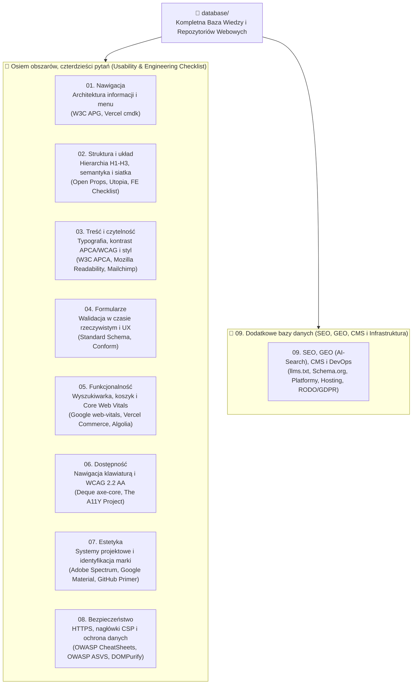

# 🏆 Kompletna Baza Wiedzy i Repozytoriów: Tworzenie, Audyt i Optymalizacja Stron WWW (2025–2026)

> **LISTA KONTROLNA — USABILITY CHECKLIST: «Osiem obszarów, czterdzieści pytań» + Obszar 9 (SEO, GEO / AI-Search, CMS i Infrastruktura).**
> Architektura tej bazy danych została zbudowana w oparciu o metodologię **8 kluczowych obszarów użyteczności i inżynierii webowej (8 obszarów × 5 pytań kontrolnych = 40 kryteriów audytu)** oraz dodatkowy 9. moduł obejmujący techniczne SEO, optymalizację pod wyszukiwarki AI (GEO), systemy CMS oraz infrastrukturę chmurową.
> W każdej kategorii znajdują się zweryfikowane repozytoria, systemy tokenów projektowych i bazy danych od światowych korporacji oraz organizacji standaryzacyjnych (**Google, Adobe, Microsoft, GitHub, Vercel, Mozilla, W3C, OWASP, Deque, Algolia, Mailchimp, Answer.AI**).

---

## 🗺️ Architektura Bazy Danych (`database/`)

---

## 📂 Nawigator po Kategoriach i Lokalnych Repozytoriach

| Kategoria | Obszar z listy kontrolnej | Główne pytanie kontrolne | Lokalnie sklonowane repozytoria | Dokumentacja kategorii |
| :--- | :--- | :--- | :--- | :--- |
| **[`01-navigation`](./01-navigation/)** | **Nawigacja** | *Czy z każdej podstrony wrócisz na stronę główną?* | • [`w3c-aria-practices`](./01-navigation/w3c-aria-practices/) (W3C) • [`cmdk`](./01-navigation/cmdk/) (Vercel / Paco Coursey) | [`01-navigation/README.md`](./01-navigation/README.md) |
| **[`02-structure-and-layout`](./02-structure-and-layout/)** | **Struktura i układ** | *Czy nagłówki tworzą hierarchię H1, H2, H3?* | • [`front-end-checklist`](./02-structure-and-layout/front-end-checklist/) (David Dias) • [`open-props`](./02-structure-and-layout/open-props/) (Google Chrome / Adam Argyle) • [`utopia-core`](./02-structure-and-layout/utopia-core/) (Utopia Fluid Scales) | [`02-structure-and-layout/README.md`](./02-structure-and-layout/README.md) |
| **[`03-content-and-readability`](./03-content-and-readability/)** | **Treść i czytelność** | *Czy rozmiar i kontrast tekstu ułatwiają czytanie?* | • [`apca-w3`](./03-content-and-readability/apca-w3/) (W3C WCAG 3 Contrast) • [`mozilla-readability`](./03-content-and-readability/mozilla-readability/) (Mozilla Firefox) • [`mailchimp-style-guide`](./03-content-and-readability/mailchimp-style-guide/) (Mailchimp) | [`03-content-and-readability/README.md`](./03-content-and-readability/README.md) |
| **[`04-forms-and-validation`](./04-forms-and-validation/)** | **Formularze** | *Czy walidacja działa w czasie rzeczywistym?* | • [`standard-schema`](./04-forms-and-validation/standard-schema/) (Zod / Valibot / ArkType) • [`conform`](./04-forms-and-validation/conform/) (Progressive HTML Forms) | [`04-forms-and-validation/README.md`](./04-forms-and-validation/README.md) |
| **[`05-functionality-and-performance`](./05-functionality-and-performance/)** | **Funkcjonalność** | *Czy koszyk i wyszukiwarka działają bezbłędnie?* | • [`web-vitals`](./05-functionality-and-performance/web-vitals/) (Google Chrome) • [`vercel-commerce`](./05-functionality-and-performance/vercel-commerce/) (Vercel Next.js) • [`algolia-autocomplete`](./05-functionality-and-performance/algolia-autocomplete/) (Algolia) | [`05-functionality-and-performance/README.md`](./05-functionality-and-performance/README.md) |
| **[`06-accessibility`](./06-accessibility/)** | **Dostępność** | *Czy po stronie da się poruszać samą klawiaturą?* | • [`axe-core`](./06-accessibility/axe-core/) (Deque Systems) • [`a11yproject`](./06-accessibility/a11yproject/) (The A11Y Project) | [`06-accessibility/README.md`](./06-accessibility/README.md) |
| **[`07-aesthetics-and-design-systems`](./07-aesthetics-and-design-systems/)** | **Estetyka** | *Czy design jest zgodny z identyfikacją marki?* | • [`spectrum-design-data`](./07-aesthetics-and-design-systems/spectrum-design-data/) (**Adobe**) • [`material-web`](./07-aesthetics-and-design-systems/material-web/) (**Google**) • [`primer-primitives`](./07-aesthetics-and-design-systems/primer-primitives/) (**GitHub / Microsoft**) | [`07-aesthetics-and-design-systems/README.md`](./07-aesthetics-and-design-systems/README.md) |
| **[`08-security-and-privacy`](./08-security-and-privacy/)** | **Bezpieczeństwo** | *Czy strona działa na HTTPS i chroni dane?* | • [`owasp-cheatsheets`](./08-security-and-privacy/owasp-cheatsheets/) (**OWASP**) • [`owasp-asvs`](./08-security-and-privacy/owasp-asvs/) (**OWASP ASVS**) • [`dompurify`](./08-security-and-privacy/dompurify/) (**Cure53**) | [`08-security-and-privacy/README.md`](./08-security-and-privacy/README.md) |
| **[`09-additional-seo-geo-and-infrastructure`](./09-additional-seo-geo-and-infrastructure/)** | **Dodatkowe (SEO, GEO, CMS, DevOps)** | *Czy strona jest zoptymalizowana pod Google i wyszukiwarki AI (GEO)?* | • [`llmstxt`](./09-additional-seo-geo-and-infrastructure/llmstxt/) (**Answer.AI `/llms.txt`**) • 14 przewodników inżynieryjnych (SEO, GEO, CMS, Infrastruktura) | [`09-additional-seo-geo-and-infrastructure/README.md`](./09-additional-seo-geo-and-infrastructure/README.md) |

---

## 📋 Pełna Lista Kontrolna: Osiem Obszarów, Czterdzieści Pytań (40 Kryteriów Audytu)

### 1. Nawigacja (`01-navigation`)
1. **Q1.1:** Czy z każdej podstrony (w tym ze strony błędu 404) wrócisz na stronę główną jednym kliknięciem (`<a href="/">` w logo + link `Skip to main content`)?
2. **Q1.2:** Czy użytkownik zawsze wie, gdzie aktualnie się znajduje w strukturze serwisu (`aria-current="page"` w menu + ścieżka powrotu `BreadcrumbList`)?
3. **Q1.3:** Czy główne menu jest spójne (4–7 pozycji) i pozwala dotrzeć do kluczowych treści w maksymalnie **3 kliknięciach**?
4. **Q1.4:** Czy nawigacja mobilna jest łatwo dostępna pod kciukiem (obszar dotyku $\ge 44\times44\text{ px}$) i poprawnie utrzymuje fokus (`FocusTrap`)?
5. **Q1.5:** Czy serwis oferuje szybką wyszukiwarkę (`<search>`, skrót `⌘K`) oraz pomocne wyjście ze stron błędów (404 / brak wyników)?

### 2. Struktura i układ (`02-structure-and-layout`)
6. **Q2.1:** Czy nagłówki tworzą logiczną hierarchię `H1 -> H2 -> H3` (dokładnie jeden `<h1>` na stronę, brak pomijania poziomów)?
7. **Q2.2:** Czy struktura strony wykorzystuje semantyczne znaczniki orientacyjne HTML5 (`<header>`, `<nav>`, `<main>`, `<aside>`, `<footer>`)?
8. **Q2.3:** Czy układ strony ma czytelną hierarchię wizualną, konsekwentną siatkę (`CSS Grid`) i zachowuje zasadę bliskości Gestalt ($d_{\text{wewnętrzny}} < d_{\text{zewnętrzny}}$)?
9. **Q2.4:** Czy układ płynnie dopasowuje się do każdej rozdzielczości (od `320px` do `4K`) oraz powiększenia `400%` (WCAG Reflow) bez poziomego przewijania (`@container`)?
10. **Q2.5:** Czy elementy strony nie przesuwają się samoistnie podczas ładowania (**CLS $\le 0.1$**, zdefiniowane `width`/`height` i `aspect-ratio`)?

### 3. Treść i czytelność (`03-content-and-readability`)
11. **Q3.1:** Czy rozmiar tekstu głównego wynosi minimum **`16px` (`1rem`)** i skaluje się płynnie za pomocą `clamp()`?
12. **Q3.2:** Czy kontrast tekstu względem tła spełnia normy **WCAG 2.2 AA ($\ge 4.5:1$)** oraz **APCA ($|L_c| \ge 75$)** zarówno w trybie jasnym, jak i ciemnym?
13. **Q3.3:** Czy szerokość kolumny tekstu wynosi optymalne **`50–75 znaków` (`max-width: 65ch`)** przy interlinii **`1.5–1.65`**?
14. **Q3.4:** Czy struktura tekstu (śródtytuły, listy punktowane, tabele, podsumowania `TL;DR` wg zasady **BLUF**) pozwala na szybkie skanowanie wzrokiem?
15. **Q3.5:** Czy język komunikatów i mikrocopy na przyciskach jest prosty, jednoznaczny i wolny od żargonu (*Plain Language*)?

### 4. Formularze (`04-forms-and-validation`)
16. **Q4.1:** Czy walidacja działa w czasie rzeczywistym zgodnie z wzorcem **„Reward Early, Punish Late”** (błąd po `onBlur`, natychmiastowe usunięcie błędu po poprawieniu `onChange`)?
17. **Q4.2:** Czy każde pole posiada stale widoczną etykietę `<label>` (zamiast samego `placeholder`) oraz powiązania `aria-invalid` i `aria-describedby`?
18. **Q4.3:** Czy formularz wspiera autouzupełnianie (`autocomplete`), dopasowuje klawiaturę mobilną (`inputmode="numeric|tel|email"`) i nie blokuje wklejania haseł (`paste`)?
19. **Q4.4:** Czy komunikaty o błędach precyzyjnie wskazują jak naprawić błąd i **nigdy nie kasują** wpisanych już przez użytkownika danych?
20. **Q4.5:** Czy formularz zawiera tylko niezbędne pola (maks. 7–8 pól w koszyku, *Guest Checkout*) i zabezpiecza przycisk przed podwójnym wysłaniem (`aria-busy="true"`)?

### 5. Funkcjonalność (`05-functionality-and-performance`)
21. **Q5.1:** Czy wyszukiwarka odpowiada błyskawicznie ($\le 100\text{ ms}$), toleruje literówki (*typo tolerance*) i pomaga użytkownikowi przy braku wyników (*Zero-Results UX*)?
22. **Q5.2:** Czy koszyk i proces zakupowy zachowują stan po odświeżeniu, reagują natychmiastowo (*Optimistic UI* $< 50\text{ ms}$) i są chronione kluczem idempotentności?
23. **Q5.3:** Czy strona spełnia progi **Google Core Web Vitals** (75. percentyl CrUX): **LCP $\le 2.5\text{ s}$**, **INP $\le 200\text{ ms}$**, **CLS $\le 0.1$**?
24. **Q5.4:** Czy aplikacja bezpiecznie izoluje awarie komponentów (`Error Boundaries`) i zwraca prawidłowy kod HTTP `404` dla nieistniejących adresów?
25. **Q5.5:** Czy kluczowe ścieżki użytkownika przechodzą testy E2E (`Playwright`) na silnikach Chromium, Firefox i WebKit (Safari / iOS) z **0 błędów w konsoli**?

### 6. Dostępność (`06-accessibility`)
26. **Q6.1:** Czy po całej stronie (włącznie z menu, modalami i zakupem) da się poruszać **samą klawiaturą** (`Tab`, `Shift+Tab`, `Enter`, `Escape`) bez pułapek fokusowych?
27. **Q6.2:** Czy aktualnie sfokusowany element ma wyraźny obrys `:focus-visible` ($\ge 2\text{ px}$, kontrast $\ge 3:1$) i nie jest zasłaniany przez pływające nagłówki (`Focus Not Obscured` WCAG 2.4.11)?
28. **Q6.3:** Czy strona posiada poprawne atrybuty `alt`, etykiety ARIA oraz komunikaty `aria-live="polite"` dla czytników ekranu (NVDA, VoiceOver)?
29. **Q6.4:** Czy wszystkie przyciski i elementy interaktywne mają rozmiar obszaru kliknięcia min. **$24\times24\text{ px}$** (WCAG 2.5.8, zalecane $44\times44\text{ px}$) oraz alternatywę dla gestów przeciągania?
30. **Q6.5:** Czy interfejs respektuje systemowe wyłączenie animacji `@media (prefers-reduced-motion: reduce)` i zapewnia napisy (`captions`) w materiałach wideo?

### 7. Estetyka (`07-aesthetics-and-design-systems`)
31. **Q7.1:** Czy fundament wizualny opiera się na spójnych tokenach projektowych (**W3C Design Tokens / DTCG**) bez przypadkowych wartości kolorów i odstępów?
32. **Q7.2:** Czy motywy kolorystyczne (Light, Dark, High-Contrast) zachowują spójność percepcyjną w przestrzeni barw `OKLCH`?
33. **Q7.3:** Czy hierarchia wizualna i światło (*whitespace* $\ge 25–40\%$) eliminują szum informacyjny zgodnie z regułą **60–30–10**?
34. **Q7.4:** Czy ikonografia SVG (`viewBox`, `stroke-width`), ilustracje i proporcje mediów (`aspect-ratio`) są spójne stylistycznie?
35. **Q7.5:** Czy mikrointerakcje i animacje (120–200 ms, płynne 60+ FPS na `transform`/`opacity`) odzwierciedlają charakter marki?

### 8. Bezpieczeństwo (`08-security-and-privacy`)
36. **Q8.1:** Czy połączenie działa wyłącznie na **HTTPS (TLS 1.3 + HTTP/3)** z nagłówkiem **HSTS Preload** i bez błędów *Mixed Content*?
37. **Q8.2:** Czy skonfigurowano restrykcyjne nagłówki bezpieczeństwa HTTP: **Strict CSP (`nonce`)**, `X-Content-Type-Options: nosniff`, `COOP`, `Referrer-Policy` i `Permissions-Policy`?
38. **Q8.3:** Czy uwierzytelnianie, sesje i ciasteczka (`__Host-`, `Secure`, `HttpOnly`, `SameSite`) są odporne na przejęcie oraz wspierają **Passkeys (WebAuthn)**?
39. **Q8.4:** Czy dane wejściowe i drzewo DOM są chronione przed XSS (sanityzacja **DOMPurify + Trusted Types**), SQL Injection oraz atakami Supply Chain (**SRI**)?
40. **Q8.5:** Czy strona chroni prywatność użytkowników (**RODO / GDPR**) i blokuje boty za pomocą niewidocznych mechanizmów (**Cloudflare Turnstile**) zamiast uciążliwych CAPTCHA?

---

## 🔗 Rejestr Źródeł, Repozytoriów i Standardów Wykorzystanych w Bazie

### 🏛️ 1. Lokalnie sklonowane repozytoria i bazy danych (22 repozytoria)
1. **Adobe Spectrum Design Data** — <https://github.com/adobe/spectrum-design-data> (`07-aesthetics-and-design-systems/spectrum-design-data`)
2. **Google Material Web (Material Design 3)** — <https://github.com/material-components/material-web> (`07-aesthetics-and-design-systems/material-web`)
3. **GitHub Primer Primitives (Design Tokens)** — <https://github.com/primer/primitives> (`07-aesthetics-and-design-systems/primer-primitives`)
4. **W3C WAI-ARIA Authoring Practices Guide (APG)** — <https://github.com/w3c/aria-practices> (`01-navigation/w3c-aria-practices`)
5. **Vercel / Paco Coursey `cmdk` (Command Menu)** — <https://github.com/pacocoursey/cmdk> (`01-navigation/cmdk`)
6. **Front-End Checklist (David Dias)** — <https://github.com/thedaviddias/Front-End-Checklist> (`02-structure-and-layout/front-end-checklist`)
7. **Google Chrome / Adam Argyle `open-props`** — <https://github.com/argyleink/open-props> (`02-structure-and-layout/open-props`)
8. **Utopia Fluid Responsive Design (`utopia-core`)** — <https://github.com/trys/utopia-core> (`02-structure-and-layout/utopia-core`)
9. **W3C WCAG 3 APCA Perceptual Contrast (`apca-w3`)** — <https://github.com/Myndex/apca-w3> (`03-content-and-readability/apca-w3`)
10. **Mozilla Firefox Readability (`@mozilla/readability`)** — <https://github.com/mozilla/readability> (`03-content-and-readability/mozilla-readability`)
11. **Mailchimp Content Style Guide** — <https://github.com/mailchimp/content-style-guide> (`03-content-and-readability/mailchimp-style-guide`)
12. **Standard Schema Specification (Zod / Valibot / ArkType)** — <https://github.com/standard-schema/standard-schema> (`04-forms-and-validation/standard-schema`)
13. **Conform Progressive HTML Form Validation** — <https://github.com/edmundhung/conform> (`04-forms-and-validation/conform`)
14. **Google Chrome `web-vitals` (LCP, INP, CLS, TTFB)** — <https://github.com/GoogleChrome/web-vitals> (`05-functionality-and-performance/web-vitals`)
15. **Vercel Next.js Commerce** — <https://github.com/vercel/commerce> (`05-functionality-and-performance/vercel-commerce`)
16. **Algolia Autocomplete UI** — <https://github.com/algolia/autocomplete> (`05-functionality-and-performance/algolia-autocomplete`)
17. **Deque Systems `axe-core` (WCAG Accessibility Engine)** — <https://github.com/dequelabs/axe-core> (`06-accessibility/axe-core`)
18. **The A11Y Project Checklist & Patterns** — <https://github.com/a11yproject/a11yproject.com> (`06-accessibility/a11yproject`)
19. **OWASP Cheat Sheet Series** — <https://github.com/OWASP/CheatSheetSeries> (`08-security-and-privacy/owasp-cheatsheets`)
20. **OWASP Application Security Verification Standard (ASVS)** — <https://github.com/OWASP/ASVS> (`08-security-and-privacy/owasp-asvs`)
21. **Cure53 `DOMPurify` (XSS Sanitizer)** — <https://github.com/cure53/DOMPurify> (`08-security-and-privacy/dompurify`)
22. **Answer.AI `/llms.txt` Specification (`llms-txt`)** — <https://github.com/AnswerDotAI/llms-txt> (`09-additional-seo-geo-and-infrastructure/llmstxt`)

### 🌐 2. Dodatkowe repozytoria referencyjne korporacji i instytucji
* **U.S. Web Design System (USWDS):** <https://github.com/uswds/uswds>
* **UK Government Digital Service (`govuk-frontend`):** <https://github.com/alphagov/govuk-frontend>
* **IBM Carbon Design System & Equal Access:** <https://github.com/carbon-design-system/carbon> | <https://github.com/IBMa/equal-access>
* **Microsoft Playwright & Fluent UI:** <https://github.com/microsoft/playwright> | <https://github.com/microsoft/fluentui>
* **Google Lighthouse & CrUX:** <https://github.com/GoogleChrome/lighthouse> | <https://github.com/GoogleChrome/CrUX>
* **Shopify Polaris & Hydrogen:** <https://github.com/Shopify/polaris> | <https://github.com/Shopify/hydrogen>
* **Adobe React Spectrum / React Aria & Leonardo:** <https://github.com/adobe/react-spectrum> | <https://github.com/adobe/leonardo>
* **Amazon Style Dictionary & W3C Design Tokens (DTCG):** <https://github.com/style-dictionary/style-dictionary> | <https://github.com/design-tokens/community-group>
* **W3C WCAG 2.2 & Nu Html Validator:** <https://github.com/w3c/wcag> | <https://github.com/validator/validator>
* **W3C CSS WG `color.js` (Lea Verou & Chris Lilley):** <https://github.com/color-js/color.js>
* **Tailwind Labs Typography & shadcn/ui:** <https://github.com/tailwindlabs/tailwindcss-typography> | <https://github.com/shadcn-ui/ui>
* **Zod, Valibot, React Hook Form & TanStack (Router / Form):** <https://github.com/colinhacks/zod> | <https://github.com/fabian-hiller/valibot> | <https://github.com/react-hook-form/react-hook-form> | <https://github.com/TanStack/router> | <https://github.com/TanStack/form>
* **Meilisearch & CloudCannon Pagefind:** <https://github.com/meilisearch/meilisearch> | <https://github.com/Pagefind/pagefind>
* **Mozilla SSL Config Generator & MDN HTTP Observatory:** <https://github.com/mozilla/ssl-config-generator> | <https://github.com/mdn/mdn-http-observatory>
* **Helmet.js & SimpleWebAuthn (Passkeys):** <https://github.com/helmetjs/helmet> | <https://github.com/MasterKale/SimpleWebAuthn>
* **Schema.org Official Vocabulary:** <https://github.com/schemaorg/schemaorg>
