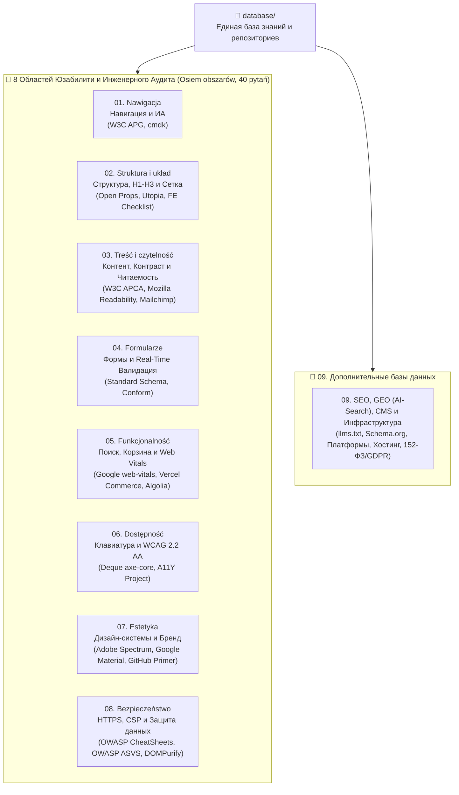

# 🏆 Единая база данных и репозиториев создания, аудита и улучшения сайтов (2025–2026)

> **Структура базы данных построена по методологии «Osiem obszarów, czterdzieści pytań» (8 областей юзабилити и веб-инженерии × 5 контрольных вопросов = 40 критериев аудита) + 9-й дополнительный блок (SEO, GEO/AI-Search, CMS, Платформы и Инфраструктура).**
> В каждой категории собраны верифицированные репозитории и базы данных от ведущих мировых корпораций и институтов стандартизации (**Google, Adobe, Microsoft, GitHub, Vercel, Mozilla, W3C, OWASP, Deque, Algolia, Answer.AI**), а также профильные инженерные руководства.

---

## 🗺️ Архитектура базы данных (`database/`)

---

## 📂 Навигатор по категориям и локальным репозиториям

| Категория | Область со слайда (PL / RU) | Базовый вопрос | Локально клонированные репозитории корпораций | Подробный справочник |
| :--- | :--- | :--- | :--- | :--- |
| **[`01-navigation`](./01-navigation/)** | **Nawigacja** (Навигация и ИА) | *Можно ли с каждой подстраницы вернуться на главную?* | • `w3c-aria-practices` (W3C) • `cmdk` (Vercel / Paco Coursey) | [`01-navigation/README.md`](./01-navigation/README.md) |
| **[`02-structure-and-layout`](./02-structure-and-layout/)** | **Struktura i układ** (Структура и макет) | *Образуют ли заголовки иерархию H1, H2, H3?* | • `front-end-checklist` (David Dias) • `open-props` (Google Chrome / Adam Argyle) • `utopia-core` (Utopia Fluid Scales) | [`02-structure-and-layout/README.md`](./02-structure-and-layout/README.md) |
| **[`03-content-and-readability`](./03-content-and-readability/)** | **Treść i czytelność** (Контент и читаемость) | *Облегчают ли размер и контраст текста чтение?* | • `apca-w3` (W3C WCAG 3 Contrast) • `mozilla-readability` (Mozilla Firefox) • `mailchimp-style-guide` (Mailchimp) | [`03-content-and-readability/README.md`](./03-content-and-readability/README.md) |
| **[`04-forms-and-validation`](./04-forms-and-validation/)** | **Formularze** (Формы и валидация) | *Работает ли валидация в реальном времени?* | • `standard-schema` (Zod / Valibot / ArkType) • `conform` (Progressive HTML Forms) | [`04-forms-and-validation/README.md`](./04-forms-and-validation/README.md) |
| **[`05-functionality-and-performance`](./05-functionality-and-performance/)** | **Funkcjonalność** (Функциональность и скорость) | *Безошибочно ли работают корзина и поиск?* | • `web-vitals` (Google Chrome) • `vercel-commerce` (Vercel Next.js) • `algolia-autocomplete` (Algolia) | [`05-functionality-and-performance/README.md`](./05-functionality-and-performance/README.md) |
| **[`06-accessibility`](./06-accessibility/)** | **Dostępność** (Доступность и клавиатура) | *Можно ли перемещаться по сайту одной клавиатурой?* | • `axe-core` (Deque Systems) • `a11yproject` (The A11Y Project) | [`06-accessibility/README.md`](./06-accessibility/README.md) |
| **[`07-aesthetics-and-design-systems`](./07-aesthetics-and-design-systems/)** | **Estetyka** (Эстетика и дизайн-системы) | *Соответствует ли дизайн идентификации бренда?* | • `spectrum-design-data` (**Adobe**) • `material-web` (**Google**) • `primer-primitives` (**GitHub / Microsoft**) | [`07-aesthetics-and-design-systems/README.md`](./07-aesthetics-and-design-systems/README.md) |
| **[`08-security-and-privacy`](./08-security-and-privacy/)** | **Bezpieczeństwo** (Безопасность и защита данных) | *Работает ли сайт по HTTPS и защищает ли данные?* | • `owasp-cheatsheets` (**OWASP**) • `owasp-asvs` (**OWASP ASVS**) • `dompurify` (**Cure53**) | [`08-security-and-privacy/README.md`](./08-security-and-privacy/README.md) |
| **[`09-additional-seo-geo-and-infrastructure`](./09-additional-seo-geo-and-infrastructure/)** | **Dodatkowe** (SEO, GEO/AI-Search, CMS, Инфраструктура) | *Индексация в Google и ИИ-поиске, выбор CMS и деплой* | • `llmstxt` (**Answer.AI `/llms.txt`**) • 14 профильных руководств (SEO, GEO, CMS, DevOps) | [`09-additional-seo-geo-and-infrastructure/README.md`](./09-additional-seo-geo-and-infrastructure/README.md) |

---

## 📋 Полная матрица 40 вопросов аудита сайта («Osiem obszarów, czterdzieści pytań»)

### 1. Nawigacja (Навигация)
1. **Q1.1:** Можно ли с любой подстраницы и 404-экрана в 1 клик вернуться на главную (`<a href="/">` в логотипе + `Skip to main content`)?
2. **Q1.2:** Понимает ли пользователь свое текущее местоположение (`aria-current="page"` в меню + `BreadcrumbList` на вложенных страницах)?
3. **Q1.3:** Доступен ли любой ключевой контент максимум в **3 клика**, а верхнее меню содержит не более 4–7 пунктов?
4. **Q1.4:** Адаптирована ли мобильная навигация под большой палец ($\ge 44\times44\text{ px}$) с удержанием фокуса (`FocusTrap`) в открытом меню?
5. **Q1.5:** Есть ли быстрый поиск (`<search>`, `⌘K`) и полезный выход со страниц 404 / пустой выдачи?

### 2. Struktura i układ (Структура и макет)
6. **Q2.1:** Образуют ли заголовки строгую иерархию `H1 -> H2 -> H3` (ровно один `<h1>`, без пропуска уровней)?
7. **Q2.2:** Размечена ли страница семантическими ориентирами HTML5 (`<header>`, `<nav>`, `<main>`, `<aside>`, `<footer>`)?
8. **Q2.3:** Соблюдается ли модульная сетка (`CSS Grid`) и правило внутреннего и внешнего ($d_{\text{internal}} < d_{\text{external}}$)?
9. **Q2.4:** Адаптируется ли верстка от `320px` до `4K` и при зуме `400%` (WCAG Reflow) без горизонтального скролла (`@container`)?
10. **Q2.5:** Стабилен ли макет при загрузке без скачков контента (**CLS $\le 0.1$**, заданные `width`/`height` и `aspect-ratio`)?

### 3. Treść i czytelność (Контент и читаемость)
11. **Q3.1:** Составляет ли базовый кегль текста $\ge 16\text{ px}$ (`1rem`) с плавным масштабированием через `clamp()`?
12. **Q3.2:** Выдержан ли контраст текста **WCAG 2.2 AA ($\ge 4.5:1$)** и перцептивный контраст **APCA ($|L_c| \ge 75$)** в Light и Dark Mode?
13. **Q3.3:** Ограничена ли длина строки диапазоном **`50–75ch`** (`max-width: 65ch`) при интерлиньяже **`1.5–1.65`**?
14. **Q3.4:** Разбит ли текст подзаголовками, списками, таблицами и выжимками `TL;DR` (принцип **BLUF**) для быстрого сканирования?
15. **Q3.5:** Написан ли контент и микрокопирайтинг кнопок простым, однозначным языком без канцелярита?

### 4. Formularze (Формы и валидация)
16. **Q4.1:** Работает ли валидация в реальном времени по паттерну **«Reward Early, Punish Late»** (ошибка на `onBlur`, снятие ошибки мгновенно на `onChange`)?
17. **Q4.2:** Имеет ли каждое поле постоянный видимый `<label>` (не `placeholder`!) и привязку ошибок через `aria-invalid` + `aria-describedby`?
18. **Q4.3:** Вызываются ли правильные мобильные клавиатуры (`inputmode="numeric|tel|email"`), `autocomplete` и разрешена ли вставка пароля (`paste`)?
19. **Q4.4:** Объясняют ли сообщения об ошибках, как исправить ввод, **не стирая** уже введенные пользователем данные?
20. **Q4.5:** Сокращено ли число полей до минимума (7–8 в чекауте, 3–4 в лид-форме) и блокируется ли кнопка при отправке (`aria-busy="true"`)?

### 5. Funkcjonalność (Функциональность и производительность)
21. **Q5.1:** Работает ли поиск за $\le 100\text{ мс}$ с исправлением опечаток (typo tolerance) и нетупиковой страницей «0 результатов»?
22. **Q5.2:** Сохраняет ли корзина товары при перезагрузке, обновляется ли оптимистично ($< 50\text{ мс}$) и защищена ли оплата от дублей?
23. **Q5.3:** Выполняются ли нормативы **Core Web Vitals**: **LCP $\le 2.5\text{ с}$**, **INP $\le 200\text{ мс}$**, **CLS $\le 0.1$**?
24. **Q5.4:** Перехватываются ли сбои локальными `Error Boundaries` и возвращают ли несуществующие адреса честный HTTP-код `404`?
25. **Q5.5:** Проходят ли сквозные E2E-тесты (`Playwright`) в Chromium, Firefox и Safari (iOS) с **0 ошибок в консоли**?

### 6. Dostępność (Доступность и клавиатура)
26. **Q6.1:** Можно ли пройти весь сайт и оформить заказ **только с клавиатуры** (`Tab`, `Shift+Tab`, `Enter`, `Escape`) без ловушек фокуса?
27. **Q6.2:** Имеет ли сфокусированный элемент четкую рамку `:focus-visible` ($\ge 2\text{ px}$, контраст $\ge 3:1$) и не перекрывается ли липкой шапкой (`Focus Not Obscured`)?
28. **Q6.3:** Озвучиваются ли все иконки, картинки и динамические уведомления (`aria-live="polite"`) скринридерами?
29. **Q6.4:** Составляет ли размер всех кнопок и интерактивных мишеней минимум **$24\times24\text{ px}$** (оптимально $44\times44\text{ px}$) с альтернативой перетаскиванию?
30. **Q6.5:** Отключаются ли анимации при `@media (prefers-reduced-motion: reduce)` и снабжены ли видео субтитрами?

### 7. Estetyka (Эстетика и идентификация бренда)
31. **Q7.1:** Построен ли интерфейс на строгой 3-уровневой системе **Design Tokens (W3C DTCG)** без случайных цветов и отступов?
32. **Q7.2:** Сохраняется ли визуальный паритет между светлой, темной и высококонтрастной темами в пространстве `OKLCH`?
33. **Q7.3:** Выдержано ли правило **60–30–10**, баланс свободного пространства ($\ge 25–40\%$) и акцент на одном главном CTA?
34. **Q7.4:** Едины ли стиль SVG-иконок (`stroke-width`, `viewBox`), пропорции медиа (`aspect-ratio`) и радиусы скругления?
35. **Q7.5:** Работают ли микро-интеракции плавно (120–200 мс, `transform`/`opacity` 60+ FPS) в характере бренда?

### 8. Bezpieczeństwo (Безопасность и защита данных)
36. **Q8.1:** Работает ли сайт по **HTTPS (TLS 1.3 + HTTP/3)** с заголовком **HSTS Preload** и без единой ошибки Mixed Content?
37. **Q8.2:** Настроены ли заголовки **Strict CSP (`nonce`)**, `X-Content-Type-Options: nosniff`, `COOP`, `Referrer-Policy` и `Permissions-Policy` (Grade A+)?
38. **Q8.3:** Защищены ли сессии флагами `__Host-`, `Secure`, `HttpOnly`, `SameSite`, анти-CSRF защитой и поддержкой **Passkeys (WebAuthn)**?
39. **Q8.4:** Проходит ли пользовательский ввод валидацию схем на сервере и DOM-санитизацию через **DOMPurify + Trusted Types**?
40. **Q8.5:** Соблюдаются ли требования приватности (**GDPR / 152-ФЗ**) и используется ли невидимая защита от ботов (**Cloudflare Turnstile**) вместо нечитаемых капч?
